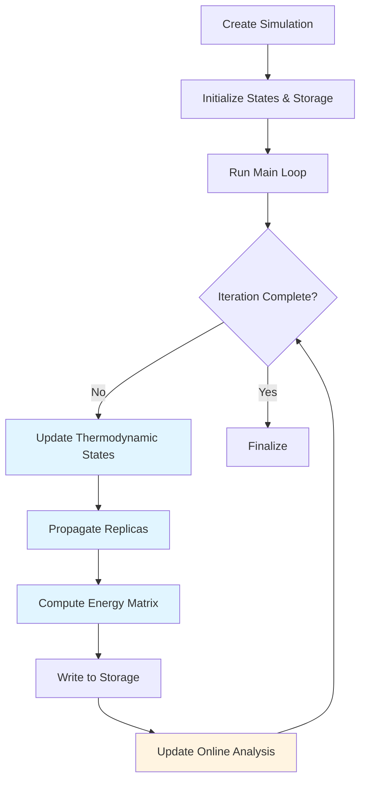

The Multi-State Sampler Architecture provides a comprehensive framework for enhanced sampling simulations across multiple thermodynamic states, enabling efficient computation of free energies and other thermodynamic observables. This architecture supports various sampling schemes including replica exchange, parallel tempering, and self-adjusted mixture sampling through an inheritance hierarchy built on a robust base class with integrated storage and analysis capabilities.

## Core Architecture Overview

The architecture follows a layered design with clear separation of concerns between sampling logic, data persistence, and analysis functionality. The foundation rests on the `MultiStateSampler` base class, which implements the core simulation loop, energy computation framework, and replica management machinery. Derived classes specialize the mixing strategies for specific sampling algorithms while sharing the underlying infrastructure for propagation, energy evaluation, and storage operations.

Sources: [multistatesampler.py](openmmtools/multistate/multistatesampler.py#L63-L120), [__init__.py](openmmtools/multistate/__init__.py#L1-L71)

## Class Hierarchy and Inheritance

The sampler hierarchy implements three concrete sampling strategies alongside the base class, each addressing different use cases in enhanced sampling:

- **MultiStateSampler**: Abstract base class providing common infrastructure for multi-state simulations, including iteration management, energy matrix computation, MCMC move propagation, and integration with storage and analysis systems
- **ReplicaExchangeSampler**: Extends MultiStateSampler to implement Hamiltonian replica exchange, where multiple replicas sample different thermodynamic states and periodically exchange configurations based on Metropolis criteria
- **ParallelTemperingSampler**: Specialized subclass of ReplicaExchangeSampler optimized for temperature-based replica exchange, leveraging the linear relationship between reduced potentials and inverse temperature for O(N) energy computations instead of O(N²)
- **SAMSSampler**: Implements self-adjusted mixture sampling with adaptive state weights, allowing one or more replicas to sample the entire state space with online free energy estimation through stochastic approximation

Sources: [replicaexchange.py](openmmtools/multistate/replicaexchange.py#L52-L240), [paralleltempering.py](openmmtools/multistate/paralleltempering.py#L44-L110), [sams.py](openmmtools/multistate/sams.py#L43-L185)

## Simulation Lifecycle and Execution Flow

The simulation follows a structured lifecycle beginning with initialization through the `create()` method, which sets up thermodynamic states, sampler states, and the storage backend. The `run()` method then orchestrates the main iteration loop, executing four key operations each iteration:

1. **Replica Mixing**: State reassignment based on the sampling scheme (swaps for replica exchange, state jumps for SAMS)
2. **Replica Propagation**: MCMC moves advance each replica according to its current thermodynamic state through dynamics-based moves or other MCMC schemes
3. **Energy Computation**: Reduced potentials evaluated for all replicas at their current and possibly neighboring thermodynamic states
4. **Storage and Analysis**: Configuration energies, mixing statistics, and analysis data written to persistent storage, with optional online free energy updates

The main loop continues until reaching iteration limits or achieving statistical convergence targets set through online analysis parameters.

Sources: [multistatesampler.py](openmmtools/multistate/multistatesampler.py#L538-L610), [multistatesampler.py](openmmtools/multistate/multistatesampler.py#L725-L805)

## Replica Mixing Strategies

The architecture supports diverse mixing strategies implemented through polymorphic `_mix_replicas()` methods in each sampler class:

### Replica Exchange Mixing
Replica exchange attempts to swap thermodynamic states between replica pairs based on Metropolis acceptance criteria. The implementation offers two mixing schemes:

- **swap-neighbors**: Traditional scheme attempting exchanges only between adjacent states in thermodynamic space, preserving one-dimensional topology
- **swap-all**: Default scheme attempting swaps between randomly selected replica pairs multiple times per iteration (default: n_replicas³ attempts), enabling improved mixing in multidimensional replica arrangements

Both schemes compute acceptance probabilities using the reduced potential difference: `log_p_accept = -(u_ij + u_ji) + u_ii + u_jj`, where `u_ij` is replica i's reduced potential at state j.

Sources: [replicaexchange.py](openmmtools/multistate/replicaexchange.py#L255-L385)

### SAMS State Updates
Self-adjusted mixture sampling implements three state update schemes:

- **global-jump**: Replica selects new thermodynamic state uniformly from all states based on current log weights
- **local-jump**: Replica selects new state only from a neighborhood of size `locality` around current state
- **restricted-range-jump**: Hybrid approach (currently experimental) attempting to balance exploration and exploitation

SAMS adaptively updates log weights using stochastic approximation to achieve target state visitation probabilities, with support for Rao-Blackwellized and optimal update methods.

Sources: [sams.py](openmmtools/multistate/sams.py#L395-L440), [sams.py](openmmtools/multistate/sams.py#L606-L688)

## Energy Computation and Locality

The energy computation framework supports both global and local evaluation strategies controlled by the `locality` parameter:

- **Global locality (None)**: All replicas compute energies at all thermodynamic states each iteration, requiring O(n_replicas × n_states) reduced potential evaluations
- **Local locality (int > 0)**: Each replica computes energies only for states within `locality` positions of its current state, reducing computational cost to approximately O(n_replicas × 2×locality)

The implementation groups thermodynamic states by compatibility to minimize context creation overhead, leveraging the context caching system to reuse OpenMM Context objects across multiple energy evaluations for compatible states.

Sources: [multistatesampler.py](openmmtools/multistate/multistatesampler.py#L1264-L1288), [multistatesampler.py](openmmtools/multistate/multistatesampler.py#L1418-L1480)

## Storage Integration

The `MultiStateReporter` class provides persistent storage using NetCDF4 format, handling checkpointing, analysis data, and simulation state management. Key responsibilities include:

- **Checkpoint management**: Periodic writes of complete simulation state at configurable intervals
- **Energy matrices**: Storage of reduced potentials for all replica-state pairs at each iteration
- **Mixing statistics**: Acceptance and proposal matrices for replica exchange attempts
- **Online analysis data**: Free energy estimates and associated uncertainties when online analysis is enabled
- **Sampler states**: Positions, velocities, and box vectors for all replicas

The reporter supports recovery from arbitrary iterations through checkpoint files and handles concurrency issues in MPI environments through robust file opening strategies with retry logic.

Sources: [multistatereporter.py](openmmtools/multistate/multistatereporter.py#L63-L186)

## Analysis Framework Integration

The analysis framework operates through `MultiStateSamplerAnalyzer` and `PhaseAnalyzer` classes, providing post-processing capabilities for thermodynamic observables:

- **Free energy estimation**: MBAR (Multistate Bennett Acceptance Ratio) analysis using energy matrices from storage
- **Equilibration detection**: Automated determination of equilibration point through statistical methods
- **Statistical inefficiency computation**: Estimation of correlation times and effective sample sizes
- **Observable registry**: Extensible system for registering computed observables (free energy, entropy, enthalpy)
- **Multi-phase analysis**: Combination of multiple phases using operator overloading (+, -) for complex thermodynamic cycles

The analyzer supports both online and offline analysis modes, with online analysis providing real-time convergence estimates and optional early termination based on statistical error targets.

Sources: [multistateanalyzer.py](openmmtools/multistate/multistateanalyzer.py#L1137-L1224), [multistateanalyzer.py](openmmtools/multistate/multistatesampler.py#L1607-L1660)

> [!TIP]
> The online analysis implementation in `_online_analysis()` uses a stochastic approximation scheme that updates free energy estimates incrementally, enabling adaptive termination without storing the complete energy matrix in memory. This is particularly valuable for large-scale simulations with many states and replicas.

## Distributed Execution Architecture

The architecture leverages MPI through the `mpiplus` framework for parallel execution across compute nodes:

- **Replica propagation**: Distributed across nodes with each node propagating a subset of replicas
- **Energy computation**: Parallelized with each node computing energies for its assigned replicas
- **Data aggregation**: Results gathered to node 0 for mixing decisions and storage operations
- **Synchronization**: Controlled MPI barriers ensure consistency across distributed state updates

The implementation uses decorated methods (`@mpiplus.on_single_node`, `@mpiplus.delayed_termination`) to control execution patterns and handle MPI rank-specific operations transparently.

Sources: [multistatesampler.py](openmmtools/multistate/multistatesampler.py#L1288-L1340)

## Configuration and Runtime Options

| Parameter | Type | Default | Description |
|-----------|------|---------|-------------|
| `mcmc_moves` | MCMCMove/list | Langevin(2fs, 5.0/ps, 500 steps) | MCMC moves for replica propagation |
| `number_of_iterations` | int/infinity | 1 | Maximum iterations to perform |
| `online_analysis_interval` | int/None | 200 | Frequency of online free energy analysis |
| `online_analysis_target_error` | float | 0.0 | Target error for convergence (kT/phase) |
| `online_analysis_minimum_iterations` | int | 200 | Minimum iterations before online analysis |
| `locality` | int/None | None | Neighborhood size for local energy computation |
| `replica_mixing_scheme` | str | 'swap-all' | Replica exchange mixing scheme |
| `checkpoint_interval` | int | 50 | Iterations between checkpoint writes |

Sources: [multistatesampler.py](openmmtools/multistate/multistatesampler.py#L194-L233), [replicaexchange.py](openmmtools/multistate/replicaexchange.py#L214-L233)

## Performance Optimizations

The architecture incorporates several performance optimizations:

- **Context caching**: Reuse of OpenMM Context objects across energy evaluations for thermodynamically compatible states
- **Numba acceleration**: JIT-compiled mixing functions for replica exchange swap attempts
- **Compatibility grouping**: Batched energy computations for states with identical system parameters
- **Locality-based computation**: Reduced energy evaluations when local neighborhoods are sufficient
- **Parallel propagation**: MPI distribution of replica propagation across available cores

These optimizations enable efficient scaling to large numbers of replicas and thermodynamic states while maintaining numerical accuracy.

Sources: [multistatesampler.py](openmmtools/multistate/multistatesampler.py#L1737-L1744), [replicaexchange.py](openmmtools/multistate/replicaexchange.py#L294-L350)

> [!TIP]
> The parallel tempering specialization achieves O(N) energy computation complexity instead of O(N²) by exploiting the linear relationship between reduced potentials and inverse temperature, computing only the potential energy once per replica and scaling by temperature differences for all states.

## Extension and Subclassing

The architecture is designed for extensibility through well-defined extension points:

1. **Custom mixing schemes**: Override `_mix_replicas()` to implement novel replica exchange or state update strategies
2. **Specialized energy computation**: Override `_compute_replica_energies()` for algorithm-specific optimizations
3. **Custom observables**: Register new observables through `ObservablesRegistry` for analysis
4. **Storage backends**: Implement reporter interfaces for alternative storage formats
5. **MCMC move integration**: Extend move library with custom propagation schemes

The base classes provide hooks through virtual methods and template methods, allowing derived implementations to customize behavior while reusing common infrastructure.

Sources: [__init__.py](openmmtools/multistate/__init__.py#L45-L58), [multistateanalyzer.py](openmmtools/multistate/multistateanalyzer.py#L106-L342)

## Integration with OpenMMTools Components

The Multi-State Sampler Architecture integrates tightly with other OpenMMTools modules:

- **States module**: `ThermodynamicState` and `SamplerState` define thermodynamic conditions and configuration data
- **MCMC module**: Move classes (Langevin, HMC, GHMC) provide propagation schemes
- **Alchemical systems**: Alchemically modified systems for free energy calculations
- **Context caching**: Shared cache management for efficient OpenMM Context reuse

This modular design enables composition of complex enhanced sampling workflows from reusable components.

Sources: [multistatesampler.py](openmmtools/multistate/multistatesampler.py#L130-L132)

## Further Reading

For detailed information on specific aspects of the architecture, consult these related documentation pages:

- [Replica Exchange Molecular Dynamics (REMD)](16-replica-exchange-molecular-dynamics-remd) for detailed algorithm discussion
- [Self-Adjusted Mixture Sampling (SAMS)](17-self-adjusted-mixture-sampling-sams) for adaptive sampling strategies
- [Online and Offline Free Energy Analysis](19-online-and-offline-free-energy-analysis) for analysis methodology
- [Storage Interface Architecture](24-storage-interface-architecture) for persistent storage details
- [Multi-State Analysis Framework](26-multi-state-analysis-framework) for post-processing capabilities