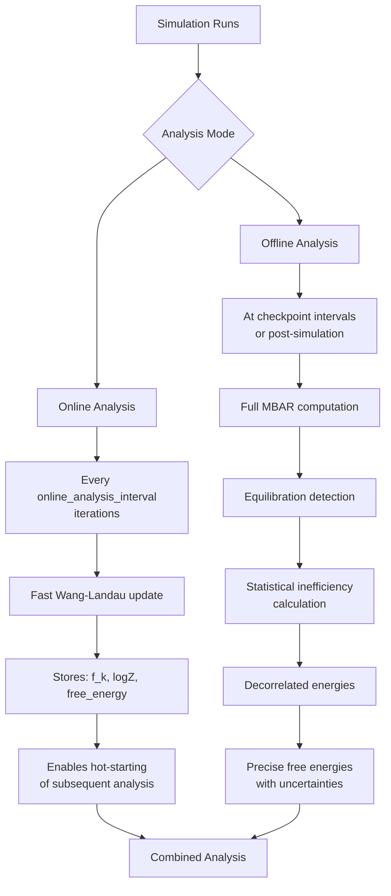

This documentation explores openmmtools' dual-mode free energy analysis architecture, which enables both real-time monitoring during simulation and comprehensive post-processing analysis. The system supports MBAR-based free energy estimation with automatic equilibration detection and statistical error analysis.

## Architectural Overview

The analysis architecture in openmmtools separates concerns between runtime monitoring and comprehensive post-processing, providing two complementary approaches that can be used independently or together:



> [!TIP]
> The online analysis can be used to provide initial estimates (hot-start) for offline MBAR analysis, potentially accelerating convergence of the more expensive offline computation.

## Configuration and Control Parameters

The analysis behavior is controlled through parameters defined during `MultiStateSampler` initialization in `multistatesampler.py`:

| Parameter | Type | Default | Description |
|-----------|------|---------|-------------|
| `online_analysis_interval` | int | 200 | Iterations between offline MBAR computations |
| `online_analysis_target_error` | float | 0.0 | Target statistical error for convergence (kT units) |
| `online_analysis_minimum_iterations` | int | 200 | Minimum iterations before any analysis begins |
| `locality` | int or None | None | Neighborhood size (None = global, enabling MBAR) |

Sources: [multistatesampler.py](/openmmtools/multistate/multistatesampler.py#L194-L197), [multistatesampler.py](/openmmtools/multistate/multistatesampler.py#L513-L517)

## Online Analysis During Simulation

Online analysis provides rapid, incremental free energy estimates during simulation execution. This approach is particularly useful for convergence monitoring and provides initial estimates for subsequent offline analysis.

### Algorithm Implementation

The online analysis implements a Wang-Landau-like weight update scheme in `_online_analysis()` method. The algorithm updates free energy estimates incrementally using:

```
gamma = gamma0 / (iteration + 1)
logZ[neighborhood] += gamma × exp(log_P_k[neighborhood] - log_pi_k[neighborhood])
```

This approach accumulates fractional weights across all states in the energy evaluation neighborhood, enabling continuous refinement of free energy estimates as simulation progresses.

Sources: [multistatesampler.py](/openmmtools/multistate/multistatesampler.py#L1607-L1660)

### Storage and Retrieval

Online analysis data is stored through `MultiStateReporter.write_online_data_dynamic_and_static()` which supports both per-iteration data (tracking convergence over time) and static data (latest estimate). The system stores:

- `f_k`: Free energy estimates for all thermodynamic states (dimensionless units)
- `free_energy`: Free energy difference between reference states with error estimate
- `logZ`: Partition function estimates

Sources: [multistatereporter.py](/openmmtools/multistate/multistatereporter.py#L1197-L1216), [multistatereporter.py](/openmmtools/multistate/multistatereporter.py#L1299-L1344)

### Usage Example

```python
from openmmtools.multistate import ReplicaExchangeSampler

# Configure online analysis with 50-iteration interval and target error of 0.1 kT
sampler = ReplicaExchangeSampler(
    mcmc_moves=mcmc_moves,
    number_of_iterations=10000,
    online_analysis_interval=50,           # Full MBAR every 50 iterations
    online_analysis_target_error=0.1,      # Stop when error < 0.1 kT
    online_analysis_minimum_iterations=200
)

# Run simulation - analysis happens automatically
sampler.run()
```

## Offline Post-Processing Analysis

Offline analysis provides comprehensive free energy estimation with statistical rigor, including automatic equilibration detection, statistical inefficiency calculation, and decorrelated energy matrix construction.

### MBAR Computation

The offline analysis uses the Multistate Bennett Acceptance Ratio (MBAR) method for optimal free energy estimation from samples across multiple thermodynamic states. The implementation in `_offline_analysis()` creates a `MultiStateSamplerAnalyzer` and computes:

```python
mbar = analysis.mbar  # MBAR object with converged free energies
free_energy, err_free_energy = analysis.get_free_energy()  # ΔF matrix and uncertainties
n_equilibration_iterations = analysis.n_equilibration_iterations  # Autodetected
statistical_inefficiency = analysis.statistical_inefficiency  # Decorrelation times
```

Sources: [multistatesampler.py](/openmmtools/multistate/multistatesampler.py#L1508-L1565), [multistateanalyzer.py](/openmmtools/multistate/multistateanalyzer.py#L1038-L1058)

### Data Preprocessing Pipeline

The offline analysis applies a sophisticated preprocessing pipeline before MBAR computation:

1. **Energy Matrix Reformatting**: Converts `[replica, state, iteration]` data to `[state, sample]` format required by MBAR through `reformat_energies_for_mbar()`

2. **Equilibration Detection**: Identifies the number of equilibration iterations using the automatic equilibration detection method

3. **Decorrelation**: Computes statistical inefficiency to identify uncorrelated samples, preventing overestimation of effective sample size

4. **Restraight Unbiasing**: (Optional) Removes bias from position restraints if present in the system

Sources: [multistateanalyzer.py](/openmmtools/multistate/multistateanalyzer.py#L993-L1036), [multistateanalyzer.py](/openmmtools/multistate/multistateanalyzer.py#L2026-L2135)

### Performing Offline Analysis

After simulation completion, offline analysis can be performed independently:

```python
from openmmtools.multistate import MultiStateSamplerAnalyzer
from openmmtools.multistate import MultiStateReporter

# Load data from storage
reporter = MultiStateReporter('simulation.nc')
reporter.open(mode='r')

# Create analyzer with optional MBAR solver parameters
analyzer = MultiStateSamplerAnalyzer(
    reporter,
    use_online_data=False,  # Ignore online estimates, recompute from scratch
    max_n_iterations=None,  # Use all data
    analysis_kwargs={
        'solver_protocol': 'robust',  # Handle poorly-conditioned matrices
        'initial_f_k': None  # Could use online estimates as hot-start
    }
)

# Compute free energies and uncertainties
delta_f_ij, delta_f_error_ij = analyzer.get_free_energy()

# Access other thermodynamic observables
enthalpy_ij, enthalpy_error_ij = analyzer.get_enthalpy()
entropy_ij, entropy_error_ij = analyzer.get_entropy()

# Check equilibration and decorrelation
print(f"Equilibrated after {analyzer.n_equilibration_iterations} iterations")
print(f"Statistical inefficiency: {analyzer.statistical_inefficiency}")
print(f"Effective length: {analyzer.effective_length} uncorrelated samples")
```

Sources: [multistateanalyzer.py](/openmmtools/multistate/multistateanalyzer.py#L1137-L1242), [multistateanalyzer.py](/openmmtools/multistate/multistateanalyzer.py#L1958-L2007)

## Hot-Starting with Online Estimates

The `PhaseAnalyzer` base class supports hot-starting offline analysis with online estimates, potentially accelerating MBAR convergence:

```python
# Use online estimates as initial guess for MBAR
analyzer = MultiStateSamplerAnalyzer(
    reporter,
    use_online_data=True,  # Read and use online f_k estimates
    analysis_kwargs={
        'initial_f_k': None  # Will be auto-populated from online data
    }
)
```

When `use_online_data=True`, the analyzer reads the latest `f_k` estimates from storage and provides them as the initial guess to MBAR's free energy solver. For simulations with well-converged online estimates, this can significantly reduce MBAR iteration count.

Sources: [multistateanalyzer.py](/openmmtools/multistate/multistateanalyzer.py#L540-L574), [multistateanalyzer.py](/openmmtools/multistate/multistateanalyzer.py#L1060-L1076)

## Observables Registry System

The analysis framework uses a registry system for extensible observable computation. The `ObservablesRegistry` class defines which observables can be computed and their error propagation rules:

| Observable | States Required | Error Propagation |
|------------|-----------------|-------------------|
| `free_energy` | Two states | Quadrature (root-sum-square) |
| `enthalpy` | Two states | Quadrature |
| `entropy` | Two states | Quadrature |

Custom observables can be registered using the registry system:

```python
from openmmtools.multistate.multistateanalyzer import default_observables_registry

# Register custom observable with linear error propagation
default_observables_registry.register_two_state_observable(
    'custom_observable',
    error_class='linear'
)
```

Sources: [multistateanalyzer.py](/openmmtools/multistate/multistateanalyzer.py#L106-L342)

## Convergence Detection and Stopping Criteria

The system automatically detects simulation completion based on multiple criteria:

1. **Iteration Limit**: Simulation stops when `iteration >= number_of_iterations`
2. **Statistical Error Target**: Simulation stops when `err_free_energy <= online_analysis_target_error` (if target > 0)
3. **Manual Termination**: Simulation can be interrupted and resumed from checkpoint

The status can be queried without loading the full simulation:

```python
from openmmtools.multistate import ReplicaExchangeSampler

# Quick status check
status = ReplicaExchangeSampler.read_status('simulation.nc')
print(f"Iteration: {status.iteration}")
print(f"Target error: {status.target_error} kT")
print(f"Completed: {status.is_completed}")
```

Sources: [multistatesampler.py](/openmmtools/multistate/multistatesampler.py#L1678-L1716), [multistatesampler.py](/openmmtools/multistate/multistatesampler.py#L308-L364)

## Multi-Phase Analysis

Complex alchemical transformations can be split into multiple phases (e.g., electrostatics, Lennard-Jones, restraints) and analyzed independently or combined:

```python
from openmmtools.multistate import MultiPhaseAnalyzer

# Analyze individual phases
phase1 = MultiStateSamplerAnalyzer(reporter1, name='electrostatics')
phase2 = MultiStateSamplerAnalyzer(reporter2, name='vdw')
phase3 = MultiStateSamplerAnalyzer(reporter3, name='restraints')

# Combine phases for total free energy
total_phase = phase1 + phase2 + phase3
delta_f_total, delta_f_error_total = total_phase.get_free_energy()

# Access phase-specific contributions
delta_f_phase1, delta_f_error_phase1 = phase1.get_free_energy()
```

The `MultiPhaseAnalyzer` automatically handles proper error propagation using the registered error propagation rules for each observable type.

Sources: [multistateanalyzer.py](/openmmtools/multistate/multistateanalyzer.py#L2224-L2487)

## Performance Considerations

| Factor | Online Analysis | Offline Analysis |
|--------|-----------------|------------------|
| Computational Cost | Low (per iteration) | High (full MBAR) |
| Accuracy | Approximate | High (optimal) |
| Uncertainty Estimates | Simple | Rigorous statistical error |
| Equilibration Detection | Manual | Automatic |
| Decorrelation Handling | None | Full statistical inefficiency |
| Storage Requirements | Moderate (online data) | High (full trajectory) |

> [!TIP]
> For production calculations, use offline analysis for final results. Online analysis is best suited for convergence monitoring and providing hot-start estimates for accelerated MBAR convergence.

## Related Documentation

- [Multi-State Sampler Architecture](18-multi-state-sampler-architecture) for understanding the simulation infrastructure that generates the data
- [Storage Interface Architecture](24-storage-interface-architecture) for details on how analysis data is stored and retrieved
- [Replica Exchange Molecular Dynamics (REMD)](16-replica-exchange-molecular-dynamics-remd) for specific sampling methods
- [Thermodynamic and Sampler States](5-thermodynamic-and-sampler-states) for understanding the thermodynamic states being analyzed