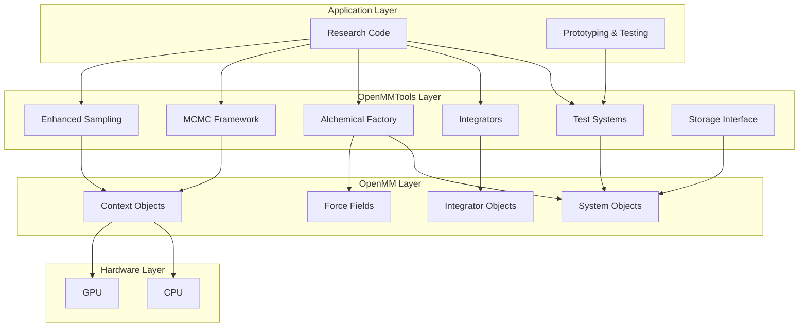

This guide provides a hands-on introduction to OpenMMTools, helping you quickly get started with molecular simulation tools that extend OpenMM's capabilities. You'll learn the essential concepts and run your first simulation within minutes.

## What is OpenMMTools?


OpenMMTools is a Python library layer that sits on top of the GPU-accelerated OpenMM molecular simulation engine, providing a **batteries-included toolkit** for building full-featured molecular simulation packages. It bridges the gap between OpenMM's low-level primitives and high-level research workflows [README.md](README.md#L1-L20).

**Core capabilities** include:
- **Test Systems**: Pre-packaged molecular systems ranging from analytically-solvable models to complex protein systems
- **Advanced Integrators**: High-quality Langevin integrators with various splitting schemes (BAOAB, VVVR, g-BAOAB)
- **Alchemical Transformations**: Framework for free energy calculations with absolute and relative alchemical modifications
- **MCMC Framework**: Extensible Markov Chain Monte Carlo moves for molecular simulations
- **Enhanced Sampling**: Replica exchange (REMD), Self-Adjusted Mixture Sampling (SAMS), and multi-state samplers

## Architecture Overview



This architecture demonstrates how OpenMMTools provides a **high-level abstraction layer** while maintaining direct access to OpenMM's core functionality. Each module is designed to work independently or in combination with others [openmmtools/__init__.py](openmmtools/__init__.py#L13-L15).

## Installation

The **recommended installation method** is via conda, which automatically handles all dependencies including OpenMM, numpy, and scipy [docs/installation.rst](docs/installation.rst#L8-L12).

### Quick Install

```bash
# Add required channels and install
conda config --add channels omnia --add channels conda-forge
conda install openmmtools
```

This installs the latest stable release. For development features, use `openmmtools-dev` instead [docs/installation.rst](docs/installation.rst#L39-L45).

### Verification

```python
# Verify installation
import openmmtools
print(f"OpenMMTools version: {openmmtools.__version__}")
```

> [!TIP]
> Conda installation is strongly preferred over pip because OpenMM requires specific binary dependencies that conda handles automatically. This prevents common installation issues related to CUDA and platform compatibility.

## Your First Simulation

Let's create a simple molecular dynamics simulation using OpenMMTools' test systems and integrators.

### Basic Water Box Simulation

```python
# Import required modules
from openmmtools import testsystems, integrators
from simtk import openmm, unit

# 1. Create a test system - a 2nm cubic box of water
water_box = testsystems.WaterBox(box_edge=2.0*unit.nanometer)
system = water_box.system
positions = water_box.positions

# 2. Set up a Langevin integrator with BAOAB splitting
integrator = integrators.LangevinIntegrator(
    temperature=298.0*unit.kelvin,
    collision_rate=1.0/unit.picoseconds,
    timestep=1.0*unit.femtoseconds
)

# 3. Create context and run simulation
context = openmm.Context(system, integrator)
context.setPositions(positions)

# Run 100 steps
integrator.step(100)

print("Simulation complete!")
```

This simple example demonstrates the **three-step workflow** that underlies most OpenMMTools usage: create a test system, configure an integrator, and run the simulation [docs/gettingstarted.rst](docs/gettingstarted.rst#L28-L45).

## Exploring Test Systems

OpenMMTools provides a **comprehensive suite** of test systems for prototyping, validation, testing, and benchmarking [openmmtools/testsystems.py](openmmtools/testsystems.py#L4-L7).

### Available Test System Categories

| Category | Examples | Use Case |
|----------|----------|----------|
| **Analytical Systems** | `HarmonicOscillator`, `Diatom`, `IdealGas` | Testing algorithms with known results |
| **Simple Fluids** | `LennardJonesFluid`, `DiatomicFluid`, `DipolarFluid` | Statistical mechanics validation |
| **Water Models** | `WaterBox`, `PMEWaterBox`, `FlexibleWaterBox` | Solvation studies |
| **Biomolecules** | `AlanineDipeptideVacuum`, `LysozymeImplicit`, `SrcExplicit` | Protein-ligand studies |
| **Host-Guest Systems** | `HostGuestImplicit`, `HostGuestExplicit` | Binding free energies |
| **Alchemical Systems** | `AlchemicalWaterBox`, `AlchemicalAlanineDipeptide` | Free energy calculations |

### Example: Protein-Ligand System

```python
# Create T4 lysozyme with p-xylene ligand in implicit solvent
lysozyme = testsystems.LysozymeImplicit()
system = lysozyme.system
positions = lysozyme.positions
topology = lysozyme.topology

# Select specific atoms using MDTraj DSL
pxylene_atoms = lysozyme.mdtraj_topology.select('resname TMP')
print(f"Found {len(pxylene_atoms)} p-xylene atoms")
```

This example shows how test systems provide **ready-to-simulate molecular systems** with OpenMM System objects, positions, and topology, along with an MDTraj topology for atom selection [docs/gettingstarted.rst](docs/gettingstarted.rst#L52-L66).

## Working with Integrators

OpenMMTools' **advanced integrators** offer superior configurational sampling compared to standard OpenMM integrators through carefully designed splitting schemes [openmmtools/integrators.py](openmmtools/integrators.py#L11-L13).

### Integrator Comparison

| Integrator | Splitting Scheme | Best For | Key Features |
|------------|------------------|----------|--------------|
| `LangevinIntegrator` | Configurable (default BAOAB) | General MD | Flexible, customizable splitting |
| `BAOABIntegrator` | V R O R V | Configurational sampling | Minimal configuration error |
| `VVVRIntegrator` | V V R | Mixed accuracy | Velocity randomization |
| `GHMCIntegrator` | Metropolized HMC | Accurate sampling | Exact sampling guarantee |
| `HMCIntegrator` | Hybrid Monte Carlo | Large timesteps | Fewer force evaluations |

### Customizing Integrator Splitting

```python
# Create integrator with geodesic-BAOAB splitting
# and measure shadow work/heat statistics
integrator = integrators.LangevinIntegrator(
    splitting="V0 V1 R R O R R V1 R R O R R V1 V0",
    measure_shadow_work=True,
    measure_heat=True,
    temperature=298.0*unit.kelvin,
    collision_rate=1.0/unit.picoseconds,
    timestep=1.0*unit.femtoseconds
)

context = openmm.Context(system, integrator)
context.setPositions(positions)
integrator.step(100)

# Access thermodynamic statistics
shadow_work = integrator.get_shadow_work()
heat = integrator.get_heat()
print(f"Shadow work: {shadow_work}")
print(f"Heat: {heat}")
```

This example demonstrates **advanced integrator features** including custom splitting schemes and thermodynamic work measurement, which are particularly useful for nonequilibrium free energy calculations [docs/gettingstarted.rst](docs/gettingstarted.rst#L74-L92).

## Alchemical Transformations

The **alchemical module** enables free energy calculations by creating modified systems where interactions can be smoothly turned on or off via lambda parameters [openmmtools/alchemy/alchemy.py](openmmtools/alchemy/alchemy.py#L8-L14).

### Creating an Alchemical System

```python
from openmmtools import alchemy

# 1. Create reference system
lysozyme_pxylene = testsystems.LysozymeImplicit()
t4_system = lysozyme_pxylene.system

# 2. Define alchemical region (p-xylene ligand)
pxylene_atoms = lysozyme_pxylene.mdtraj_topology.select('resname TMP')
alchemical_region = alchemy.AlchemicalRegion(alchemical_atoms=pxylene_atoms)

# 3. Create alchemical factory and modify system
factory = alchemy.AbsoluteAlchemicalFactory()
alchemical_system = factory.create_alchemical_system(t4_system, alchemical_region)

# 4. Control alchemical state via lambda parameters
alchemical_state = alchemy.AlchemicalState.from_system(alchemical_system)
alchemical_state.lambda_electrostatics = 0.0  # Turn off electrostatics
alchemical_state.lambda_sterics = 0.5        # Half steric interactions

# Apply to context
context = openmm.Context(alchemical_system, integrator)
context.setPositions(lysozyme_pxylene.positions)
alchemical_state.apply_to_context(context)
```

**Important convention**: OpenMMTools uses `lambda=1` for the interacting (fully coupled) state and `lambda=0` for the non-interacting (decoupled) state, which differs from some other packages [docs/gettingstarted.rst](docs/gettingstarted.rst#L135-L142).

### Lambda Parameter Control

| Parameter | Range | Effect | Common Uses |
|-----------|-------|--------|-------------|
| `lambda_electrostatics` | 0.0 - 1.0 | Scales partial charges | Decoupling electrostatics |
| `lambda_sterics` | 0.0 - 1.0 | Scales Lennard-Jones interactions | Decoupling steric interactions |
| `lambda_bonds` | 0.0 - 1.0 | Scales bond terms | Alchemical topology changes |
| `lambda_angles` | 0.0 - 1.0 | Scales angle terms | Geometry changes |
| `lambda_torsions` | 0.0 - 1.0 | Scales torsion terms | Conformational sampling |

## Project Structure

Understanding the repository organization helps you navigate the codebase effectively:

```
openmmtools/
├── __init__.py              # Package initialization
├── testsystems.py           # Test system library
├── integrators.py           # Custom integrators
├── alchemy/                 # Alchemical free energy module
│   └── alchemy.py          # Factory and state management
├── mcmc.py                  # MCMC move framework
├── states.py                # Thermodynamic and sampler states
├── cache.py                 # Context caching
├── forces.py                # Custom force objects
├── forcefactories.py        # Force factory utilities
├── storage/                 # Storage interface layer
│   ├── storageinterface.py
│   └── iodrivers.py
├── multistate/              # Multi-state sampling
│   ├── multistatesampler.py
│   ├── replicaexchange.py
│   └── sams.py
└── utils/                   # Utility functions
```

The **modular design** allows you to import only the components you need for your specific application [openmmtools/__init__.py](openmmtools/__init__.py#L13-L15).

## Common Patterns

### Pattern 1: Setting Up a Basic Simulation

```python
# 1. Create test system
system = testsystems.WaterBox()
positions = system.positions

# 2. Configure integrator
integrator = integrators.LangevinIntegrator(
    temperature=300*unit.kelvin,
    collision_rate=1.0/unit.picoseconds,
    timestep=2.0*unit.femtoseconds
)

# 3. Run simulation
context = openmm.Context(system.system, integrator)
context.setPositions(positions)
integrator.step(1000)
```

### Pattern 2: Adding Custom Forces

```python
from openmmtools import forces

# Add harmonic restraint between molecules
harmonic_restraint = forces.HarmonicRestraintForce(
    spring_constant=0.2*unit.kilocalories_per_mole/unit.angstrom**2,
    restrained_atom_indices1=group1_indices,
    restrained_atom_indices2=group2_indices
)
system.system.addForce(harmonic_restraint)

# Find forces in system
restrained_forces = forces.find_forces(
    system.system, 
    force_type=forces.HarmonicRestraintForce
)
```

### Pattern 3: Running a Simple Benchmark

```python
import time

# Set up timing parameters
nsteps = 1000
n_trials = 10

# Run benchmark
times = []
for trial in range(n_trials):
    start = time.time()
    integrator.step(nsteps)
    times.append(time.time() - start)

mean_time = np.mean(times)
print(f"Average time per {nsteps} steps: {mean_time:.3f} seconds")
```

> [!TIP]
> When benchmarking integrators, always minimize the system first and discard the first few timing trials to account for initialization overhead. This provides more accurate performance comparisons.

## Next Steps

Now that you've completed the Quick Start, explore these topics in depth:

### Recommended Learning Path

1. **[Introduction to Test Systems](4-introduction-to-test-systems)** - Learn about the full range of test systems and their analytical properties
2. **[Thermodynamic and Sampler States](5-thermodynamic-and-sampler-states)** - Understand how to manage simulation conditions and thermodynamic ensembles
3. **[Langevin Integrators and Splitting Schemes](7-langevin-integrators-and-splitting-schemes)** - Dive deep into the mathematical foundations and performance characteristics
4. **[Alchemical State Management](20-alchemical-state-management)** - Master alchemical free energy calculations
5. **[MCMC Move Abstraction and Base Classes](12-mcmc-move-abstraction-and-base-classes)** - Build custom sampling algorithms

### Practical Resources

- **Example Scripts**: Check the [`examples/`](examples/) directory for benchmarking scripts [examples/integrator-benchmarks/integrator-benchmarks.py](examples/integrator-benchmarks/integrator-benchmarks.py#L1-L80)
- **Full Documentation**: Visit [ReadTheDocs](http://openmmtools.readthedocs.io) for comprehensive API documentation
- **GitHub Repository**: Report issues and contribute at [choderalab/openmmtools](https://github.com/choderalab/openmmtools)

### Key Takeaways

- OpenMMTools provides **high-level abstractions** that extend OpenMM's capabilities
- The **test system library** offers ready-to-use molecular systems for rapid prototyping
- **Advanced integrators** with customizable splitting schemes enable superior sampling
- The **alchemical module** simplifies free energy calculations through lambda-based transformations
- **Modular architecture** allows flexible composition of components for custom workflows

Your journey into molecular simulation with OpenMMTools has just begun. The library's design philosophy emphasizes both ease of use for beginners and flexibility for advanced users, making it suitable for everything from classroom demonstrations to cutting-edge research.