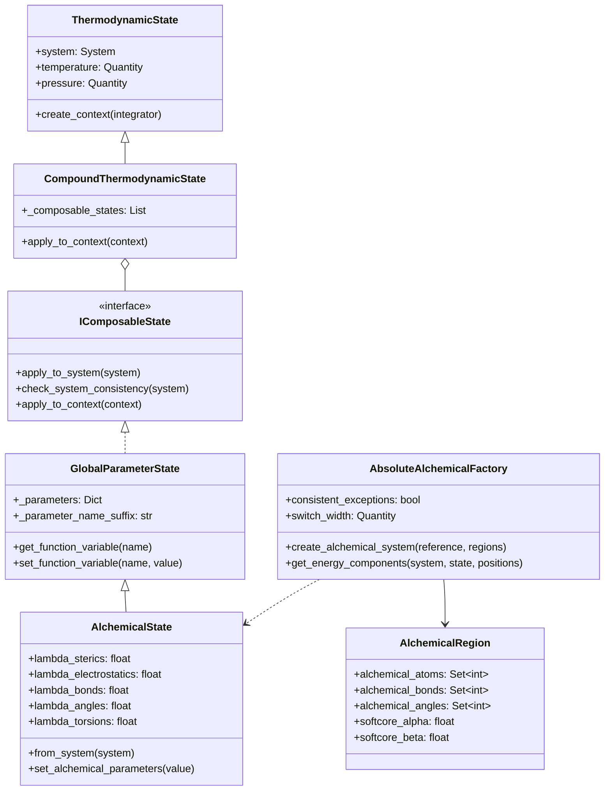
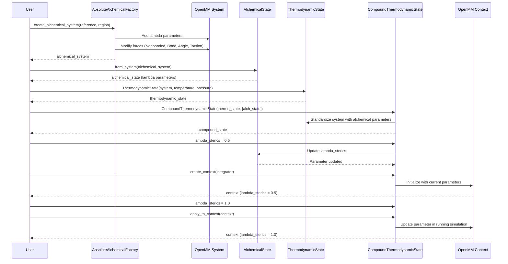

Alchemical state management in openmmtools provides a systematic framework for controlling thermodynamic transformations between molecular states through lambda parameters. This system enables the computation of free energy differences by smoothly interpolating between reference and perturbed Hamiltonians, essential for molecular dynamics applications like solvation free energies, ligand binding calculations, and molecular transformations. The architecture builds upon the thermodynamic state foundation and extends it through composable states that control global OpenMM parameters governing alchemical transformations.

## Architecture Overview

The alchemical state management system integrates with the broader thermodynamic state architecture through composition rather than inheritance. At its core, the `AlchemicalState` class extends `GlobalParameterState`, which itself implements the `IComposableState` interface. This design allows alchemical states to be seamlessly integrated with `ThermodynamicState` objects via `CompoundThermodynamicState`, creating a unified representation of both traditional thermodynamic parameters (temperature, pressure) and alchemical parameters (lambda values). The factory pattern embodied by `AbsoluteAlchemicalFactory` generates modified OpenMM System objects with the necessary global parameters and force modifications to support alchemical transformations.



The architectural flow demonstrates how alchemical transformations are embedded into molecular dynamics simulations. The factory creates modified systems with lambda-controlled force terms, the state object manages lambda values, and the compound state integrates these into the simulation context.

## Core Classes and Components

### AlchemicalState

The `AlchemicalState` class serves as the primary controller for alchemical transformations through five lambda parameters that scale different energy components:

Sources: [openmmtools/alchemy/alchemy.py](openmmtools/alchemy/alchemy.py#L90-L280)

**Lambda Parameters**:

| Parameter | Energy Component | Default Value | Range |
|-----------|-----------------|---------------|-------|
| `lambda_sterics` | Lennard-Jones and Halgren interactions | 1.0 | [0.0, 1.0] |
| `lambda_electrostatics` | Particle charges, Born radii, surface area term | 1.0 | [0.0, 1.0] |
| `lambda_bonds` | Alchemically-softened bonds | 1.0 | [0.0, 1.0] |
| `lambda_angles` | Alchemically-softened angles | 1.0 | [0.0, 1.0] |
| `lambda_torsions` | Alchemically-softened torsions | 1.0 | [0.0, 1.0] |

Each lambda parameter is implemented as a `_LambdaParameter` descriptor that validates values are within the valid range [0.0, 1.0]. Parameters set to `None` remain undefined, causing an `AlchemicalStateError` when attempting to apply the state to a system requiring those parameters. This design allows flexible configuration where only certain energy components need to be alchemically transformed.

The class provides several key methods for state manipulation:

- **`from_system()`**: Static constructor that reads lambda values from an existing alchemical system, creating a state object that matches the system's current parameter configuration
- **`set_alchemical_parameters()`**: Convenience method to set all defined lambda parameters to a single value simultaneously
- **`apply_to_system()`**: Modifies an OpenMM System object's global parameters to match the state
- **`apply_to_context()`**: Updates an OpenMM Context's parameters directly, useful for dynamic lambda changes during simulation

Sources: [openmmtools/alchemy/alchemy.py](openmmtools/alchemy/alchemy.py#L228-L358)

> [!TIP]
> AlchemicalState implements parameter validation through the `_LambdaParameter` descriptor class, which automatically enforces the [0.0, 1.0] range constraint and converts values to float type. This ensures lambda parameters always remain physically meaningful during alchemical transformations.

### AlchemicalRegion

The `AlchemicalRegion` namedtuple defines which portions of the molecular system should undergo alchemical transformation and specifies softcore parameters that control the smoothness of the energy landscape:

Sources: [openmmtools/alchemy/alchemy.py](openmmtools/alchemy/alchemy.py#L417-L495)

**Configuration Parameters**:

| Parameter | Type | Default | Purpose |
|-----------|------|---------|---------|
| `alchemical_atoms` | List[int] | None | Indices of atoms to be alchemically modified |
| `alchemical_bonds` | bool or List[int] | None | Bond indices to soften (or True for auto-detection) |
| `alchemical_angles` | bool or List[int] | None | Angle indices to soften (or True for auto-detection) |
| `alchemical_torsions` | bool or List[int] | None | Torsion indices to soften (or True for auto-detection) |
| `annihilate_electrostatics` | bool | True | If True, electrostatics annihilated; if False, decoupled |
| `annihilate_sterics` | bool | False | If True, sterics annihilated; if False, decoupled |
| `softcore_alpha` | float | 0.5 | Lennard-Jones softcore parameter |
| `softcore_beta` | float | 0.0 | Electrostatics softcore parameter (0 = standard scaling) |
| `softcore_a/b/c` | float | 1/1/6 | Lennard-Jones softcore form modifiers |
| `softcore_d/e/f` | float | 1/1/2 | Electrostatics softcore form modifiers |

The distinction between annihilation and decoupling is crucial for absolute free energy calculations. **Annihilation** removes the alchemical particle entirely from the system, while **decoupling** removes its interactions with the environment while keeping the particle present. Electrostatic interactions are typically annihilated (default), while steric interactions are typically decoupled (default), following best practices from the alchemical free energy literature.

Softcore parameters modify the effective distance between particles to prevent endpoint singularities when lambda approaches 0 or 1. The effective distance for electrostatics follows:

```
r_eff = sigma * ((softcore_beta * (lambda_electrostatics - 1)^softcore_e + (r/sigma)^softcore_f))^(1/softcore_f)
```

This formulation ensures finite energies even at complete decoupling (lambda = 0) where particles may overlap.

Sources: [openmmtools/alchemy/alchemy.py](openmmtools/alchemy/alchemy.py#L448-L489)

## Integration with Thermodynamic State System

AlchemicalState integrates seamlessly with the thermodynamic state architecture through the `IComposableState` interface. This interface defines methods required for states to be composable with `ThermodynamicState`:

Sources: [openmmtools/states.py](openmmtools/states.py#L2533-L2580)



The `CompoundThermodynamicState` class dynamically inherits from `ThermodynamicState` and provides transparent access to all composable state attributes. When accessing an attribute not found in the thermodynamic state, the class delegates to the composable states in order. Similarly, setting an attribute updates all composable states that define that attribute:

Sources: [openmmtools/states.py](openmmtools/states.py#L2695-L2874)

> [!TIP]
> CompoundThermodynamicState uses a dynamic inheritance pattern where it copies the thermodynamic state's `__dict__` and delegates attribute access to composable states. This allows seamless access to lambda parameters like `compound_state.lambda_sterics` without explicit method calls, while maintaining the full functionality of the underlying ThermodynamicState.

This integration enables several key capabilities:

1. **Unified state management**: Single object controls both thermodynamic conditions and alchemical parameters
2. **Context creation**: `create_context()` initializes OpenMM Context with all parameters correctly set
3. **Dynamic updates**: `apply_to_context()` efficiently updates parameters during simulation without recreating the context
4. **Force group optimization**: `_find_force_groups_to_update()` identifies which force groups need recomputation when parameters change

Sources: [openmmtools/states.py](openmmtools/states.py#L3026-L3037)

## State Manipulation Patterns

### Creating Alchemical States from Systems

The most common pattern for working with alchemical states is to create them from alchemically-modified systems:

```python
from openmmtools import testsystems, alchemy
from openmm import unit

# Create alchemically-modified system
factory = alchemy.AbsoluteAlchemicalFactory(consistent_exceptions=False)
alanine_vacuum = testsystems.AlanineDipeptideVacuum().system
alchemical_region = alchemy.AlchemicalRegion(alchemical_atoms=range(22))
alanine_alchemical_system = factory.create_alchemical_system(
    reference_system=alanine_vacuum,
    alchemical_regions=alchemical_region
)

# Extract current alchemical state
alchemical_state = alchemy.AlchemicalState.from_system(alanine_alchemical_system)
print(f"Lambda sterics: {alchemical_state.lambda_sterics}")
print(f"Lambda electrostatics: {alchemical_state.lambda_electrostatics}")
```

Sources: [openmmtools/alchemy/alchemy.py](openmmtools/alchemy/alchemy.py#L227-L280)

### Modifying Lambda Parameters

Lambda parameters can be modified individually or collectively:

```python
# Set individual parameters
alchemical_state.lambda_sterics = 0.5
alchemical_state.lambda_electrostatics = 0.3

# Set all defined parameters simultaneously
alchemical_state.set_alchemical_parameters(0.0)  # Complete decoupling
alchemical_state.set_alchemical_parameters(1.0)  # Fully interacting state
```

Sources: [openmmtools/alchemy/alchemy.py](openmmtools/alchemy/alchemy.py#L255-L274)

### Integration with Simulation Contexts

Alchemical states are typically used within compound thermodynamic states for simulation:

```python
import openmm
from openmmtools import states

# Create thermodynamic state
thermodynamic_state = states.ThermodynamicState(
    system=alanine_alchemical_system,
    temperature=300*unit.kelvin
)

# Create compound state
compound_state = states.CompoundThermodynamicState(
    thermodynamic_state=thermodynamic_state,
    composable_states=[alchemical_state]
)

# Create simulation context
integrator = openmm.VerletIntegrator(1.0*unit.femtoseconds)
context = compound_state.create_context(integrator)

# Modify alchemical state during simulation
compound_state.lambda_sterics = 0.75
compound_state.apply_to_context(context)  # Efficient parameter update
```

Sources: [openmmtools/states.py](openmmtools/states.py#L2750-L2795)

## Energy Analysis and Debugging

The `AbsoluteAlchemicalFactory` provides the `get_energy_components()` class method for analyzing energy contributions by force type, which is invaluable for debugging alchemical implementations:

Sources: [openmmtools/alchemy/alchemy.py](openmmtools/alchemy/alchemy.py#L756-L850)

```python
# Compute energy components for analysis
energy_components = alchemy.AbsoluteAlchemicalFactory.get_energy_components(
    alchemical_system=alanine_alchemical_system,
    alchemical_state=alchemical_state,
    positions=alanine_vacuum.getPositions(),
    platform=None  # Let OpenMM choose fastest platform
)

# Components include labels like:
# - 'NonbondedForce': Non-alchemical particle interactions
# - 'CustomNonbondedForce.sterics.aa': Alchemical-alchemical sterics
# - 'CustomNonbondedForce.electrostatics.na': Non-alchemical-alchemical electrostatics
# - 'CustomBondForce.sterics.exceptions': Sterics exception terms

for label, energy in energy_components.items():
    print(f"{label}: {energy}")
```

The method assigns each force to a separate force group, computes individual contributions, and returns an ordered dictionary mapping descriptive labels to energy quantities. This enables detailed verification that alchemical modifications are correctly implemented and that energy components scale appropriately with lambda values.

## Advanced Features

### Parameter Name Suffixes

For systems requiring multiple independent alchemical transformations (e.g., dual-topology approaches), the `parameters_name_suffix` mechanism allows controlling separate parameter sets:

Sources: [openmmtools/alchemy/alchemy.py](openmmtools/alchemy.py#L90-L115)

```python
# Create state controlling modified parameters
alchemical_state = alchemy.AlchemicalState(
    parameters_name_suffix='ligand',
    lambda_sterics=0.5
)

# This controls 'lambda_sterics_ligand' instead of 'lambda_sterics'
# The standard 'lambda_sterics' parameter becomes inaccessible
```

This suffix mechanism is inherited from `GlobalParameterState` and enables reuse of the same AlchemicalState logic for multiple alchemical regions within a single system.

### Undefined Parameters and Validation

The alchemical state system includes comprehensive validation to prevent undefined parameters from being applied to systems that require them:

Sources: [openmmtools/alchemy/alchemy.py](openmmtools/alchemy/alchemy.py#L90-L150)

```python
# Create state with undefined parameters
alchemical_state = alchemy.AlchemicalState()  # All lambdas = None

try:
    alchemical_state.apply_to_system(alanine_alchemical_system)
except alchemy.AlchemicalStateError as e:
    print(f"Error: {e}")
    # Output: "The system parameter lambda_electrostatics is not defined in this state."
```

This validation occurs both when applying to systems and when applying to contexts, ensuring simulation parameters remain well-defined throughout the calculation.

## Best Practices

1. **Use `from_system()` for initialization**: Always initialize alchemical states from the actual alchemical system to ensure parameter consistency and detect any missing or mismatched parameters

2. **Validate energy components**: Use `get_energy_components()` to verify that energy terms scale correctly with lambda before running production calculations

3. **Choose appropriate softcore parameters**: The default softcore parameters work well for most systems, but adjust `softcore_alpha` and `softcore_beta` if experiencing endpoint singularities in specific systems

4. **Prefer decoupling for ligand binding**: Use `annihilate_sterics=False` (decoupling) for ligand binding calculations to maintain proper volume effects, while electrostatics can be annihilated

5. **Leverage compound state composition**: Use `CompoundThermodynamicState` to combine alchemical states with other composable states (e.g., barostat modifications, restraint potentials) for complex simulation protocols

6. **Test endpoint behavior**: Verify that energies remain finite and physically reasonable at lambda = 0 and lambda = 1 before proceeding with free energy calculations

## Next Steps

For comprehensive understanding of alchemical free energy calculations, continue with:

- **[Alchemical Factory System Design](21-alchemical-factory-system-design)**: Detailed exploration of how AbsoluteAlchemicalFactory generates modified systems and handles complex force modifications
- **[Creating Alchemically-Modified Systems](22-creating-alchemically-modified-systems)**: Practical guide for setting up alchemical regions and configuring transformation protocols
- **[Alchemical Force Modifications](23-alchemical-force-modifications)**: In-depth examination of how different force types (Nonbonded, Bond, Angle, Torsion) are modified for alchemical transformations

For integration into enhanced sampling workflows, see:
- **[Multi-State Sampler Architecture](18-multi-state-sampler-architecture)**: How alchemical states integrate with replica exchange and other multi-state sampling methods
- **[Alchemical Nonequilibrium Switching](11-alchemical-nonequilibrium-switching)**: Using alchemical state management with nonequilibrium switching protocols for fast free energy estimates