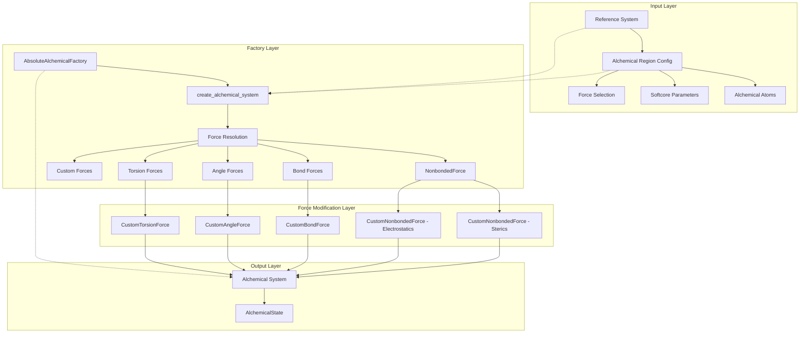

The Alchemical Factory System in openmmtools provides a sophisticated architecture for creating alchemically-modified OpenMM System objects, enabling the calculation of free energy differences through systematic transformation of molecular interactions. This design leverages factory and state patterns to achieve separation of concerns between system modification and parameter control, with support for multiple alchemical regions and flexible force modifications.

## Architectural Overview

The system follows a layered architecture where factory classes handle the complex task of modifying OpenMM Systems, while state classes manage alchemical parameter values and their application to contexts. The core abstraction rests on the concept of lambda parameters (λ) that scale different energy components, allowing smooth transformation between thermodynamic states.

The primary components operate through a clear division of responsibilities: `AbsoluteAlchemicalFactory` performs deep modifications to System structures, `AlchemicalRegion` specifies which portions of the system to modify, and `AlchemicalState` provides runtime parameter control through OpenMM's global parameter mechanism.

## Factory Architecture

The `AbsoluteAlchemicalFactory` class implements the core factory pattern, serving as the primary entry point for creating alchemically-modified systems. It maintains configuration options that control how alchemical modifications are applied globally, including electrostatics treatment schemes, softcore parameters, and force group organization.

Sources: [openmmtools/alchemy/alchemy.py](openmmtools/alchemy/alchemy.py#L496-L640)

The factory initialization accepts several critical parameters that determine modification behavior. The `alchemical_pme_treatment` parameter offers three distinct approaches: 'exact' includes reciprocal space contributions but only allows charge annihilation, 'direct-space' models only the direct space contribution, and 'coulomb' includes switched Coulomb interactions. For reaction field systems, `alchemical_rf_treatment` controls whether switched or shifted approaches are used, with switched being the default to ensure energy continuity.

The `split_alchemical_forces` parameter enables force group separation for different lambda variables, which is essential for computing individual energy components. This separation allows up to 32 distinct force groups in OpenMM, with the factory throwing an error if this limit would be exceeded.

### System Creation Process

The `create_alchemical_system()` method orchestrates a complex multi-stage transformation process that converts a reference OpenMM System into an alchemically-modified version. The process begins with validation of alchemical regions, ensuring no duplicate atoms, bonds, angles, or torsions exist across regions and that each region has a unique name.

Sources: [openmmtools/alchemy/alchemy.py](openmmtools/alchemy/alchemy.py#L637-L756)

The factory then iterates through all forces in the reference system, dynamically dispatching to appropriate modification methods based on force type. This uses Python's dynamic method lookup to find `_alchemically_modify_<ForceName>` methods for each force type present in the system. Forces that lack modification handlers remain unchanged.

The force modification process follows a consistent pattern: for each force type, the factory creates separate OpenMM Force objects for non-alchemical and alchemical interactions. Alchemical forces are further subdivided by lambda variable, with each group receiving its own force object. This enables independent scaling of different interaction types (sterics, electrostatics, etc.) through separate lambda parameters.

Finally, the factory removes original forces that have been modified and adds the new forces to the system. If force splitting is enabled, it assigns each lambda-controlled group to a distinct force group index, ensuring that energy components can be computed independently through OpenMM's force group mechanism.

> [!TIP]
> Force group organization is critical for performance in free energy calculations. The factory automatically assigns force groups to enable energy component computation, but developers must be aware of the 32-group limit when working with systems containing multiple alchemical regions or many force types.

## Force Modification System

The factory implements specialized modification methods for each OpenMM force type that can be alchemically transformed. These methods follow a consistent architectural pattern while addressing the unique characteristics of each force type.

### Nonbonded Force Modification

The NonbondedForce modification is the most complex, handling both sterics (Lennard-Jones) and electrostatics interactions through softcore potentials that prevent singularities as lambda approaches zero. The system creates multiple CustomNonbondedForce objects to handle different interaction categories: alchemical-alchemical, alchemical-non-alchemical, and non-alchemical-non-alchemical pairs.

Sources: [openmmtools/alchemy/alchemy.py](openmmtools/alchemy/alchemy.py#L1539-L1650)

The softcore formulation for sterics follows the Pham-Shirts softcore potential, where the effective distance becomes λ-dependent according to `reff_sterics = σ*((softcore_alpha*(1-λ)^softcore_b + (r/σ)^softcore_c))^(1/softcore_c)`. This prevents the energy divergence that would occur at r=0 with standard Lennard-Jones potentials when λ approaches zero.

For electrostatics, the factory implements different approaches based on the nonbonded method. With PME and exact treatment, charges are scaled directly through NonbondedForce parameters, while cutoff-based methods use CustomNonbondedForce with softcore electrostatics formulations. The electrostatics softcore uses a similar effective distance formulation controlled by `softcore_beta` and related parameters.

The modification process carefully handles exception interactions (1-2, 1-3, and 1-4 pairs), creating separate CustomBondForce objects to scale these interactions appropriately. This ensures that bonded exclusions are maintained while still allowing alchemical modification of the remaining nonbonded interactions.

### Bonded Force Modifications

Bonded forces (HarmonicBondForce, HarmonicAngleForce, PeriodicTorsionForce) receive simpler modifications, primarily involving the addition of scaling factors to force constants. These modifications use OpenMM's Custom*Force classes to introduce lambda-dependent scaling: bonds use `lambda_bonds * k * (r - r0)^2`, angles use `lambda_angles * k * (θ - θ0)^2`, and torsions use `lambda_torsions * k * (1 + cos(periodicity*θ - phase))`.

Sources: [openmmtools/alchemy/alchemy.py](openmmtools/alchemy/alchemy.py#L1114-L1200)

These modifications allow systematic softening of bonded interactions, which can be useful for gradually removing molecular constraints or studying the contribution of different bond types to free energy differences.

The factory also supports automatic selection of bonds, angles, and torsions based on alchemical atoms through the `_build_alchemical_X_list` methods. These methods identify all bonded terms involving alchemical atoms, enabling automated region specification without requiring manual enumeration of bond indices.

## Alchemical Region Configuration

The `AlchemicalRegion` class serves as a configuration container that specifies exactly which portions of the system to modify and how to modify them. Implemented as a named tuple, it provides a structured interface for specifying alchemical atoms, bonds, angles, torsions, and various softcore parameters.

Sources: [openmmtools/alchemy/alchemy.py](openmmtools/alchemy/alchemy.py#L430-L495)

The region supports both explicit specification (through lists of indices) and automatic selection (through boolean flags). For example, setting `alchemical_bonds=True` causes the factory to automatically identify all bonds involving any alchemical atom. This flexibility allows developers to choose the most convenient specification method for their use case.

The `annihilate_sterics` and `annihilate_electrostatics` parameters control whether interactions should be completely removed (annihilation, λ=0 → zero interaction) or decoupled from the environment (λ=0 → interactions with environment removed but self-interactions remain). Annihilation is typically used for absolute free energy calculations, while decoupling is preferred for relative binding free energy calculations.

The softcore parameters (softcore_alpha, softcore_a, softcore_b, softcore_c for sterics; softcore_beta, softcore_d, softcore_e, softcore_f for electrostatics) control the shape of the softcore potential and can be tuned to optimize the smoothness of free energy pathways. The default values are based on the Pham-Shirts parameterization, which has been shown to work well for many systems.

### Region Resolution Process

When creating an alchemical system, the factory calls `_resolve_alchemical_region()` to process the AlchemicalRegion configuration and resolve all indices into concrete frozensets. This method validates that all specified indices exist in the system and automatically generates lists for bonds, angles, and torsions when requested.

Sources: [openmmtools/alchemy/alchemy.py](openmmtools/alchemy/alchemy.py#L816-L905)

The resolution process is critical for ensuring that the alchemical modification is well-defined and that no invalid indices are used. It also transforms numpy arrays (which can cause issues with SWIG-wrapped OpenMM) into Python lists and converts all collections to frozensets for efficient set operations during force modification.

> [!TIP]
> Automatic selection of bonded terms through boolean flags is convenient but can be computationally expensive for large systems. For production runs with many alchemical modifications, consider manually specifying bond indices to avoid repeated searches through force definitions.

## State Management Architecture

The `AlchemicalState` class extends the `GlobalParameterState` pattern to provide runtime control over alchemical parameters. It manages five lambda parameters (sterics, electrostatics, bonds, angles, torsions) that scale different energy components, with each parameter constrained to the [0, 1] range.

Sources: [openmmtools/alchemy/alchemy.py](openmmtools/alchemy/alchemy.py#L90-L220)

The state implements the IComposableState interface, enabling it to be combined with `CompoundThermodynamicState` for multi-parameter control. This allows alchemical parameters to be managed alongside thermodynamic parameters like temperature and pressure in a unified interface.

The `from_system()` class method provides convenient initialization by inspecting an alchemical system to determine which lambda parameters are present and setting their values appropriately. This enables automatic configuration of states based on factory outputs.

### Parameter Application Process

AlchemicalState provides two methods for applying parameters: `apply_to_system()` modifies OpenMM System objects directly by setting global parameter values, while `apply_to_context()` applies parameters to an existing OpenMM Context. The context-based approach is more efficient during simulation as it avoids system rebuilding.

The state also supports mathematical expressions for lambda parameters through the `AlchemicalFunction` class. This enables complex protocols where lambda values are expressed as functions of other variables. For example, a two-stage transformation can be implemented with expressions like `step_hm(lambda - 0.5) + 2*lambda * step_hm(0.5 - lambda)`, creating non-linear transformations of a primary lambda variable.

## Force Group and Energy Component Management

The factory's force group system enables sophisticated energy decomposition by assigning different alchemical forces to separate force groups. This organization is controlled by the `split_alchemical_forces` parameter and managed by the `_add_alchemical_forces()` method.

Sources: [openmmtools/alchemy/alchemy.py](openmmtools/alchemy/alchemy.py#L1052-L1085)

When force splitting is enabled, each lambda variable receives its own force group index. This allows individual energy components to be computed by requesting specific force groups from OpenMM Context objects. For example, one can compute only the sterics contribution by requesting the force group containing the sterics CustomNonbondedForce.

The force group assignment is deterministic, with the factory selecting the smallest available group index for each lambda variable. This ensures reproducibility and makes it easier to reason about which force group corresponds to which energy component.

### Energy Component Analysis

The `get_energy_components()` class method provides a convenient interface for computing all energy components of an alchemical system. It uses the force group organization to compute energies separately for sterics, electrostatics, bonds, angles, and torsions, returning a dictionary mapping component names to their energy values.

This capability is essential for free energy calculations using methods like thermodynamic integration or multistate Bennett acceptance ratio (MBAR), where knowledge of individual energy components enables more efficient estimators and better error analysis.

The `_find_force_components()` static method implements the reverse operation, identifying which forces contribute to each lambda parameter by analyzing global parameter names and energy expressions. This enables automatic mapping between forces and lambda variables without requiring manual bookkeeping.

## Configuration Options and Trade-offs

The factory provides several configuration options that involve trade-offs between accuracy, performance, and convenience. Understanding these trade-offs is essential for effective use of the alchemical factory system.

### PME Treatment Options

The choice of PME treatment (`alchemical_pme_treatment`) significantly affects both accuracy and performance. The 'exact' option includes reciprocal space contributions and is the most physically accurate but only supports charge annihilation and disables electrostatics softcore. The 'direct-space' option enables full softcore but neglects reciprocal contributions, which can affect accuracy for charged systems in periodic boundary conditions.

Sources: [openmmtools/alchemy/alchemy.py](openmmtools/alchemy/alchemy.py#L496-L640)

For most practical applications with explicit solvent, the 'exact' treatment is recommended because the errors from neglecting reciprocal contributions are typically larger than those from disabling softcore electrostatics. However, for vacuum or implicit solvent calculations, the 'direct-space' approach with softcore electrostatics can provide smoother free energy pathways.

### Dispersion Correction Handling

The `disable_alchemical_dispersion_correction` parameter controls whether long-range Lennard-Jones dispersion corrections are recomputed when lambda_sterics changes. Enabling this (setting to True) can provide 100x speedups for nonequilibrium switching protocols because it avoids the expensive (~0.5s) recomputation required each time lambda changes.

However, disabling the dispersion correction introduces systematic errors that depend on system size and the extent of steric alchemical modification. For equilibrium calculations where lambda changes infrequently, the correction should be kept enabled to maintain accuracy. The trade-off should be evaluated based on the specific application and required precision.

## Extension Points and Customization

The factory architecture is designed for extensibility, with clear patterns for adding support for new force types or modification strategies. The dispatch mechanism in `create_alchemical_system()` allows new modification methods to be added by following the naming convention `_alchemically_modify_<ForceName>`.

### Adding Force Type Support

To support a new OpenMM force type, developers can add a new modification method to the factory class. The method should accept the same signature as existing methods (reference_force, alchemical_regions, alchemical_regions_interactions) and return a dictionary mapping lambda variable names to lists of Force objects.

The method must handle both non-alchemical and alchemical interactions, potentially creating separate forces for different interaction categories. It should also respect the alchemical regions configuration and handle straddling interactions that connect different regions appropriately.

### Custom Softcore Potentials

While the factory provides default softcore formulations based on published parameterizations, developers can modify the energy expressions returned by `_get_sterics_energy_expressions()` and `_get_electrostatics_energy_expressions()` to implement alternative softcore potentials. This requires careful consideration of the mathematical properties to ensure energy and force continuity at lambda boundaries.

The modification process must also update the global parameters added to CustomNonbondedForce objects to match the new expression requirements. This can involve adding new softcore parameters or changing the existing ones.

## Integration with Enhanced Sampling

The alchemical factory system integrates seamlessly with openmmtools' enhanced sampling framework, including replica exchange and self-adjusted mixture sampling. The AlchemicalState class implements the necessary interfaces to serve as a thermodynamic variable for these methods.

Sources: [openmmtools/states.py](openmmtools/states.py#L1-L100)

The combination enables sophisticated protocols like replica exchange with alchemical intermediates (λ-REMD), where different replicas sample different alchemical states. The force group organization provided by the factory ensures that energy calculations for exchange moves are efficient and accurate.

For advanced applications, the AlchemicalFunction support enables implementation of complex λ-scheduling strategies, including automatic optimization of λ-spacing based on variance estimates or adaptive protocols that concentrate λ values in regions of high free energy change.

## Next Steps

After understanding the factory system architecture, developers should explore:

- [Alchemical State Management](20-alchemical-state-management) for detailed information on parameter control and protocols
- [Creating Alchemically-Modified Systems](22-creating-alchemically-modified-systems) for practical examples and code patterns
- [Alchemical Force Modifications](23-alchemical-force-modifications) for implementation details of specific force types
- [Multi-State Sampler Architecture](18-multi-state-sampler-architecture) for integration with enhanced sampling methods
