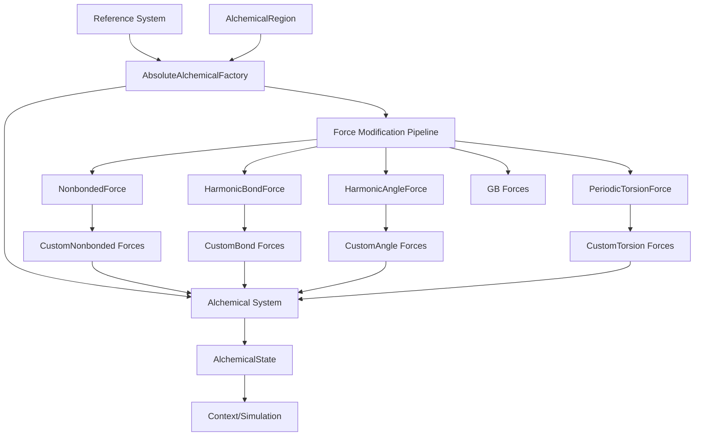

This page explains how to create alchemically-modified OpenMM System objects for free energy calculations using the `AbsoluteAlchemicalFactory`. Alchemical modification allows you to gradually transform molecular systems by softening or removing specific interactions, enabling computation of free energy differences through thermodynamic integration or free energy perturbation methods.

Sources: [alchemy.py](openmmtools/alchemy/alchemy.py#L7-L25)

## Architectural Overview

The alchemical system creation process follows a factory pattern that transforms reference OpenMM System objects into modified versions with softcore potentials. The architecture centers on three core components working together: the `AlchemicalRegion` specification, the `AbsoluteAlchemicalFactory` that performs the transformation, and the `AlchemicalState` that controls the alchemical parameters during simulation.



The factory systematically processes each force type in the reference system, creating custom force objects that implement softcore potentials with lambda-dependent scaling. This modular approach allows selective modification of specific molecular regions while preserving the rest of the system unchanged.

Sources: [alchemy.py](openmmtools/alchemy/alchemy.py#L637-L750), [test_alchemy.py](openmmtools/tests/test_alchemy.py#L1738-L1800)

## AlchemicalRegion Configuration

The `AlchemicalRegion` namedtuple specifies which parts of your system to modify and how to apply the alchemical transformations. It provides fine-grained control over atoms, bonds, angles, torsions, and the softcore potential parameters.

### Core Parameters

| Parameter | Type | Default | Description |
|-----------|------|---------|-------------|
| `alchemical_atoms` | list of int | None | Indices of atoms for nonbonded force modification |
| `alchemical_bonds` | bool/list of int | None | Bond indices to soften (True = auto-detect) |
| `alchemical_angles` | bool/list of int | None | Angle indices to soften (True = auto-detect) |
| `alchemical_torsions` | bool/list of int | None | Torsion indices to soften (True = auto-detect) |
| `annihilate_electrostatics` | bool | True | Annihilate rather than decouple electrostatics |
| `annihilate_sterics` | bool | False | Annihilate rather than decouple steric interactions |

### Softcore Potential Parameters

| Parameter | Type | Default | Purpose |
|-----------|------|---------|---------|
| `softcore_alpha` | float | 0.5 | Softcore lengthscale for Lennard-Jones |
| `softcore_a`, `softcore_b`, `softcore_c` | float | 1, 1, 6 | LJ softcore form parameters (Eq. 13, Ref [1]) |
| `softcore_beta` | float | 0.0 | Softcore lengthscale for electrostatics (0 = standard scaling) |
| `softcore_d`, `softcore_e`, `softcore_f` | float | 1, 1, 2 | Electrostatics softcore form parameters |

The effective distance between point charges follows:

```
r_eff = sigma * ((softcore_beta*(lambda_electrostatics-1)^softcore_e + (r/sigma)^softcore_f))^(1/softcore_f)
```

Sources: [alchemy.py](openmmtools/alchemy/alchemy.py#L417-L489), [alchemy.py](openmmtools/alchemy/alchemy.py#L1356-L1393)

## AbsoluteAlchemicalFactory Usage

The `AbsoluteAlchemicalFactory` class performs the actual transformation of reference systems into alchemical variants. Its constructor accepts several configuration options that control the modification strategy.

### Factory Configuration Options

| Option | Type | Default | Effect |
|--------|------|---------|--------|
| `consistent_exceptions` | bool | False | Use nonbonded method form for 1,4 exceptions |
| `switch_width` | Quantity | 1.0 Å | Switch width for periodic cutoff electrostatics |
| `alchemical_pme_treatment` | str | 'exact' | PME treatment: 'direct-space', 'coulomb', or 'exact' |
| `alchemical_rf_treatment` | str | 'switched' | Reaction field treatment: 'switched' or 'shifted' |
| `disable_alchemical_dispersion_correction` | bool | False | Skip dispersion correction for nonequilibrium protocols |
| `split_alchemical_forces` | bool | True | Assign different lambda variables to different force groups |

The PME treatment option is particularly important: `'exact'` includes reciprocal space contributions (only charge annihilation supported), `'direct-space'` models only direct space, and `'coulomb'` adds switched Coulomb interactions.

Sources: [alchemy.py](openmmtools/alchemy/alchemy.py#L626-L637), [alchemy.py](openmmtools/alchemy/alchemy.py#L496-L625)

### Basic Creation Workflow


The factory's `create_alchemical_system` method accepts a reference system and one or more `AlchemicalRegion` specifications, returning a modified system with custom forces implementing softcore potentials. The method validates input, resolves region specifications, and systematically processes each force type.

Sources: [alchemy.py](openmmtools/alchemy/alchemy.py#L637-L750)

## Force Modification Strategies

The factory employs specialized methods to handle each force type, creating appropriate custom force objects with lambda-dependent energy expressions.

### NonbondedForce Modification

The `NonbondedForce` undergoes the most complex transformation, being split into multiple components:

- **Non-alchemical interactions**: Standard `NonbondedForce` for unmodified atoms
- **Alchemical-alchemical sterics**: `CustomNonbondedForce` with softcore LJ potential
- **Alchemical-alchemical electrostatics**: `CustomNonbondedForce` with softcore Coulomb
- **Non-alchemical/alchemical interactions**: Separate sterics and electrostatics custom forces
- **Exception handling**: `CustomBondForce` for 1-4 interactions with proper softcore treatment

The softcore Lennard-Jones expression uses:

```
U_sterics = (lambda_sterics^softcore_a) * 4 * epsilon * x * (x - 1.0)
x = (sigma/reff_sterics)^6
reff_sterics = sigma * ((softcore_alpha*(1.0-lambda_sterics)^softcore_b + (r/sigma)^softcore_c))^(1/softcore_c)
```

Sources: [alchemy.py](openmmtools/alchemy/alchemy.py#L1539-L1600), [alchemy.py](openmmtools/alchemy/alchemy.py#L1356-L1378)

### Bonded Force Modifications

Bonded forces follow a consistent pattern: unmodified interactions go into standard force objects, while alchemical interactions receive lambda scaling through custom forces.

**HarmonicBondForce:**
- Standard force: Unmodified bonds and straddling bonds between non-interacting regions
- Custom force: `lambda_bonds * (K/2) * (r-r0)^2` for specified alchemical bonds

**HarmonicAngleForce:**
- Standard force: Unmodified angles not connecting non-interacting regions
- Custom force: `lambda_angles * (K/2) * (theta-theta0)^2` for specified angles

**PeriodicTorsionForce:**
- Standard force: Unmodified torsions (improper torsions never softened)
- Custom force: `lambda_torsions * k * (1 + cos(periodicity*theta - phase))`

This separation allows selective control over different bonded interaction types during alchemical transformations.

Sources: [alchemy.py](openmmtools/alchemy/alchemy.py#L1114-L1200), [alchemy.py](openmmtools/alchemy/alchemy.py#L1277-L1355)

## AlchemicalState Integration

Once an alchemical system is created, the `AlchemicalState` class manages the lambda parameters that control the degree of alchemical modification. It extends `GlobalParameterState` with specific parameters for different interaction types.

### Available Lambda Parameters

| Parameter | Controls | Default |
|-----------|----------|---------|
| `lambda_sterics` | Lennard-Jones and Halgren interactions | 1.0 |
| `lambda_electrostatics` | Charges, Born radii, surface area term | 1.0 |
| `lambda_bonds` | Alchemically-softened bonds | 1.0 |
| `lambda_angles` | Alchemically-softened angles | 1.0 |
| `lambda_torsions` | Alchemically-softened torsions | 1.0 |

You can create states manually or extract them from existing systems:

```python
# Manual creation
alchemical_state = AlchemicalState(lambda_sterics=0.5, lambda_electrostatics=0.7)

# Extract from system (automatically detects parameters)
alchemical_state = AlchemicalState.from_system(alchemical_system)
```

The state can be applied directly to Context objects for efficient parameter updates during simulation without system reinitialization.

Sources: [alchemy.py](openmmtools/alchemy/alchemy.py#L90-L150), [alchemy.py](openmmtools/alchemy/alchemy.py#L358-L415)

## Multi-Region Support

The factory supports simultaneous modification of multiple alchemical regions, enabling complex transformations like ligand binding where both ligand and receptor sites may need modification. Each region can have independent lambda parameters when named.

### Multi-Region Configuration

When using multiple regions, provide a list of `AlchemicalRegion` objects with distinct names:

```python
alchemical_regions = [
    AlchemicalRegion(name='ligand', alchemical_atoms=range(0, 21)),
    AlchemicalRegion(name='protein_site', alchemical_atoms=range(2603, 2621))
]
alchemical_system = factory.create_alchemical_system(reference_system, alchemical_regions)
```

Named regions create suffixed lambda variables (e.g., `lambda_sterics_ligand`, `lambda_sterics_protein_site`), allowing independent control over each region's transformation. By default, regions interact only with the non-alchemical environment, though region-region interactions can be specified through the `alchemical_regions_interactions` parameter.

The factory validates that regions have no duplicate atoms, bonds, angles, or torsions, and ensures unique region names to prevent parameter conflicts.

Sources: [alchemy.py](openmmtools/alchemy/alchemy.py#L637-L750), [alchemy.py](openmmtools/alchemy/alchemy.py#L1052-L1120)

## Practical Examples

### Example 1: Simple Ligand Annihilation

```python
from openmmtools import testsystems, alchemy

# Load reference system
test_system = testsystems.HostGuestExplicit(nonbondedMethod=openmm.app.PME)

# Define alchemical region (guest atoms)
alchemical_region = alchemy.AlchemicalRegion(
    alchemical_atoms=range(21),  # First 21 atoms are the guest
    annihilate_sterics=True,
    annihilate_electrostatics=True
)

# Create factory and modify system
factory = alchemy.AbsoluteAlchemicalFactory(
    alchemical_pme_treatment='exact',
    consistent_exceptions=False
)
alchemical_system = factory.create_alchemical_system(
    test_system.system, 
    alchemical_region
)
```

This creates a system where the guest molecule can be completely annihilated by setting both `lambda_sterics` and `lambda_electrostatics` to zero.

Sources: [test_alchemy.py](openmmtools/tests/test_alchemy.py#L1812-L1870)

### Example 2: Partial Modification with Bonded Terms

```python
# Alanine dipeptide in vacuum
test_system = testsystems.AlanineDipeptideVacuum()

# Modify backbone with automatic bond/angle/torsion detection
alchemical_region = alchemy.AlchemicalRegion(
    alchemical_atoms=[0, 1, 2],  # N-terminal atoms
    alchemical_bonds=True,
    alchemical_angles=True,
    alchemical_torsions=True,
    softcore_alpha=0.5,
    softcore_beta=0.0
)

alchemical_system = factory.create_alchemical_system(
    test_system.system, 
    alchemical_region
)
```

The `True` values for bonded terms cause automatic detection of all bonds, angles, and torsions involving the specified atoms.

Sources: [alchemy.py](openmmtools/alchemy/alchemy.py#L816-L904)

### Example 3: Nonequilibrium Switching Optimization

For nonequilibrium protocols where lambda changes every step, disable dispersion correction to avoid CPU bottlenecks:

```python
factory = alchemy.AbsoluteAlchemicalFactory(
    disable_alchemical_dispersion_correction=True,
    alchemical_pme_treatment='direct-space'  # Faster for frequent updates
)

alchemical_system = factory.create_alchemical_system(
    testsystems.WaterBox().system,
    alchemy.AlchemicalRegion(alchemical_atoms=[0, 1, 2])
)
```

This configuration eliminates the ~0.5 second dispersion correction recomputation that would otherwise occur on every lambda update.

Sources: [alchemy.py](openmmtools/alchemy/alchemy.py#L626-L637)

## Energy Component Analysis

The factory provides utilities for debugging and analyzing alchemical systems through energy component decomposition. The `get_energy_components` class method computes contributions from each force, helping verify correct alchemical modification.

```python
from openmm import unit

# Create alchemical state at full interaction
alchemical_state = AlchemicalState.from_system(alchemical_system)

# Compute energy components
energy_components = AbsoluteAlchemicalFactory.get_energy_components(
    alchemical_system,
    alchemical_state,
    test_system.positions,
    platform=None  # Use fastest available
)
```

This returns an ordered dictionary mapping force labels to their energy contributions, useful for ensuring that alchemical interactions scale correctly with lambda and that non-alchemical forces remain unchanged.

Sources: [alchemy.py](openmmtools/alchemy/alchemy.py#L756-L815), [test_alchemy.py](openmmtools/tests/test_alchemy.py#L616-L700)

## Validation and Testing

The test suite demonstrates comprehensive validation procedures to ensure alchemical systems behave correctly. The `compare_system_energies` function verifies that reference and alchemical systems produce identical energies at full coupling, accounting for PME treatment differences.

For direct-space PME treatment, the test computes correction terms for alchemical atom exceptions and compares direct-space energies. For exact PME treatment, full system energies are compared directly. This validation ensures energy conservation and correct thermodynamic properties.

Test systems range from simple clusters to complex proteins with various force fields (AMOEBA, GBSA, explicit solvent), demonstrating the factory's broad applicability across different molecular systems and nonbonded methods.

Sources: [test_alchemy.py](openmmtools/tests/test_alchemy.py#L616-L700), [test_alchemy.py](openmmtools/tests/test_alchemy.py#L2032-L2048)

## Next Steps

After creating alchemically-modified systems, several related capabilities become relevant:

- **[Alchemical Force Modifications](23-alchemical-force-modifications)** - Deep dive into the mathematical forms and implementation details of softcore potentials
- **[Alchemical State Management](20-alchemical-state-management)** - Advanced techniques for managing alchemical states during multi-state simulations
- **[Alchemical Factory System Design](21-alchemical-factory-system-design)** - Architectural patterns for extending and customizing alchemical factories
- **[Multi-State Sampler Architecture](18-multi-state-sampler-architecture)** - Using alchemical systems in enhanced sampling simulations like replica exchange

The alchemical system creation described here provides the foundation for all subsequent free energy calculations in the openmmtools ecosystem.
