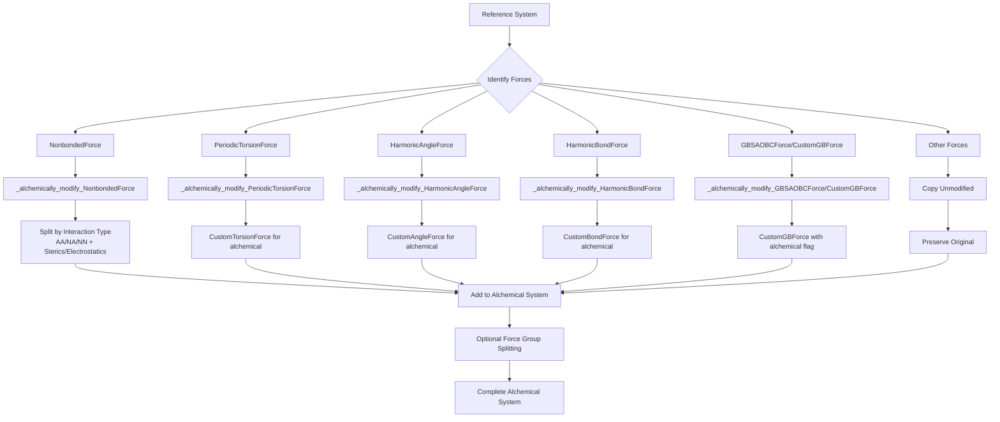

Alchemical force modifications enable the systematic transformation of molecular systems through lambda-controlled perturbations of the Hamiltonian. This page documents how `AbsoluteAlchemicalFactory` decomposes and reconstructs OpenMM force objects to create alchemically modified systems suitable for free energy calculations.

## Architecture of Alchemical Force Transformation

The `AbsoluteAlchemicalFactory` employs a systematic approach to force modification that separates alchemical from non-alchemical interactions while preserving the underlying physics of the original system. Each force type is processed through dedicated modification methods that create CustomForce objects with lambda-dependent energy expressions.



## Force-Specific Modifications

### Nonbonded Force Modifications

The `NonbondedForce` undergoes the most comprehensive decomposition, being split into up to eight distinct CustomForce objects depending on the system configuration. This granular separation enables precise control over different interaction types during alchemical transformation.

**Steric Interactions**: The Lennard-Jones potential is modified with a softcore formulation that prevents singularities as atoms are decoupled. The effective distance transformation follows the Pham and Shirts 2011 formulation:

```
reff_sterics = sigma*((softcore_alpha*(1.0-λ_sterics)^softcore_b + (r/sigma)^softcore_c))^(1/softcore_c)
U_sterics = (λ_sterics^softcore_a) * 4*epsilon*x*(x-1.0)
where x = (sigma/reff_sterics)^6
```

Sources: [alchemy.py](openmmtools/alchemy/alchemy.py#L1356-L1375)

**Electrostatic Interactions**: Coulomb interactions are similarly softened using a configurable softcore parameter. For PME systems, three treatment modes are available:

| Treatment | Description | Constraints |
|-----------|-------------|-------------|
| `exact` | Includes reciprocal space, modifies charges directly | Requires charge annihilation only |
| `direct-space` | Only direct-space contribution with softcore | No reciprocal space inclusion |
| `coulomb` | Switched Coulomb potential | Most general case |

Sources: [alchemy.py](openmmtools/alchemy/alchemy.py#L626-L629), [alchemy.py](openmmtools/alchemy/alchemy.py#L1392-L1450)

**Force Distribution Table**: The mapping of original NonbondedForce interactions to CustomForce objects follows a systematic pattern:

| CustomForce Type | Interaction Domain | Sterics/Electrostatics | Lambda Control |
|------------------|-------------------|------------------------|----------------|
| `nonbonded_force` | non-alchemical/non-alchemical | Both | None |
| `aa_sterics_custom_nonbonded_force` | alchemical/alchemical | Sterics | `lambda_sterics` |
| `na_sterics_custom_nonbonded_force` | non-alchemical/alchemical | Sterics | `lambda_sterics` |
| `aa_electrostatics_custom_nonbonded_force` | alchemical/alchemical | Electrostatics | `lambda_electrostatics` |
| `na_electrostatics_custom_nonbonded_force` | non-alchemical/alchemical | Electrostatics | `lambda_electrostatics` |
| `aa_sterics_custom_bond_force` | alchemical/alchemical | Sterics exceptions | `lambda_sterics` |
| `na_sterics_custom_bond_force` | non-alchemical/alchemical | Sterics exceptions | `lambda_sterics` |
| `aa_electrostatics_custom_bond_force` | alchemical/alchemical | Electrostatics exceptions | `lambda_electrostatics` |
| `na_electrostatics_custom_bond_force` | non-alchemical/alchemical | Electrostatics exceptions | `lambda_electrostatics` |

Sources: [alchemy.py](openmmtools/alchemy/alchemy.py#L1705-L1730)

### Torsion Force Modifications

Proper torsions specified in `AlchemicalRegion.alchemical_torsions` are transferred to a `CustomTorsionForce` with a lambda-scaled energy expression. Improper torsions are never softened to maintain proper stereochemical constraints.

**Energy Expression**: 
```
U_torsion = lambda_torsions * k * (1 + cos(periodicity*θ - phase))
```

The factory automatically filters torsions that straddle non-interacting alchemical regions, preventing spurious coupling between independent alchemical transformations.

Sources: [alchemy.py](openmmtools/alchemy/alchemy.py#L1114-L1200), [alchemy.py](openmmtools/alchemy/alchemy.py#L1085-L1113)

### Angle and Bond Force Modifications

HarmonicAngleForce and HarmonicBondForce follow a similar pattern to torsions, creating CustomAngleForce and CustomBondForce respectively for the alchemical interactions. Bond, angle, and torsion lists can be manually specified or auto-generated to include all such terms involving alchemical atoms.

**Auto-generation Logic**: When set to `True`, these parameters are populated through systematic analysis of the system topology:
- Bonds: All bonds where either atom is alchemical
- Angles: All angles where at least one atom is alchemical
- Torsions: All proper torsions where at least one atom is alchemical (improper torsions excluded)

Sources: [alchemy.py](openmmtools/alchemy/alchemy.py#L945-L1021)

### Implicit Solvent Force Modifications

For GBSAOBCForce, the modification creates a CustomGBForce that introduces an `alchemical` per-particle parameter (1.0 for alchemical atoms, 0.0 otherwise). All energy terms are prefixed with a lambda-dependent scaling factor:

```
scaling_factor = lambda_electrostatics * alchemical + (1 - alchemical)
```

This approach allows electrostatic interactions of alchemical atoms to be smoothly turned off while preserving the GB solvation model's computational framework.

Sources: [alchemy.py](openmmtools/alchemy/alchemy.py#L2143-L2210), [alchemy.py](openmmtools/alchemy/alchemy.py#L2223-L2345)

## Multiple Alchemical Regions

The factory supports the definition of multiple independent alchemical regions with optional inter-region interactions. Each region can have its own set of alchemical atoms, bonds, angles, and torsions, along with region-specific lambda parameters and softcore settings.

**Region Naming and Lambda Variables**: When regions are named, lambda variables acquire suffixes to distinguish them:

```python
alchemical_region_ligand = AlchemicalRegion(alchemical_atoms=[1,2,3], name='ligand')
alchemical_region_water = AlchemicalRegion(alchemical_atoms=[4,5,6], name='water')
# Results in lambda_sterics_ligand, lambda_electrostatics_ligand, etc.
```

For interacting regions, the energy expressions multiply the corresponding lambda variables, enforcing that the interaction is zero unless both regions are fully coupled.

Sources: [alchemy.py](openmmtools/alchemy/alchemy.py#L417-L495), [alchemy.py](openmmtools/alchemy/alchemy.py#L637-L750)

## Force Group Allocation

The optional `split_alchemical_forces` parameter assigns each set of lambda-controlled forces to a separate force group (OpenMM supports up to 32 groups). This enables energy component analysis by allowing selective evaluation of different contributions.

**Allocation Algorithm**: Non-alchemical forces retain their original groups. Lambda-controlled forces are assigned to the smallest available group indices, with forces controlled by the same lambda variable sharing a group.

Sources: [alchemy.py](openmmtools/alchemy/alchemy.py#L1052-L1095), [alchemy.py](openmmtools/alchemy/alchemy.py#L626-L635)

## Energy Component Analysis

The `get_energy_components` class method provides diagnostic capabilities by computing the contribution of each force group separately. This is invaluable for debugging alchemical protocols and verifying that force modifications produce the expected energy behavior.

**Output Structure**: Returns an `OrderedDict` mapping descriptive labels (e.g., "alchemically modified NonbondedForce for non-alchemical/alchemical sterics") to their energy contributions.

Sources: [alchemy.py](openmmtools/alchemy/alchemy.py#L756-L815), [alchemy.py](openmmtools/alchemy/alchemy.py#L2346-L2545)

## Limitations and Unimplemented Features

Certain force types and scenarios remain unsupported:

- **Tabulated Lennard-Jones potentials** from OpenMM's forcefield generator (`acoef/r^12 - bcoef/r^6`) cannot be alchemically modified due to the difficulty of softcore reformulation for tabulated coefficients. See [issue #510](https://github.com/choderalab/openmmtools/issues/510).

- **Multiple alchemical regions with AmoebaMultipoleForce** are not supported due to complexity in handling multipole interactions across regions.

- **Virtual sites** cannot be included in alchemical regions as their force-dependent positions create complications during decoupling.

- **Relative alchemical factories** for transformation between two non-interacting states are planned but not yet implemented.

Sources: [alchemy.py](openmmtools/alchemy/alchemy.py#L2040-L2075), [alchemy.py](openmmtools/alchemy/alchemy.py#L719-L723), [alchemy.rst](docs/alchemy.rst)

## Practical Considerations

**Performance Optimization**: For nonequilibrium switching protocols where lambda changes frequently, setting `disable_alchemical_dispersion_correction=True` prevents the costly CPU-side recomputation of the long-range dispersion correction (~0.5s per call).

**Parameter Consistency**: With exact PME treatment, electrostatics softcore parameters are deactivated (softcore_beta=0, softcore_d=1, softcore_e=1) as charges are modified directly rather than through potential scaling.

Sources: [alchemy.py](openmmtools/alchemy/alchemy.py#L1677-L1692), [alchemy.py](openmmtools/alchemy/alchemy.py#L626-L635)

> [!TIP]
> When defining alchemical regions, always verify that virtual sites are excluded. Including virtual sites will raise a ValueError, but identifying them beforehand prevents workflow interruption. The system's `isVirtualSite(particle_index)` method can be used for pre-screening.

> [!TIP]
> For debugging complex alchemical transformations, use `get_energy_components` with multiple lambda values to verify that energy varies smoothly and monotonically with each lambda parameter. Sudden jumps or non-physical behavior often indicate missing interaction groups or incorrect parameter assignment.