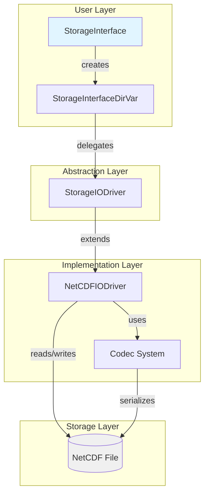

The Storage Interface Architecture provides a flexible, hierarchical abstraction layer for storing and retrieving simulation data in structured formats, primarily NetCDF. This system separates the concerns of data organization (StorageInterface) from data serialization (StorageIODriver and Codec system), enabling developers to work with complex data structures through intuitive Python object attributes.

The architecture is designed around three core principles: **lazy binding** (delaying disk I/O until necessary), **type safety** through codec validation, and **hierarchical organization** mirroring filesystem structures. This design ensures efficient data access while maintaining type integrity across read/write operations.

Sources: [storage/__init__.py](openmmtools/storage/__init__.py#L3-L71), [storageinterface.py](openmmtools/storage/storageinterface.py#L7-L10)

## Core Architecture Components

The storage architecture consists of four interconnected layers that work together to provide seamless data persistence. At the highest level, users interact with `StorageInterface`, which dynamically creates `StorageInterfaceDirVar` objects representing directories and variables. These interface with `StorageIODriver` implementations that handle physical I/O operations, while a codec system manages type-specific data encoding and decoding.



This layered approach enables clean separation of concerns: the user interface handles attribute-style navigation, the abstraction layer manages I/O operations, the implementation layer handles storage format specifics, and codecs ensure type-safe data conversion. The system supports both read and write operations, with automatic type detection and validation through the codec system.

Sources: [storage/__init__.py](openmmtools/storage/__init__.py#L6-L30), [iodrivers.py](openmmtools/storage/iodrivers.py#L7-L13)

## StorageInterface: The User-Facing Layer

`StorageInterface` serves as the entry point for all storage operations, providing a Pythonic interface through dynamic attribute access. When you access an undefined attribute, `StorageInterface` automatically creates a `StorageInterfaceDirVar` instance that represents either a directory or variable in the storage system. This lazy creation pattern means the storage structure is built on-demand as you interact with it.

The interface maintains minimal state—only a reference to the underlying `StorageIODriver`—delegating all actual I/O operations to that driver. This design allows the same interface to work with different storage backends by simply swapping the driver implementation.

Sources: [storageinterface.py](openmmtools/storage/storageinterface.py#L383-L500)

### StorageInterfaceDirVar: Dynamic Directory/Variable Objects

`StorageInterfaceDirVar` (SIDV) is the workhorse of the system, representing both directories and variables through a unified interface. SIDV instances track their position in the hierarchical path through a predecessor chain, enabling reconstruction of full storage paths. Each SIDV can exist in three states: **unbound** (no disk interaction), **directory** (bound as a NetCDF group), or **variable** (bound as a NetCDF variable).

The class employs Python's `__getattr__` magic method to enable hierarchical path construction. When you access `storage.dir1.dir2.var`, each dot operator triggers `__getattr__`, creating a chain of SIDV instances. Only when you call `read()`, `write()`, or `append()` does the system actually interact with the disk, at which point the binding process determines whether each SIDV represents a directory or variable.

Sources: [storageinterface.py](openmmtools/storage/storageinterface.py#L28-L382), [storageinterface.py](openmmtools/storage/storageinterface.py#L368-L382)

## The Binding Mechanism

The binding process is the critical mechanism that converts unbound SIDV instances into actual storage objects. Binding occurs on the first I/O operation and follows different logic depending on the operation type:

- **Read binding**: Checks that the file exists and verifies the path exists on disk. The SIDV determines its type (directory vs. variable) from what's actually stored and creates the appropriate codec for type conversion.
- **Write binding**: Creates the full directory structure if it doesn't exist, then creates the variable with appropriate dimensions based on the data type and operation mode.
- **Append binding**: Similar to write binding but creates an unlimited "iteration" dimension to enable sequential data accumulation.

The binding process is one-way—once bound to a variable, an SIDV cannot be converted to a directory, and vice versa. This ensures type safety and prevents data corruption from ambiguous state transitions.

Sources: [storage/__init__.py](openmmtools/storage/__init__.py#L32-L52), [storageinterface.py](openmmtools/storage/storageinterface.py#L320-L357)

## StorageIODriver: Abstract I/O Layer

`StorageIODriver` is the abstract base class defining the contract for storage implementations. It maintains a type-to-codec mapping that determines which codec handles each Python data type, and tracks all variables created through the driver. The abstract methods define essential operations: creating storage variables, retrieving existing variables, managing directories, closing files, and adding metadata.

The driver implements the **lazy loading principle**—variables aren't created on disk until the first write operation, and existing variables aren't read until requested. This minimizes unnecessary I/O operations and keeps memory usage low. The `set_codec` method allows users to add custom codecs or override default ones, providing extensibility for specialized data types.

Sources: [iodrivers.py](openmmtools/storage/iodrivers.py#L100-L240)

## NetCDFIODriver: NetCDF Implementation

`NetCDFIODriver` is the concrete implementation for NetCDF storage, handling all NetCDF-specific operations including dimension management, group creation, and variable binding. The driver manages several special dimensions: a "scalar" dimension for single values, an "iteration" dimension for appendable data, and dynamic "iterable" dimensions for array-like data.

The driver implements the abstract methods defined in `StorageIODriver`, using the netCDF4 library's Python interface. Key responsibilities include:

- **Dimension management**: Creating and checking dimensions needed for variables
- **Group operations**: Creating and binding to NetCDF groups (directories)
- **Variable creation**: Instantiating variables with appropriate dimensions and chunking strategies
- **Metadata handling**: Adding global and variable-specific attributes

The driver also handles NetCDF-specific optimizations like chunking for efficient access patterns and compression for space savings.

Sources: [iodrivers.py](openmmtools/storage/iodrivers.py#L245-L538), [iodrivers.py](openmmtools/storage/iodrivers.py#L349-L417)

## The Codec System

The codec system provides type-safe serialization and deserialization through a hierarchy of codec classes. Each codec knows how to convert between Python types and NetCDF storage formats, handling encoding (Python → NetCDF) and decoding (NetCDF → Python). The base `Codec` class defines the interface with three abstract methods: `read()`, `write()`, and `append()`.

> [!TIP]
> The codec system is extensible—new data types can be added by creating a codec class and registering it with `set_codec()`. This enables support for custom types without modifying core storage logic.

### NCVariableCodec: NetCDF Codec Base

`NCVariableCodec` extends the base `Codec` with NetCDF-specific functionality. It adds abstract properties for `dtype` (Python type), `dtype_string` (type identifier for errors), `_encoder` (encoding function), and `_decoder` (decoding function). The class implements the binding logic that connects the codec to actual NetCDF variables on disk.

The binding process determines the appropriate dimensions, chunking strategy, and data type for storage. For write operations, the codec creates new variables; for read operations, it retrieves existing variables and validates type compatibility.

Sources: [iodrivers.py](openmmtools/storage/iodrivers.py#L539-L905)

### Scalar and Array Codecs

The architecture includes specialized codecs for common data types, organized into a clean hierarchy:

- **NCScalar**: Base class for scalar types (int, float, string)
- **NCInt**: Integer codec using simple encoding and scalar decoding
- **NCFloat**: Float codec using simple encoding and scalar decoding  
- **NCString**: String codec handling NetCDF's character array representation
- **NCArray**: NumPy array codec supporting multi-dimensional data
- **NCIterable**: List and tuple codec for homogeneous iterables

These codecs leverage common encoding functions where possible, reducing code duplication while ensuring type-specific handling where necessary.

Sources: [iodrivers.py](openmmtools/storage/iodrivers.py#L1137-L1400)

### NCQuantity: OpenMM Unit Support

The `NCQuantity` codec demonstrates the system's flexibility by handling OpenMM's `Quantity` objects, which combine numerical values with physical units. The codec separates the unit and value components during encoding, storing the unit as metadata and the value using appropriate scalar or array codecs. During decoding, it reconstructs the full `Quantity` by reattaching the stored unit.

This implementation handles quantities containing scalars, arrays, or other iterables, automatically detecting the underlying value type and applying the appropriate codec. The unit information is stored as a NetCDF attribute (`IODriver_Unit`), enabling lossless round-trip conversion.

Sources: [iodrivers.py](openmmtools/storage/iodrivers.py#L1401-L1540)

### NCDict: Dictionary Storage

The `NCDict` codec handles dictionary storage by serializing them to YAML format and storing as strings. This approach enables storage of complex nested structures with mixed data types. The codec uses custom YAML loaders/dumpers that properly reconstruct OpenMM `Quantity` objects and NumPy arrays, ensuring fidelity for scientific computing objects.

The YAML representation is stored in NetCDF character arrays, with automatic string/byte conversion handling. This codec is particularly useful for storing metadata, configuration parameters, and other structured data that doesn't fit cleanly into typed arrays.

Sources: [iodrivers.py](openmmtools/storage/iodrivers.py#L1577-L1621)

## Storage Operations API

The StorageInterface provides three primary operations for data manipulation, each with distinct semantics:

| Operation | Mode | Use Case | Appended Data |
|-----------|------|----------|---------------|
| `write(data)` | Overwrite | Immutable values, one-time writes | Overwrites entire variable |
| `write(data, at_index=N)` | Index overwrite | Replace specific entry in appendable variable | Replaces entry at position N |
| `append(data)` | Append | Sequential data accumulation, time series | Adds new entry at end |
| `read()` | Read | Retrieve stored data | Returns all data (as array if appended) |

The `append` operation creates an unlimited dimension in NetCDF, enabling sequential writes for time-series data like simulation trajectories. The `write(at_index=N)` mode allows efficient updates to specific entries without rewriting the entire dataset.

Sources: [storageinterface.py](openmmtools/storage/storageinterface.py#L77-L194)

## Practical Usage Examples

### Basic Write and Read Operations

```python
from openmmtools.storage import StorageInterface, NetCDFIODriver
import numpy as np

# Create storage interface
driver = NetCDFIODriver('simulation_data.nc')
storage = StorageInterface(driver)

# Write a scalar value
storage.temperature.write(300.0)

# Write an array
storage.coordinates.write(np.random.rand(100, 3))

# Append time series data
for step in range(10):
    storage.energies.append(np.random.rand())

# Read back data
temp = storage.temperature.read()  # Returns 300.0
coords = storage.coordinates.read()  # Returns (100, 3) array
energies = storage.energies.read()  # Returns (10,) array
```

Sources: [test_storage_interface.py](openmmtools/tests/test_storage_interface.py#L64-L92)

### Hierarchical Organization

The dynamic attribute creation enables natural hierarchical organization:

```python
# Create nested directory structure
storage.simulation.replica_0.coordinates.write(coords_0)
storage.simulation.replica_1.coordinates.write(coords_1)
storage.simulation.metadata.creator.write("OpenMMTools")
storage.simulation.metadata.timestamp.write("2024-01-01")

# Access nested data
coords_0 = storage.simulation.replica_0.coordinates.read()
creator = storage.simulation.metadata.creator.read()
```

This structure mirrors filesystem organization, making it intuitive to organize complex simulation data. NetCDF groups are automatically created for each directory level.

Sources: [test_storage_interface.py](openmmtools/tests/test_storage_interface.py#L123-L182)

### Metadata Management

Both directories and variables support metadata attachment for documentation and provenance:

```python
# Add metadata to directories
storage.simulation.add_metadata("description", "NPT simulation")
storage.simulation.add_metadata("temperature", 300.0)

# Add metadata to variables  
storage.coordinates.add_metadata("units", "nanometers")
storage.energies.add_metadata("ensemble", "NVT")

# Metadata is stored as NetCDF attributes
```

Metadata is buffered until the object binds to disk, ensuring that metadata can be added before the directory or variable exists.

Sources: [storageinterface.py](openmmtools/storage/storageinterface.py#L194-L219), [test_storage_interface.py](openmmtools/tests/test_storage_interface.py#L168-L182)

## Integration with MultiStateSampler

The `MultiStateReporter` class demonstrates real-world usage of the storage architecture for complex molecular dynamics simulations. The reporter uses two storage files: an analysis file for static data and a checkpoint file for dynamic state information. Both use the underlying StorageInterface for organized data access.

The reporter stores various data types through the storage interface:
- **Thermodynamic states**: Dictionary-based storage with YAML serialization
- **Sampler states**: Position and velocity arrays with OpenMM Quantity units
- **Energies**: Multi-dimensional arrays for replica exchange data
- **Mixing statistics**: Matrices tracking acceptance rates
- **Analysis data**: Dynamic dictionaries for online analysis results

The reporter's `write_dict` and `read_dict` methods showcase hierarchical dictionary storage, where dictionaries can be nested and partially accessed through path notation.

Sources: [multistatereporter.py](openmmtools/multistate/multistatereporter.py#L124-L180), [multistatereporter.py](openmmtools/multistate/multistatereporter.py#L1037-L1130)

<CgxTip>
When working with large-scale simulations, the checkpoint interval parameter in MultiStateReporter controls how frequently state data is written to disk, balancing performance against data loss risk.
</cgtip>

## Performance Considerations

The storage architecture is designed for efficiency in high-throughput computational chemistry workflows:

- **Lazy binding**: No disk I/O until data is actually accessed, minimizing overhead for unused paths
- **Chunked storage**: NetCDF chunking enables efficient access patterns for large array data
- **Buffered metadata**: Metadata is accumulated in memory and written during binding
- **Type validation**: Codec-level validation ensures data integrity before writes occur

For append operations, the system automatically determines optimal chunk sizes based on data characteristics and memory constraints, balancing read efficiency against write performance.

Sources: [iodrivers.py](openmmtools/storage/iodrivers.py#L1098-L1137), [storage/__init__.py](openmmtools/storage/__init__.py#L26-L30)

## Error Handling and Validation

The storage system provides comprehensive validation to catch errors early:

- **Type safety**: Codecs validate data types on write and ensure type consistency on append
- **Shape validation**: Array codecs verify shape consistency for append operations
- **Path validation**: Read operations verify paths exist before attempting access
- **Unit consistency**: NCQuantity enforces unit matching for quantities

Error messages include contextual information about the expected vs. actual data types and shapes, making debugging straightforward.

Sources: [iodrivers.py](openmmtools/storage/iodrivers.py#L852-L870), [test_storage_iodrivers.py](openmmtools/tests/test_storage_iodrivers.py#L259-L294)

## Next Steps

Having understood the storage interface architecture, you can explore:

- **[NetCDF Storage Drivers](25-netcdf-storage-drivers)**: Deep dive into NetCDF-specific implementation details and advanced features
- **[Multi-State Analysis Framework](26-multi-state-analysis-framework)**: How storage integrates with replica exchange and other enhanced sampling methods
- **[Multi-State Sampler Architecture](18-multi-state-sampler-architecture)**: High-level design of the sampling algorithms that use this storage system

The storage interface provides the foundation for reproducible simulation workflows, enabling efficient storage and analysis of complex molecular dynamics data.