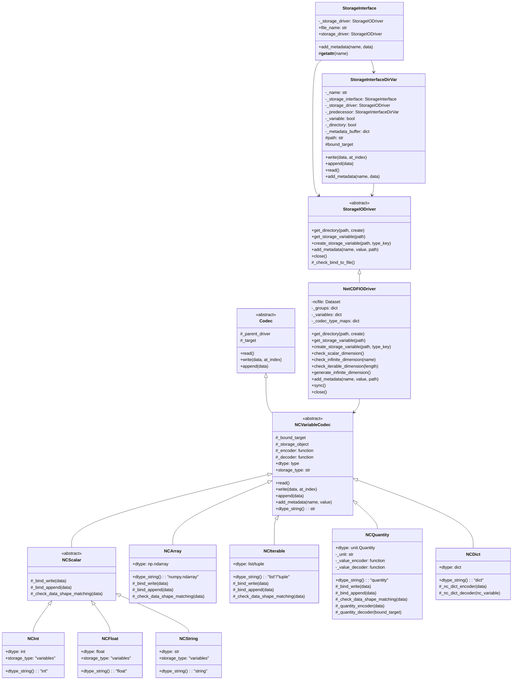
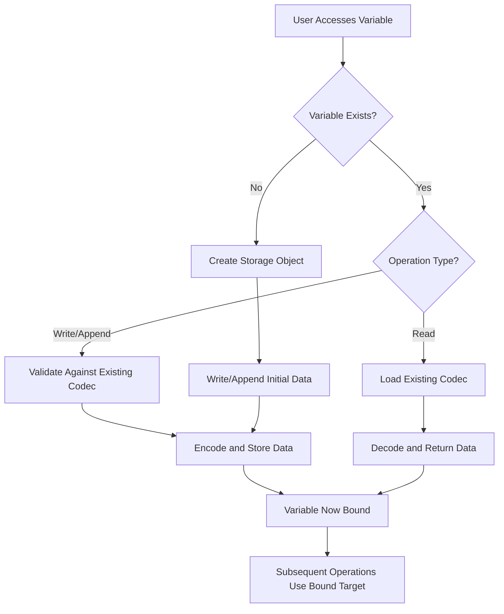

The NetCDF Storage Drivers in openmmtools provide a robust, type-safe framework for persisting molecular simulation data to NetCDF files. This system abstracts away the complexity of NetCDF file manipulation while providing type preservation for scientific data including OpenMM Quantity objects with units. The architecture employs a lazy binding mechanism to minimize I/O operations and supports hierarchical data organization similar to a filesystem.

Sources: [iodrivers.py](openmmtools/storage/iodrivers.py#L1-L1621), [storageinterface.py](openmmtools/storage/storageinterface.py#L1-L500)

## Architecture Overview

The NetCDF storage system is built upon a three-layer architecture that separates concerns between low-level I/O operations, type-specific encoding/decoding, and user-facing interfaces. This design enables extensibility while maintaining type safety and performance through lazy evaluation.



The driver manages the NetCDF file lifecycle, codec registry, and coordinate system (groups and variables). Codecs handle type-specific encoding and decoding, while the interface layer provides a Pythonic API through dynamic attribute access.

Sources: [iodrivers.py](openmmtools/storage/iodrivers.py#L100-L243), [iodrivers.py](openmmtools/storage/iodrivers.py#L245-L538)

## The Binding Mechanism

A core innovation in this system is the binding mechanism, which implements lazy evaluation to defer disk I/O until absolutely necessary. This approach significantly improves performance by avoiding premature file access operations.

When a variable is first accessed through the interface, it exists in an "unbound" state—it knows its path in the file hierarchy but has not yet interacted with the disk. The binding action occurs on the first read, write, or append operation, at which point the system:

1. Checks if data already exists at the target path
2. For existing data: determines the appropriate codec from metadata attributes
3. For new data: creates storage based on the type key and data shape
4. Establishes the connection to the specific NetCDF variable or group

The system maintains binding state through the `_bound_target` attribute in each codec instance, which remains `None` until the first I/O operation triggers binding. After binding, subsequent operations use the established connection without re-binding.



> [!TIP]
> The binding mechanism is critical for performance in high-throughput simulations where thousands of variables might be defined but only a subset are actively written to each iteration.

Sources: [storage/__init__.py](openmmtools/storage/__init__.py#L25-L75), [iodrivers.py](openmmtools/storage/iodrivers.py#L687-L746)

## NetCDFIODriver Core Operations

The NetCDFIODriver class serves as the primary orchestrator for all NetCDF file operations. It maintains three critical internal registries: `_groups` for tracking NetCDF groups (directories), `_variables` for tracking codec instances, and `_codec_type_maps` for mapping Python types to their corresponding codec implementations.

### Dimension Management

NetCDF files organize data along named dimensions, and the driver provides methods to ensure required dimensions exist before creating variables. The system supports three dimension types:

| Dimension Type | Purpose | Creation Method | Typical Usage |
|----------------|---------|-----------------|---------------|
| `scalar` | Single-value storage | `check_scalar_dimension()` | Integers, floats, strings |
| `iterable{N}` | Fixed-length arrays | `check_iterable_dimension(length=N)` | NumPy arrays, lists/tuples |
| `unlimited{N}` | Appendable data | `generate_infinite_dimension()` | Time series, iteration data |

The driver automatically creates dimensions as needed during variable binding. For example, when binding a NumPy array of shape (3, 4), the driver checks for `iterable3` and `iterable4` dimensions, creating them if they don't exist.

Sources: [iodrivers.py](openmmtools/storage/iodrivers.py#L367-L427)

### Variable Creation and Retrieval

The `create_storage_variable` method is the primary interface for creating new storage locations. It accepts a path (e.g., "simulation/trajectory/positions") and a type key (Python type or custom codec identifier). The method:

1. Validates the type key against registered codecs
2. Decomposes the path into hierarchy components
3. Creates intermediate groups if needed
4. Instantiates the appropriate codec with the storage object
5. Returns the codec instance for immediate use

Conversely, `get_storage_variable` retrieves existing variables from disk. It navigates the NetCDF group hierarchy to locate the target, then reads the `IODriver_Type` attribute to determine which codec to instantiate for reading the data. This enables automatic type detection when reopening files.

Sources: [iodrivers.py](openmmtools/storage/iodrivers.py#L285-L365)

## Codec System

The codec system is the heart of type-safe persistence. Each codec implements the NCVariableCodec interface, providing type-specific encoding and decoding logic. The system includes built-in codecs for common scientific data types and is designed for extensibility.

### Built-in Codec Types

| Codec Class | Python Type | Storage Type | Key Features |
|-------------|-------------|--------------|--------------|
| `NCInt` | `int` | variable | Scalar integer storage |
| `NCFloat` | `float` | variable | Scalar float storage |
| `NCString` | `str` | variable | Variable-length string storage |
| `NCArray` | `np.ndarray` | variable | NumPy array with shape preservation |
| `NCIterable` | `list`, `tuple` | variable | Homogeneous iterable storage |
| `NCQuantity` | `unit.Quantity` | variable | OpenMM Quantity with unit preservation |
| `NCDict` | `dict` | variable | Dictionary via YAML serialization |

Each codec implements three critical binding methods: `_bind_read`, `_bind_write`, and `_bind_append`. These methods configure the NetCDF variable structure appropriately for the operation type and data characteristics.

Sources: [iodrivers.py](openmmtools/storage/iodrivers.py#L1188-L1621)

### The NCQuantity Codec

The NCQuantity codec deserves special attention as it handles OpenMM's unit-bearing Quantity objects, which are essential for molecular simulations. This codec performs sophisticated processing to separate values from units while maintaining type safety.

When binding for write operations, the codec:
1. Extracts the unit string from the Quantity object
2. Determines the underlying value type (int, float, ndarray, list, or tuple)
3. Creates appropriate dimensions based on the value's shape
4. Stores both the `IODriver_Type` (for value decoding) and `IODriver_Unit` (for unit reconstruction)

The encoding process strips units before storage, while decoding reconstructs the complete Quantity object by reading both the value and unit metadata. This enables lossless round-trip conversion of physical quantities with units.

Sources: [iodrivers.py](openmmtools/storage/iodrivers.py#L1401-L1540)

### The NCDict Codec

Dictionaries present a unique storage challenge due to their heterogeneous key-value structure. The NCDict codec solves this by serializing dictionaries to YAML strings, then storing them as NetCDF string variables.

The codec uses custom PyYAML loaders and dumpers (`_DictYamlLoader` and `_DictYamlDumper`) to handle special cases:
- OpenMM Quantity objects within dictionaries are preserved through custom tags
- Nested data structures are correctly reconstructed
- Type information is maintained through the YAML representation

For appendable dictionaries, the codec creates a two-dimensional array where the first dimension is unlimited and stores each dictionary as a row.

Sources: [iodrivers.py](openmmtools/storage/iodrivers.py#L1547-L1621)

## StorageInterface: User-Facing API

The StorageInterface class provides a Pythonic API that abstracts away the driver-level details. Through dynamic attribute access, users can create hierarchical data structures using familiar dot notation instead of string paths.

### Dynamic Property System

The interface's `__getattr__` method enables the magic of path creation. When accessing an undefined attribute, the system creates a StorageInterfaceDirVar instance with that name. This enables nested hierarchies:

```python
# Create hierarchical storage structure
storage = StorageInterface(driver)
storage.simulation.trajectory.positions.write(coords)
storage.simulation.trajectory.velocities.write(vels)
storage.simulation.metadata.create_time.write(datetime.now())
```

Each `StorageInterfaceDirVar` maintains a reference to its predecessor, enabling path reconstruction. The `path` property builds the full path by traversing the predecessor chain, while `bound_target` provides access to the actual codec instance after binding.

Sources: [storageinterface.py](openmmtools/storage/storageinterface.py#L383-L500), [storageinterface.py](openmmtools/storage/storageinterface.py#L28-L368)

### Read, Write, and Append Operations

The three core data operations are implemented at the StorageInterfaceDirVar level:

- **Write**: Stores data at a specific path. If the variable doesn't exist, it's created. If it exists, the operation validates data compatibility. The optional `at_index` parameter enables overwriting specific indices of appendable variables.
- **Append**: Extends an appendable variable with new data. Creates an unlimited dimension if the variable doesn't exist. Validates that appended data matches the shape and type of existing entries.
- **Read**: Retrieves data from disk. Raises an error if the variable doesn't exist. Type conversion is handled automatically by the codec.

All three operations trigger binding on first access if the variable is unbound.

Sources: [storageinterface.py](openmmtools/storage/storageinterface.py#L77-L348), [iodrivers.py](openmmtools/storage/iodrivers.py#L748-L867)

## Practical Usage Examples

### Basic Storage Operations

```python
from openmmtools.storage import NetCDFIODriver, StorageInterface
from openmm import unit
import numpy as np

# Initialize driver and interface
driver = NetCDFIODriver('simulation_data.nc')
storage = StorageInterface(driver)

# Write scalar values
storage.temperature.write(298.15 * unit.kelvin)
storage.pressure.write(1.0 * unit.atmosphere)
storage.steps.write(1000)

# Write array data
coordinates = np.random.rand(100, 3) * unit.nanometers
storage.coordinates.write(coordinates)

# Append time series data
for i in range(10):
    energy = i * 0.5 * unit.kilojoules_per_mole
    storage.energies.append(energy)

# Read data back
temp = storage.temperature.read()  # Returns Quantity
coords = storage.coordinates.read()  # Returns numpy array
energies = storage.energies.read()  # Returns array of Quantities
```

Sources: [storage/__init__.py](openmmtools/storage/__init__.py#L55-L75), [test_storage_iodrivers.py](openmmtools/tests/test_storage_iodrivers.py#L1-L294)

### Hierarchical Data Organization

```python
# Organize data by simulation state
storage.initial.positions.write(initial_coords)
storage.initial.velocities.write(initial_vels)
storage.initial.forces.write(initial_forces)

storage.final.positions.write(final_coords)
storage.final.velocities.write(final_vels)

# Store metadata
storage.metadata.system_name.write('alanine_dipeptide')
storage.metadata.forcefield.write('amber14')
storage.metadata.add_metadata('creation_date', '2024-01-15')

# Complex dictionary storage
parameters = {
    'cutoff': 1.0 * unit.nanometer,
    'timestep': 2.0 * unit.femtosecond,
    'constraints': 'HBonds'
}
storage.simulation_params.write(parameters)
```

Sources: [storageinterface.py](openmmtools/storage/storageinterface.py#L48-L120), [test_storage_iodrivers.py](openmmtools/tests/test_storage_iodrivers.py#L175-L210)

### Modifying Appended Data

The system supports modifying specific entries in appendable data using the `write` method with the `at_index` parameter:

```python
# Append multiple entries
for i in range(5):
    data = [i, i*2, i*3]
    storage.time_series.append(data)

# Modify the third entry (index 2)
new_data = [100, 200, 300]
storage.time_series.write(new_data, at_index=2)

# Read back all entries
all_data = storage.time_series.read()
# Result: [[0,0,0], [1,2,3], [100,200,300], [3,6,9], [4,8,12]]
```

This capability is particularly useful for correcting errors in time series data without rewriting the entire dataset.

Sources: [storageinterface.py](openmmtools/storage/storageinterface.py#L77-L131), [test_storage_iodrivers.py](openmmtools/tests/test_storage_iodrivers.py#L112-L150)

## Metadata and Attributes

Beyond storing data values, the NetCDF storage system supports attaching metadata to both variables and groups. Metadata is stored as NetCDF attributes, which are key-value pairs attached to any object in the file hierarchy.

### Adding Metadata

```python
# Add metadata to root file
storage.add_metadata('author', 'Research Lab')
storage.add_metadata('simulation_id', 'sim_001')

# Add metadata to specific variables
storage.coordinates.add_metadata('units', 'nanometers')
storage.coordinates.add_metadata('description', 'Cartesian coordinates')
storage.coordinates.add_metadata('dimension', 3)
```

Metadata can be attached at any level—root file, groups (directories), or variables. The system buffers metadata until binding occurs, ensuring that attributes are written only after the target object exists.

Sources: [iodrivers.py](openmmtools/storage/iodrivers.py#L428-L457), [storageinterface.py](openmmtools/storage/storageinterface.py#L436-L457)

## Type Preservation and Conversion

The codec system ensures type preservation through the round-trip process of write → disk → read. Each codec stores type information as NetCDF attributes that enable accurate reconstruction during read operations.

### Automatic Type Detection

When reading existing files, the system automatically determines the appropriate codec by reading the `IODriver_Type` attribute stored during write operations. This enables seamless file reopening without requiring users to specify types:

```python
# Write data
storage.int_value.write(42)
storage.float_value.write(3.14159)
storage.array_value.write(np.eye(3))
storage.quantity_value.write(5.0 * unit.kelvin)

# Later, in a new session:
new_driver = NetCDFIODriver('simulation_data.nc', access_mode='r')
new_storage = StorageInterface(new_driver)

# Types are automatically detected and restored
int_val = new_storage.int_value.read()  # Returns int
float_val = new_storage.float_value.read()  # Returns float
array_val = new_storage.array_value.read()  # Returns np.ndarray
quantity_val = new_storage.quantity_value.read()  # Returns Quantity
```

Sources: [iodrivers.py](openmmtools/storage/iodrivers.py#L285-L347), [iodrivers.py](openmmtools/storage/iodrivers.py#L957-L975)

## Performance Considerations

The binding mechanism and chunking strategy are designed to optimize I/O performance for scientific computing workloads.

### Chunking Strategy

NetCDF supports chunked storage for efficient partial reads and writes. The system automatically determines appropriate chunk sizes based on data characteristics:

- Scalar data uses chunk size of 1
- Appendable data uses dynamically calculated chunk sizes to balance memory usage and I/O efficiency
- Array data chunks match the array shape for efficient full-array operations

The `determine_appendable_chunk_size` function calculates optimal chunk sizes based on data type and memory constraints, defaulting to a maximum of 128 iterations or 100MB per chunk.

Sources: [iodrivers.py](openmmtools/storage/iodrivers.py#L1098-L1137)

### Lazy Binding Benefits

The lazy binding mechanism provides several performance advantages:

1. **Reduced I/O Operations**: Variables are only opened when accessed, not when defined
2. **Memory Efficiency**: Codec instances are created on-demand rather than preemptively
3. **Fast Startup**: Large files can be opened quickly without reading all metadata
4. **Selective Access**: Users can access specific variables without loading the entire file

> [!TIP]
> For maximum performance in high-throughput scenarios, design your data access patterns to minimize the number of binding operations. Group related reads and writes to take advantage of the bound state once established.

## Extension and Customization

The system is designed for extensibility, allowing developers to add custom codecs for specialized data types.

### Creating Custom Codecs

To add support for a new data type, create a subclass of NCVariableCodec and implement the required abstract methods:

```python
class MyCustomCodec(NCVariableCodec):
    @property
    def dtype(self):
        return MyCustomType
    
    @staticmethod
    def dtype_string():
        return "my_custom_type"
    
    @property
    def _encoder(self):
        return self._my_encoder
    
    @property
    def _decoder(self):
        return self._my_decoder
    
    def _bind_write(self, data):
        # Configure NetCDF variable for writing
        # Set self._bound_target
        # Call self._dump_metadata_buffer()
        pass
    
    def _bind_append(self, data):
        # Configure NetCDF variable for appending
        # Set self._bound_target
        # Call self._dump_metadata_buffer()
        pass
    
    def _check_data_shape_matching(self, data):
        # Validate data compatibility
        pass
    
    @property
    def storage_type(self):
        return 'variables'  # or 'groups'
    
    def _my_encoder(self, data):
        # Convert Python type to NetCDF-compatible format
        pass
    
    def _my_decoder(self, bound_target):
        # Convert NetCDF data back to Python type
        pass
```

Register the custom codec with the driver using `set_codec(type_key, codec_instance)`.

Sources: [iodrivers.py](openmmtools/storage/iodrivers.py#L539-L868)

## Next Steps

The NetCDF Storage Drivers provide a powerful foundation for persisting simulation data. To continue exploring the openmmtools storage system:

- **[Storage Interface Architecture](24-storage-interface-architecture)**: Deep dive into the interface layer design and dynamic attribute system
- **[Multi-State Analysis Framework](26-multi-state-analysis-framework)**: Learn how stored data integrates with advanced analysis methods for free energy calculations
- **[Context Caching Architecture](6-context-caching-architecture)**: Understand how the storage system integrates with OpenMM context management for optimal performance
- **[Introduction to Test Systems](4-introduction-to-test-systems)**: Explore the available test systems that demonstrate storage capabilities in practice

The storage system is designed to seamlessly integrate with the broader openmmtools ecosystem, enabling efficient data persistence for molecular dynamics simulations, enhanced sampling methods, and free energy calculations.