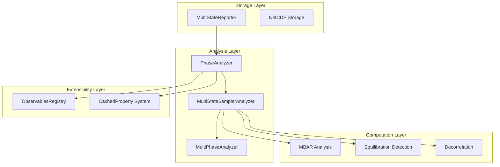
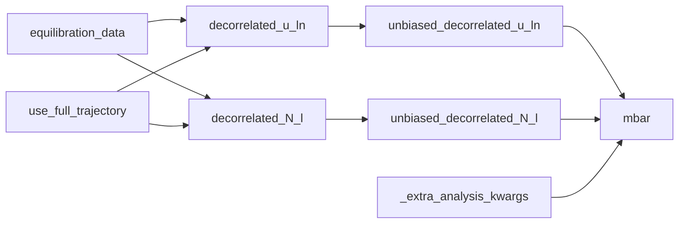
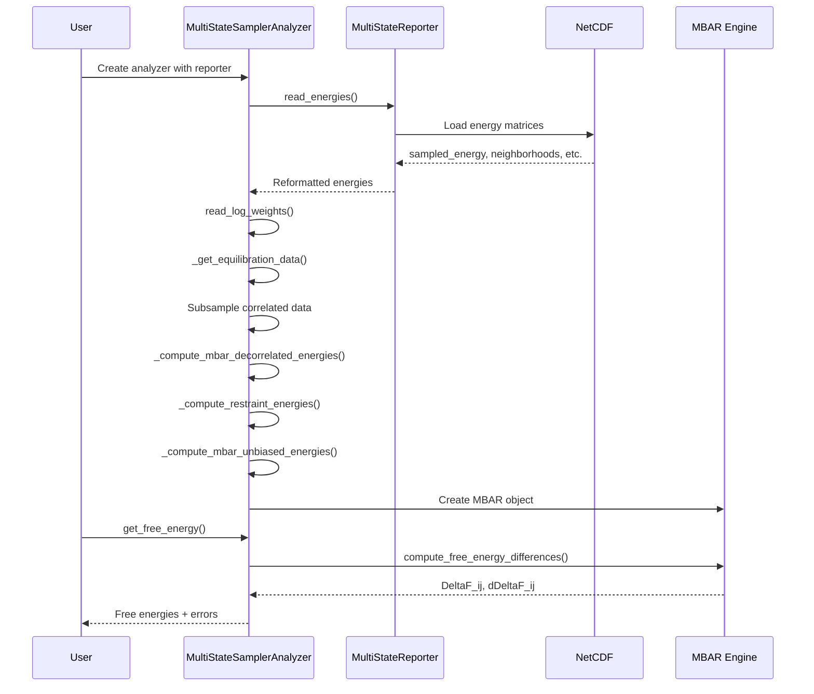

The Multi-State Analysis Framework provides a comprehensive system for analyzing multi-thermodynamic state simulations generated by MultiStateSampler and its subclasses. This framework implements best practices for free energy calculations, including automatic equilibration detection, statistical decorrelation, and support for both online and offline analysis modes. The architecture is designed for extensibility, allowing custom observables and analysis methods to be integrated seamlessly.

Sources: [multistateanalyzer.py](openmmtools/multistate/multistateanalyzer.py#L7-L17)

## Architecture Overview

The analysis framework follows a layered architecture that separates concerns between data access, computation, and observable management. At the foundation lies the MultiStateReporter which handles all disk I/O operations, while the analyzer layer provides the computational logic and the registry system manages extensibility.



## Core Components

### PhaseAnalyzer: The Foundation Class

The `PhaseAnalyzer` is an abstract base class that serves as the foundation for all phase-specific analysis. It manages the connection between simulation data stored by MultiStateReporter and the analysis computations. A "phase" represents a single, self-contained thermodynamic protocol, such as a ligand transformation or alchemical modification.

The analyzer operates primarily in dimensionless units (kT) to simplify calculations, with conversion to physical units available through the `kT` property. Key configuration options include:

- **max_n_iterations**: Limits the number of iterations analyzed (default: all iterations)
- **reference_states**: Tuple of integers `(i, j)` specifying which thermodynamic states serve as reference points for reporting differences (default: `(0, -1)`)
- **use_online_data**: Boolean flag to attempt hot-starting analysis from pre-computed online analysis data (default: `True`)
- **use_full_trajectory**: Forces analysis on the full trajectory without automatic equilibration detection and decorrelation (default: `False`)

Sources: [multistateanalyzer.py](openmmtools/multistate/multistateanalyzer.py#L446-L550)

### MultiStateSamplerAnalyzer: Production Implementation

The `MultiStateSamplerAnalyzer` extends `PhaseAnalyzer` with production-ready functionality for MultiStateSampler simulations. It adds several critical capabilities:

- **Automatic equilibration detection**: Uses statistical methods to identify when the system reaches equilibrium
- **Statistical inefficiency computation**: Calculates the number of iterations between statistically independent samples
- **Restraint unbiasing**: Automatically removes bias from radially-symmetric restraints used in alchemical transformations
- **Mixing statistics**: Computes transition matrices and eigenvalues to analyze replica exchange efficiency

The analyzer processes energy matrices in the shape `(n_replicas, n_states, n_iterations)`, automatically converting from the storage format `(n_iterations, n_replicas, n_states)` during data loading.

Sources: [multistateanalyzer.py](openmmtools/multistate/multistateanalyzer.py#L1137-L1210)

### MultiPhaseAnalyzer: Compositional Analysis

The `MultiPhaseAnalyzer` enables combining multiple phases using mathematical operations (`+`, `-`, `negation`). This is particularly powerful for complex free energy calculations requiring multiple sequential transformations, such as calculating binding free energies through separate complex and receptor phases.

When phases are combined:
- Only observables common to all phases remain available
- Reference states from each phase determine which values contribute to the combined result
- Operations maintain references to original phase objects (shallow copies)
- Error propagation follows rules defined in the ObservablesRegistry (linear or quadrature)

Sources: [multistateanalyzer.py](openmmtools/multistate/multistateanalyzer.py#L2224-L2370)

## Observable Registry System

The ObservablesRegistry provides a declarative system for registering and categorizing computable observables. This system enables automatic discovery of available observables and handles error propagation across phase combinations.

### Observable Categories

| Category | Definition | Example | State Reference |
|----------|------------|---------|-----------------|
| `two_state` | Requires two states to define (typically differences) | Free energy ΔF, Entropy ΔS | Uses both i and j from reference_states |
| `one_state` | Fully defined by a single state | Temperature, Pressure | Uses only i from reference_states |
| `phase` | Defined by the entire phase, state-independent | Standard state correction | No reference states needed |

### Error Propagation Rules

When combining phases, errors propagate according to registered rules:

- **Quadrature (quad)**: For C = A + B, error is `sqrt(eA² + eB²)` (appropriate for statistically independent errors)
- **Linear**: For C = A + B, error is `eA + eB` (conservative upper bound)
- **None**: Observable carries no error

Default registered observables include free energy, entropy, and enthalpy, all using quadrature error propagation.

Sources: [multistateanalyzer.py](openmmtools/multistate/multistateanalyzer.py#L106-L245)

## Caching and Dependency Management

The framework employs a sophisticated `CachedProperty` descriptor system that implements automatic caching with dependency tracking. This ensures efficient recomputation when parameters change while preventing redundant calculations.

### Key Features

- **Dependency tracking**: Each cached property declares its dependencies, forming a directed acyclic graph
- **Automatic invalidation**: When a property changes, all dependent cached values are invalidated
- **Lazy evaluation**: Properties are computed only when first accessed
- **Validators**: Optional validation functions enforce constraints on new values
- **Change detection**: Optional comparison of old and new values before triggering invalidation

### Dependency Graph Example



The MBAR object depends on unbias_restraint, restraint_energy_cutoff, and other parameters. Changes to any dependency trigger recomputation through the graph.

Sources: [multistateanalyzer.py](openmmtools/multistate/multistateanalyzer.py#L366-L445)

## Equilibration and Decorrelation Pipeline

The framework implements best practices for timeseries analysis through an automated pipeline:

1. **Effective Energy Timeseries**: Combines replica energy data into a single diagnostic timeseries
2. **Equilibration Detection**: Identifies the iteration where the system reaches equilibrium using the method that maximizes the number of effective samples
3. **Statistical Inefficiency Computation**: Calculates the correlation time using PyMBAR's algorithms
4. **Subsampling**: Selects decorrelated samples based on the statistical inefficiency

### Equilibration Data Computation

The `_get_equilibration_data()` method implements the core algorithm:

- Optionally uses pre-specified values for `n_equilibration_iterations` and `statistical_inefficiency`
- Otherwise, computes them from the effective energy timeseries
- Respects SAMS two-stage start times if available in online analysis data
- Uses `get_equilibration_data_per_sample()` which analyzes up to `max_subset` points distributed uniformly across the timeseries
- Returns `n_equilibration`, `g_t` (statistical inefficiency), and effective sample count

### Statistical Inefficiency

The statistical inefficiency `g` represents the number of iterations between statistically independent samples. It's computed as `g = 1 + 2τ`, where τ is the correlation time. A value of `g = 1` indicates no correlation, while `g = 10` means every 10th iteration is independent.

Sources: [multistateanalyzer.py](openmmtools/multistate/multistateanalyzer.py#L2026-L2085), [utils.py](openmmtools/multistate/utils.py#L100-L220)

## Data Flow: From Storage to Analysis

The analysis framework follows a structured data flow pipeline:



### Energy Matrix Processing

The energy matrices are stored in a specific format:

- **sampled_energy_matrix**: Shape `(n_iterations, n_replicas, n_states)` - reduced potentials for sampled states
- **unsampled_energy_matrix**: Shape `(n_iterations, n_replicas, n_unsampled_states)` - reduced potentials for unsampled (alchemical) states
- **neighborhoods**: Boolean mask indicating which states each energy was computed for
- **replica_state_indices**: Shape `(n_iterations, n_replicas)` - which state each replica sampled

The analyzer automatically transposes these to `(n_replicas, n_states, n_iterations)` for internal processing, then concatenates decorrelated samples for MBAR input in shape `(n_states + n_unsampled_states, n_decorrelated_samples)`.

Sources: [multistateanalyzer.py](openmmtools/multistate/multistateanalyzer.py#L831-L920)

## Restraint Unbiasing

For alchemical transformations using radially-symmetric restraints, the analyzer provides automatic unbiasing:

### Mechanism

1. **Force Detection**: Locates `RadiallySymmetricRestraintForce` in the bound (end) state
2. **Cutoff Determination**: Computes restraint energy and/or distance distributions in the bound state
3. **Automatic Cutoffs**: When set to 'auto', uses the 99.9-percentile of the distribution
4. **Reweighting**: Applies maximum-likelihood reweighting to remove the restraint bias

### Configuration Options

| Parameter | Type | Description |
|-----------|------|-------------|
| `unbias_restraint` | bool | Enable/disable restraint unbiasing (default: `True`) |
| `restraint_energy_cutoff` | float or 'auto' | Maximum restraint energy in kT to include (default: 'auto') |
| `restraint_distance_cutoff` | Quantity or 'auto' | Maximum restraint distance to include (default: 'auto') |

The unbiasing process discards samples beyond the cutoffs, effectively placing a hard wall at the restraint distance corresponding to the energy cutoff.

> [!TIP]
> Automatic cutoff selection (99.9-percentile) balances bias removal with sample retention. Manual cutoffs should be chosen based on examining the restraint energy/distance distributions in the bound state.

Sources: [multistateanalyzer.py](openmmtools/multistate/multistateanalyzer.py#L1355-L1865)

## Mixing Statistics and Replica Exchange Analysis

The `generate_mixing_statistics()` method provides insights into replica exchange efficiency:

### Computed Metrics

1. **Transition Matrix**: Empirical estimate of state transition probabilities
2. **Eigenvalues**: Decomposition of the transition matrix, with the second eigenvalue (Perron eigenvalue) indicating mixing efficiency
3. **Statistical Inefficiency**: Correlation time for replica state indices

### Interpretation

- **Perron eigenvalue close to 1.0**: Slow mixing, chain may be decomposable
- **Perron eigenvalue significantly less than 1.0**: Good mixing, equilibration timescale is `1/(1-λ₂)`
- **State index statistical inefficiency**: Number of iterations between uncorrelated replica state assignments

The `show_mixing_statistics()` method prints a formatted summary with transition probabilities above a user-specified cutoff (default: 0.05).

Sources: [multistateanalyzer.py](openmmtools/multistate/multistateanalyzer.py#L1243-L1410)

## Online vs Offline Analysis

The framework supports both analysis modes with distinct trade-offs:

### Online Analysis

- **Hot-starting**: Uses pre-computed `logZ` (free energies) and `log_weights` stored during simulation
- **Performance**: Faster initial convergence by starting from previous estimates
- **Storage**: Writes analysis data at intervals controlled by the sampler
- **Trade-off**: Requires storage space and I/O overhead during simulation

### Offline Analysis

- **Fresh computation**: Computes everything from raw energy data
- **Flexibility**: Can re-analyze with different parameters (e.g., different equilibration detection)
- **Storage**: Minimal simulation storage requirements
- **Trade-off**: Slower initial analysis, no convergence history

The `use_online_data` parameter controls whether the analyzer attempts to read online analysis data. Setting it to `False` after initialization triggers cache invalidation and fresh computation.

Sources: [multistateanalyzer.py](openmmtools/multistate/multistateanalyzer.py#L505-L520), [multistatereporter.py](openmmtools/multistate/multistatereporter.py#L1197-L1280)

## Practical Usage Patterns

### Basic Single-Phase Analysis

```python
from openmmtools.multistate import MultiStateReporter, MultiStateSamplerAnalyzer

# Load existing simulation
reporter = MultiStateReporter('simulation.nc', open_mode='r')

# Create analyzer
analyzer = MultiStateSamplerAnalyzer(reporter, 
                                     name='complex_phase',
                                     max_n_iterations=1000)

# Compute free energies
DeltaF_ij, dDeltaF_ij = analyzer.get_free_energy()

# Access analysis diagnostics
print(f"Equilibration iterations: {analyzer.n_equilibration_iterations}")
print(f"Statistical inefficiency: {analyzer.statistical_inefficiency}")
print(f"Effective samples: {analyzer.effective_length}")
```

### Multi-Phase Binding Free Energy Calculation

```python
# Load two phases
complex_analyzer = MultiStateSamplerAnalyzer(complex_reporter, 
                                             name='complex',
                                             reference_states=(0, -1))
receptor_analyzer = MultiStateSamplerAnalyzer(receptor_reporter,
                                              name='receptor',
                                              reference_states=(0, -1))

# Combine phases (complex - receptor)
binding_analyzer = complex_analyzer - receptor_analyzer

# Compute binding free energy
binding_DeltaF, binding_error = binding_analyzer.get_free_energy()
```

### Custom Equilibration Control

```python
# Override automatic detection
analyzer = MultiStateSamplerAnalyzer(
    reporter,
    n_equilibration_iterations=500,  # Discard first 500 iterations
    statistical_inefficiency=10.0,   # Sample every 10th iteration
)

# Or force full trajectory analysis
analyzer.use_full_trajectory = True  # Disable equilibration/decorrelation
```

Sources: [multistateanalyzer.py](openmmtools/multistate/multistateanalyzer.py#L1958-L2008)

## Common Observables

### Thermodynamic Observables

| Observable | Method | Description | Error Type |
|------------|--------|-------------|------------|
| Free Energy | `get_free_energy()` | ΔF between all state pairs | quadrature |
| Enthalpy | `get_enthalpy()` | ΔH between all state pairs | quadrature |
| Entropy | `get_entropy()` | ΔS between all state pairs | quadrature |

### Computed Properties

| Property | Access Method | Description |
|----------|---------------|-------------|
| `n_equilibration_iterations` | `analyzer.n_equilibration_iterations` | Number of discarded iterations |
| `statistical_inefficiency` | `analyzer.statistical_inefficiency` | Decorrelation interval |
| `effective_length` | `analyzer.effective_length` | Number of uncorrelated samples |
| `mbar` | `analyzer.mbar` | Direct access to MBAR object |

Sources: [multistateanalyzer.py](openmmtools/multistate/multistateanalyzer.py#L1919-L2008)

## Performance Considerations

### Computational Bottlenecks

1. **Energy Matrix Loading**: Reading large NetCDF files can be slow; consider `max_n_iterations` for testing
2. **Equilibration Detection**: Analyzes multiple points in the timeseries; `max_subset` parameter controls this
3. **MBAR Initialization**: Iterative convergence; hot-starting with online data significantly speeds this up
4. **Caching**: All intermediate results are cached; modifying parameters triggers selective recomputation

### Memory Management

- Energy matrices are loaded into memory as NumPy arrays
- Decorrelated samples are concatenated, requiring memory proportional to `n_states × n_decorrelated_samples`
- For very large simulations, consider analyzing in segments or using `max_n_iterations`

> [!TIP]
> For development and testing, use `max_n_iterations` to limit the data volume. Set `use_online_data=False` and `use_full_trajectory=False` to enable automatic equilibration detection without requiring pre-computed online analysis.

## Error Handling

### Common Exceptions

| Exception | Cause | Resolution |
|-----------|-------|------------|
| `InsufficientData` | Not enough decorrelated samples | Run longer simulation or adjust parameters |
| `ValueError` | Incompatible ObservablesRegistry | Ensure all phases use same registry instance |
| `TypeError` | Restraint configuration error | Check that `lambda_restraints=1` in bound state |
| `forces.NoForceFoundError` | Missing restraint force | Ensure restraint was properly configured |

Sources: [multistateanalyzer.py](openmmtools/multistate/multistateanalyzer.py#L357-L365)

## Integration with Samplers

The analysis framework is designed to work seamlessly with the samplers described in [Online and Offline Free Energy Analysis](19-online-and-offline-free-energy-analysis). Samplers automatically write the data structures required by the analyzers:

- Energy matrices at each iteration
- Replica thermodynamic state assignments
- Thermodynamic state definitions
- Online analysis data (if enabled)
- MCMC move definitions

The MultiStateReporter serves as the bridge, storing data in a format that analyzers can reconstruct the complete simulation state.
