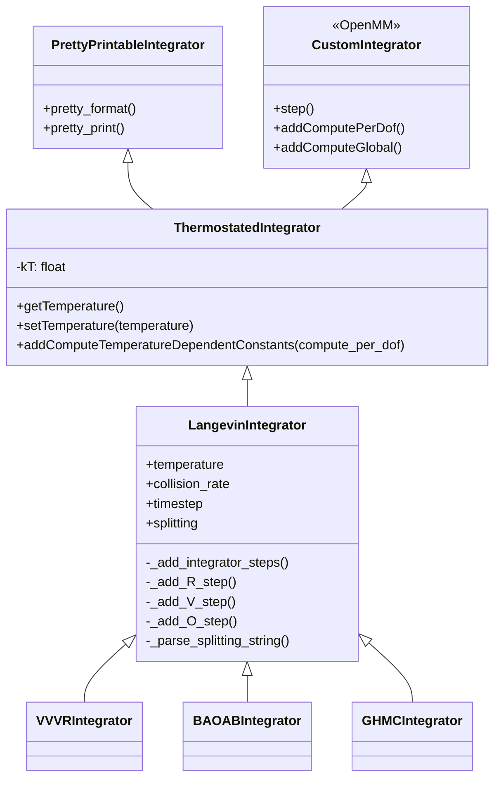

This guide provides advanced developers with the architectural patterns, implementation strategies, and practical techniques for creating custom integrators in openmmtools. The framework extends OpenMM's CustomIntegrator with sophisticated features including operator splitting, Metropolization, temperature control, and alchemical nonequilibrium switching.

## Integrator Architecture and Class Hierarchy

The openmmtools integrator framework provides a layered architecture that enables rapid development of sophisticated integration schemes. At its foundation, the framework provides two critical mix-in classes that endow integrators with essential capabilities.

**PrettyPrintableIntegrator** provides human-readable introspection of integrator step programs, enabling debugging and verification of complex integration schemes. This mix-in formats each computation step with readable descriptions, showing target variables and expressions in a structured format that reveals the integration algorithm's structure.

**ThermostatedIntegrator** serves as the primary base class for integrators that maintain stationary distributions at a specified temperature. This class automatically manages thermal energy (`kT`), provides temperature getters/setters, and handles temperature-dependent constants through an efficient update mechanism. The class adds a global variable `kT` defining thermal energy and wraps per-DOF constants in conditional blocks that execute only when temperature changes, optimizing performance for thermodynamic simulations.

Sources: [openmmtools/integrators.py](openmmtools/integrators.py#L59-L125), [openmmtools/integrators.py](openmmtools/integrators.py#L125-L320)



## The Splitting Language for Operator Composition

The framework provides a sophisticated string-based language for composing integration operators. This splitting language enables declarative specification of complex integration schemes through sequences of fundamental operators.

The fundamental operators in the splitting alphabet are:

- **R (Position update):** Deterministic drift step that updates positions using current velocities: `x ← x + v·dt`. When constraints are present, the step includes position and velocity corrections to maintain constraints.
- **V (Velocity kick):** Deterministic velocity update using forces: `v ← v + (f/m)·dt`. Forces are evaluated only during V-steps, making this the natural place for force group specifications.
- **O (Ornstein-Uhlenbeck):** Stochastic velocity update simulating interaction with a heat bath: `v ← a·v + b·σ·R`, where `a = exp(-γ·dt)`, `b = sqrt(1 - exp(-2γ·dt))`, and R represents Gaussian random numbers.
- **{ and } (Metropolization):** Delimiters marking a Metropolis correction block. Shadow work is accumulated within this block, and the final state is accepted or rejected based on the Metropolis criterion `accept ∝ exp(-shadow_work/kT)`.

For multiple-timestep (MTS) integration, force groups can be specified by appending indices to V-steps: "V0", "V1", etc. This enables evaluating fast-varying forces more frequently than slow-varying forces, a critical optimization for complex molecular systems.

Sources: [openmmtools/integrators.py](openmmtools/integrators.py#L1072-L1175), [openmmtools/integrators.py](openmmtools.py#L1310-L1320)

> [!TIP]
> When designing custom splitting schemes, remember that shadow work must be accumulated inside the Metropolization block for proper sampling. The framework includes validation to ensure R and V steps are properly contained within { } markers when Metropolization is enabled.

| Splitting Pattern | Description | Typical Use Cases |
|-------------------|-------------|------------------|
| "V R O R V" | Velocity Verlet with Ornstein-Uhlenbeck at end | General purpose Langevin dynamics |
| "V R H R V" | Velocity Verlet with Hamiltonian update | Hamiltonian Monte Carlo variants |
| "O { V R V } O" | Ornstein-Uhlenbeck with Metropolized inner steps | Generalized Hybrid Monte Carlo (GHMC) |
| "V R O V R O" | Symmetric Langevin splitting | Geodesic integrators |
| "O V R H R V O" | Full Langevin with Metropolization | Alchemical nonequilibrium switching |

## Creating a Custom Langevin-Based Integrator

The most common approach for custom integrator development is to extend `LangevinIntegrator`. This base class provides a complete implementation of the splitting language, shadow work measurement, and Metropolization support.

The core workflow involves overriding the `_add_integrator_steps()` method to customize the integration sequence. The base implementation adds context state updates, computes temperature-dependent constants, then iterates through the splitting string executing each substep via the dispatch table.

**Step Addition Methods:** The framework provides protected methods for adding specific step types:
- `_add_R_step()`: Adds position updates with constraint handling. Includes shadow work accumulation if `measure_shadow_work` is enabled.
- `_add_V_step(force_group)`: Adds velocity updates using specified force group. The optional `force_group` parameter enables MTS integration.
- `_add_O_step()`: Adds stochastic velocity updates with heat accumulation if `measure_heat` is enabled.
- `_add_metropolize_start()` and `_add_metropolize_finish()`: Bookend a Metropolis correction block, saving state and applying acceptance/rejection logic.

Sources: [openmmtools/integrators.py](openmmtools/integrators.py#L1310-L1420), [openmmtools/integrators.py](openmmtools/integrators.py#L1405-L1560)

### Example: Implementing a Custom Splitting

Creating a custom integrator requires specifying the splitting scheme and optionally customizing global variable initialization. The following example demonstrates creating a modified Langevin integrator with a specific splitting:

```python
from openmmtools import integrators
from openmm import unit

class CustomLangevinIntegrator(integrators.LangevinIntegrator):
    """A Langevin integrator with custom splitting."""
    
    def __init__(self, temperature=298.0*unit.kelvin, 
                 collision_rate=1.0/unit.picoseconds,
                 timestep=1.0*unit.femtoseconds):
        # Specify the splitting: Ornstein-Uhlenbeck followed by 
        # two V-R pairs, then Metropolization, then final V-R
        super().__init__(
            temperature=temperature,
            collision_rate=collision_rate,
            timestep=timestep,
            splitting="O V R V R { V R } V R",
            measure_shadow_work=True,  # Enable for Metropolization
            measure_heat=False
        )
```

The `LangevinIntegrator` constructor validates the splitting string, computes necessary constants (velocity mixing parameters `a` and `b`), and initializes global variables including shadow work and heat accumulators if enabled. The `splitting` parameter defines the exact sequence of operations executed each timestep.

Sources: [openmmtools/integrators.py](openmmtools/integrators.py#L1072-L1175)

### Advanced Customization: Pre- and Post-Processing

For more sophisticated integrators, override `_add_integrator_steps()` to insert custom logic before or after the main integration. This pattern is essential for algorithms that require initialization or cleanup phases.

```python
class AdvancedCustomIntegrator(integrators.LangevinIntegrator):
    """Custom integrator with pre- and post-processing."""
    
    def __init__(self, *args, **kwargs):
        super().__init__(*args, **kwargs)
        # Add custom global variables
        self.addGlobalVariable("custom_counter", 0)
        self.addGlobalVariable("custom_accumulator", 0.0)
    
    def _add_integrator_steps(self):
        """Override to add custom pre- and post-processing."""
        
        # Custom pre-processing
        self.addComputeGlobal("custom_counter", "custom_counter + 1")
        
        # Call parent implementation for standard integration
        super()._add_integrator_steps()
        
        # Custom post-processing
        self.addComputeGlobal("custom_accumulator", 
                             "custom_accumulator + energy")
```

Sources: [openmmtools/integrators.py](openmmtools/integrators.py#L1310-L1320)

## Implementing Nonequilibrium Switching Integrators

For free energy calculations and alchemical transformations, the framework provides `NonequilibriumLangevinIntegrator` and `AlchemicalNonequilibriumLangevinIntegrator`. These extend `LangevinIntegrator` with protocol work tracking and alchemical parameter management.

**Protocol Work Accumulation:** The nonequilibrium framework introduces a new operator "H" (Hamiltonian update) that modifies alchemical parameters and accumulates protocol work. The protocol work tracks the work done by changing system parameters, distinct from shadow work generated by the numerical integration.

**Alchemical Functions:** The `AlchemicalNonequilibriumLangevinIntegrator` accepts a dictionary mapping context parameter names to Lepton-compatible expressions depending on the variable `lambda`. During the switching protocol, `lambda` progresses from 0 to 1 over `nsteps_neq` steps, and the associated alchemical functions update context parameters accordingly.

Sources: [openmmtools/integrators.py](openmmtools/integrators.py#L1560-L1655), [openmmtools/integrators.py](openmmtools/integrators.py#L1655-L1750)

### Example: Nonequilibrium Alchemical Integrator

```python
from openmmtools import integrators, testsystems
import openmm
from openmm import unit

# Create a testsystem
testsystem = testsystems.HarmonicOscillator()

# Define alchemical functions
alchemical_functions = {
    'testsystems_HarmonicOscillator_x0': 'lambda'
}

# Create integrator with alchemical switching
integrator = integrators.AlchemicalNonequilibriumLangevinIntegrator(
    temperature=300*unit.kelvin,
    collision_rate=1.0/unit.picoseconds,
    timestep=1.0*unit.femtoseconds,
    alchemical_functions=alchemical_functions,
    splitting="O { V R H R V } O",
    nsteps_neq=100,
    measure_shadow_work=True
)

# Run switching simulation
context = openmm.Context(testsystem.system, integrator)
context.setPositions(testsystem.positions)
integrator.step(100)

protocol_work = integrator.protocol_work  # Work from parameter changes
total_work = integrator.total_work  # protocol_work + shadow_work
```

Sources: [openmmtools/integrators.py](openmmtools/integrators.py#L1838-L1920)

## Specialized Integrator Implementations

The framework includes several specialized integrator implementations that demonstrate advanced patterns:

**HMCIntegrator** implements standard Hybrid Monte Carlo with explicit velocity resampling, symplectic integration via velocity Verlet, and Metropolis acceptance. The integrator uses a loop to perform multiple integration steps before the Metropolis correction, demonstrating how to structure multi-step algorithms within the CustomIntegrator framework.

**GHMCIntegrator** provides a generalized Hybrid Monte Carlo scheme implemented as a Langevin integrator with Metropolization: `splitting="O { V R V } O"`. This demonstrates the compactness achievable with the splitting language for complex algorithms.

**VVVRIntegrator**, **BAOABIntegrator**, and **GeodesicBAOABIntegrator** demonstrate the ease of implementing specific splitting schemes. Each is simply a subclass of `LangevinIntegrator` that passes a specific `splitting` parameter to the constructor.

Sources: [openmmtools/integrators.py](openmmtools/integrators.py#L886-L1015), [openmmtools/integrators.py](openmmtools/integrators.py#L2243-L2290)

## Debugging and Validation Strategies

Effective debugging of custom integrators requires understanding the internal state and verifying correct implementation:

**Pretty Printing:** Use `pretty_print()` to examine the generated step program. This reveals the exact sequence of operations added to the integrator, helping identify issues with step ordering or missing operations.

**Statistics Tracking:** For Metropolized integrators, track acceptance rates via the `acceptance_rate` property. Low acceptance rates may indicate issues with the splitting scheme or parameter choices.

**Shadow Work Analysis:** Enable `measure_shadow_work=True` to examine the work generated by numerical integration. Large shadow work values can indicate numerical instabilities or inappropriate timesteps.

**Temperature Conservation:** For equilibrium integrators, verify temperature conservation over extended simulations. The `ThermostatedIntegrator` base class provides `getTemperature()` for monitoring.

Sources: [openmmtools/integrators.py](openmmtools/integrators.py#L59-L125), [openmmtools/integrators.py](openmmtools/integrators.py#L1287-L1310)

### Example: Diagnostic Workflow

```python
import numpy as np

def validate_integrator(integrator_class, testsystem, nsteps=1000):
    """Validate an integrator's stability and acceptance rate."""
    
    # Create context
    integrator = integrator_class()
    context = openmm.Context(testsystem.system, integrator)
    context.setPositions(testsystem.positions)
    context.setVelocitiesToTemperature(298.0*unit.kelvin)
    
    # Track statistics
    energies = []
    temperatures = []
    
    for _ in range(100):
        integrator.step(nsteps)
        state = context.getState(getEnergy=True, getPositions=True)
        energies.append(state.getPotentialEnergy().value_in_unit(unit.kilojoules_per_mole))
    
    # Analyze results
    energy_std = np.std(energies)
    
    # Check acceptance rate if available
    if hasattr(integrator, 'acceptance_rate'):
        acceptance = integrator.acceptance_rate
        print(f"Acceptance rate: {acceptance:.3f}")
    
    print(f"Energy std: {energy_std:.3f} kJ/mol")
    
    # Pretty print integrator for inspection
    if hasattr(integrator, 'pretty_print'):
        integrator.pretty_print()
```

Sources: [openmmtools/tests/test_integrators.py](openmmtools/tests/test_integrators.py#L145-L245)

## Advanced Topics and Considerations

**Multiple Timestep Integration:** The framework supports MTS through force group indexing in the splitting string. Specify force groups for each V-step: `splitting="O V0 R V1 R V0 O"` evaluates force group 0 twice and force group 1 once per timestep. This requires setting force groups in the system definition using `Force.setForceGroup()`.

**Constraint Handling:** The framework automatically handles constraints by including constraint steps within R and V operations. Position and velocity constraints are applied after position updates, ensuring the system remains on the constraint manifold.

**Temperature-Dependent Constants:** The `addComputeTemperatureDependentConstants()` method wraps per-DOF computations in conditional blocks that execute only when the temperature changes, optimizing performance. This is particularly useful for quantities like velocity standard deviations that depend on `kT`.

**Serialization Recovery:** CustomIntegrators lose their Python methods when serialized (e.g., through XML serialization). The `ThermostatedIntegrator.restore_interface()` static method can restore the original interface, but custom integrators must implement similar recovery mechanisms if they rely on Python methods.

Sources: [openmmtools/integrators.py](openmmtools/integrators.py#L236-L245), [openmmtools/integrators.py](openmmtools/integrators.py#L1475-L1540)

## Performance Optimization Strategies

**Minimize Conditional Logic:** While conditional blocks (via `beginIfBlock()`) are powerful, they add computational overhead. Use them sparingly and prefer unconditional computations when possible.

**Efficient Force Grouping:** When using MTS, organize force groups to balance computational cost. Place fast, cheap forces in frequently evaluated groups and expensive forces in infrequently evaluated groups.

**Shadow Work Measurement:** Enable `measure_shadow_work` only when needed for Metropolization or analysis. The additional energy evaluations add computational cost.

**Temperature Updates:** Use `addComputeTemperatureDependentConstants()` for temperature-dependent quantities rather than recomputing them every timestep. The conditional block mechanism ensures these quantities are only updated when temperature actually changes.

> [!TIP]
> When optimizing performance, profile your integrator using OpenMM's platform tools. The overhead from Python-based integrator construction is incurred once at initialization, but the actual step execution runs on the compute platform (CPU/GPU) with high efficiency.

## Integration with MCMC Moves

Custom integrators can be seamlessly integrated with the MCMC framework through the `LangevinDynamicsMove` and related classes. This enables constructing sophisticated sampling schemes that combine dynamics-based moves with other Monte Carlo proposals.

The MCMC framework uses integrators as proposal generators, with acceptance/rejection handled either internally (for Metropolized integrators) or externally (for non-Metropolized integrators). This modular design allows mixing different integrators and move types in composite samplers.

Sources: [openmmtools/mcmc.py](openmmtools/mcmc.py), [Langevin Integrators and Splitting Schemes](7-langevin-integrators-and-splitting-schemes)

## Summary and Best Practices

Developing custom integrators in openmmtools follows these key principles:

1. **Choose Appropriate Base Class:** Extend `LangevinIntegrator` for most Langevin-based schemes, `ThermostatedIntegrator` for equilibrium integrators, or `NonequilibriumLangevinIntegrator` for nonequilibrium switching.

2. **Leverage the Splitting Language:** Use the declarative splitting string to define integration schemes rather than manually adding individual steps whenever possible.

3. **Validate Rigorously:** Test stability, energy conservation, and acceptance rates using test systems before deploying to production simulations.

4. **Document Custom Schemes:** Provide clear documentation of custom splitting schemes, including theoretical justification and parameter recommendations.

5. **Consider Performance:** Use force groups efficiently, minimize conditional logic, and enable measurement features only when needed.

The framework's power lies in its ability to express complex integration schemes concisely while maintaining efficiency and correctness. By understanding the splitting language, step addition methods, and base class patterns, developers can create sophisticated integrators for specialized simulation needs.

For further exploration of specific integrator implementations, examine the source code of existing integrators in `openmmtools/integrators.py`, particularly `LangevinIntegrator` for the complete base implementation and `GHMCIntegrator`, `BAOABIntegrator` for concise examples of specialized schemes.
