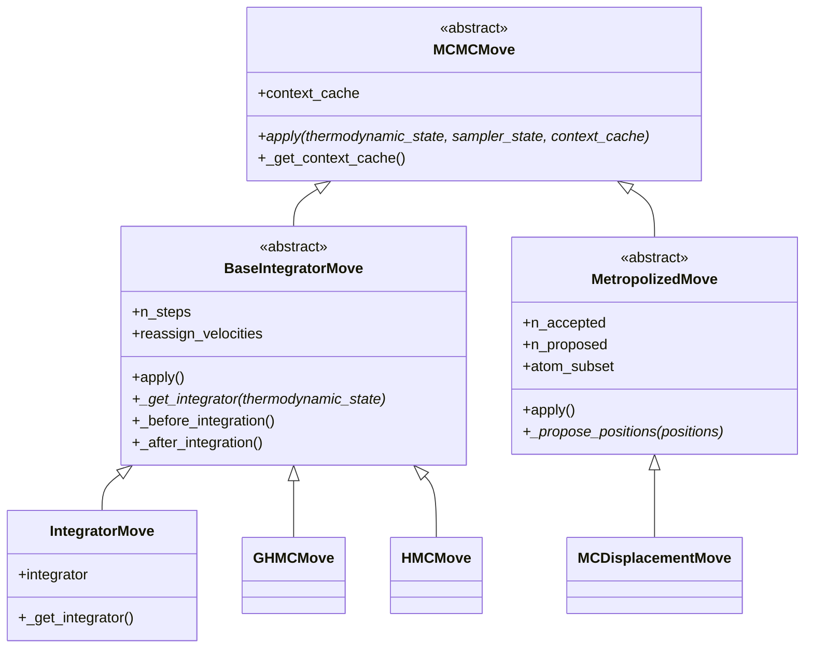

This guide provides a comprehensive framework for implementing custom Markov Chain Monte Carlo (MCMC) moves in the openmmtools framework. You'll learn to extend the move abstraction through two primary inheritance paths: dynamics-based moves using OpenMM integrators, and metropolized moves that implement custom proposal mechanisms with Metropolis acceptance criteria.

## MCMC Move Architecture

The MCMC framework is built around a clean hierarchy of abstractions that enable flexible move composition and efficient simulation. At the foundation lies the `MCMCMove` abstract base class, which defines the contract all moves must implement. This design allows moves to be combined through composition classes like `SequenceMove` and `WeightedMove`, enabling sophisticated sampling strategies.



### The MCMCMove Contract

The `MCMCMove` abstract base class establishes the fundamental interface. Every custom move must implement the `apply` method, which receives a `ThermodynamicState` (defining the system's thermodynamic parameters) and a `SamplerState` (holding particle positions, velocities, and box dimensions). The optional `context_cache` parameter enables efficient reuse of OpenMM Context objects across moves [openmmtools/mcmc.py#L143-L215].

Sources: [mcmc.py](openmmtools/mcmc.py#L143-L215)

## Dynamics-Based Moves

Dynamics-based moves leverage OpenMM's integrators to propagate system dynamics. These moves inherit from `BaseIntegratorMove`, which provides a robust framework for handling Context creation, integration, and error recovery.

### BaseIntegratorMove Framework

`BaseIntegratorMove` implements the complete workflow for integrator-based moves: Context retrieval via caching, velocity reassignment (optional), execution of `_before_integration` hooks, integration step execution, NaN detection with automatic restart attempts, execution of `_after_integration` hooks, and final SamplerState updates [openmmtools/mcmc.py#L603-L795].

> [!TIP]
> The framework includes automatic restart logic (configurable via `n_restart_attempts`) that handles NaN energies by reinitializing Context objects, preventing simulation crashes from numerical instabilities.

Sources: [mcmc.py](openmmtools/mcmc.py#L603-L795)

### Creating a Custom Integrator Move

Here's a complete example of creating a custom integrator move:

```python
from openmm import unit
from openmmtools.mcmc import BaseIntegratorMove
from openmmtools import integrators

class CustomDynamicsMove(BaseIntegratorMove):
    """A custom dynamics move using a custom integrator."""
    
    def __init__(self, timestep, n_steps, collision_rate=10.0/unit.picoseconds, **kwargs):
        super(CustomDynamicsMove, self).__init__(n_steps=n_steps, **kwargs)
        self.timestep = timestep
        self.collision_rate = collision_rate
    
    def _get_integrator(self, thermodynamic_state):
        """Return a new integrator instance for the move."""
        return integrators.LangevinIntegrator(
            temperature=thermodynamic_state.temperature,
            collision_rate=self.collision_rate,
            timestep=self.timestep
        )
    
    def _before_integration(self, context, thermodynamic_state):
        """Custom hook executed before integration."""
        # Custom pre-integration logic here
        pass
    
    def _after_integration(self, context, thermodynamic_state):
        """Custom hook executed after integration."""
        # Read statistics or modify state post-integration
        state = context.getState(getEnergy=True)
        print(f"Potential energy: {state.getPotentialEnergy()}")
```

The `IntegratorMove` adapter class provides a simpler alternative when you want to wrap any existing OpenMM integrator without subclassing:

```python
from openmm import VerletIntegrator
from openmmtools.mcmc import IntegratorMove

# Create a move from any OpenMM integrator
verlet_integrator = VerletIntegrator(1.0*unit.femtosecond)
verlet_move = IntegratorMove(integrator=verlet_integrator, n_steps=1000)
```

Sources: [mcmc.py](openmmtools/mcmc.py#L977-L1023)

## Metropolized Moves

Metropolized moves implement the Metropolis-Hastings algorithm, where proposals are generated through `_propose_positions` and accepted or rejected based on energy differences. This approach is ideal for moves that don't require full integration, such as random displacements or rotations.

### MetropolizedMove Framework

`MetropolizedMove` handles the complete Metropolis algorithm: computing initial reduced potential, generating proposals via `_propose_positions`, computing proposed energy, applying Metropolis acceptance criterion, and maintaining acceptance statistics [openmmtools/mcmc.py#L810-L976].

> [!TIP]
> The framework automatically handles partial system moves through the `atom_subset` parameter, enabling moves that affect only selected atoms (e.g., solvent moves, side-chain rotations).

Sources: [mcmc.py](openmmtools/mcmc.py#L810-L976)

### Creating a Custom Metropolized Move

Example: Implementing a biased displacement move:

```python
import numpy as np
from openmm import unit
from openmmtools.mcmc import MetropolizedMove

class BiasedDisplacementMove(MetropolizedMove):
    """A move with direction-biased displacements."""
    
    def __init__(self, bias_direction, displacement_sigma=0.1*unit.nanometer, **kwargs):
        super(BiasedDisplacementMove, self).__init__(**kwargs)
        self.bias_direction = np.array(bias_direction) / np.linalg.norm(bias_direction)
        self.displacement_sigma = displacement_sigma
    
    def _propose_positions(self, positions):
        """Generate biased random displacements."""
        # Create random displacement with bias
        random_step = np.random.randn(len(positions), 3)
        biased_step = random_step + 0.5 * self.bias_direction
        
        # Scale and apply
        positions_unit = positions.unit
        unitless_sigma = self.displacement_sigma / positions_unit
        displacement = unit.Quantity(biased_step * unitless_sigma, positions_unit)
        
        return positions + displacement

# Usage
move = BiasedDisplacementMove(
    bias_direction=[1.0, 0.0, 0.0],  # Bias along x-axis
    displacement_sigma=0.05*unit.nanometer,
    atom_subset=list(range(10))  # Apply to first 10 atoms
)
```

Sources: [mcmc.py](openmmtools/mcmc.py#L1704-L1777)

## Advanced Move Composition

The framework provides powerful composition mechanisms for building complex sampling strategies.

### SequenceMove Composition

`SequenceMove` executes a series of moves in order, allowing you to chain different move types:

```python
from openmmtools.mcmc import SequenceMove, GHMCMove, LangevinDynamicsMove, MonteCarloBarostatMove

# Create a production cycle: equilibration dynamics -> production dynamics -> barostat
production_cycle = SequenceMove([
    LangevinDynamicsMove(timestep=1.0*unit.femtosecond, n_steps=100),  # Equilibration
    GHMCMove(timestep=2.0*unit.femtosecond, n_steps=500, collision_rate=5.0/unit.picoseconds),  # Production
    MonteCarloBarostatMove(n_attempts=5)  # Volume sampling
])
```

Sources: [mcmc.py](openmmtools/mcmc.py#L350-L438)

### WeightedMove Composition

`WeightedMove` randomly selects moves with specified probabilities:

```python
from openmmtools.mcmc import WeightedMove, HMCMove, MCDisplacementMove

# Mixed sampling: 70% HMC, 30% displacement moves
mixed_sampler = WeightedMove([
    (HMCMove(timestep=1.5*unit.femtosecond, n_steps=1000), 0.7),
    (MCDisplacementMove(displacement_sigma=0.1*unit.nanometer), 0.3)
])
```

Sources: [mcmc.py](openmmtools/mcmc.py#L439-L537)

## Context Cache Management

Efficient Context management is critical for performance. The framework provides a global `ContextCache` that minimizes Context creation overhead by caching Context objects keyed by `ThermodynamicState` and integrator configuration [openmmtools/cache.py#L214-L464].

```python
from openmmtools import cache

# Configure global cache
cache.global_context_cache.platform = openmm.Platform.getPlatformByName('CUDA')
cache.global_context_cache.capacity = 10
cache.global_context_cache.time_to_live = 50

# Or use local caches for specific moves
local_cache = cache.ContextCache(capacity=5, time_to_live=20)
custom_move.apply(thermodynamic_state, sampler_state, context_cache=local_cache)

# Disable caching for debugging
dummy_cache = cache.DummyContextCache(platform=openmm.Platform.getPlatformByName('Reference'))
```

Sources: [cache.py](openmmtools/cache.py#L214-L464), [mcmc.py](openmmtools/mcmc.py#L178-L184)

## Statistics and Monitoring

Both `BaseIntegratorMove` and `MetropolizedMove` provide mechanisms for tracking move statistics:

```python
# Access statistics
print(f"Acceptance rate: {move.n_accepted / move.n_proposed}")

# Reset statistics for new sampling phase
move.reset_statistics()

# Access nested move statistics in composite moves
for i, sub_move in enumerate(sequence_move):
    stats = sub_move.statistics
    print(f"Move {i}: {stats}")
```

Sources: [mcmc.py](openmmtools/mcmc.py#L862-L869)

## Best Practices and Common Patterns

### Error Handling

Implement robust error handling in your custom moves:

```python
class RobustCustomMove(BaseIntegratorMove):
    def apply(self, thermodynamic_state, sampler_state, context_cache=None):
        try:
            super(RobustCustomMove, self).apply(
                thermodynamic_state, sampler_state, context_cache
            )
        except Exception as e:
            logger.warning(f"Move failed: {e}, attempting recovery...")
            # Implement recovery logic or allow parent retry mechanism
            raise
```

### Move Comparison

| Aspect | BaseIntegratorMove | MetropolizedMove |
|--------|-------------------|------------------|
| **Use Case** | Dynamics-based sampling | Custom proposal moves |
| **Energy Evaluation** | Automatic during integration | Manual pre/post proposal |
| **Acceptance** | Implicit (GHMC) or explicit (HMC) | Explicit Metropolis criterion |
| **Performance** | Higher computational cost | Lower computational cost |
| **Complexity** | Higher (integrator management) | Lower (proposal logic only) |
| **Examples** | GHMC, HMC, Langevin | Displacement, Rotation |

Sources: [mcmc.py](openmmtools/mcmc.py#L603-L795), [mcmc.py](openmmtools/mcmc.py#L810-L976)

### Serialization

Custom moves must implement proper serialization for checkpointing:

```python
class SerializableCustomMove(BaseIntegratorMove):
    def __init__(self, custom_param, **kwargs):
        super(SerializableCustomMove, self).__init__(**kwargs)
        self.custom_param = custom_param
    
    def __getstate__(self):
        serialization = super(SerializableCustomMove, self).__getstate__()
        serialization['custom_param'] = self.custom_param
        return serialization
    
    def __setstate__(self, serialization):
        super(SerializableCustomMove, self).__setstate__(serialization)
        self.custom_param = serialization['custom_param']
```

## Testing Your Custom Moves

Validate your custom moves using the testing framework:

```python
import pytest
from openmmtools import testsystems, states
from openmmtools.mcmc import MCMCSampler

def test_custom_move():
    # Create test system
    test = testsystems.AlanineDipeptideVacuum()
    sampler_state = states.SamplerState(test.positions)
    thermodynamic_state = states.ThermodynamicState(
        test.system, temperature=298*unit.kelvin
    )
    
    # Test move
    move = CustomMove(n_steps=100)
    sampler = MCMCSampler(thermodynamic_state, sampler_state, move=move)
    
    # Run sampling
    initial_positions = sampler_state.positions.copy()
    sampler.run(n_iterations=10)
    
    # Verify positions changed
    assert not np.allclose(sampler_state.positions, initial_positions)
    
    # Verify no NaNs
    assert not sampler_state.has_nan()
```

Sources: [test_mcmc.py](openmmtools/tests/test_mcmc.py#L1-L150)

## Integration with Enhanced Sampling

Custom moves integrate seamlessly with enhanced sampling methods like replica exchange:

```python
from openmmtools.multistate import ReplicaExchangeSampler

# Use custom moves in replica exchange
move = SequenceMove([
    CustomMove(timestep=1.0*unit.femtosecond, n_steps=100),
    MCDisplacementMove(displacement_sigma=0.05*unit.nanometer)
])

# Create temperature protocol
temperatures = [300, 320, 340, 360, 380] * unit.kelvin
protocol = {'temperature': temperatures}
states = states.create_thermodynamic_state_protocol(test.system, protocol)

# Run replica exchange
replica_sampler = ReplicaExchangeSampler(mcmc_move=move, number_of_iterations=1000)
replica_sampler.run()
```

## Next Steps

Now that you understand custom MCMC move creation, explore these related topics:

- **[MCMC Move Abstraction and Base Classes](12-mcmc-move-abstraction-and-base-classes)** - Deeper dive into move architecture
- **[Dynamics-Based Moves (Langevin, HMC, GHMC)](13-dynamics-based-moves-langevin-hmc-ghmc)** - Built-in dynamics move implementations
- **[Composing MCMC Moves (SequenceMove, WeightedMove)](14-composing-mcmc-moves-sequencemove-weightedmove)** - Advanced composition patterns
- **[Metropolized Monte Carlo Moves](15-metropolized-monte-carlo-moves)** - Built-in metropolized move examples
- **[Context Caching Architecture](6-context-caching-architecture)** - Optimizing Context management for performance
