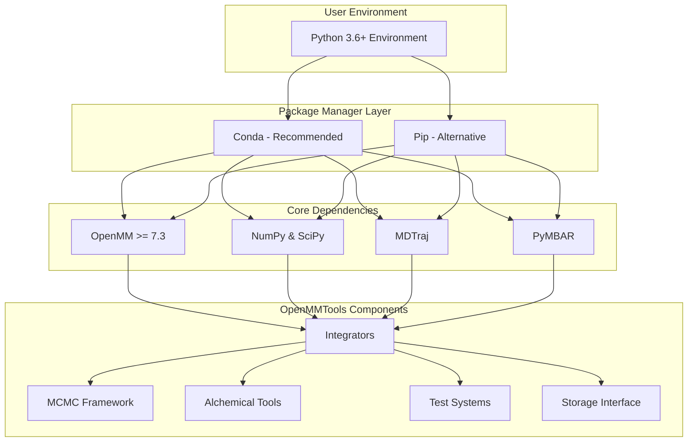
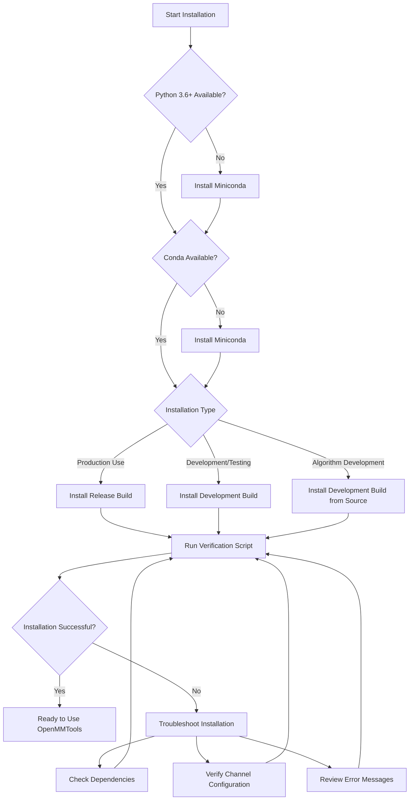

This guide provides comprehensive installation instructions for OpenMMTools, a Python library layer that extends the GPU-accelerated OpenMM molecular simulation engine with advanced tools for molecular dynamics simulations, enhanced sampling methods, and alchemical free energy calculations. We'll cover multiple installation approaches tailored to different use cases and experience levels.

## Installation Architecture Overview

OpenMMTools operates as a comprehensive Python toolkit that builds upon the OpenMM molecular simulation engine. Understanding the installation architecture helps you make informed decisions about which installation method best suits your needs.



The installation architecture demonstrates that OpenMMTools requires a carefully orchestrated set of dependencies. The recommended path uses Conda as the package manager, which automatically handles complex dependencies like OpenMM that can be challenging to install manually. OpenMMTools then leverages these core dependencies to provide its comprehensive suite of molecular simulation tools.

Sources: [setup.py](/setup.py#L1-L81), [docs/environment.yml](/docs/environment.yml#L1-L20)


## Installation Methods Comparison

OpenMMTools offers multiple installation approaches designed to accommodate different user scenarios, from production deployments to active development. The following table compares the available methods to help you choose the most appropriate approach for your needs.

| **Installation Method** | **Use Case** | **Stability** | **Update Frequency** | **Complexity** |
|------------------------|--------------|---------------|----------------------|----------------|
| Conda Release Build | Production use, stable applications | High - tested releases | Periodic (versioned releases) | Low - automated dependency resolution |
| Conda Development Build | Early access to new features, testing bleeding-edge | Low - experimental | Continuous (per commit) | Low - automated dependency resolution |
| Pip Installation | Standard Python environments, pip-based workflows | Medium | Periodic (versioned releases) | Medium - requires manual OpenMM installation |
| Development Installation | Algorithm development, contribution to codebase | Variable | Self-controlled | High - requires full dependency management |

The Conda-based installation methods are strongly recommended for most users, as they provide the most straightforward path to a working environment by automatically handling all dependencies including OpenMM, NumPy, SciPy, MDTraj, PyMBAR, and NetCDF4.

Sources: [docs/installation.rst](/docs/installation.rst#L1-L78), [setup.py](/setup.py#L60-L72)

## Prerequisites

Before installing OpenMMTools, ensure your system meets the basic requirements. OpenMMTools supports multiple operating systems including Linux, macOS, and Windows, making it accessible across diverse computing environments.

The primary prerequisite is a Python 3.6 or higher environment. The library leverages modern Python features and depends on scientific computing packages that require contemporary Python versions. OpenMMTools is designed for scientific and research applications, so familiarity with molecular simulation concepts and Python programming will be helpful but is not strictly required for installation.

For users who don't already have conda installed, the Miniconda distribution provides a lightweight Python environment that includes only the essential components. This approach avoids the overhead of the full Anaconda distribution while providing the package management capabilities needed for OpenMMTools installation.

Sources: [setup.py](/setup.py#L60-L72), [README.md](/README.md#L1-L50)

## Conda Installation (Recommended)

Conda provides the most reliable installation method for OpenMMTools by automatically managing all dependencies from binary packages. This approach eliminates the need to compile complex packages like OpenMM from source and ensures compatibility across all components.

### Setting Up Conda

If you already have Anaconda or Miniconda installed, you can skip this step. Otherwise, install Miniconda using the appropriate commands for your operating system.

For Linux systems, you can install the Python 3 version into your home directory with these commands:

```bash
$ wget https://repo.continuum.io/miniconda/Miniconda3-latest-Linux-x86_64.sh
$ bash ./Miniconda3-latest-Linux-x86_64.sh -b -p $HOME/miniconda3
$ export PATH="$HOME/miniconda3/bin:$PATH"
```

For macOS systems, use the macOS-specific installer:

```bash
$ wget https://repo.continuum.io/miniconda/Miniconda3-latest-MacOSX-x86_64.sh
$ bash ./Miniconda3-latest-MacOSX-x86_64.sh -b -p $HOME/miniconda3
$ export PATH="$HOME/miniconda3/bin:$PATH"
```

Consider adding the PATH modification to your `~/.bashrc` or `~/.zshrc` file to ensure Anaconda Python is used by default in your terminal sessions. This local Python installation approach prevents disruption to existing Python environments on your system.

Sources: [docs/installation.rst](/docs/installation.rst#L15-L31)

### Installing Release Builds

The stable release build is recommended for all users not actively developing new algorithms. This version undergoes comprehensive testing and provides the most reliable experience for production workflows.

To install the latest stable release, first configure conda to use the appropriate channels, then install the package:

```bash
$ conda config --add channels omnia --add channels conda-forge
$ conda install openmmtools
```

This command automatically fetches and installs OpenMMTools along with all required dependencies including OpenMM, NumPy, SciPy, MDTraj, PyMBAR, and NetCDF4. The omnia channel provides specialized scientific computing packages, while conda-forge offers a broad collection of community-maintained packages. This combination ensures access to all required dependencies in precompiled binary form.

Sources: [docs/installation.rst](/docs/installation.rst#L33-L42)

### Installing Development Builds

For users who need access to the latest features or want to test experimental functionality, development builds are available. These builds are pushed to Anaconda Cloud with each GitHub commit, providing continuous access to cutting-edge capabilities.

Install the development build using:

```bash
$ conda config --add channels omnia --add channels conda-forge
$ conda install openmmtools-dev
```

These development builds may include new features, bug fixes, and performance improvements before they reach the stable release. However, they are subjected to less testing and may contain instabilities or breaking changes. Use development builds with caution and avoid them for critical production workflows.

Sources: [docs/installation.rst](/docs/installation.rst#L44-L52)

> [!TIP]
> When working with development builds, consider creating separate conda environments for different projects. This practice allows you to maintain stable production environments alongside experimental setups without version conflicts. Use `conda create -n myproject python=3.8` to create isolated environments.

### Upgrading Existing Installations

To update an existing conda installation of OpenMMTools to the latest release version, use the conda update command:

```bash
$ conda update openmmtools
```

This command will upgrade OpenMMTools and any dependencies that have newer versions available in the configured channels. For development builds, use `conda update openmmtools-dev` instead.

Sources: [docs/installation.rst](/docs/installation.rst#L54-L58)

## Dependency Overview

OpenMMTools depends on a comprehensive suite of scientific computing packages that work together to provide its full functionality. Understanding these dependencies helps troubleshoot installation issues and optimize your environment.

### Core Dependencies

| **Package** | **Minimum Version** | **Purpose** |
|-------------|-------------------|-------------|
| Python | 3.6+ | Runtime environment |
| OpenMM | 7.3+ | Molecular simulation engine |
| NumPy | Latest stable | Numerical computing |
| SciPy | Latest stable | Scientific algorithms |
| MDTraj | Latest stable | Molecular trajectory analysis |
| PyMBAR | Latest stable | Free energy analysis |
| NetCDF4 | 1.4.2+ | Data storage format |
| libnetcdf | 4.6.2+ | NetCDF library |
| Cython | Latest stable | C-level Python extensions |
| PyYAML | Latest stable | Configuration management |
| mpiplus | Latest stable | MPI parallelization |

The conda installation automatically handles these dependencies, fetching compatible versions from the omnia and conda-forge channels. This automated dependency resolution is one of the primary advantages of the conda-based installation approach.

Sources: [docs/environment.yml](/docs/environment.yml#L1-L20), [devtools/conda-envs/test_env.yaml](/devtools/conda-envs/test_env.yaml#L1-L32)

### Additional Dependencies for Development

For users who plan to contribute to OpenMMTools or run the test suite, additional development dependencies are required. These include testing frameworks, code coverage tools, and documentation generators.

Development dependencies include pytest for testing, codecov and pytest-cov for coverage analysis, sphinx and sphinx-rtd-theme for documentation building, and various other tools that facilitate code quality and continuous integration workflows.

Sources: [devtools/conda-envs/test_env.yaml](/devtools/conda-envs/test_env.yaml#L1-L32)

## Verifying Installation

After installation, verify that OpenMMTools is correctly installed and accessible in your Python environment. This verification step ensures all dependencies are properly configured and the package is ready for use.

Create a simple test script to verify the installation:

```python
import openmmtools
print(f"OpenMMTools version: {openmmtools.__version__}")
print(f"Available modules: {dir(openmmtools)}")
```

Run this script in your terminal. If successful, you should see the version number and a list of available modules including testsystems, integrators, alchemy, mcmc, states, cache, utils, constants, forces, forcefactories, storage, and multistate.

For a more comprehensive verification, OpenMMTools includes a console script to test OpenMM platform availability:

```bash
$ test-openmm-platforms
```

This utility script checks which OpenMM platforms (Reference, CPU, CUDA, OpenCL) are available and properly configured in your environment, which is essential for GPU-accelerated simulations.

Sources: [openmmtools/__init__.py](/openmmtools/__init__.py#L1-L19), [setup.py](/setup.py#L73-L76)

## Installation Flow

The complete installation process follows a logical sequence from environment preparation through verification. This flowchart summarizes the recommended path for a successful OpenMMTools installation.



This flowchart provides a systematic approach to installation, helping identify potential issues at each step. Most installation problems stem from incorrect channel configuration, Python version incompatibility, or missing dependencies.

Sources: [docs/installation.rst](/docs/installation.rst#L1-L78), [setup.py](/setup.py#L1-L81)

## Troubleshooting Common Issues

Even with the automated dependency management provided by conda, you may encounter installation issues. Understanding common problems and their solutions helps you quickly resolve obstacles and get started with OpenMMTools.

### Channel Configuration Issues

If conda cannot find the openmmtools package, verify that both the omnia and conda-forge channels are configured correctly:

```bash
$ conda config --show channels
```

You should see both omnia and conda-forge in the output. If they're missing, add them again:

```bash
$ conda config --add channels omnia --add channels conda-forge
```

> [!TIP]
> Channel order matters in conda. When adding channels, conda prioritizes packages from more recently added channels. The omnia channel should typically be added last to ensure OpenMMTools-specific packages take precedence over more generic versions from conda-forge.

### Python Version Conflicts

OpenMMTools requires Python 3.6 or higher. If you encounter Python version errors, create a new conda environment with the correct Python version:

```bash
$ conda create -n openmmtools_env python=3.8
$ conda activate openmmtools_env
$ conda config --add channels omnia --add channels conda-forge
$ conda install openmmtools
```

This approach creates an isolated environment with the correct Python version, avoiding conflicts with system Python or other projects.

### OpenMM Platform Issues

If OpenMM is installed but GPU platforms are not available, you may need to install additional system-level dependencies. For CUDA support on Linux, ensure your NVIDIA drivers and CUDA toolkit are properly installed and compatible with your OpenMM version.

The test-openmm-platforms utility script provides detailed information about platform availability and any issues preventing GPU acceleration.

Sources: [docs/installation.rst](/docs/installation.rst#L1-L78), [devtools/conda-envs/test_env.yaml](/devtools/conda-envs/test_env.yaml#L1-L32)

## Next Steps

With OpenMMTools successfully installed, you're ready to begin exploring its capabilities. The documentation is structured to guide you from basic concepts through advanced applications.

For an introduction to the library's purpose and core features, visit [Overview](1-overview). If you prefer hands-on learning, the [Quick Start](2-quick-start) guide provides practical examples to get you running simulations quickly.

When you're ready to dive deeper, explore the fundamental concepts starting with [Introduction to Test Systems](4-introduction-to-test-systems), which covers the benchmarking and validation systems included with OpenMMTools. Understanding [Thermodynamic and Sampler States](5-thermodynamic-and-sampler-states) will provide the foundation for working with advanced sampling methods.

For users interested in molecular dynamics, begin with [Langevin Integrators and Splitting Schemes](7-langevin-integrators-and-splitting-schemes) to learn about the sophisticated integrators that provide enhanced sampling capabilities. Those working on free energy calculations should proceed to [Alchemical State Management](20-alchemical-state-management) to understand the alchemical transformation framework.

The documentation is designed to support both linear learning paths and topic-based exploration, allowing you to focus on the aspects most relevant to your research goals.
