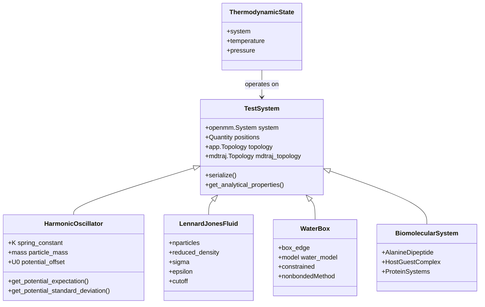

OpenMMTools provides a comprehensive library of **test systems** for molecular simulation, serving as pre-configured molecular systems that enable rapid prototyping, algorithm validation, performance benchmarking, and educational demonstrations. These systems range from simple analytically tractable models to complex biomolecular assemblies, all accessible through a unified, consistent interface that integrates seamlessly with OpenMM simulation workflows.

## Architecture Overview

The test system architecture follows a clean object-oriented design pattern centered around a base class that provides standardized access to simulation objects. Each test system encapsulates three core components: the OpenMM System object (defining forces and constraints), particle positions with proper units, and an OpenMM Topology object for structural representation. This design ensures that every test system, regardless of complexity, presents the same interface to downstream code.



The `TestSystem` base class serves as the foundation, providing properties that return **deep copies** of internal objects to prevent accidental modification. The class also implements a `serialize()` method for XML-based debugging and an `analytical_properties` property that introspects available analytical computation methods. Systems with known theoretical implementations expose methods prefixed with `get_` (e.g., `get_potential_expectation`) which can be called with a `ThermodynamicState` object to compute property values at specified conditions.

Sources: [testsystems.py](/openmmtools/testsystems.py#L448-L625), [testsystems.py](/openmmtools/testsystems.py#L386-L447)

## Core Test System Interface

The fundamental interaction pattern involves instantiating a test system and extracting its components for simulation. All test systems follow this consistent pattern:

```python
from openmmtools import testsystems
import openmm.unit as unit

# Create a test system
testsystem = testsystems.HarmonicOscillator()

# Extract simulation components
system = testsystem.system
positions = testsystem.positions
topology = testsystem.topology

# Access analytical properties (if available)
state = testsystems.ThermodynamicState(
    system=system, 
    temperature=298.0*unit.kelvin
)
if testsystem.analytical_properties:
    potential_mean = testsystem.get_potential_expectation(state)
```

> [!TIP]
> The properties `system`, `positions`, and `topology` always return **deep copies**, not references. This means you cannot modify the internal state of a test system directly. If you need to modify forces or positions, work with the returned copy and consider creating a new test system instance.

All positions are returned as `openmm.unit.Quantity` objects with proper unit annotations, typically in nanometers. This unit-aware design prevents common errors from unit mismatches during simulation setup.

Sources: [testsystems.py](/openmmtools/testsystems.py#L515-L553), [testsystems.py](/openmmtools/testsystems.py#L563-L577)

## Analytically Tractable Systems

These test systems are designed with simple mathematical models that permit exact calculation of thermodynamic properties. They serve as **validation tools** for verifying that simulation algorithms produce theoretically correct results.

### Harmonic Oscillator

The `HarmonicOscillator` class implements a single particle confined in a three-dimensional isotropic harmonic well with potential energy U(x) = (K/2)[(x-x₀)² + y² + z²] + U₀. This system provides exact expressions for both the expectation value and standard deviation of potential energy: both equal (3/2)kT for a 3D harmonic oscillator.

Key parameters include the spring constant K (default: 100.0 kcal/mol/Ų), particle mass (default: 39.948 amu, argon), and potential offset U₀. The system context includes global parameters `testsystems_HarmonicOscillator_K`, `testsystems_HarmonicOscillator_x0`, and `testsystems_HarmonicOscillator_U0` that can be modified during simulation.

Sources: [testsystems.py](/openmmtools/testsystems.py#L685-L842)

### Additional Analytical Systems

The library includes several other analytically tractable systems:

- **PowerOscillator**: Generalizes the harmonic oscillator with a power-law potential U(x) = K|x|b, enabling tests of anharmonic potentials
- **ConstraintCoupledHarmonicOscillator**: Two oscillators coupled by a distance constraint, useful for testing constraint algorithms
- **HarmonicOscillatorArray**: Multiple harmonic oscillators in a linear arrangement
- **IdealGas** and **MolecularIdealGas**: Non-interacting particles in a box, providing analytical properties for pressure and energy
- **Diatom**: Two particles connected by a harmonic bond, with optional constraints
- **LennardJonesPair**: Exactly two interacting Lennard-Jones particles

These systems are particularly valuable for testing integrators, MCMC move proposals, and sampling methods where exact theoretical results provide ground truth validation.

Sources: [testsystems.py](/openmmtools/testsystems.py#L843-L948), [testsystems.py](/openmmtools/testsystems.py#L1349-L1561), [testsystems.py](/openmmtools/testsystems.py#L2631-L2828), [testsystems.py](/openmmtools/testsystems.py#L948-L1067)

## Simple Fluids and Model Systems

This category includes systems that model collective behavior while remaining computationally tractable. These are ideal for **algorithm benchmarking** and testing periodic boundary conditions.

### Lennard-Jones Fluid

The `LennardJonesFluid` class creates a periodic fluid of interacting particles using the standard 12-6 Lennard-Jones potential. By default, the system uses argon parameters (σ = 3.4 Å, ε = 0.238 kcal/mol) with a reduced density of 0.05 (gas phase) to avoid equilibration needs. Initial positions are assigned using a subrandom Sobol sequence to minimize steric clashes.

Key configuration options include:

- `nparticles`: Number of particles (default: 1000)
- `reduced_density`: Reduced density ρ* = ρσ³ (default: 0.05 for gas)
- `cutoff`: Nonbonded cutoff distance (default: 3.0σ)
- `switch_width`: Width of switching function (default: σ)
- `shift`: Boolean for shifted potential instead of switched
- `dispersion_correction`: Toggle analytical dispersion correction
- `charge`: Optional alternating charges for testing electrostatics
- `lattice`: Use FCC lattice packing instead of random positions

The system supports both cutoff periodic interactions and PME electrostatics when charges are specified. Variants include `LennardJonesFluidTruncated` (hard cutoff) and `LennardJonesFluidSwitched` (switched potential only).

Sources: [testsystems.py](/openmmtools/testsystems.py#L1872-L2032), [testsystems.py](/openmmtools/testsystems.py#L2033-L2083)

### WCA Fluid and Double-Well Systems

The `WCAFluid` implements the Weeks-Chandler-Andersen potential—a truncated and shifted Lennard-Jones potential that is purely repulsive. This system models hard-sphere behavior and is useful for testing algorithms that require purely repulsive interactions.

Building on this, the `DoubleWellDimer_WCAFluid` and `DoubleWellChain_WCAFluid` systems embed double-well potentials within a WCA fluid, creating complex energy landscapes. These systems are specifically designed to test rare event sampling methods and free energy calculation algorithms, as the double-well potential creates metastable states separated by barriers.

Sources: [testsystems.py](/openmmtools/testsystems.py#L2312-L2393), [testsystems.py](/openmmtools/testsystems.py#L2393-L2540), [testsystems.py](/openmmtools/testsystems.py#L2540-L2631)

### Diatomic and Dipolar Fluids

The `DiatomicFluid` base class creates fluids of diatomic molecules using both bonded (harmonic) and nonbonded (Lennard-Jones) interactions. The class supports variants with constraints (`ConstrainedDiatomicFluid`) or flexible bonds (`UnconstrainedDiatomicFluid`). Building on this, `DipolarFluid` adds alternating charges to create polar molecules, enabling tests of electrostatic interactions in dense fluids.

These systems are particularly valuable for testing algorithms that must handle both bonded and nonbonded forces simultaneously, as well as methods for handling constraints in periodic systems.

Sources: [testsystems.py](/openmmtools/testsystems.py#L1067-L1260), [testsystems.py](/openmmtools/testsystems.py#L1294-L1349)

## Water Model Systems

Water test systems provide realistic solvent environments for testing biomolecular simulations. The `WaterBox` base class supports multiple water models and treatment methods.

### Water Box Variants

The `WaterBox` class creates a cubic box of water with configurable parameters:

| Parameter | Default | Description |
|-----------|---------|-------------|
| `box_edge` | 25.0 Å | Cubic box edge length |
| `model` | 'tip3p' | Water model ('tip3p', 'tip4pew', 'tip5p', 'spce') |
| `constrained` | True | Use SETTLE for rigid water |
| `nonbondedMethod` | PME | Electrostatics treatment |
| `cutoff` | 10.0 Å | Nonbonded cutoff |
| `switch_width` | 1.5 Å | Switching function width |
| `dispersion_correction` | True | Long-range Lennard-Jones correction |
| `ewaldErrorTolerance` | 1×10⁻⁵ | PME accuracy |

Specialized variants include:
- **FlexibleWaterBox**: Flexible water geometry without constraints
- **FlexiblePMEWaterBox**: Flexible water with tight PME tolerance
- **FlexibleReactionFieldWaterBox**: Flexible water with reaction field electrostatics
- **FourSiteWaterBox**: TIP4P-Ew four-site water model
- **FiveSiteWaterBox**: TIP5P five-site water model
- **GiantFlexibleWaterBox**: Large flexible water box (40 Å edge)
- **DischargedWaterBox**: Water with all charges zeroed
- **AlchemicalWaterBox**: Single alchemically modified water molecule

Sources: [testsystems.py](/openmmtools/testsystems.py#L2828-L2978), [testsystems.py](/openmmtools/testsystems.py#L2979-L3329)

## Biomolecular Test Systems

For testing methods on realistic biomolecular systems, the library provides protein, peptide, and protein-ligand complexes.

### Alanine Dipeptide Systems

Alanine dipeptide serves as a minimal protein model with realistic dihedral angle dynamics. The system is available in three environments:

- **AlanineDipeptideVacuum**: Isolated peptide in vacuum with ff96 force field
- **AlanineDipeptideImplicit**: Peptide in OBC1 GBSA implicit solvent
- **AlanineDipeptideExplicit**: Peptide solvated in TIP3P water with PME electrostatics

The explicit solvent version loads pre-equilibrated coordinates and periodic box vectors from Amber files stored in the data directory. All versions support hydrogen mass repartitioning via the `hydrogenMass` parameter for enabling longer timesteps.

Sources: [testsystems.py](/openmmtools/testsystems.py#L3352-L3532)

### Host-Guest Complexes

Host-guest systems model molecular recognition and provide realistic binding free energy benchmarks. The library includes systems based on cucurbit[7]uril (CB7) hosts:

- **HostGuestVacuum**: Host-guest complex in vacuum
- **HostGuestImplicit**: Complex in implicit solvent with multiple GB variants (HCT, OBC1, OBC2, GBn, GBn2)
- **HostGuestExplicit**: Fully solvated complex with explicit water and ions

These systems leverage the `_HostGuestBase` mixin which provides access to the host and guest as OEMols when available, enabling integration with OpenEye toolkits for chemical manipulation.

Sources: [testsystems.py](/openmmtools/testsystems.py#L3650-L3789), [testsystems.py](/openmmtools/testsystems.py#L3789-L3863)

### Protein Systems

For larger systems, the library provides several protein test cases:

- **LysozymeImplicit**: T4-lysozyme L99A in implicit solvent
- **SrcImplicit** and **SrcExplicit**: Src kinase domain in implicit/explicit solvent
- **SrcExplicitReactionField**: Src with reaction field electrostatics
- **DHFRExplicit**: Dihydrofolate reductase in explicit solvent
- **DNADodecamerExplicit**: DNA dodecamer in explicit solvent

These systems load pre-parameterized Amber files from the data directory, providing realistic protein environments for testing advanced sampling methods, free energy calculations, and integrator performance.

Sources: [testsystems.py](/openmmtools/testsystems.py#L3929-L4146), [testsystems.py](/openmmtools/testsystems.py#L3863-L3929)

## Working with Test Systems

### Computing Analytical Properties

For systems with analytical implementations, property calculation requires a `ThermodynamicState` object specifying temperature and optionally pressure:

```python
from openmmtools import testsystems
import openmm.unit as unit

# Create test system
testsystem = testsystems.HarmonicOscillator(K=100.0*unit.kilocalories_per_mole/unit.angstrom**2)

# Define thermodynamic state
state = testsystems.ThermodynamicState(
    system=testsystem.system,
    temperature=298.15*unit.kelvin
)

# Compute analytical properties
potential_mean = testsystem.get_potential_expectation(state)
potential_stddev = testsystem.get_potential_standard_deviation(state)

print(f"Mean potential: {potential_mean}")
print(f"Potential std dev: {potential_stddev}")
```

The `analytical_properties` property introspects available methods, allowing you to discover what analytical capabilities each system provides.

Sources: [testsystems.py](/openmmtools/testsystems.py#L563-L577), [testsystems.py](/openmmtools/testsystems.py#L804-L842)

### Serialization and Debugging

The `serialize()` method exports test systems to XML format for inspection and debugging:

```python
system_xml, state_xml = testsystem.serialize()

# system_xml contains the OpenMM System object
# state_xml contains particle positions (if particles exist)
```

This is particularly useful for comparing system setups, verifying force field parameters, or debugging unexpected simulation behavior.

Sources: [testsystems.py](/openmmtools/testsystems.py#L585-L621)

### Creating Custom Test Systems

To create a new test system, inherit from the `TestSystem` base class and implement the `__init__` method to populate `self.system`, `self.positions`, and `self.topology`:

```python
from openmmtools.testsystems import TestSystem
import openmm
import openmm.unit as unit
import numpy as np

class MyCustomSystem(TestSystem):
    def __init__(self, **kwargs):
        super().__init__(**kwargs)
        
        # Create OpenMM System
        system = openmm.System()
        system.addParticle(12.0*unit.amu)
        
        # Add forces
        force = openmm.HarmonicBondForce()
        force.addBond(0, 1, 1.5*unit.nanometer, 1000.0*unit.kilojoules_per_mole/unit.nanometer**2)
        system.addForce(force)
        
        # Set positions
        positions = unit.Quantity(np.array([[0.0, 0.0, 0.0], [1.5, 0.0, 0.0]]), unit.nanometers)
        
        # Create topology
        import openmm.app as app
        topology = app.Topology()
        # ... populate topology ...
        
        self.system = system
        self.positions = positions
        self.topology = topology
```

For systems with analytical properties, implement methods with the `get_` prefix that accept a `ThermodynamicState` object.

Sources: [testsystems.py](/openmmtools/testsystems.py#L448-L501)

## Test System Categories

| Category | Purpose | Example Systems | Typical Use Cases |
|----------|---------|----------------|-------------------|
| Analytically Tractable | Validation of exact results | HarmonicOscillator, PowerOscillator, IdealGas | Testing integrators, MCMC acceptance, thermostat accuracy |
| Simple Fluids | Benchmarking performance | LennardJonesFluid, DiatomicFluid, WCAFluid | Algorithm comparison, scaling studies |
| Water Models | Solvent environment testing | WaterBox, FlexibleWaterBox, FourSiteWaterBox | Testing water models, nonbonded treatment |
| Peptide Systems | Minimal biomolecular behavior | AlanineDipeptideVacuum, AlanineDipeptideExplicit | Free energy method validation, sampling tests |
| Protein Systems | Realistic biological systems | SrcImplicit, DHFRExplicit, LysozymeImplicit | Enhanced sampling, protein-ligand binding |
| Host-Guest Systems | Molecular recognition | HostGuestImplicit, HostGuestExplicit | Alchemical free energy calculations |

## Advanced Topics

### Alchemical Test Systems

Several systems support alchemical modification for testing free energy methods:

- **AlchemicalAlanineDipeptide**: All atoms can be discharged via a `lambda_electrostatics` parameter
- **AlchemicalWaterBox**: Single water molecule can be alchemically modified

These systems integrate with the `AlchemicalRegion` and `AbsoluteAlchemicalFactory` from the `alchemy` module, enabling testing of alchemical free energy calculation protocols.

Sources: [testsystems.py](/openmmtools/testsystems.py#L3390-L3422), [testsystems.py](/openmmtools/testsystems.py#L3310-L3352)

### Polarizable Systems

The library includes AMOEBA polarizable force field implementations:

- **AMOEBAIonBox**: Single Ca²⁺ ion in water box
- **AMOEBAProteinBox**: PDB 1AP4 in water with AMOEBA

These systems test algorithms that must handle mutual polarization, multipole electrostatics, and many-body interactions.

Sources: [testsystems.py](/openmmtools/testsystems.py#L4402-L4456)

## Best Practices

<CgxTip>
When selecting a test system, match the complexity to your needs: start with simple systems (HarmonicOscillator, LennardJonesFluid) for algorithm validation, then progress to more complex systems (AlanineDipeptide, WaterBox) for integration testing, and finally use full biomolecular systems for end-to-end testing.
</cgt_tip>

- **Always verify** analytical properties against simulation results when available
- **Use reduced density** of 0.05 for LJ fluids to avoid equilibration delays during rapid testing
- **Specify appropriate cutoffs** (box_edge > 2*cutoff) to avoid artifacts in periodic systems
- **Consider constraints** carefully—rigid water (SETTLE) enables longer timesteps but tests different code paths than flexible water
- **Leverage the serialize() method** for debugging when systems behave unexpectedly

## What's Next

Having mastered test systems, you're ready to explore how they integrate with thermodynamic and sampling frameworks:

- **[Thermodynamic and Sampler States](5-thermodynamic-and-sampler-states)**: Learn about the `ThermodynamicState` and `SamplerState` objects that provide complete descriptions of simulation conditions
- **[Langevin Integrators and Splitting Schemes](7-langevin-integrators-and-splitting-schemes)**: Discover the specialized integrators available for different test system types
- **[Hamiltonian Monte Carlo (HMC) and GHMC](9-hamiltonian-monte-carlo-hmc-and-ghmc)**: Understand how to use HMC-based moves with analytical test systems for validation

The test systems form the foundation for all algorithmic development and testing in OpenMMTools—mastering them provides a reliable toolkit for molecular simulation work.