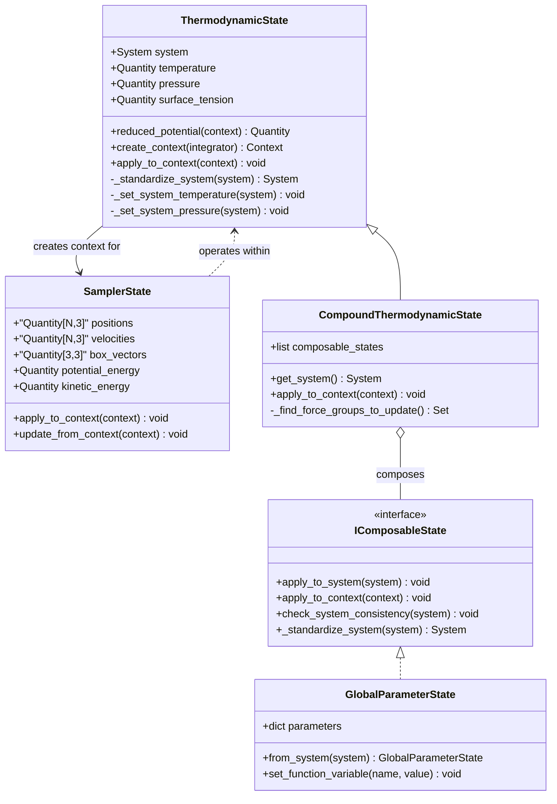
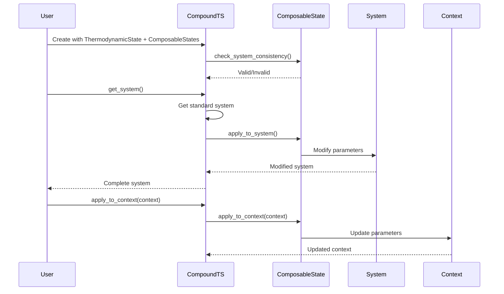

The states module provides a fundamental architectural foundation for molecular simulations in openmmtools, establishing a clean separation between thermodynamic conditions and configurational data. This separation enables flexible composition of simulation components while maintaining thermodynamic consistency across complex workflows like replica exchange, alchemical free energy calculations, and enhanced sampling methods.

## Architectural Foundation

OpenMM simulations involve two distinct categories of state information that must be tracked and managed. The **thermodynamic state** encompasses conditions that define the statistical ensemble—temperature, pressure, system parameters, and force field configurations—while the **sampler state** captures the microscopic configuration that evolves during integration, including particle positions, velocities, and periodic box dimensions.



This architecture promotes **separation of concerns** by isolating ensemble-defining parameters from the evolving configuration. ThermodynamicState objects can be efficiently shared across multiple replicas in parallel tempering simulations, while SamplerState objects track the unique microscopic state of each replica.

## Thermodynamic State

The ThermodynamicState class serves as the primary interface for managing ensemble conditions. It wraps an OpenMM System object and enforces thermodynamic consistency by automatically managing thermostats and barostats according to the desired ensemble.

**Core responsibilities** include maintaining system parameters, supporting multiple ensembles (NVT, NPT, NPγT), computing reduced potentials, and creating OpenMM Context objects ready for simulation [openmmtools/states.py](openmmtools/states.py#L385-L500).

### Supported Ensembles

ThermodynamicState supports three primary ensembles through intelligent thermostat and barostat management:

| Ensemble | Thermodynamic Variables | Required Forces | Volume Behavior |
|----------|------------------------|-----------------|-----------------|
| NVT | Temperature only | Thermostat | Constant |
| NPT | Temperature, Pressure | Thermostat, MonteCarloBarostat | Fluctuates |
| NPγT | Temperature, Pressure, Surface Tension | Thermostat, MonteCarloMembraneBarostat | Fluctuates (XY fixed, Z free) |

The class automatically infers ensemble conditions from system forces or allows explicit specification through constructor parameters [openmmtools/states.py](openmmtools/states.py#L507-L520).

### Temperature and Pressure Management

Temperature control is implemented through the management of thermostat forces. When a temperature is specified, ThermodynamicState either utilizes an existing thermostat or adds one configured to the specified value. The class supports multiple thermostat types but validates that only one thermostat is present to ensure ensemble consistency [openmmtools/states.py](openmmtools/states.py#L658-L677).

Pressure management follows a similar pattern with the MonteCarloBarostat. Setting the pressure property automatically adds or configures a barostat, while setting it to None removes the barostat and converts the ensemble to NVT [openmmtools/states.py](openmmtools/states.py#L680-L730).

> [!TIP]
> The temperature property exposes derived thermodynamic quantities: `kT` (thermal energy per mole) and `beta` (inverse thermal energy in mole/energy units). These computed properties are essential for reduced potential calculations and acceptance probability computations in Markov chain Monte Carlo moves.

### System Standardization and Caching

A critical optimization in ThermodynamicState is the concept of the "standard system"—a canonical representation stored in a weak reference cache that minimizes memory consumption when simulating many thermodynamic states [openmmtools/states.py](openmmtools/states.py#L1372-L1376).

When multiple ThermodynamicState objects are created from the same system (e.g., at different temperatures in replica exchange), they share the same standard system instance. The cache uses hash-based keys computed from system properties to identify equivalent systems [openmmtools/states.py](openmmtools/states.py#L1493-L1500).

```python
# Example: Creating multiple states that share the underlying system
from openmmtools import testsystems, states
from openmm import unit

test_system = testsystems.AlanineDipeptideExplicit()
base_system = test_system.system

# Create NVT states at different temperatures
temperatures = [280.0, 300.0, 320.0, 340.0] * unit.kelvin
thermodynamic_states = [
    states.ThermodynamicState(base_system, temperature=T)
    for T in temperatures
]
# All states share the same standard system internally
```

### Context Creation and Application

ThermodynamicState provides two primary methods for integrating with OpenMM simulations:

1. **`create_context(integrator, platform, platform_properties)`** - Creates a new OpenMM Context configured with the thermodynamic state. The method intelligently removes the internal thermostat when using a thermostated integrator like LangevinIntegrator to avoid double temperature control [openmmtools/states.py](openmmtools/states.py#L1094-L1183).

2. **`apply_to_context(context)`** - Modifies an existing Context to match the thermodynamic state by updating force parameters, thermostat settings, and barostat configurations. This is essential for efficient replica exchange simulations where contexts are reused across state swaps [openmmtools/states.py](openmmtools/states.py#L1183-L1235).

The context management includes compatibility checking to ensure the context's system structure matches the thermodynamic state's requirements, catching errors before simulation begins [openmmtools/states.py](openmmtools/states.py#L1052-L1094).

### Reduced Potential Computation

The reduced potential (βu = u/kT) serves as the fundamental quantity for comparing states in free energy calculations and replica exchange. ThermodynamicState provides methods to compute this quantity efficiently:

```python
def reduced_potential(self, context_state):
    """Compute reduced potential of the context configuration in this state."""
    potential_energy = context_state.getPotentialEnergy()
    temperature = self.temperature
    volume = self.get_volume(ignore_ensemble=True)
    pressure = self.pressure
    # Apply statistical mechanics formula: βu = βU + βpV - βγA
    return self._compute_reduced_potential(potential_energy, temperature, 
                                          volume, pressure)
```

The formula correctly handles all supported ensembles: for NVT, only potential energy contributes; for NPT, the pv term is added; for NPγT, the surface tension term subtracts from the total [openmmtools/states.py](openmmtools/states.py#L1910-L1927).

## Sampler State

While ThermodynamicState defines the ensemble, SamplerState captures the instantaneous microscopic configuration that evolves during integration. It serves as a cache for particle positions, velocities, and periodic box dimensions, along with derived energy quantities [openmmtools/states.py](openmmtools/states.py#L1934-L2040).

### Core Properties

SamplerState maintains the following primary configurational data:

| Property | Type | Description | Optional |
|----------|------|-------------|----------|
| positions | Quantity[N,3] | Particle coordinates | Required |
| velocities | Quantity[N,3] | Particle velocities | Optional |
| box_vectors | Quantity[3,3] | Periodic box dimensions | Optional |
| potential_energy | Quantity | Potential energy of configuration | Computed |
| kinetic_energy | Quantity | Kinetic energy of configuration | Computed |
| collective_variables | dict | Custom CV values from integrator | Optional |

The positions, velocities, and box vectors are set through the constructor or extracted from an existing Context using the `from_context` alternative constructor [openmmtools/states.py](openmmtools/states.py#L2040-L2071).

```python
# Example: Creating sampler states from context
from openmmtools import testsystems, states

test_system = testsystems.AlanineDipeptideExplicit()
thermodynamic_state = states.ThermodynamicState(
    test_system.system, 
    temperature=300*unit.kelvin
)
integrator = openmm.LangevinIntegrator(300*unit.kelvin, 1.0/unit.picosecond, 
                                        1.0*unit.femtosecond)
context = thermodynamic_state.create_context(integrator)
context.setPositions(test_system.positions)

# Extract complete sampler state including energies
sampler_state = states.SamplerState.from_context(context)
print(sampler_state.potential_energy)  # Now populated
```

### Context Integration

SamplerState provides symmetric methods for integration with OpenMM Context objects:

- **`apply_to_context(context, ignore_velocities)`** - Sets the Context's positions, velocities, and box vectors from the SamplerState. Useful for initializing new contexts or restoring saved configurations [openmmtools/states.py](openmmtools/states.py#L2258-L2282).

- **`update_from_context(context, ignore_positions, ignore_velocities)`** - Updates the SamplerState from a Context's current state. Used after integration steps to capture the evolved configuration. Energy attributes are automatically populated [openmmtools/states.py](openmmtools/states.py#L2216-L2258).

Compatibility checking ensures that the number of particles matches between the SamplerState and the Context, preventing errors from mismatched systems [openmmtools/states.py](openmmtools/states.py#L2192-L2216).

> [!TIP]
> SamplerState supports array-like indexing to extract subsets of particles. This enables operations like selecting only solvent or solute atoms for analysis or specialized sampling moves. The sliced state maintains proper energy units and can be applied to compatible contexts.

### State Validation

SamplerState includes diagnostic methods to detect numerical issues:

- **`has_nan()`** - Checks if potential energy or any coordinates contain NaN values, which can indicate numerical instabilities or integration errors [openmmtools/states.py](openmmtools/states.py#L2282-L2291).

This validation is particularly valuable in complex simulations where numerical issues may propagate silently through the sampling process.

## Composable State Architecture

The composable state pattern extends ThermodynamicState functionality through composition rather than inheritance. This enables modular addition of new state dimensions without creating deep class hierarchies.

### IComposableState Interface

The `IComposableState` abstract base class defines the contract for composable extensions [openmmtools/states.py](openmmtools/states.py#L2533-L2695):



Key methods include:
- **`apply_to_system(system)`** - Applies the composable state's parameters to an OpenMM System
- **`check_system_consistency(system)`** - Validates that the system is compatible with the composable state
- **`apply_to_context(context)`** - Updates a running Context with new parameter values
- **`_standardize_system(system)`** - Establishes standard parameter values in the system
- **`_find_force_groups_to_update(context, memo)`** - Identifies force groups needing recompute after parameter changes

This interface enables seamless integration of additional state dimensions like alchemical parameters, custom force parameters, or any other modifiable system properties.

### CompoundThermodynamicState

The `CompoundThermodynamicState` class combines a base `ThermodynamicState` with multiple `IComposableState` implementations [openmmtools/states.py](openmmtools/states.py#L2695-L2850). It uses Python's `__getattr__` and `__setattr__` magic methods to expose all attributes from both the base state and composable states as a unified interface.

```python
from openmmtools import states, alchemy
from openmm import unit

# Create base thermodynamic state
test_system = testsystems.AlanineDipeptideVacuum()
factory = alchemy.AbsoluteAlchemicalFactory()
alchemical_system = factory.create_alchemical_system(
    reference_system=test_system.system,
    alchemical_regions=alchemy.AlchemicalRegion(alchemical_atoms=range(22))
)

# Create alchemical state
alchemical_state = alchemy.AlchemicalState.from_system(alchemical_system)

# Combine into compound state
thermodynamic_state = states.ThermodynamicState(
    alchemical_system, 
    temperature=300*unit.kelvin
)
compound_state = states.CompoundThermodynamicState(
    thermodynamic_state=thermodynamic_state,
    composable_states=[alchemical_state]
)

# Access alchemical parameters directly
compound_state.lambda_sterics = 0.5
compound_state.lambda_electrostatics = 0.7
```

The compound state handles force group management intelligently, identifying which force groups need recomputation when parameters change. This optimization avoids unnecessary energy evaluations in complex systems [openmmtools/states.py](openmmtools/states.py#L3031-L3037).

## Global Parameter State

GlobalParameterState provides a specialized composable state for controlling OpenMM Force global parameters [openmmtools/states.py](openmmtools/states.py#L3101-L3200). This is particularly useful for custom forces that expose parameters for runtime modification.

### Parameter Definition with Descriptors

The class uses Python descriptor protocol through the nested `GlobalParameter` class to define parameters:

```python
class CustomForceState(states.GlobalParameterState):
    # Define controlled parameters with standard values
    lambda_scaling = GlobalParameterState.GlobalParameter('lambda_scaling', standard_value=1.0)
    gamma = GlobalParameterState.GlobalParameter('gamma', standard_value=2.0)
    
    # Add validation for constrained parameters
    @lambda_scaling.validator
    def lambda_scaling(self, instance, new_value):
        if new_value is not None and not (0.0 <= new_value <= 1.0):
            raise ValueError('lambda_scaling must be in [0, 1]')
        return new_value
```

### Parameter Functions

The `GlobalParameterFunction` class enables mathematical relationships between parameters and external variables [openmmtools/states.py](openmmtools/states.py#L3059-L3101). This supports sophisticated parameter coupling schemes:

```python
# Define parameter as function of external variable
composable_state.set_function_variable('lambda', 0.5)
composable_state.lambda_scaling = GlobalParameterFunction('lambda**2')
# Now lambda_scaling automatically equals 0.25
```

Parameter functions support all mathematical expressions available in `openmmtools.utils.math_eval`, enabling complex parameter interpolation strategies commonly used in alchemical calculations.

## Integration with Simulation Workflows

The states module integrates seamlessly with the broader openmmtools simulation framework, particularly the MCMC and multistate sampling modules.

### MCMC Integration

Markov Chain Monte Carlo moves in openmmtools rely on the ThermodynamicState/SamplerState separation for efficient proposal generation and acceptance testing. The `MCMCSampler` class maintains references to both state types [openmmtools/mcmc.py](openmmtools/mcmc.py#L78-L110):

```python
from openmmtools import states, mcmc
from openmm import unit

# Setup states
test_system = testsystems.AlanineDipeptideExplicit()
thermodynamic_state = states.ThermodynamicState(
    test_system.system,
    temperature=298*unit.kelvin
)
sampler_state = states.SamplerState(positions=test_system.positions)

# Create sampler with GHMC move
ghmc_move = mcmc.GHMCMove(timestep=1.0*unit.femtosecond, n_steps=50)
sampler = mcmc.MCMCSampler(thermodynamic_state, sampler_state, move=ghmc_move)

# Run simulation
sampler.minimize()
sampler.run(n_iterations=100)
```

The sampler automatically updates the SamplerState after each iteration while keeping the ThermodynamicState constant, maintaining the ensemble definition throughout the simulation.

### Replica Exchange Integration

Replica exchange methods exploit ThermodynamicState immutability by reusing Context objects across multiple temperature states. The `ReplicaExchangeSampler` maintains a single ThermodynamicState object per replica but swaps SamplerState objects between temperatures [openmmtools/multistate/paralleltempering.py](openmmtools/multistate/paralleltempering.py).

The `group_by_compatibility` utility function efficiently groups thermodynamic states for context reuse, minimizing the number of Context objects needed in replica exchange simulations [openmmtools/states.py](openmmtools/states.py#L186-L220).

### Alchemical Integration

Alchemical free energy calculations use CompoundThermodynamicState to manage both thermodynamic conditions (temperature, pressure) and alchemical parameters (lambda values) through AlchemicalState, which implements the IComposableState interface [openmmtools/alchemy/alchemy.py](openmmtools/alchemy/alchemy.py#L120-L200).

```python
# Alchemical free energy workflow
from openmmtools import alchemy

# Create alchemically modified system
factory = alchemy.AbsoluteAlchemicalFactory()
alchemical_system = factory.create_alchemical_system(
    reference_system=test_system.system,
    alchemical_regions=alchemy.AlchemicalRegion(alchemical_atoms=range(22))
)

# Create alchemical state
alchemical_state = alchemy.AlchemicalState.from_system(alchemical_system)

# Combine into single state object
thermodynamic_state = states.ThermodynamicState(
    alchemical_system,
    temperature=300*unit.kelvin,
    pressure=1.0*unit.atmosphere
)
compound_state = states.CompoundThermodynamicState(
    thermodynamic_state=thermodynamic_state,
    composable_states=[alchemical_state]
)
```

This architecture enables seamless integration with the SAMS (Self-Adjusted Mixture Sampling) framework and other multistate sampling methods.

## Best Practices and Common Patterns

### Efficient State Management

When working with multiple thermodynamic states (e.g., in replica exchange), leverage the shared standard system cache by creating all states from the same base System object:

```python
# Efficient: All states share the same underlying system
base_system = testsystem.system
thermodynamic_states = [
    states.ThermodynamicState(base_system, temperature=T)
    for T in temperatures
]
```

### State Serialization

Both ThermodynamicState and SamplerState support pickling for checkpointing and analysis. The `__getstate__` and `__setstate__` methods handle proper serialization including unit conversions and system caching [openmmtools/states.py](openmmtools/states.py#L1257-L1283):

```python
import pickle

# Save checkpoint
with open('checkpoint.pkl', 'wb') as f:
    pickle.dump({'thermo': thermodynamic_state, 
                 'sampler': sampler_state}, f)

# Restore checkpoint
with open('checkpoint.pkl', 'rb') as f:
    checkpoint = pickle.load(f)
    thermodynamic_state = checkpoint['thermo']
    sampler_state = checkpoint['sampler']
```

### Context Reuse Strategies

For workflows requiring frequent state changes (e.g., replica exchange), use context caching strategies. The global `ContextCache` in openmmtools automatically manages context reuse, but you can create local caches for specific workflows:

```python
from openmmtools import cache

# Create local cache for controlled context reuse
local_cache = cache.ContextCache(capacity=5, time_to_live=50)
context = thermodynamic_state.create_context(integrator, context_cache=local_cache)
```

### Error Handling

The states module provides specialized exception classes for troubleshooting:

| Exception Class | Common Causes |
|-----------------|---------------|
| ThermodynamicsError | Multiple thermostats/barostats, incompatible ensemble, non-periodic system with barostat |
| SamplerStateError | Inconsistent particle count between positions/velocities |
| ComposableStateError | Incompatible composable states, parameter validation failures |
| GlobalParameterError | Undefined parameters applied to system |

These exceptions provide detailed error messages and error codes to help diagnose configuration issues [openmmtools/states.py](openmmtools/states.py#L272-L375).

## Next Steps

The states module provides the foundation for all openmmtools simulation workflows. With this understanding, you can explore:

- **[MCMC Move Abstraction and Base Classes](12-mcmc-move-abstraction-and-base-classes)** - Learn how MCMC moves use the state separation to generate proposals
- **[Replica Exchange Molecular Dynamics (REMD)](16-replica-exchange-molecular-dynamics-remd)** - See how multiple ThermodynamicStates are managed in parallel tempering
- **[Alchemical State Management](20-alchemical-state-management)** - Explore advanced use of CompoundThermodynamicState for free energy calculations
- **[Context Caching Architecture](6-context-caching-architecture)** - Deep dive into the caching optimization strategies used throughout openmmtools
