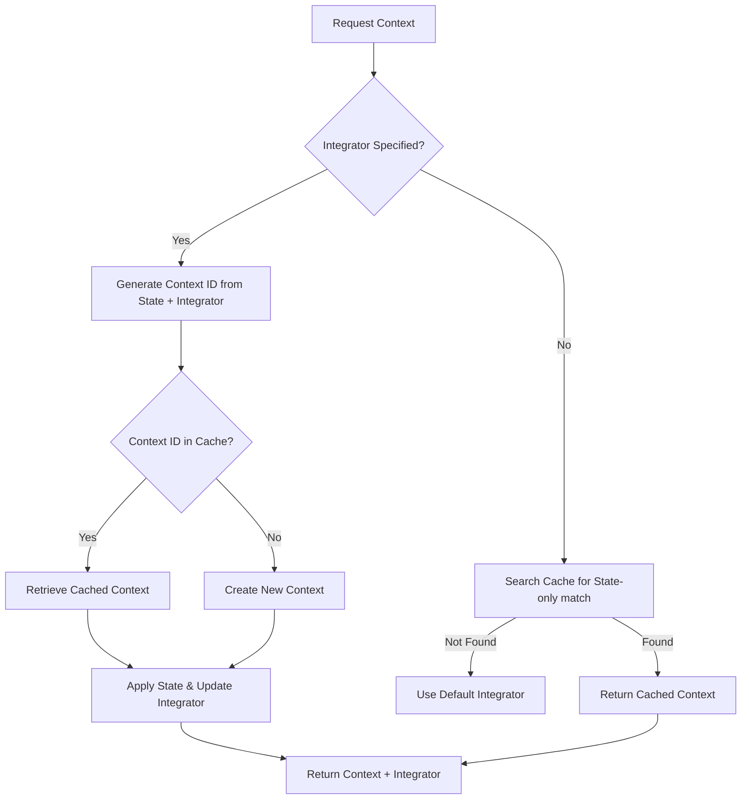

The Context Caching Architecture in openmmtools provides a sophisticated mechanism for efficiently managing OpenMM Context objects. This architecture minimizes memory usage and computational overhead by intelligently reusing Context objects when possible, particularly important when performing multiple simulations with similar thermodynamic conditions or when using Markov Chain Monte Carlo sampling methods that require repeated Context creation.

Sources: [cache.py](openmmtools/cache.py#L7-L10), [mcmc.py](openmmtools/mcmc.py#L31-L36)

## Core Components

The caching system consists of three main classes that work together to provide efficient Context management:

### LRUCache: The Foundation

The **LRUCache** class implements a least-recently-used caching strategy with dictionary-like interface. It serves as the underlying storage mechanism for Context objects, providing two key features:

1. **Capacity Management**: When the cache reaches its maximum capacity, the least recently accessed element is automatically removed
2. **Time-to-Live (TTL)**: Elements can be configured to expire after a specified number of read/write operations

```python
# Basic LRUCache usage example
cache = LRUCache(capacity=2, time_to_live=3)
cache['context1'] = context1
cache['context2'] = context2
# Adding a third element evicts the least recently used one
cache['context3'] = context3  # context1 is evicted if capacity is 2
```

Sources: [cache.py](openmmtools/cache.py#L34-L213)

### ContextCache: OpenMM-Specific Caching

The **ContextCache** class extends LRUCache functionality specifically for OpenMM Context objects. It intelligently determines when Contexts can be reused based on:

- **ThermodynamicState compatibility**: Two states are compatible if their underlying OpenMM Systems have the same structure
- **Integrator compatibility**: Two integrators can share a Context if they differ only by parameters that can be modified after Context initialization

This is particularly powerful because it allows the same Context to be reused across simulations with different temperatures or integrator time steps, as long as the underlying molecular system remains compatible.

Sources: [cache.py](openmmtools/cache.py#L214-L380), [states.py](openmmtools/states.py#L994-L1052)

### DummyContextCache: No-Caching Alternative

For debugging or testing purposes, the **DummyContextCache** class creates a new Context on every request without any caching behavior.

Sources: [cache.py](openmmtools/cache.py#L703-L792)

## Architecture Overview

The Context caching architecture follows a clear flow for managing Context objects efficiently:



Sources: [cache.py](openmmtools/cache.py#L378-L462)

## Key Design Patterns

### Context Identification Strategy

ContextCache uses a sophisticated two-part key system to identify cached Contexts:

1. **State ID**: Generated from the ThermodynamicState's `_standard_system_hash`, which captures the essential structure of the OpenMM System independent of variable parameters like temperature
2. **Integrator ID**: Generated from the XML serialization of the integrator, with compatible parameters standardized to a common value

This separation allows the cache to efficiently search for Contexts by state alone when no specific integrator is requested.

Sources: [cache.py](openmmtools/cache.py#L614-L649), [states.py](openmmtools/states.py#L1493-L1495)

### Integrator Compatibility System

The architecture includes a whitelist/blacklist system for integrator attributes:

**Compatible Attributes** (can change without requiring new Context):
- StepSize, ConstraintTolerance, Temperature, Friction, RandomNumberSeed
- CustomIntegrator global variables (except those in the blacklist)

**Incompatible Attributes** (require new Context):
- `_restorable__class_hash` (by default, prevents incompatible integrator classes from sharing Contexts)

This system allows fine-grained control over when Contexts can be reused, balancing memory efficiency against correctness.

Sources: [cache.py](openmmtools/cache.py#L495-L512), [cache.py](openmmtools/cache.py#L554-L612)

### Standardization Process

When determining if integrators are compatible, ContextCache creates a "standardized" version of the integrator where all compatible parameters are set to common values. This allows two integrators that differ only in compatible parameters to be recognized as compatible for caching purposes.

Sources: [cache.py](openmmtools/cache.py#L585-L612)

## Usage Patterns

### Using the Global Cache

OpenMMTools provides a shared global context cache used by default by MCMC moves:

```python
from openmmtools.cache import global_context_cache
from openmm import unit
from openmmtools import testsystems, states

# Configure the global cache (must be empty to change platform)
global_context_cache.capacity = 10
global_context_cache.time_to_live = 50

# Use with MCMC sampler
test_system = testsystems.AlanineDipeptideVacuum()
thermo_state = states.ThermodynamicState(test_system.system, 300*unit.kelvin)
```

Sources: [cache.py](openmmtools/cache.py#L791-L792), [mcmc.py](openmmtools/mcmc.py#L64-L70)

### Creating Local Caches

For more control over caching behavior, create dedicated ContextCache instances:

```python
from openmmtools.cache import ContextCache

# Cache with capacity limit and expiration
local_cache = ContextCache(
    capacity=5,
    time_to_live=100,
    platform=openmm.Platform.getPlatformByName('CUDA'),
    platform_properties={'CudaDeviceIndex': '0'}
)

# Request context - reuse cached version if available
context, integrator = local_cache.get_context(thermo_state, integrator)
```

Sources: [cache.py](openmmtools/cache.py#L313-L376)

### Disabling Caching

Use DummyContextCache when you want to ensure fresh Context objects are always created:

```python
from openmmtools.cache import DummyContextCache

no_cache = DummyContextCache(platform=reference_platform)
context, integrator = no_cache.get_context(thermo_state, integrator)
# Creates a new Context every time
```

Sources: [cache.py](openmmtools/cache.py#L703-L792)

## Configuration Options

| Parameter | Type | Default | Description |
|-----------|------|---------|-------------|
| capacity | int or None | None | Maximum number of Contexts to cache. None means unlimited. |
| time_to_live | int or None | None | Number of cache accesses before expiration. None means no expiration. |
| platform | openmm.Platform | None | OpenMM platform to use. None lets OpenMM choose the fastest. |
| platform_properties | dict | None | Platform-specific configuration properties. |

> [!TIP]
> Setting `capacity=None` and `time_to_live=None` creates an unbounded cache that never expires - useful for small numbers of states but can cause memory issues with many different thermodynamic conditions.

> [!TIP]
> Always configure the platform when the cache is empty. Attempting to change the platform after Contexts have been cached will raise a RuntimeError.

Sources: [cache.py](openmmtools/cache.py#L88-L183), [cache.py](openmmtools/cache.py#L319-L372)

## Compatibility Rules

Two Contexts can share the same cached object when:

1. **Thermodynamic States are Compatible**: The OpenMM Systems have identical structure (checked via hash), even if they have different temperatures or pressures
2. **Integrators are Compatible**: Same integrator class and only differ in compatible parameters

Examples of compatible combinations:
- Same system with different temperatures (NVT ensemble)
- Same system with different pressures (NPT ensemble with compatible barostat)
- Same integrator class with different time steps
- CustomIntegrators with different global variable values (except blacklisted ones)

Examples of incompatible combinations:
- Different molecular systems
- Different integrator classes (Langevin vs Verlet)
- Different barostat types
- Integrator parameters marked as incompatible

Sources: [states.py](openmmtools/states.py#L994-L1052), [cache.py](openmmtools/cache.py#L499-L510)

## Performance Considerations

The Context caching architecture provides significant performance benefits in typical workflows:

1. **Reduced Memory Allocation**: Context objects are expensive to create (especially for GPU platforms), so reuse dramatically reduces overhead
2. **Lower Memory Footprint**: Fewer Context objects means less GPU memory consumption, allowing larger systems or more replicas
3. **Faster Simulation Setup**: Reusing cached Contexts avoids expensive Context initialization steps

However, caching adds lookup overhead. The architecture is optimized by:
- Using efficient hash-based lookups
- LRU eviction keeps frequently-used Contexts accessible
- Separation of state and integrator IDs allows flexible searching

Sources: [cache.py](openmmtools/cache.py#L34-L213), [mcmc.py](openmmtools/mcmc.py#L31-L36)

## Testing and Validation

The caching system is comprehensively tested to ensure correct behavior:

```python
# Test that compatible states share a single cached Context
test_cases = [
    (water_300k, verlet_2fs),
    (water_310k, verlet_3fs)  # Same system, different temperature and timestep
]
context_cache = ContextCache()
context_ids = set()
for state, integrator in test_cases:
    context, _ = context_cache.get_context(state, integrator)
    context_ids.add(id(context))
assert len(context_ids) == 1  # Only one Context created
```

Sources: [test_cache.py](openmmtools/tests/test_cache.py#L167-L275)

## Next Steps

Now that you understand the Context Caching Architecture, you can explore:

- [Thermodynamic and Sampler States](5-thermodynamic-and-sampler-states) - Learn about the state objects that define simulation conditions
- [Langevin Integrators and Splitting Schemes](7-langevin-integrators-and-splitting-schemes) - Understand the integrators that use cached Contexts
- [MCMC Move Abstraction and Base Classes](12-mcmc-move-abstraction-and-base-classes) - See how MCMC moves leverage the global cache
- [Introduction to Test Systems](4-introduction-to-test-systems) - Explore the test systems used for demonstrating Context caching