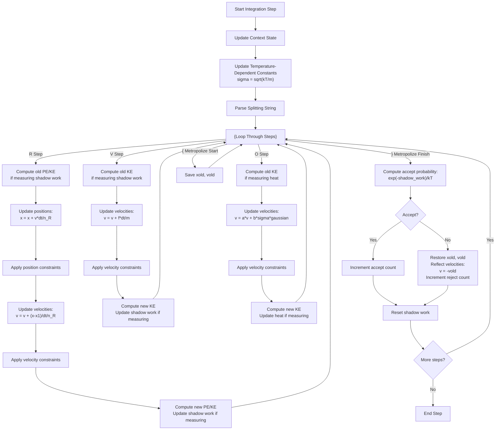

The `openmmtools.integrators` module provides a comprehensive family of Langevin integrators based on operator splitting methods. These integrators enable efficient and configurable molecular dynamics simulations with precise control over how the Langevin propagator is decomposed and integrated. The framework supports multiple time step integration, Metropolization for exact sampling, and detailed thermodynamic property measurement.

## Architectural Foundation

The Langevin integrator architecture is built upon OpenMM's `CustomIntegrator` facility, allowing researchers to specify integrators through a symbolic operator splitting syntax. The design follows a modular pattern where a base `LangevinIntegrator` class implements the general framework, and specialized subclasses provide pre-configured splittings for common use cases.

```mermaid
classDiagram
    class CustomIntegrator {
        <<OpenMM>>
        +step(nsteps)
        +getNumComputations()
    }
    
    class ThermostatedIntegrator {
        <<Mix-in>>
        +temperature
        +kT
        +setTemperature()
        +getTemperature()
    }
    
    class LangevinIntegrator {
        <<Core Framework>>
        -splitting: str
        -_gamma: collision rate
        -shadow_work
        -heat
        +__init__(temperature, collision_rate, timestep, splitting)
        +reset()
        +get_shadow_work()
        +get_heat()
        +get_acceptance_rate()
    }
    
    class VVVRIntegrator {
        <<Specialized>>
        +splitting = "O V R V O"
    }
    
    class BAOABIntegrator {
        <<Specialized>>
        +splitting = "V R O R V"
    }
    
    class GeodesicBAOABIntegrator {
        <<Specialized>>
        +K_r: int
        +splitting = "V R^K_r O R^K_r V"
    }
    
    class GHMCIntegrator {
        <<Specialized>>
        +splitting = "O { V R V } O"
    }
    
    CustomIntegrator <|-- ThermostatedIntegrator
    ThermostatedIntegrator <|-- LangevinIntegrator
    LangevinIntegrator <|-- VVVRIntegrator
    LangevinIntegrator <|-- BAOABIntegrator
    LangevinIntegrator <|-- GeodesicBAOABIntegrator
    LangevinIntegrator <|-- GHMCIntegrator
```

The architecture leverages multiple inheritance with mix-in classes to separate concerns. The `ThermostatedIntegrator` provides temperature management capabilities, while `PrettyPrintableIntegrator` enables human-readable display of integration steps. The core `LangevinIntegrator` implements the operator splitting framework and work measurement capabilities.

Sources: [openmmtools/integrators.py](openmmtools/integrators.py#L59-L124), [openmmtools/integrators.py](openmmtools/integrators.py#L1016-L1081)

## Operator Splitting Fundamentals

The Langevin equation can be decomposed into three exactly solvable components, each representing a physical process:

- **R (Rotation/Position)**: Linear drift step updating positions using current velocities
  - Equation: `x ← x + v · dt`
  - Deterministic update constrained to the manifold when holonomic constraints are present
  
- **V (Velocity)**: Linear kick step updating velocities using forces
  - Equation: `v ← v + (f/m) · dt`
  - Deterministic update that can be split by force group for multiple time step integration
  
- **O (Ornstein-Uhlenbeck)**: Stochastic velocity update simulating heat bath interaction
  - Equation: `v ← a·v + b·√(kT/m)·R`
  - Parameters: `a = exp(-γ·dt)`, `b = √(1 - exp(-2γ·dt))`, where R is i.i.d. standard normal

This decomposition enables the construction of integrators by sequentially applying these operations with appropriate timestep fractions. The power of this approach lies in the ability to create different integration schemes simply by rearranging the order of these operations.

Sources: [openmmtools/integrators.py](openmmtools/integrators.py#L1016-L1050), [openmmtools/integrators.py](openmmtools/integrators.py#L1405-L1453)

## Splitting String Syntax

The `splitting` parameter uses a space-delimited string notation to specify the sequence of operations. This flexible syntax enables specification of any symmetric splitting scheme:

```
splitting = "R V O V R"  # BAOAB splitting
splitting = "O V R V O"  # VVVR splitting  
splitting = "O { V R V } O"  # GHMC with Metropolization
splitting = "V0 V1 R O R V1 R O R V1 V0"  # Multiple timestep with force groups
```

The syntax supports several special characters:

| Symbol | Meaning | Example |
|--------|---------|---------|
| R | Position update | `"R"` |
| V | Velocity update (all forces) | `"V"` |
| V0, V1, ... | Velocity update (force group specific) | `"V0"`, `"V1"` |
| O | Ornstein-Uhlenbeck thermostat step | `"O"` |
| { | Start Metropolization block | `"{"` |
| } | End Metropolization block | `"}"` |

For multiple time step integration, force groups are specified by appending indices to V steps. This enables fast-fluctuating forces (e.g., bonded interactions) to be evaluated more frequently than expensive slow-fluctuating forces (e.g., long-range electrostatics).

Sources: [openmmtools/integrators.py](openmmtools/integrators.py#L1075-L1081), [openmmtools/integrators.py](openmmtools.py#L1475-L1540)

## Common Integrator Schemes

### VVVR (Velocity Verlet with Velocity Randomization)

The VVVR integrator uses the splitting `"O V R V O"`, which provides excellent sampling properties and timestep invariance of diffusion constants. This scheme is particularly useful for nonequilibrium simulations where correct diffusion behavior is critical.

**Physical interpretation**: The VVVR scheme applies the thermostat before and after the velocity Verlet substeps, ensuring symmetric treatment of stochastic forces.

```python
from openmmtools import integrators
from openmm import unit

# Create a VVVR integrator
integrator = integrators.VVVRIntegrator(
    temperature=298.0 * unit.kelvin,
    collision_rate=91.0 / unit.picoseconds,
    timestep=2.0 * unit.femtoseconds
)
```

Sources: [openmmtools/integrators.py](openmmtools/integrators.py#L2126-L2148)

### BAOAB

The BAOAB integrator uses the splitting `"V R O R V"`. This scheme exhibits superior sampling efficiency for configurational properties and reduced resonance artifacts in biomolecular simulations.

**Physical interpretation**: By placing the thermostat in the middle of the symplectic steps, BAOAB achieves enhanced phase space exploration while maintaining good energy conservation.

```python
# Create a BAOAB integrator
integrator = integrators.BAOABIntegrator(
    temperature=298.0 * unit.kelvin,
    collision_rate=91.0 / unit.picoseconds,
    timestep=2.0 * unit.femtoseconds
)
```

Sources: [openmmtools/integrators.py](openmmtools/integrators.py#L2153-L2181), [docs/integrators.rst](docs/integrators.rst#L18-L21)

### Geodesic BAOAB (g-BAOAB)

The geodesic BAOAB integrator extends BAOAB by introducing multiple drift steps between thermostat applications. The splitting takes the form `"V R^K_r O R^K_r V"` where `K_r` controls the number of drift steps.

**Physical interpretation**: Multiple drift steps allow the system to explore the constraint manifold more thoroughly, dramatically reducing sampling artifacts for systems with many constraints.

```python
# Create a geodesic BAOAB integrator with K_r=3
integrator = integrators.GeodesicBAOABIntegrator(
    K_r=3,
    temperature=298.0 * unit.kelvin,
    collision_rate=91.0 / unit.picoseconds,
    timestep=2.0 * unit.femtoseconds
)
```

> [!TIP]
> For equilibrium simulations where only configurational properties are of interest, the geodesic BAOAB integrator is highly recommended due to its extraordinary sampling properties for biomolecular systems.

Sources: [openmmtools/integrators.py](openmmtools/integrators.py#L2195-L2233), [docs/integrators.rst](docs/integrators.rst#L18-L21)

### GHMC (Generalized Hybrid Monte Carlo)

The GHMC integrator uses the splitting `"O { V R V } O"` with Metropolization. This scheme combines Langevin dynamics with Metropolis-Hastings acceptance to ensure exact sampling from the target distribution.

**Physical interpretation**: GHMC performs a Metropolis acceptance test based on the shadow work accumulated during the symplectic substeps, ensuring the integrator preserves the correct equilibrium distribution even for large timesteps.

```python
# Create a GHMC integrator
integrator = integrators.GHMCIntegrator(
    temperature=298.0 * unit.kelvin,
    collision_rate=91.0 / unit.picoseconds,
    timestep=2.0 * unit.femtoseconds
)

# Track acceptance statistics
for i in range(1000):
    integrator.step(10)
    print(f"Acceptance rate: {integrator.acceptance_rate}")
```

Sources: [openmmtools/integrators.py](openmmtools/integrators.py#L2243-L2283)

## Comparison of Integrator Schemes

| Integrator | Splitting | Key Properties | Best Use Cases |
|------------|-----------|----------------|----------------|
| VVVR | `O V R V O` | Diffusion invariance, good for nonequilibrium | Nonequilibrium switching, diffusion-sensitive properties |
| BAOAB | `V R O R V` | Reduced resonance, configurational sampling | Equilibrium biomolecular simulations |
| Geodesic BAOAB | `V R^K_r O R^K_r V` | Superior for constrained systems | Systems with many constraints (proteins, nucleic acids) |
| GHMC | `O { V R V } O` | Exact sampling, Metropolized | Large timesteps, precision sampling requirements |

## Work and Heat Measurement

The `LangevinIntegrator` framework provides built-in capabilities for tracking thermodynamic quantities during integration, which are essential for free energy calculations and validation of integration accuracy.

### Shadow Work

Shadow work measures the deviation between the discrete-time integrator and the continuous-time dynamics. It is accumulated during the symplectic R and V steps and can be enabled with `measure_shadow_work=True`.

```python
integrator = integrators.LangevinIntegrator(
    temperature=298.0 * unit.kelvin,
    collision_rate=1.0 / unit.picoseconds,
    timestep=2.0 * unit.femtoseconds,
    splitting="V R O R V",
    measure_shadow_work=True
)

# Run simulation and track shadow work
for i in range(100):
    integrator.step(100)
    print(f"Shadow work: {integrator.shadow_work}")
```

### Heat

Heat measures the energy exchanged between the system and the thermostat during the O steps. Enable with `measure_heat=True`.

```python
integrator = integrators.LangevinIntegrator(
    temperature=298.0 * unit.kelvin,
    collision_rate=1.0 / unit.picoseconds,
    timestep=2.0 * unit.femtoseconds,
    measure_heat=True
)

# Accumulate heat over simulation
for i in range(100):
    integrator.step(100)
    print(f"Heat: {integrator.heat}")
```

The work and heat measurements can be retrieved either in energy units or as dimensionless quantities (in units of kT) by using the `dimensionless=True` parameter.

Sources: [openmmtools/integrators.py](openmmtools/integrators.py#L1243-L1303), [openmmtools/integrators.py](openmmtools/integrators.py#L1174-L1217)

## Multiple Time Step Integration

The framework supports rRESPA-style multiple time step integration by splitting V steps across force groups. This enables computational efficiency by evaluating fast forces more frequently than expensive forces.

```python
# Create system with force groups
# Force group 0: bonded interactions (fast)
# Force group 1: non-bonded interactions (slow)

integrator = integrators.LangevinIntegrator(
    temperature=298.0 * unit.kelvin,
    collision_rate=1.0 / unit.picoseconds,
    timestep=4.0 * unit.femtoseconds,
    splitting="V0 V1 R O R V1 R O R V1 V0"
)
```

In this example, bonded forces (`V0`) are evaluated once per timestep, while non-bonded forces (`V1`) are evaluated three times per timestep, corresponding to a 3:1 multiple time step ratio.

Sources: [openmmtools/integrators.py](openmmtools/integrators.py#L1426-L1444), [openmmtools/respa.py](openmmtools/respa.py#L39-L80)

## Metropolization

Metropolization ensures exact sampling from the target Boltzmann distribution by applying a Metropolis-Hastings acceptance test based on the accumulated shadow work. Enable by enclosing shadow-work-generating steps in curly braces.

```python
# Create a Metropolized Langevin integrator
integrator = integrators.LangevinIntegrator(
    temperature=298.0 * unit.kelvin,
    collision_rate=1.0 / unit.picoseconds,
    timestep=4.0 * unit.femtoseconds,
    splitting="{ V R O R V }"
)

# Monitor acceptance rate
for i in range(100):
    integrator.step(10)
    print(f"Acceptance rate: {integrator.acceptance_rate}")
```

The Metropolis acceptance criterion is: `accept = exp(-shadow_work/kT)`. If the trial is rejected, positions and velocities are restored and the momentum is reflected to preserve detailed balance.

Sources: [openmmtools/integrators.py](openmmtools/integrators.py#L1540-L1560), [openmmtools/integrators.py](openmmtools/integrators.py#L1366-L1404)

## Usage Example: Complete Simulation

```python
try:
    import openmm
    from openmm import unit, app
except ImportError:
    from simtk import openmm, unit, app
    
from openmmtools import integrators, testsystems

# Create test system
testsystem = testsystems.AlanineDipeptideImplicit()
system = testsystem.system

# Create BAOAB integrator
integrator = integrators.BAOABIntegrator(
    temperature=300.0 * unit.kelvin,
    collision_rate=91.0 / unit.picoseconds,
    timestep=2.0 * unit.femtoseconds,
    measure_heat=True,
    measure_shadow_work=True
)

# Create simulation context
platform = openmm.Platform.getPlatformByName('CPU')
context = openmm.Context(system, integrator, platform)
context.setPositions(testsystem.positions)
context.setVelocitiesToTemperature(integrator.getTemperature())

# Equilibrate
print("Equilibrating...")
integrator.step(1000)

# Production simulation
print("Running production simulation...")
for i in range(100):
    integrator.step(1000)
    state = context.getState(getEnergy=True, getPositions=True)
    print(f"Step {i*1000}: PE = {state.getPotentialEnergy()}, "
          f"Heat = {integrator.heat}, Shadow work = {integrator.shadow_work}")
```

Sources: [examples/integrator-benchmarks/integrator-benchmarks.py](examples/integrator-benchmarks/integrator-benchmarks.py#L1-L80)

## Step-by-Step Integration Process

The following flowchart illustrates how the `LangevinIntegrator` processes each integration step:



Sources: [openmmtools/integrators.py](openmmtools/integrators.py#L1310-L1320), [openmmtools/integrators.py](openmmtools/integrators.py#L1405-L1560)

## Debugging and Inspection

The `PrettyPrintableIntegrator` mix-in provides tools for inspecting the generated integration steps:

```python
integrator = integrators.BAOABIntegrator(timestep=2.0*unit.femtoseconds)

# Print all integration steps with line numbers
integrator.pretty_print()

# Get formatted list of steps
steps = integrator.pretty_format(as_list=True)

# Highlight specific step types
highlighted = integrator.pretty_format(step_types_to_highlight=[0, 2, 4])
```

This capability is invaluable for understanding how the splitting string translates to CustomIntegrator operations and for debugging custom splittings.

Sources: [openmmtools/integrators.py](openmmtools/integrators.py#L59-L124), [openmmtools/tests/test_integrators.py](openmmtools/tests/test_integrators.py#L239-L257)

## Advanced Configuration

### Temperature Control

All thermostated integrators support dynamic temperature adjustment:

```python
integrator = integrators.BAOABIntegrator(temperature=298*unit.kelvin)

# Get current temperature
current_temp = integrator.getTemperature()

# Set new temperature
integrator.setTemperature(350*unit.kelvin)
```

The temperature is stored internally in the `kT` global variable, which is automatically updated when the temperature changes.

Sources: [openmmtools/integrators.py](openmmtools/integrators.py#L206-L228)

### Constraint Tolerance

For systems with holonomic constraints (e.g., bonds involving hydrogen), the constraint solver tolerance can be adjusted:

```python
integrator = integrators.LangevinIntegrator(
    temperature=298*unit.kelvin,
    constraint_tolerance=1e-10  # Stricter than default 1e-8
)
```

Stricter tolerances improve accuracy but increase computational cost.

Sources: [openmmtools/integrators.py](openmmtools/integrators.py#L1086-L1089)

### Resetting Statistics

When monitoring thermodynamic quantities, it's often useful to reset statistics periodically:

```python
# Reset all statistics (heat, shadow work, acceptance rates)
integrator.reset()

# Reset specific quantities
integrator.reset_heat()
integrator.reset_shadow_work()
integrator.reset_ghmc_statistics()
```

This is particularly useful in nonequilibrium simulations where work statistics are accumulated per trajectory segment.

Sources: [openmmtools/integrators.py](openmmtools/integrators.py#L1197-L1217)

## Selection Guidelines

Choose an integrator based on your simulation requirements:

- **Equilibrium configurational sampling**: Use Geodesic BAOAB with K_r=2-3 for constrained systems
- **Nonequilibrium switching**: Use VVVR for diffusion invariance or a Metropolized scheme for exact sampling
- **Large timesteps**: Use GHMC or any Metropolized integrator to maintain correct sampling
- **Fast/cheap forces vs slow/expensive forces**: Use multiple time step splitting with force groups

> [!TIP]
> Always test integrator stability for your specific system and parameters. The [integrator benchmarks example](examples/integrator-benchmarks/integrator-benchmarks.py) provides a template for comparative performance testing.

Sources: [docs/integrators.rst](docs/integrators.rst#L18-L21), [examples/integrator-benchmarks/integrator-benchmarks.py](examples/integrator-benchmarks/integrator-benchmarks.py#L1-L80)

## Next Steps

Having mastered the fundamentals of Langevin integrators and splitting schemes, you're now ready to explore more advanced topics:

- **Advanced splitting schemes**: Dive deeper into specific integrator characteristics in [Advanced Integrator Splittings (BAOAB, VVVR, g-BAOAB)](8-advanced-integrator-splittings-baoab-vvvr-g-baoab)
- **Hamiltonian methods**: Learn about exact sampling with [Hamiltonian Monte Carlo (HMC) and GHMC](9-hamiltonian-monte-carlo-hmc-and-ghmc)
- **Nonequilibrium applications**: Explore free energy calculations with [Nonequilibrium Integrators for Free Energy Calculations](10-nonequilibrium-integrators-for-free-energy-calculations)
- **Custom integrator development**: Create your own splittings in [Custom Integrator Development](27-custom-integrator-development)

The openmmtools integrator framework provides a powerful and flexible foundation for molecular dynamics simulations, enabling precise control over integration schemes while maintaining ease of use through well-designed Pythonic interfaces.
