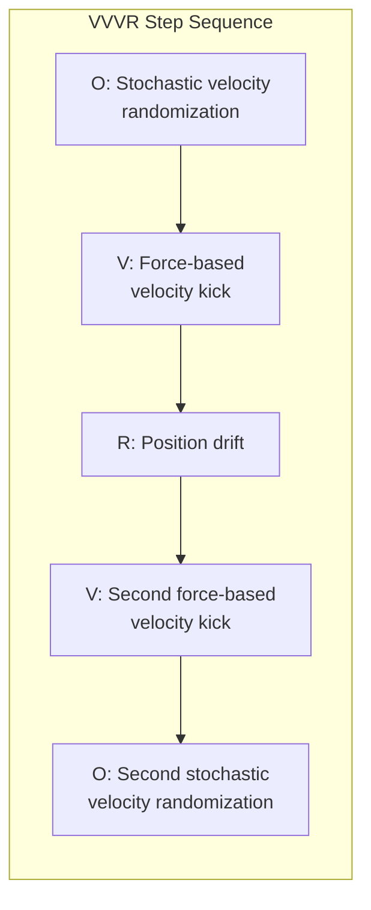
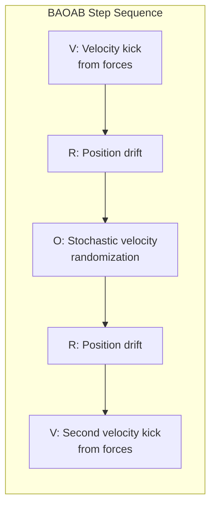
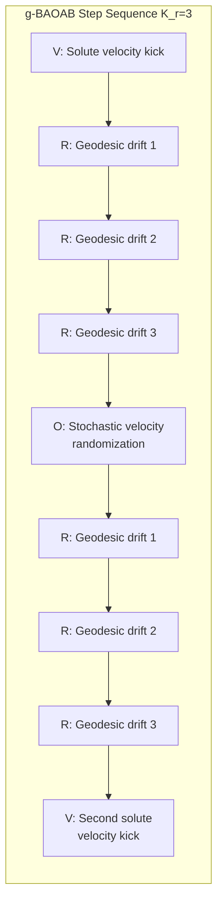
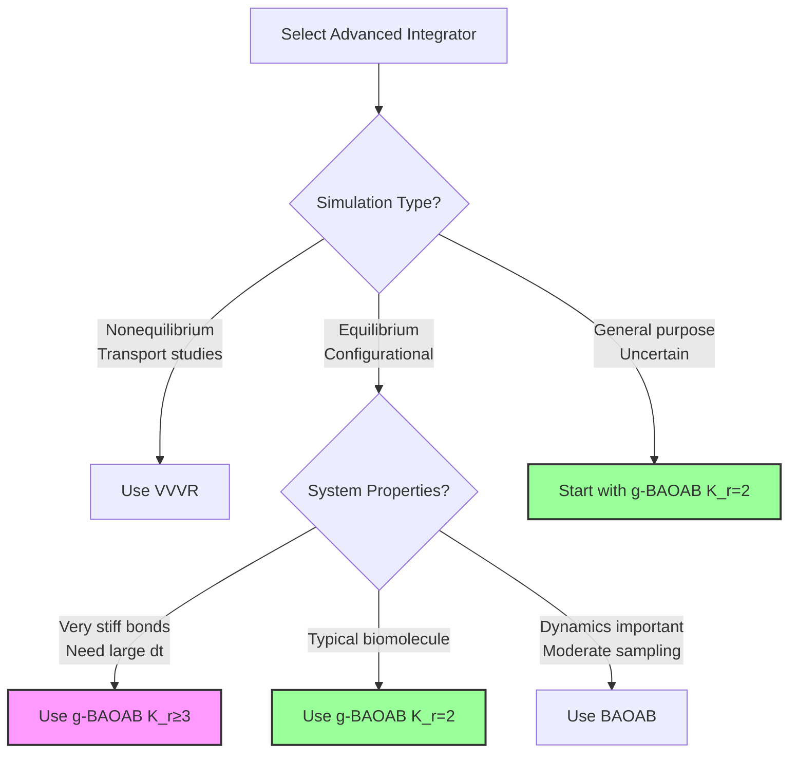

Advanced operator splitting schemes provide specialized integration strategies for Langevin dynamics, each optimized for different simulation scenarios. These integrators decompose the Langevin equation into solvable components and apply them in carefully designed sequences to achieve superior configurational sampling efficiency, reduced phase space errors, or enhanced stability for specific molecular properties.

## The Operator Splitting Framework

The Langevin integrator family in openmmtools is built upon a foundational operator splitting approach that divides the dynamics into three analytically tractable components. This decomposition enables the construction of various integration schemes through different sequencing of these basic operations.

**The Three Fundamental Operators:**

- **R (Drift)**: Deterministic position update using current velocities
  - x ← x + v dt
  - When constraints are present, positions are constrained and velocities adjusted to preserve momentum

- **V (Kick)**: Deterministic velocity update using forces
  - v ← v + (f/m) dt
  - Supports multiple time step force group splittings (V0, V1, etc.)

- **O (Ornstein-Uhlenbeck)**: Stochastic velocity update simulating heat bath interaction
  - v ← a v + b √(kT/m) R
  - Where a = exp(-γh), b = √(1 - exp(-2γh)), and R is standard Gaussian noise

This framework enables the creation of diverse integration schemes by simply rearranging the sequence of R, V, and O operations. The choice of sequence profoundly impacts the integrator's properties, including sampling efficiency, phase space accuracy, and stability for different types of molecular systems.

Sources: [openmmtools/integrators.py](openmmtools/integrators.py#L1016-L1080)

## VVVR: Velocity Verlet with Velocity Randomization

The VVVR integrator implements the splitting scheme "O V R V O", which provides timestep-invariant diffusion properties for nonequilibrium simulations. This scheme is particularly valuable when accurate dynamical properties are required alongside configurational sampling.

**Splitting Sequence:**



**Key Characteristics:**

The VVVR scheme applies stochastic velocity randomization at both the beginning and end of each timestep, with velocity Verlet force updates sandwiching the position drift. This symmetric arrangement ensures that the field-free diffusion constant remains invariant with respect to timestep size—a critical property for nonequilibrium studies where transport coefficients matter.

The integrator automatically tracks heat accumulation when `measure_heat=True`, enabling statistical analysis of energy exchange with the bath. This feature is particularly useful for verifying thermodynamic consistency in nonequilibrium protocols.

**Mathematical Foundation:**

VVVR includes a timestep correction factor that recovers continuous-time dynamical properties in discrete-time Langevin integration. This correction ensures that diffusion coefficients and other time-dependent properties converge to their continuum values even at relatively large timesteps.

**Code Example:**

```python
from openmm import unit
from openmmtools import integrators

# Create a VVVR integrator
temperature = 298.0 * unit.kelvin
collision_rate = 1.0 / unit.picoseconds
timestep = 1.0 * unit.femtoseconds

integrator = integrators.VVVRIntegrator(
    temperature=temperature,
    collision_rate=collision_rate,
    timestep=timestep,
    measure_heat=True  # Track heat exchange
)
```

**When to Use VVVR:**

- Nonequilibrium simulations requiring accurate dynamical properties
- Studies of transport coefficients or diffusion-limited processes
- Applications where timestep invariance of diffusion is critical
- Benchmarks requiring comparison with analytical Langevin solutions

Sources: [openmmtools/integrators.py](openmmtools/integrators.py#L2126-L2152), [examples/integrator-benchmarks/integrator-benchmarks.py](examples/integrator-benchmarks/integrator-benchmarks.py#L36-L38)

## BAOAB: Balanced Position-Velocity Ornstein-Uhlenbeck Alternating

The BAOAB integrator uses the splitting "V R O R V" and represents one of the most widely adopted schemes for molecular dynamics simulations. This scheme was introduced by Leimkuhler and Matthews and offers an excellent balance between configurational sampling efficiency and phase space accuracy.

**Splitting Sequence:**



**Key Characteristics:**

The BAOAB scheme derives its name from the sequence of operators: B (V kick), A (R drift), O (Ornstein-Uhlenbeck), A (R drift), B (V kick). By centering the stochastic O-step between two deterministic drifts, BAOAB achieves several desirable properties:

- **Minimal Phase Space Error**: The symmetric arrangement reduces discretization error in the conserved energy for the underlying Hamiltonian system
- **Good Sampling Efficiency**: The O-step placement prevents excessive correlation in configuration space
- **Reasonable Dynamical Properties**: While not optimized for dynamics, BAOAB still provides reasonably accurate short-time correlation functions

**Theoretical Advantages:**

BAOAB achieves superior configurational sampling by ensuring that position updates are influenced by both the current forces and thermal fluctuations within each timestep. This interleaving prevents the integrator from spending excessive time in regions of configuration space that would be poorly sampled by purely deterministic schemes.

**Code Example:**

```python
from openmm import unit
from openmmtools import integrators

# Create a BAOAB integrator
temperature = 298.0 * unit.kelvin
collision_rate = 91.0 / unit.picoseconds
timestep = 2.0 * unit.femtoseconds

integrator = integrators.BAOABIntegrator(
    temperature=temperature,
    collision_rate=collision_rate,
    timestep=timestep,
    constraint_tolerance=1e-8,
    measure_shadow_work=False
)
```

**When to Use BAOAB:**

- Equilibrium simulations focused on configurational properties
- Free energy calculations requiring efficient phase space exploration
- Biomolecular simulations where structural sampling is the primary goal
- General-purpose molecular dynamics where a balance of properties is desired

Sources: [openmmtools/integrators.py](openmmtools/integrators.py#L2153-L2194), [docs/integrators.rst](docs/integrators.rst#L31-L38)

## g-BAOAB: Geodesic BAOAB with Solvent-Solute Splitting

The geodesic BAOAB (g-BAOAB) integrator represents the state-of-the-art for equilibrium biomolecular simulations. Developed by Leimkuhler and Matthews in 2016, g-BAOAB extends the BAOAB framework through multiple subdrift steps and optional solvent-solute force splitting, achieving extraordinarily good sampling properties for complex biomolecular systems.

**Splitting Sequence:**



**Key Characteristics:**

The geodesic approach replaces the single position drift in standard BAOAB with multiple smaller drift steps (controlled by parameter K_r) around the stochastic O-step. This modification addresses a critical issue: the standard BAOAB integrator can suffer from resonance artifacts when the timestep is comparable to vibrational periods, particularly in systems with stiff bonds.

**Geodesic Integration:**

In geodesic BAOAB, the multiple R steps collectively approximate geodesic motion along the potential energy surface. By dividing the position update into smaller substeps, the integrator more accurately follows the natural curvature of the energy landscape, reducing sampling artifacts and enabling larger timesteps without loss of accuracy.

**Solvent-Solute Splitting:**

The g-BAOAB implementation supports advanced force group splittings that treat solvent and solute forces differently. For example, with K_r=K_p=2:
```
"V0 V1 R R O R R V1 R R O R R V1 V0"
```
This pattern evaluates slow-moving solute forces less frequently than fast-fluctuating solvent forces, enabling computational efficiency while maintaining sampling quality.

**Theoretical Superiority:**

g-BAOAB demonstrates "extraordinarily good properties for biomolecular simulation" according to the openmmtools documentation. The integrator achieves near-optimal sampling efficiency for configurational properties while maintaining excellent numerical stability, making it the recommended choice for most equilibrium applications.

**Code Example:**

```python
from openmm import unit
from openmmtools import integrators

# Create a geodesic BAOAB integrator with K_r=3
temperature = 298.0 * unit.kelvin
collision_rate = 1.0 / unit.picoseconds
timestep = 4.0 * unit.femtoseconds

integrator = integrators.GeodesicBAOABIntegrator(
    K_r=3,  # Number of geodesic drift steps
    temperature=temperature,
    collision_rate=collision_rate,
    timestep=timestep,
    constraint_tolerance=1e-8
)
```

> [!TIP]
> The default K_r=2 provides a good balance between accuracy and computational cost for most systems. Increase K_r to 3 or 4 for systems with very stiff bonds or when using larger timesteps (>3 fs). The geodesic approach typically allows 2-3× larger timesteps than standard BAOAB for comparable sampling accuracy.

**When to Use g-BAOAB:**

- **Default choice** for equilibrium biomolecular simulations
- Systems with stiff bonds or high-frequency vibrations
- Free energy calculations requiring optimal configurational sampling
- Simulations where computational efficiency through larger timesteps is valuable
- Any application where only equilibrium configurational properties matter

Sources: [openmmtools/integrators.py](openmmtools/integrators.py#L2195-L2242), [docs/integrators.rst](docs/integrators.rst#L33-L38)

## Comparison and Selection Guide

Understanding the trade-offs between these integrator schemes enables informed selection based on simulation goals and system characteristics.

**Integrator Properties Comparison:**

| Property | VVVR | BAOAB | g-BAOAB |
|----------|------|-------|---------|
| Splitting | O V R V O | V R O R V | V R...R O R...R V |
| Configurational Sampling | Good | Very Good | Excellent |
| Dynamical Accuracy | Very Good | Good | Moderate |
| Diffusion Invariance | Yes | No | No |
| Max Stable Timestep | 1-2 fs | 2-3 fs | 3-5 fs |
| Computational Cost | Standard | Standard | Higher (K_r × cost) |
| Nonequilibrium Suitability | Excellent | Good | Limited |
| Recommended Use | Transport studies | General purpose | **Default choice** |

**Decision Tree:**



**Performance Considerations:**

The computational overhead of g-BAOAB scales linearly with K_r, but this is typically offset by the ability to use 2-3× larger timesteps. Benchmark studies show that g-BAOAB with K_r=2 and a 4 fs timestep often achieves similar or better sampling accuracy per unit time compared to BAOAB with a 2 fs timestep.

**Parameter Recommendations:**

| Scenario | Collision Rate | Timestep | K_r |
|----------|---------------|----------|-----|
| Protein/water explicit | 91 ps⁻¹ | 4 fs | 2-3 |
| Implicit solvent | 1 ps⁻¹ | 10-20 fs | 2-3 |
| Small molecule explicit | 91 ps⁻¹ | 2-3 fs | 2 |
| Very stiff constraints | 91 ps⁻¹ | 2-4 fs | 3-4 |

Sources: [openmmtools/integrators.py](openmmtools/integrators.py#L2126-L2242), [examples/integrator-benchmarks/integrator-benchmarks.py](examples/integrator-benchmarks/integrator-benchmarks.py#L1-L80)

## Advanced Features and Extensions

The Langevin integrator framework provides several advanced capabilities that enhance functionality for specialized applications.

**Shadow Work and Heat Measurement:**

When `measure_shadow_work=True` and `measure_heat=True`, the integrators track the work performed by the symplectic substeps and heat exchanged with the bath. These quantities are essential for:
- Metropolization schemes based on shadow work
- Nonequilibrium work analysis
- Thermodynamic consistency verification
- Understanding discrete-time energy conservation

```python
# Enable work and heat measurement
integrator = integrators.GeodesicBAOABIntegrator(
    temperature=temperature,
    collision_rate=collision_rate,
    timestep=timestep,
    measure_shadow_work=True,
    measure_heat=True
)

# Access accumulated quantities
shadow_work = integrator.shadow_work
heat = integrator.heat

# Reset for new measurements
integrator.reset()
```

**Multiple Time Step Force Splittings:**

All three integrators support force group-based MTS splittings, enabling different force components to be evaluated at different frequencies. This is particularly valuable for systems with multiple force terms operating at different timescales.

```python
# Solvent-solute splitting example
integrator = integrators.GeodesicBAOABIntegrator(
    temperature=temperature,
    collision_rate=collision_rate,
    timestep=timestep,
    splitting="V0 V1 R R O R R V1 R R O R R V1 V0"
)
# Force group 0: evaluated once per timestep
# Force group 1: evaluated twice per timestep
```

**Metropolization:**

The framework supports Metropolization through shadow work, providing exact sampling properties for cases where discrete-time artifacts are unacceptable. This feature is automatically enabled when the splitting string contains "{" and "}" delimiters.

> [!TIP]
> Metropolization introduces additional computational cost and potential rejection, making it most valuable when exact sampling is required rather than typical equilibrium applications. For most biomolecular simulations, g-BAOAB without Metropolization provides sufficient accuracy.

Sources: [openmmtools/integrators.py](openmmtools/integrators.py#L1174-L1220), [openmmtools/integrators.py](openmmtools/integrators.py#L1366-L1550)

## Practical Usage Patterns

Established patterns for using these integrators effectively in production simulations.

**Typical Production Simulation:**

```python
from openmm import unit, app
from openmmtools import integrators, testsystems

# Create system and integrator
testsystem = testsystems.AlanineDipeptideImplicit()
integrator = integrators.GeodesicBAOABIntegrator(
    temperature=298.0 * unit.kelvin,
    collision_rate=91.0 / unit.picoseconds,
    timestep=4.0 * unit.femtoseconds,
    K_r=2
)

# Setup simulation
simulation = app.Simulation(
    testsystem.topology,
    testsystem.system,
    integrator
)
simulation.context.setPositions(testsystem.positions)
simulation.minimizeEnergy()

# Production run
simulation.reporters.append(app.DCDReporter('output.dcd', 1000))
simulation.reporters.append(
    app.StateDataReporter('data.csv', 1000, 
                          step=True, time=True,
                          potentialEnergy=True, temperature=True)
)
simulation.step(100000)  # 400 ps with 4 fs timestep
```

**Comparison Benchmarking:**

```python
import time
integrators_to_compare = [
    ('BAOAB', integrators.BAOABIntegrator()),
    ('g-BAOAB_K2', integrators.GeodesicBAOABIntegrator(K_r=2)),
    ('g-BAOAB_K3', integrators.GeodesicBAOABIntegrator(K_r=3))
]

for name, integrator in integrators_to_compare:
    context = openmm.Context(testsystem.system, integrator)
    context.setPositions(testsystem.positions)
    
    start = time.time()
    integrator.step(10000)
    elapsed = time.time() - start
    
    state = context.getState(getEnergy=True)
    energy = state.getPotentialEnergy()
    
    print(f"{name}: {elapsed:.3f}s, PE={energy}")
    del context
```

Sources: [examples/integrator-benchmarks/integrator-benchmarks.py](examples/integrator-benchmarks/integrator-benchmarks.py#L1-L80), [openmmtools/tests/test_integrators.py](openmmtools/tests/test_integrators.py#L850-L1000)

## References and Further Reading

The theoretical foundations of these integrator schemes are well-established in the literature.

**Primary References:**

- **BAOAB**: Leimkuhler, B., & Matthews, D. (2013). Rational construction of stochastic numerical methods for molecular sampling. *Applied Mathematics Research eXpress*, 2013(1), 34-73. https://academic.oup.com/amrx/article-abstract/2013/1/34/166771

- **g-BAOAB**: Leimkuhler, B., & Matthews, D. (2016). Efficient molecular dynamics using geodesic integration and solvent-solute splitting. *Proceedings of the Royal Society A*, 472(2189), 20160138. http://rspa.royalsocietypublishing.org/content/472/2189/20160138

- **VVVR**: Sivak, D. A., Chodera, J. D., & Crooks, G. E. (2013). Time step rescaling recovers continuous-time dynamical properties for discrete-time Langevin integration of nonequilibrium systems. *Physical Review Letters*, 110(17), 170602. http://arxiv.org/abs/1301.3800

**Comprehensive Treatment:**

- Leimkuhler, B., & Matthews, D. (2015). *Molecular Dynamics: With Deterministic and Stochastic Numerical Methods*. Interdisciplinary Applied Mathematics, Vol. 39. Springer. (Chapter 7 covers Langevin integration in depth)

**Related Topics:**

For deeper understanding of the broader context, see [Langevin Integrators and Splitting Schemes](7-langevin-integrators-and-splitting-schemes) for the general framework, and [Hamiltonian Monte Carlo (HMC) and GHMC](9-hamiltonian-monte-carlo-hmc-and-ghmc) for Metropolized variants. For free energy applications using nonequilibrium protocols, explore [Nonequilibrium Integrators for Free Energy Calculations](10-nonequilibrium-integrators-for-free-energy-calculations).