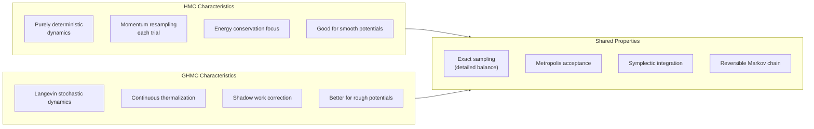

This page explores two powerful Metropolis-Hastings-based integrators that combine molecular dynamics with statistical mechanics to ensure exact sampling from target distributions. Both Hybrid Monte Carlo (HMC) and Generalized Hybrid Monte Carlo (GHMC) provide reversible Markov chain Monte Carlo methods with excellent mixing properties for complex biomolecular systems.

## Algorithmic Foundations

HMC and GHMC both leverage symplectic integration schemes to propose distant states in configuration space while maintaining detailed balance through Metropolis acceptance. The key insight is that Hamiltonian dynamics conserves energy and can explore high-dimensional spaces more efficiently than random-walk proposals.

**HMC** follows a classic three-step algorithm: sample momenta from Maxwell-Boltzmann distribution, integrate Hamiltonian dynamics for n steps using velocity Verlet, then accept or reject based on energy difference. This deterministic trajectory through phase space generates coherent proposals that can cross energy barriers.

**GHMC** extends this concept by incorporating stochastic velocity updates through the Langevin equation. The algorithm uses Ornstein-Uhlenbeck dynamics to simulate thermalization between symplectic integration steps, then applies a Metropolis correction to eliminate discretization error. The splitting scheme `O { V R V } O` represents: stochastic velocity update (O), constrained deterministic dynamics block (V R V), and final stochastic update (O).

Sources: [integrators.py](openmmtools/integrators.py#L886-L1015), [integrators.py](openmmtools/integrators.py#L2243-L2290)

## HMCIntegrator Architecture

The `HMCIntegrator` class implements a standalone HMC integrator using OpenMM's CustomIntegrator framework. Each call to `step(1)` executes a complete HMC trial consisting of momentum resampling, nsteps of velocity Verlet integration, and Metropolis acceptance.

The integrator maintains several global variables for bookkeeping: `naccept` (number of accepted moves), `ntrials` (total trials), and energy tracking variables. Per-degree-of-freedom variables store old positions (`xold`) and intermediate constraint positions (`x1`).

```python
# Initialize HMCIntegrator
from openmmtools import integrators
from openmm import unit

integrator = integrators.HMCIntegrator(
    temperature=298.0 * unit.kelvin,
    nsteps=10,  # velocity Verlet steps per trial
    timestep=1.0 * unit.femtoseconds
)

# Access acceptance statistics
acceptance_rate = integrator.acceptance_rate  # n_accept / n_trials
n_trials = integrator.n_trials
n_accepted = integrator.n_accept
```

**Warning**: A critical implementation detail is that calling `integrator.step(1)` actually advances the simulation by `timestep` units, not `timestep * nsteps` as might be expected. The TODO in the source code indicates this is a known issue requiring correction.

Sources: [integrators.py](openmmtools/integrators.py#L886-L1015)

## GHMCIntegrator Architecture

The `GHMCIntegrator` class extends `LangevinIntegrator`, inheriting its sophisticated operator splitting framework. It uses the splitting string `"O { V R V } O"` to define the integration scheme:

- **O (Ornstein-Uhlenbeck)**: Stochastic velocity update simulating interaction with heat bath
- **{ (Metropolis start)**: Begin shadow work accumulation region
- **V (Velocity kick)**: Deterministic velocity update using forces
- **R (Position drift)**: Deterministic position update using velocities
- **} (Metropolis end)**: Apply acceptance/rejection based on accumulated shadow work

```python
# Initialize GHMCIntegrator
integrator = integrators.GHMCIntegrator(
    temperature=298.0 * unit.kelvin,
    collision_rate=1.0 / unit.picoseconds,
    timestep=1.0 * unit.femtoseconds
)

# Access inherited acceptance statistics
acceptance_rate = integrator.acceptance_rate
shadow_work = integrator.shadow_work  # Work done during integration
```

The Metropolization mechanism in GHMC accumulates "shadow work"—the difference between the exact continuous-time dynamics and the discretized approximation. This accumulated error is then corrected through a Metropolis acceptance step using the Boltzmann factor `exp(-shadow_work/kT)`.

Sources: [integrators.py](openmmtools/integrators.py#L2243-L2290), [integrators.py](openmmtools/integrators.py#L1016-L1155)

## Operator Splitting Framework

Both integrators rely on the mathematical decomposition of the Langevin propagator into three analytically solvable components:

| Operator | Symbol | Physical Meaning | Update Formula |
|----------|--------|------------------|----------------|
| Position drift | R | Deterministic position update | x ← x + v·dt |
| Velocity kick | V | Deterministic velocity update | v ← v + (f/m)·dt |
| Ornstein-Uhlenbeck | O | Stochastic thermalization | v ← a·v + b·σ·R |

Where `a = exp(-γ·dt)` and `b = sqrt(1 - exp(-2γ·dt))` with γ as the collision rate, σ = sqrt(kT/m), and R as a standard normal random variable.

> [!TIP]
> The choice of splitting scheme critically impacts sampling efficiency. GHMC's `"O { V R V } O"` splitting provides good phase space exploration with moderate stochasticity, while alternative schemes like `"V R O R V"` (BAOAB) offer enhanced configurational sampling by more frequently applying stochastic updates.

Sources: [integrators.py](openmmtools/integrators.py#L1016-L1155), [integrators.py](openmmtools/integrators.py#L1405-L1475)

## Metropolization Mechanism

The Metropolis acceptance correction eliminates integration error and ensures detailed balance. For both HMC and GHMC, acceptance probability follows:

```
P_accept = min[1, exp(-(E_new - E_old)/kT)]
```

In HMC, E represents total Hamiltonian (kinetic + potential energy). In GHMC, E_new - E_old is the accumulated shadow work from deterministic steps. The implementation uses a clever trick:

```python
self.addComputeGlobal("accept", "step(exp(-(Enew-Eold)/kT) - uniform)")
self.addComputePerDof("x", "x*accept + xold*(1-accept)")
```

The `step()` function returns 1 if its argument is positive, 0 otherwise. Multiplying by `accept` implements the accept/reject decision in a vectorized manner without explicit branching.

Sources: [integrators.py](openmmtools/integrators.py#L1540-L1559), [integrators.py](openmmtools/integrators.py#L1287-L1359)

## MCMC Integration: HMCMove and GHMCMove

The `openmmtools.mcmc` module provides wrapper classes that integrate HMC and GHMC integrators into the Markov Chain Monte Carlo framework. These move classes handle context management, statistics tracking, and integration with the `MCMCSampler` infrastructure.

**HMCMove** is the MCMC move that wraps `HMCIntegrator`:

```python
from openmmtools.mcmc import HMCMove
from openmmtools import testsystems, states
from openmm import unit

# Create test system
test = testsystems.AlanineDipeptideVacuum()
thermodynamic_state = states.ThermodynamicState(
    system=test.system,
    temperature=298 * unit.kelvin
)
sampler_state = states.SamplerState(positions=test.positions)

# Create HMC move
hmc_move = HMCMove(
    timestep=0.5 * unit.femtoseconds,
    n_steps=10
)

# Apply move (updates sampler_state)
hmc_move.apply(thermodynamic_state, sampler_state)
```

**GHMCMove** wraps `GHMCIntegrator` with additional statistics tracking:

```python
from openmmtools.mcmc import GHMCMove

ghmc_move = GHMCMove(
    timestep=0.5 * unit.femtoseconds,
    collision_rate=20.0 / unit.picoseconds,
    n_steps=1000
)

# Track acceptance statistics
print(f"Acceptance rate: {ghmc_move.fraction_accepted}")
print(f"Trials: {ghmc_move.n_proposed}, Accepted: {ghmc_move.n_accepted}")

# Reset statistics
ghmc_move.reset_statistics()
```

Both moves inherit from `BaseIntegratorMove`, which provides context caching, restart attempts on numerical failures, and serialization support.

Sources: [mcmc.py](openmmtools/mcmc.py#L1323-L1596), [mcmc.py](openmmtools/mcmc.py#L603-L801)

## Algorithm Flow Diagrams

The execution flow for HMC and GHMC follows distinct patterns reflecting their different theoretical foundations:

```mermaid
flowchart TD
    subgraph HMC ["HMC Algorithm"]
        H1["Start"] --> H2["Draw v ~ Maxwell-Boltzmann"]
        H2 --> H3["Save old state: xold, Eold"]
        H3 --> H4{Loop: nsteps}
        H4 -->|Step| H5["Half-step velocity: v ← v + 0.5·dt·f/m"]
        H5 --> H6["Full-step position: x ← x + dt·v"]
        H6 --> H7["Apply position constraints"]
        H7 --> H8["Half-step velocity: v ← v + 0.5·dt·f/m + constraint correction"]
        H8 --> H9["Apply velocity constraints"]
        H9 --> H4
        H4 -->|Complete| H10["Compute new energy: Enew"]
        H10 --> H11["Metropolis acceptance: min[1, exp(-(Enew-Eold)/kT)]"]
        H11 --> H12{"Accept?"}
        H12 -->|Yes| H13["Keep new state, increment naccept"]
        H12 -->|No| H14["Restore xold, flip velocities"]
        H13 --> H15["End"]
        H14 --> H15
    end

    subgraph GHMC ["GHMC Algorithm"]
        G1["Start"] --> G2["Ornstein-Uhlenbeck: v ← a·v + b·σ·gaussian"]
        G2 --> G3["Save old state: xold, vold"]
        G3 --> G4["Begin Metropolis block: reset shadow_work = 0"]
        G4 --> G5["Velocity kick: v ← v + dt·f/m"]
        G5 --> G6["Position drift: x ← x + dt·v"]
        G6 --> G7["Apply constraints"]
        G7 --> G8["Velocity kick: v ← v + dt·f/m + correction"]
        G8 --> G9["Apply constraints"]
        G9 --> G10["End Metropolis block: accumulate shadow_work"]
        G10 --> G11["Ornstein-Uhlenbeck: v ← a·v + b·σ·gaussian"]
        G11 --> G12["Metropolis: min[1, exp(-shadow_work/kT)]"]
        G12 --> G13{"Accept?"}
        G13 -->|Yes| G14["Keep state, increment naccept"]
        G13 -->|No| G15["Restore xold, reverse velocities"]
        G14 --> G16["End"]
        G15 --> G16
    end
```



Sources: [integrators.py](openmmtools/integrators.py#L886-L1015), [integrators.py](openmmtools/integrators.py#L1405-L1475)

## Parameter Selection Guidelines

Choosing appropriate parameters is crucial for efficient sampling:

| Parameter | HMCIntegrator | GHMCIntegrator | Typical Range | Impact |
|-----------|---------------|----------------|---------------|---------|
| **timestep** | 0.5-2.0 fs | 0.5-4.0 fs | 1-5 fs | Larger steps = more distance but lower acceptance |
| **nsteps** (HMC) / **n_steps** (HMCMove) | 5-100 | - | 10-100 | Longer trajectories = better mixing but more expensive |
| **collision_rate** (GHMC) | - | 1-100 ps⁻¹ | 5-50 ps⁻¹ | Higher = more stochasticity, less correlation |
| **n_steps** (GHMCMove) | - | 100-5000 | 500-2000 | Steps per move application |

> [!TIP]
> A practical heuristic: tune timestep to achieve ~65-80% acceptance rate for HMC, or 60-75% for GHMC. Monitor acceptance rates during equilibration and adjust parameters accordingly. For systems with stiff bonds (explicit solvent), use smaller timesteps; for implicit solvent or coarse-grained systems, larger timesteps are feasible.

Sources: [integrators.py](openmmtools/integrators.py#L886-L1015), [mcmc.py](openmmtools/mcmc.py#L1323-L1596)

## Comparative Analysis



**Key differences:**

1. **Stochasticity**: HMC is purely deterministic between momentum resampling, while GHMC incorporates continuous stochastic thermalization through the Ornstein-Uhlenbeck process.

2. **Momentum handling**: HMC completely resamples momenta from Maxwell-Boltzmann each trial, whereas GHMC gradually thermalizes velocities through Langevin dynamics.

3. **Energy considerations**: HMC acceptance depends on total Hamiltonian change; GHMC acceptance depends on shadow work accumulated during deterministic steps.

4. **Trajectory structure**: HMC requires explicit `nsteps` parameter controlling trajectory length; GHMC uses fixed splitting with momentum thermalization integrated into each step.

5. **适用场景**: HMC excels in smooth potentials with good energy conservation; GHMC handles rougher energy landscapes better due to continuous stochasticity.

Sources: [integrators.py](openmmtools/integrators.py#L886-L1015), [integrators.py](openmmtools/integrators.py#L2243-L2290)

## Practical Usage Examples

### Basic HMC Simulation

```python
from openmmtools import integrators, testsystems
from openmm import unit, Context

# Create system
test = testsystems.AlanineDipeptideVacuum()

# Create HMC integrator
hmc_integrator = integrators.HMCIntegrator(
    temperature=300.0 * unit.kelvin,
    nsteps=20,
    timestep=1.0 * unit.femtoseconds
)

# Create context
context = Context(test.system, hmc_integrator)
context.setPositions(test.positions)
context.setVelocitiesToTemperature(300.0 * unit.kelvin)

# Run simulation
for i in range(100):
    hmc_integrator.step(1)  # One HMC trial
    if i % 10 == 0:
        print(f"Step {i}, acceptance: {hmc_integrator.acceptance_rate:.3f}")
```

### GHMC within MCMC Framework

```python
from openmmtools.mcmc import MCMCSampler, GHMCMove
from openmmtools import testsystems, states, cache
from openmm import unit

# Setup system and states
test = testsystems.AlanineDipeptideVacuum()
thermodynamic_state = states.ThermodynamicState(
    system=test.system,
    temperature=298.0 * unit.kelvin
)
sampler_state = states.SamplerState(positions=test.positions)

# Create GHMC move
ghmc_move = GHMCMove(
    timestep=2.0 * unit.femtoseconds,
    collision_rate=20.0 / unit.picoseconds,
    n_steps=500
)

# Create sampler with context caching
sampler = MCMCSampler(thermodynamic_state, sampler_state, move=ghmc_move)

# Minimize and equilibrate
sampler.minimize()

# Run production
sampler.run(n_iterations=1000)

# Check statistics
print(f"GHMC acceptance: {ghmc_move.fraction_accepted:.3f}")
```

### Combining Multiple Move Types

```python
from openmmtools.mcmc import SequenceMove, WeightedMove, HMCMove, LangevinDynamicsMove

# Combine HMC and Langevin moves
sequence_move = SequenceMove([
    HMCMove(timestep=1.0*unit.femtoseconds, n_steps=10),
    LangevinDynamicsMove(n_steps=100)
])

# Or random selection
weighted_move = WeightedMove([
    (GHMCMove(n_steps=500), 0.7),  # 70% GHMC
    (HMCMove(n_steps=10), 0.3)     # 30% HMC
])

sampler = MCMCSampler(thermodynamic_state, sampler_state, move=weighted_move)
```

Sources: [mcmc.py](openmmtools/mcmc.py#L27-L105), [test_mcmc.py](openmmtools/tests/test_mcmc.py#L1-L100)

## Performance Considerations

Both HMC and GHMC require careful parameter balancing for optimal performance:

**Acceptance rate vs. efficiency**: The classic HMC tuning principle suggests ~65% acceptance for optimal efficiency in high-dimensional spaces. For GHMC, aim for 60-75% due to the additional stochastic thermalization.

**Shadow work measurement**: Both integrators can measure shadow work when enabled. This is essential for GHMC's Metropolis correction and useful for diagnosing integration errors.

**Context caching**: When using `GHMCMove` or `HMCMove` within the MCMC framework, leverage `ContextCache` to avoid expensive context creation overhead. The default `global_context_cache` automatically handles this on the fastest available platform.

**Multiple timestep schemes**: For systems with multiple force timescales, GHMC can use force group splittings (e.g., `"V0 V1 R R O R R V1 R R O R R V1 V0"`) to evaluate fast forces more frequently than slow forces.

Sources: [integrators.py](openmmtools/integrators.py#L1174-L1217), [mcmc.py](openmmtools/mcmc.py#L350-L439)

## Common Pitfalls and Troubleshooting

| Issue | Symptoms | Likely Cause | Solution |
|-------|----------|--------------|----------|
| Low acceptance (< 20%) | Very slow mixing, moves rarely accepted | Timestep too large, constraints violated | Reduce timestep, increase nsteps to maintain efficiency |
| High acceptance (> 95%) | Short step lengths, poor exploration | Timestep too small | Increase timestep or reduce nsteps |
| NaN energies | Simulation explosion | Constraint handling, timestep too large | Use smaller timestep, check constraint tolerance |
| Wrong time advancement | Inconsistent timing | HMC nsteps behavior | Remember step(1) advances by timestep, not timestep*nsteps |

> [!TIP]
> When debugging HMC/GHMC simulations, always check the constraint tolerance setting. Systems with many constraints (e.g., explicit water with SHAKE/RATTLE) may require tighter tolerance (1e-8) to maintain numerical stability during symplectic integration steps.

Sources: [integrators.py](openmmtools/integrators.py#L886-L1015), [test_integrators.py](openmmtools/tests/test_integrators.py#L1-L100)

## Next Steps

For deeper understanding of related concepts:

- **Langevin integrators and splitting schemes**: Explore the broader family of Langevin integrators and their operator splittings in [Langevin Integrators and Splitting Schemes](7-langevin-integrators-and-splitting-schemes)

- **Advanced splittings**: Learn about specialized schemes like BAOAB, VVVR, and geodesic-BAOAB in [Advanced Integrator Splittings (BAOAB, VVVR, g-BAOAB)](8-advanced-integrator-splittings-baoab-vvvr-g-baoab)

- **MCMC move framework**: Understand the architecture that enables composing different move types in [MCMC Move Abstraction and Base Classes](12-mcmc-move-abstraction-and-base-classes)

- **Dynamics-based moves**: See how HMC and GHMC fit into the broader category of dynamics-based MCMC methods in [Dynamics-Based Moves (Langevin, HMC, GHMC)](13-dynamics-based-moves-langevin-hmc-ghmc)

For practical implementation guidance, examine the test suites showing production-ready usage patterns in [test_integrators.py](openmmtools/tests/test_integrators.py#L1-L1252) and [test_mcmc.py](openmmtools/tests/test_mcmc.py#L1-L646).