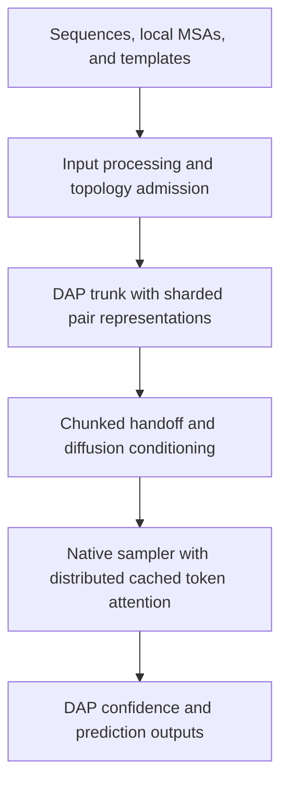

# Boltz-DAP: Dynamic Axial Parallelism for Boltz-2

Multi-GPU inference for large protein complexes with
[Boltz-2](https://github.com/jwohlwend/boltz).

Boltz-DAP distributes pair-representation computation across GPUs and combines
chunked operations, CPU staging, and distributed attention to reduce per-GPU
memory requirements. It provides a general DAP inference entrypoint and an
experimental BF16-mixed workflow targeting complete 60-subunit capsids on four
nodes and 32 GPUs.

- [Installation](#installation): the pinned Boltz version and required native patch.
- [General DAP inference](#general-dap-inference): direct single-node CLI usage.
- [Full60 BF16 workflow](#full60-bf16-workflow): public input, preparation, and Slurm launch.
- [Verification and limitations](#verification-and-limitations): what has actually been tested.
- [Citation](#citation): repository authors and a BibTeX entry for LaTeX.
- [Differences with Fold-CP](#differences-with-fold-cp): the retained project comparison.
- [Detailed full60 guide](https://github.com/coqylight/boltz_dap/blob/HEAD/docs/full60_bf16.md): controller and protocol details.

## Why DAP?

Boltz's pair representation has shape `[batch, tokens, tokens, channels]` and
grows quadratically with sequence length. Replicating large pair tensors and
their intermediates on one GPU can make otherwise useful complexes impractical.

Dynamic axial parallelism divides work along the pair axes. Each rank processes
a shard, while collectives exchange the rows, columns, or smaller attention
biases needed by individual operations. Chunking and selective CPU staging bound
additional intermediates. The full60 path also distributes cached diffusion
token attention while keeping the native sampler on rank zero.

DAP does not make every tensor smaller by exactly the GPU count. Replicated
state, communication buffers, diffusion, confidence computation, and CPU
offloading all affect memory and throughput. Large runs need substantial host
RAM as well as GPU memory.

## Installation

### Requirements

- Linux, Git, Bash, and Python 3.11 for the qualified installation.
- CUDA-capable PyTorch and a compatible NVIDIA driver; BF16-capable GPUs for the
	full60 profile.
- NCCL networking and shared filesystem access for multi-node execution.
- An authorized Boltz2 model/data cache, obtained separately under its applicable
	terms.

Use a checkout containing the full60 requirements, native patch, and portable
controller described below. Older repository revisions may not contain them.
Run the commands from that checkout's root, using a new virtual environment and
a separate, pristine native Boltz checkout:

```bash
python3.11 -m venv .venv
source .venv/bin/activate

python -m pip install --index-url https://download.pytorch.org/whl/cu128 torch==2.10.0+cu128
python -m pip install -r requirements-full60-bf16.txt

git clone --branch v2.2.1 --depth 1 https://github.com/jwohlwend/boltz.git ../boltz-native
test "$(git -C ../boltz-native rev-parse HEAD)" = "cb04aeccdd480fd4db707f0bbafde538397fa2ac"

python scripts/apply_full60_boltz_patch.py --boltz-checkout ../boltz-native --check-only
python scripts/apply_full60_boltz_patch.py --boltz-checkout ../boltz-native
python -m pip install -e ../boltz-native
python -m pip check
```

**The native patch is required for this codebase, including the general DAP
entrypoint.** Plain `pip install boltz` is not a complete installation. The patch
adds native helpers used by the distributed runtime; older instructions that
promise an entirely unmodified Boltz installation do not apply to this version.

The upstream base is official Boltz v2.2.1 at
`cb04aeccdd480fd4db707f0bbafde538397fa2ac`. The patch checks recorded dependency
hashes before and after application and refuses unexpected source states or a
second application. Do not apply it to an unrelated Boltz working checkout.

The qualified environment uses Torch 2.10.0+cu128, Triton 3.6.0, Lightning 2.5.0,
and the versions in [the requirements file](https://github.com/coqylight/boltz_dap/blob/HEAD/requirements-full60-bf16.txt). These
are observed qualification versions, not a complete transitive lockfile. The
pure-PyTorch distributed path was tested; optional ColossalAI integration was
not qualified.

Weights are not included. The full60 controller expects an existing cache with
`boltz2_conf.ckpt` and the required canonical molecule files under `mols/`; it
does not download missing model files or fetch MSAs.

## General DAP Inference

For a smaller complex, prepare a valid Boltz YAML input with sequences and local
MSAs, and optionally templates. Consult the
[upstream input documentation](https://github.com/jwohlwend/boltz/tree/v2.2.1/docs)
for the native format. Use the patched installation above for all modes.

Example for four GPUs on one allocated node:

```bash
torchrun --standalone --nnodes=1 --nproc_per_node=4 \
	boltz_dap_v2/run_boltz_dap_v2.py my_complex.yaml \
	--out_dir ./output \
	--cache /path/to/authorized/boltz-cache \
	--precision 32-true \
	--seed 42 \
	--no_kernels
```

Here `42` is an illustrative, explicitly chosen seed. Keep the same seed when
comparing configurations. `--no_kernels` selects the non-cuEquivariance kernel
path for this example; it can be slower. This direct CLI example is not the
full60 launch recipe, and the full60 resource/verification contract does not
automatically apply to arbitrary direct-CLI settings.

Inspect all supported options with:

```bash
python boltz_dap_v2/run_boltz_dap_v2.py --help
```

| Option | Purpose |
| --- | --- |
| `--out_dir` | Prediction and processed-input output directory. |
| `--cache` | Authorized Boltz model/data cache. |
| `--precision` | `32-true` or experimental `bf16-mixed`; direct CLI default is `32-true`. |
| `--execution-mode` | Direct CLI default is `legacy_dap`; the full60 controller selects its reviewed execution settings. |
| `--recycling_steps` | Number of recycling iterations. |
| `--sampling_steps` | Diffusion sampling steps. |
| `--diffusion_samples` | Number of requested predictions. |
| `--seed` | Explicit seed for reproducibility. |
| `--use_potentials` | Enable native FK/physical guidance. |
| `--use_msa_server` | Opt into a remote MSA service in direct CLI mode, not the full60 controller. |
| `--no_kernels` | Disable cuEquivariance kernels. |
| `--use_flex_attention_chunked` | Select the separate chunked FlexAttention option; not the full60 profile's fused path. |

The repository also contains [earlier getting-started notes](https://github.com/coqylight/boltz_dap/blob/HEAD/docs/GETTING_STARTED.md),
[prediction documentation](https://github.com/coqylight/boltz_dap/blob/HEAD/docs/boltz2_dap_prediction.md), and a
[hexamer reproduction workflow](https://github.com/coqylight/boltz_dap/blob/HEAD/repro/README.md). Their older environment and
launch assumptions are historical: use this README's patched installation and
the full60 guide for the new workflow. Legacy scripts are not evidence of
current full60 qualification.

## Full60 BF16 Workflow

The full60 profile is a specific configuration, not simply the direct CLI with
BF16 enabled. It combines sharded trunk execution, host-staged row/column
transport, fused BF16 triangle attention, compact features, distributed cached
token attention, and DAP confidence computation.

BF16-mixed does **not** mean all weights, tensors, or operations are BF16. Native
diffusion regions, model parameters, and cache storage retain FP32 where
required. TF32 is disabled in this profile.

### Profile

| Setting | Full60 profile |
| --- | --- |
| Layout | 4 nodes, 8 GPUs per node, 32 ranks total. |
| CPU allocation | 128 CPUs total. |
| Precision | BF16-mixed trunk/attention with required native FP32 regions. |
| Sampling | 3 recycles, 200 diffusion steps, 1 prediction. |
| Guidance | Native FK steering with 3 particles, physical/contact guidance, and 20 guidance-descent steps. |
| Templates | Local, soft/unfrozen; `force=false`, `freeze=false`. |
| Host RAM request | 1800 GiB per node. |
| Intended host peak ceiling | 1672 GiB per node; simultaneous peak certification remains open. |
| GPU allocated-memory ceiling | 80000 MiB per rank, **not** 80 GiB. |
| Wall time request | 72 hours. |
| Retries and resume | No automatic retry, requeue, or activation resume. |
| Optional trunk archives | Off; live inference caches remain enabled. |

These are configured requests and limits, not measurements proving the current
pipeline's full60 memory bounds. Confirm cluster policy, networking, available
memory, and shared paths before requesting this allocation. Smaller synthetic
tests do not establish that a new full60 workload fits.

### Public Example and Inputs

[The public 1LP3 YAML](https://github.com/coqylight/boltz_dap/blob/HEAD/examples/public_1lp3_full60.yaml) contains 60 protein
chains of 519 residues, or 31,140 sequence tokens. It is not the historical
60-by-534-residue benchmark input.

The [query-only MSA](https://github.com/coqylight/boltz_dap/blob/HEAD/examples/public_1lp3_query_only.csv) is a format fixture,
not an inference-quality evolutionary MSA. Supply a suitable local MSA for
scientific use. Download the corresponding public CIF separately:

```bash
curl --fail --location https://files.rcsb.org/download/1LP3.cif \
	--output examples/public_1lp3.cif
```

Check the template's biological assembly and modeled-chain identity for the
chosen input. Full60 admission requires exactly 60 unique, equally sized
protein chains, explicit local MSA paths, local CIF templates, and no explicit
contact or pocket restraints. Native contact guidance is distinct from adding
user-specified contact restraints.

### Prepare Without Launching Inference

Preparation is CPU-only. It processes inputs, checks chain/template topology,
hashes the input, release, and external dependencies, and creates a run binding.
It can still require substantial host memory and filesystem work.

```bash
python repro/full60_bf16.py prepare \
	--input examples/public_1lp3_full60.yaml \
	--cache /path/to/authorized/boltz-cache \
	--native-source ../boltz-native/src \
	--seed 42 \
	--run /shared/new-full60-run
```

Use a new run directory and retain the returned binding SHA256. A partially
prepared or previously executed directory is not reusable. Preparation does not
fetch MSAs, download weights, redraw seeds, submit a job, or reuse activations.

### Submit Explicitly

Only submit after reviewing the resource request and successful input admission.
The Python environment, release checkout, cache, native source, and run directory
must be accessible consistently on all allocated nodes.

```bash
export FULL60_PYTHON="$(command -v python)"
export FULL60_RELEASE="$PWD"

sbatch --account YOUR_ACCOUNT --partition YOUR_PARTITION \
	repro/full60_bf16.sbatch /shared/new-full60-run EXACT_BINDING_SHA256
```

`FULL60_RELEASE` is explicit because Slurm may execute a spooled copy of the
batch script. Replace the account, partition, paths, and binding hash with your
own values; copying this example is not a resource or publication approval.

The launcher performs node admission and a separate 32-rank CUDA/NCCL transport
preflight before inference. It uses a held OS-assigned rendezvous endpoint,
static membership, zero restarts, and fail-fast gates. Postflight requires
matching per-rank execution receipts and complete prediction artifacts. These
checks detect operational failures; they do not prove a correct biological
assembly or high-quality structure.

See [the full60 guide](https://github.com/coqylight/boltz_dap/blob/HEAD/docs/full60_bf16.md) and
[the profile](https://github.com/coqylight/boltz_dap/blob/HEAD/repro/full60_bf16.json) for the complete protocol and controls.

## Verification and Limitations

The following describes development qualification recorded on November 18, 2026.
It distinguishes small-test evidence from full-scale execution.

| Check | Result and scope |
| --- | --- |
| Isolated CPU/package checks | Passed native patch preconditions/application/reapplication refusal, source isolation, portable controller/CLI checks, and package/privacy checks. |
| Fresh installation | Passed in a new Python 3.11 environment with independently installed dependencies, official patched Boltz 2.2.1, and clean `pip check`; no inherited third-party site-packages. |
| Portable unit tests | 60 run: 59 passed and one CUDA-only test skipped during CPU qualification. |
| CPU distributed checks | Four-rank Gloo staged transport and attention checks, including padding and noncontiguous subgroups, passed. |
| Startup and public preprocessing | Two-worker held-port startup and actual public 60-chain CPU preprocessing passed, including in the fresh environment. |
| CUDA/NCCL smoke | Passed on two H800 GPUs on two nodes: FP32/BF16 staged transport, attention including fused BF16 paths, no-sequence Pairformer, cached token service, and portable-adapter contract fixtures. All measured tensor comparisons were bitwise-identical. |
| Historical full60 runs | Seven completed runs used an earlier, identical frozen runtime; they are reference evidence, not full60 validation of the newer code. |
| Latest full32/full60 execution | Not established for the current portable controller and newer runtime. |
| Production host-memory peak | Not certified; process RSS is not a simultaneous node-host peak measurement. |

The GPU smoke used one visible device per node. Nonzero CUDA-index handling and
noncontiguous subgroup logic have separate CPU/mock coverage, not equivalent
allocated-GPU coverage. Portable-adapter fixtures are not a full32 controller
execution. Exact comparisons in synthetic cases do not establish end-to-end
numerical equivalence or statistically equivalent structural accuracy.

To run the portable CPU regressions from the release checkout after installation:

```bash
export PYTHONPATH="$PWD/../boltz-native/src:$PWD:$PWD/boltz_dap_v2:$PWD/tests"

python repro/full60_bf16.py --self-test
CUDA_VISIBLE_DEVICES='' PYTHONNOUSERSITE=1 OMP_NUM_THREADS=1 OPENBLAS_NUM_THREADS=1 \
	python -m unittest discover -s tests -v
CUDA_VISIBLE_DEVICES='' PYTHONNOUSERSITE=1 OMP_NUM_THREADS=1 OPENBLAS_NUM_THREADS=1 \
	python boltz_distributed/test_comm_host_staging.py
bash -n repro/full60_bf16.sbatch
```

GPU availability is hidden only for the two CPU-test commands above. No
production job is submitted by these checks. Changing kernels, precision,
topology, dependencies, inputs, or protocol may require new scoped validation.

Low confidence, contraction, backbone problems, or poor packing can remain even
when inference completes. Evaluate confidence, geometry, interfaces, and
biological plausibility independently. This project does not guarantee freedom
from OOM, a correct capsid assembly, or experimental accuracy.

## Historical Smaller-Complex Results

Earlier project documentation reported the following memory use on four
NVIDIA RTX 5880 Ada GPUs with 48 GB VRAM each:

| AAV2 VP3 complex | Sequence tokens | Previously reported memory per GPU |
| --- | --- | --- |
| Trimer, 3 chains of 519 residues | 1,557 | Approximately 12 GB. |
| Pentamer, 5 chains of 519 residues | 2,595 | Approximately 36 GB. |
| Hexamer, 6 chains of 519 residues | 3,114 | Approximately 45 GB. |

These are historical reports from earlier code and configurations, not newly
measured limits for the current runtime. Measurement methods and settings were
not standardized across these examples. They should not be extrapolated to
full60, another GPU model, or a different number of samples.

## How It Works

The full60 execution path is organized around these stages:



- **Distributed pair operations:** row/column sharding and chunked triangle
	multiplication avoid replicating large pair intermediates where supported.
- **Bounded transport:** inference-only host staging releases selected GPU
	source storage before allocating destination buffers; it trades transfers and
	host RAM for GPU residency.
- **Chunked attention:** smaller bias exchanges and row/query chunks reduce
	attention intermediates. The full60 profile uses its selected fused BF16 path.
- **Cached diffusion token attention:** prediction-scoped projected biases are
	sharded and reused across denoising steps, with required FP32 cache storage.
- **Explicit execution contracts:** native source hashes, input bindings,
	admission gates, and rank receipts make configuration and operational failures
	visible rather than silently retrying or changing the workload.

The integration combines DAP wrappers with a versioned native Boltz patch. It is
not a drop-in claim that arbitrary upstream Boltz versions remain untouched.

## Project Layout

```text
boltz_dap_v2/             DAP layers, compact features, trunk and diffusion integration
boltz_distributed/        Initialization and communication primitives
docs/full60_bf16.md       Detailed full60 workflow
examples/                Public input and query-only MSA fixture
patches/boltz-2.2.1/      Native patch and dependency hash manifest
repro/full60_bf16.py      Preparation, admission, execution, and postflight controller
repro/full60_bf16.sbatch  Explicit four-node Slurm launcher
repro/full60_bf16.json    Reviewed precision, chunking, and resource profile
scripts/                 Patch application and auxiliary tools
tests/                   Portable numerical and controller regressions
licenses/                Upstream license texts and provenance information
```

Existing repository history also contains earlier scripts, logs, and example
outputs. The new full60 payload does not add model weights, private sequences,
private MSAs, prediction archives, or optional trunk activation dumps.
[The file allowlist](https://github.com/coqylight/boltz_dap/blob/HEAD/release_allowlist.json) identifies the selected full60
payload; it is not an inventory or privacy certification of all historical
repository files.

## Outputs and Reproducibility

The full60 workflow retains processed inputs, an immutable run binding,
admission/execution receipts, and native prediction artifacts. Its output
contract includes CIF, confidence, pLDDT, PAE, and PDE files. Direct CLI outputs
are placed under the requested output directory.

Record the release and native revisions, input/MSA/template identities, seed,
dependency versions, GPU topology, precision, and guidance settings when
reporting results. A matching seed alone does not guarantee identical outputs
across different kernels, software stacks, or topologies. Do not reuse stale
prepared bindings or activation caches with changed inputs or source files.

## License and Third-Party Notices

Boltz-DAP follows the MIT licensing approach of Boltz-2 for project code,
subject to the separately licensed third-party components it incorporates.
Boltz-derived code retains the
[original Boltz MIT notice](https://github.com/coqylight/boltz_dap/blob/HEAD/licenses/Boltz-MIT.txt).

The distributed implementation includes code adapted from FastFold, whose
[Apache-2.0 license](https://github.com/coqylight/boltz_dap/blob/HEAD/licenses/FastFold-LICENSE.txt) and applicable attribution
and modification-notice requirements must also be retained. The Boltz MIT
notice does not replace these obligations. See
[the third-party notices](https://github.com/coqylight/boltz_dap/blob/HEAD/THIRD_PARTY_NOTICES.md) and
[provenance record](https://github.com/coqylight/boltz_dap/blob/HEAD/licenses/provenance.json) for attribution, modification
notices, and the documented limitation on the historical adaptation revision.

Model parameters, databases, and prediction outputs have their own applicable
terms. This repository does not redistribute Boltz model weights or grant
additional rights to third-party data or parameters.

## Citation

If you use Boltz-DAP in your work, please cite this software repository:

**Geunhee Lee, Kim Won Joon, and Danqing Zhu. Boltz-DAP: Dynamic Axial Parallelism for Boltz-2.**
[https://github.com/coqylight/boltz_dap](https://github.com/coqylight/boltz_dap)

```bibtex
@misc{boltz_dap,
	author       = {Lee, Geunhee and Kim, Won Joon and Zhu, Danqing},
	title        = {{Boltz-DAP: Dynamic Axial Parallelism for Boltz-2}},
	howpublished = {\url{https://github.com/coqylight/boltz_dap}},
	note         = {Software repository}
}
```

Use `\cite{boltz_dap}` in LaTeX with the `url` or `hyperref` package loaded.
Please also identify the commit or public release used for your results.
Machine-readable citation metadata is provided in [CITATION.cff](https://github.com/coqylight/boltz_dap/blob/HEAD/CITATION.cff).

## References

Please cite the upstream methods and software relevant to your work:

- [Boltz-2](https://github.com/jwohlwend/boltz): the base model and inference framework.
- [FastFold](https://github.com/hpcaitech/FastFold): DAP communication primitives adapted by this project.
- [AlphaFold 3](https://github.com/google-deepmind/alphafold3): related structure-prediction architecture and research.
- [ColabFold](https://github.com/sokrypton/ColabFold): MSA tooling and the optional server workflow.

## Differences with [Fold-CP](https://github.com/NVIDIA-Digital-Bio/boltz-cp)

We note the parallel development of [Fold-CP](https://github.com/NVIDIA-Digital-Bio/boltz-cp) by the team at NVIDIA Digital Bio, which also enables multi-GPU Boltz-2 inference (and also training) with a different approach. We look forward to comparing and learning from each other's implementations!

Adapted from [boltz2_cp_prediction](https://github.com/NVIDIA-Digital-Bio/boltz-cp/blob/main/docs/boltz2_cp_prediction.md). Most of the original serial prediction's features are supported by Boltz-DAP.

The Fold-CP column is retained from the existing project documentation and has
not been re-audited against its latest revision. The Boltz-DAP entries describe
this codebase.

| Aspect                | Boltz-DAP (`boltz_dap_v2/run_boltz_dap_v2.py`)        | Fold-CP (`src/boltz/distributed/main.py`)                                          |
| --------------------- | ------------------------------------------- | ------------------------------------------------------------------------------------- |
| Multi-GPU strategy    | Dynamic axial parallelism: row/column pair-representation sharding with custom distributed operations; distributed cached diffusion token attention in the full60 profile. | `SingleDeviceStrategy` + DTensor CP mesh                                              |
| Device management     | One process per GPU; `LOCAL_RANK` selects the CUDA device, with NCCL initialized through `init_dap()`. | `DistributedManager` via `--size_dp`, `--size_cp`                                     |
| Launch method         | `torchrun` or `srun`          | `torchrun` or `srun`                                                                  |
| Input formats         | `config_files` (YAML/FASTA), `preprocessed` | `preprocessed` only                                                                   |
| `num_workers`         | Configurable                                | Fixed at `0` (DTensor CP requires main-process collation)                             |
| Precision             | Lightning `--precision` string              | Top-level `--precision` enum                                                          |
| Attention backends    | Native/PyTorch attention paths; optional FlexAttention and chunked FlexAttention; fused BF16 triangle attention in the full60 profile. | `--triattn_backend`, `--sdpa_with_bias_backend`, `--sdpa_with_bias_shardwise_backend` |
| CUDA memory profiling | Built-in node-local `nvidia-smi` monitoring and per-rank PyTorch allocated/peak-memory reporting; no dedicated profiling flag. | `--cuda_memory_profile` flag                                                          |
| Confidence prediction | **Supported**                                   | Not yet supported (`write_confidence_summary=False`)                                  |
| Steering potentials   | **Supported**                                   | Not yet supported                                                                     |
| Affinity prediction   | **Supported**                                   | Not yet supported                                                                     |
| Template features     | **Supported**                                   | Weights loaded but distributed TemplateModule not yet implemented                     |
| Constraint features   | **Supported**                                   | Not yet supported                                                                     |
| Checkpoint loading    | Native `Boltz2.load_from_checkpoint()` with `strict=True`, initially on CPU; DAP wrappers injected afterward. | Reads checkpoint hparams, merges v2 flags, loads with `strict=True`                   |
| Output writing        | Only DAP rank 0 writes prediction outputs. | Only CP rank 0 per DP group writes output                                             |

## Contact and Acknowledgements

For questions and collaboration, contact `gleeai@connect.ust.hk` or
`wjkimab@connect.ust.hk`.

We thank the Boltz team for releasing their models and software, the FastFold
team for their distributed communication work, the AlphaFold 3 team and the
broader biomolecular modeling community for their research contributions, and
the developers and maintainers of the dependencies used here. We also thank
contributors to the earlier Boltz-DAP workflows and documentation.

This project was developed with compute support from HKUST HPC4 and SuperPOD
at The Hong Kong University of Science and Technology, in the laboratory of
Prof. Bonnie Danqing Zhu, Department of Chemical and Biological Engineering.