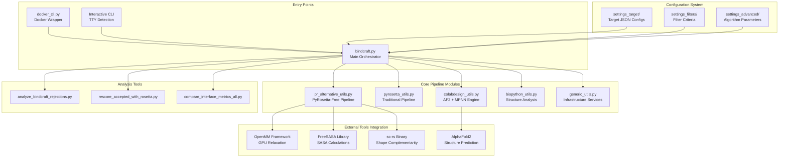
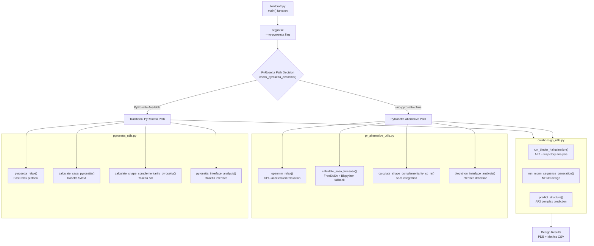

# Overview

<details>
<summary>Relevant source files</summary>

The following files were used as context for generating this wiki page:

- [README.md](README.md)

</details>


This document introduces FreeBindCraft, explaining its purpose as a PyRosetta-free protein design system, key features, and architectural overview. For detailed installation procedures, see [Installation](#2.1). For comprehensive configuration guidance, see [Configuration System](#5). For performance comparisons with traditional BindCraft, see [Performance & Benchmarks](#7).

## Purpose and Scope

FreeBindCraft is a modified version of Martin Pacesa's BindCraft (v1.52) that provides optional PyRosetta bypass functionality. The system enables protein binder design using either traditional PyRosetta-based methods or open-source alternatives including OpenMM, FreeSASA, and custom shape complementarity tools. This dual-path architecture allows users to perform protein design workflows without PyRosetta licensing requirements while maintaining compatibility with existing BindCraft configurations.

## Key Features

FreeBindCraft introduces several key innovations over the original BindCraft pipeline:

| Feature | PyRosetta Implementation | FreeBindCraft Alternative |
|---------|-------------------------|---------------------------|
| **Structural Relaxation** | PyRosetta FastRelax (CPU) | OpenMM with GPU acceleration (2-4x faster) |
| **Shape Complementarity** | Rosetta scoring functions | `sc-rs` open-source implementation |
| **SASA Calculations** | PyRosetta SASA | FreeSASA library with Biopython fallback |
| **Interface Analysis** | PyRosetta interface metrics | Biopython-based routines |
| **Deployment** | Local installation only | Local, Docker, and HPC (SLURM) support |
| **Runtime Control** | Fixed PyRosetta dependency | `--no-pyrosetta` flag for runtime switching |

The system maintains full backward compatibility with existing BindCraft configurations while providing the flexibility to run without PyRosetta when licensing or installation constraints exist.

**Sources:** [README.md:7-21](), [README.md:66-77]()

## System Architecture

### Core Component Overview

The following diagram shows the primary system components and their relationships, using actual module names from the codebase:



**Sources:** [README.md:1-10](), system architecture diagrams from context

### Dual-Path Architecture Implementation

This diagram illustrates the specific functions and modules involved in the PyRosetta vs PyRosetta-free decision paths:



**Sources:** [README.md:13-21](), [README.md:66-69](), pipeline flow diagrams from context

## Core Components

### Main Orchestrator

The `bindcraft.py` module serves as the primary entry point and pipeline coordinator. It handles argument parsing, configuration validation, and orchestrates the design workflow through the following key functions:

- `main()` - Primary entry point with argument processing
- `perform_input_check()` - Validates input files and configurations  
- `generate_directories()` - Sets up output directory structure
- `run_design_pipeline()` - Coordinates the multi-stage design process

### Design Engine Integration

The system integrates multiple computational engines through dedicated utility modules:

| Module | Primary Functions | Purpose |
|--------|------------------|---------|
| `colabdesign_utils.py` | `run_binder_hallucination()`, `run_mpnn()` | AlphaFold2-based design and MPNN sequence generation |
| `pyrosetta_utils.py` | `pyrosetta_relax()`, `calculate_interface_metrics()` | Traditional PyRosetta-based operations |
| `pr_alternative_utils.py` | `openmm_relax()`, `calculate_sasa_freesasa()` | Open-source alternatives to PyRosetta |
| `biopython_utils.py` | `analyze_structure()`, `calculate_secondary_structure()` | Structure analysis and validation |

### Configuration Management

The system uses a three-tier JSON configuration system managed by `generic_utils.py`:

1. **Target Settings** (`settings_target/*.json`) - Define protein targets, chains, and design constraints
2. **Filter Settings** (`settings_filters/*.json`) - Specify quality thresholds and selection criteria  
3. **Advanced Settings** (`settings_advanced/*.json`) - Control algorithm parameters and optimization strategies

**Sources:** [README.md:78](), table of contents structure, configuration system diagrams

## Usage Modes

### Interactive CLI Mode

When run without explicit settings or with the `--interactive` flag, `bindcraft.py` launches an interactive setup wizard that:

- Detects TTY environment automatically
- Validates input PDB file existence  
- Configures design type (miniprotein vs peptide) with appropriate filter restrictions
- Generates target settings JSON in the specified output directory
- Optionally launches Docker containers with GPU selection

### Command Line Mode

Direct execution with explicit configuration files:

```bash
python bindcraft.py \
  --settings './settings_target/target.json' \
  --filters './settings_filters/default_filters.json' \
  --advanced './settings_advanced/default_4stage_multimer.json' \
  --no-pyrosetta
```

### Containerized Deployment

The system supports Docker deployment through:

- `Dockerfile` - Container build specification with CUDA/OpenMM support
- `docker_cli.py` - Interactive Docker wrapper with GPU management
- Prebuilt images available at `cytokineking/freebindcraft-no-pyrosetta:latest`

**Sources:** [README.md:80-100](), [README.md:235-249](), [README.md:54-78]()

## Analysis and Validation Tools

FreeBindCraft includes comprehensive analysis capabilities in the `extras/` directory:

| Tool | Primary Function | Use Case |
|------|-----------------|----------|
| `analyze_bindcraft_rejections.py` | Quantify rejection reasons across runs | Debugging filter performance |
| `rescore_accepted_with_rosetta.py` | Validate PyRosetta-free results with PyRosetta | Cross-validation of design quality |
| `compare_interface_metrics_all.py` | Compare metrics across computational engines | Engine validation and benchmarking |
| `test_openmm_relax.py` | Test OpenMM relaxation protocols | System validation |

These tools enable comprehensive validation of the PyRosetta-free pipeline against traditional methods and facilitate debugging of design workflows.

**Sources:** [README.md:257-270]()

---