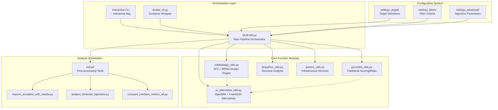
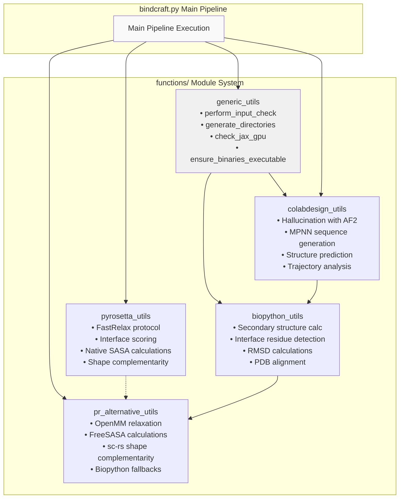
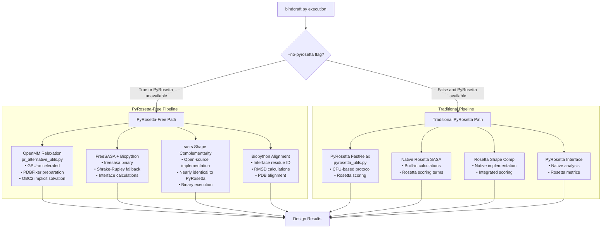
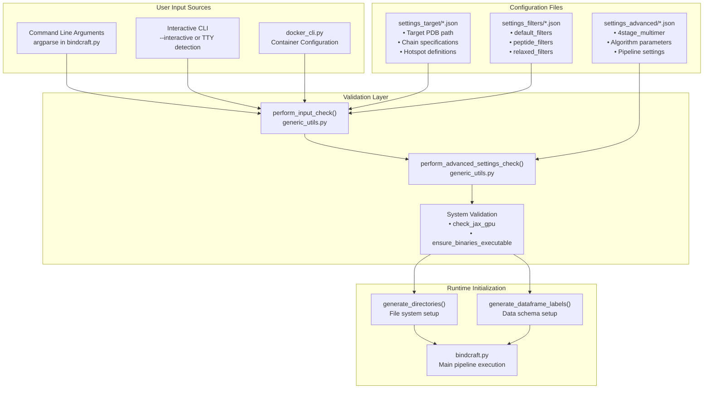
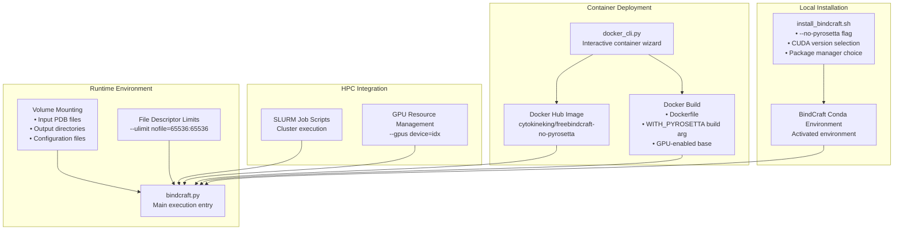

# System Architecture

Relevant source files

The following files were used as context for generating this wiki page:

- [README.md](README.md)
- [functions/__init__.py](functions/__init__.py)

This document provides a comprehensive overview of FreeBindCraft's modular architecture, explaining how the system's components interact to provide both traditional PyRosetta-based and PyRosetta-free protein design capabilities. For installation and deployment details, see [Installation](#2.1) and [Docker Deployment](#2.2). For configuration specifics, see [Configuration System](#5).

## Overview

FreeBindCraft implements a dual-path architecture that allows users to choose between PyRosetta-based traditional methods or open-source alternatives. The system is built around a modular design with clear separation between core pipeline logic, computational backends, configuration management, and analysis tools.

## High-Level System Architecture

**System Components Overview**

Sources: [README.md:1-303](), [functions/__init__.py:11-15]()

## Core Module Architecture

The system's functionality is organized into five primary modules under the `functions/` directory, each with distinct responsibilities:

**Module Dependencies and Interactions**

| Module | Primary Functions | Key Dependencies |
|--------|------------------|------------------|
| `generic_utils` | System setup, validation, directory management | Core infrastructure |
| `colabdesign_utils` | Design engine, hallucination, MPNN | JAX, ColabDesign |
| `biopython_utils` | Structure analysis, alignment, secondary structure | Biopython, NumPy |
| `pyrosetta_utils` | Traditional scoring, relaxation, interface metrics | PyRosetta |
| `pr_alternative_utils` | OpenMM relaxation, FreeSASA, open-source tools | OpenMM, FreeSASA, sc-rs |

Sources: [functions/__init__.py:11-15](), [README.md:15-21]()

## Dual-Path Design Philosophy

FreeBindCraft's core innovation is providing computational alternatives to PyRosetta-dependent operations through the `--no-pyrosetta` flag:

**PyRosetta vs PyRosetta-Free Execution Paths**

Sources: [README.md:13-21](), [README.md:66-77]()

## Configuration and Orchestration Layer

The system uses a three-tier JSON configuration system that controls all aspects of the design process:

**Configuration Flow and Validation**

Sources: [README.md:82-100](), [README.md:235-249]()

## Deployment Architecture

FreeBindCraft supports multiple deployment scenarios with consistent interfaces:

**Deployment Options and Container Integration**

Sources: [README.md:28-51](), [README.md:118-250]()

## Analysis and Validation Architecture

The system includes comprehensive post-processing tools for design validation and comparison:

| Tool | Purpose | Key Features |
|------|---------|--------------|
| `analyze_bindcraft_rejections.py` | Rejection analysis | Filter failure quantification, hypothetical ranking |
| `rescore_accepted_with_rosetta.py` | PyRosetta validation | Re-score PyRosetta-free designs with traditional methods |
| `compare_interface_metrics_all.py` | Engine comparison | Side-by-side PyRosetta vs FreeSASA vs Biopython metrics |
| `test_openmm_relax.py` | Relaxation testing | OpenMM vs PyRosetta relaxation comparison |

Sources: [README.md:257-270]()

The architecture demonstrates a well-designed separation of concerns, enabling users to leverage both traditional computational biology tools and modern open-source alternatives while maintaining compatibility and providing comprehensive analysis capabilities.

---