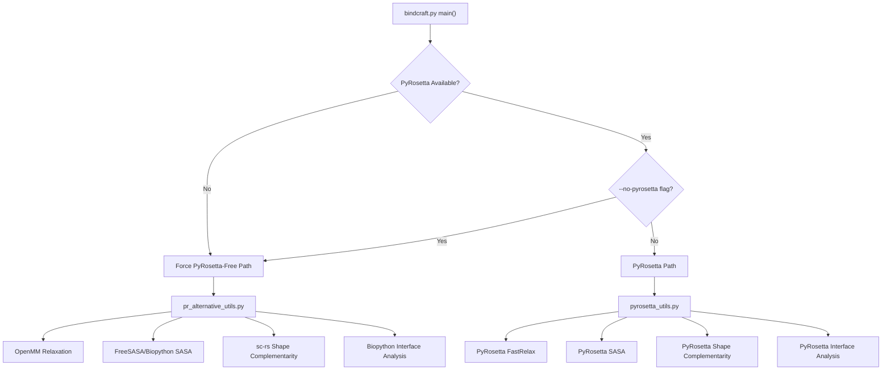
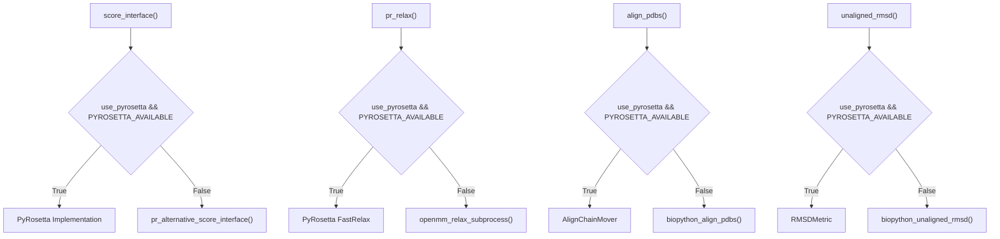
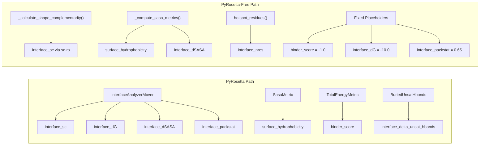
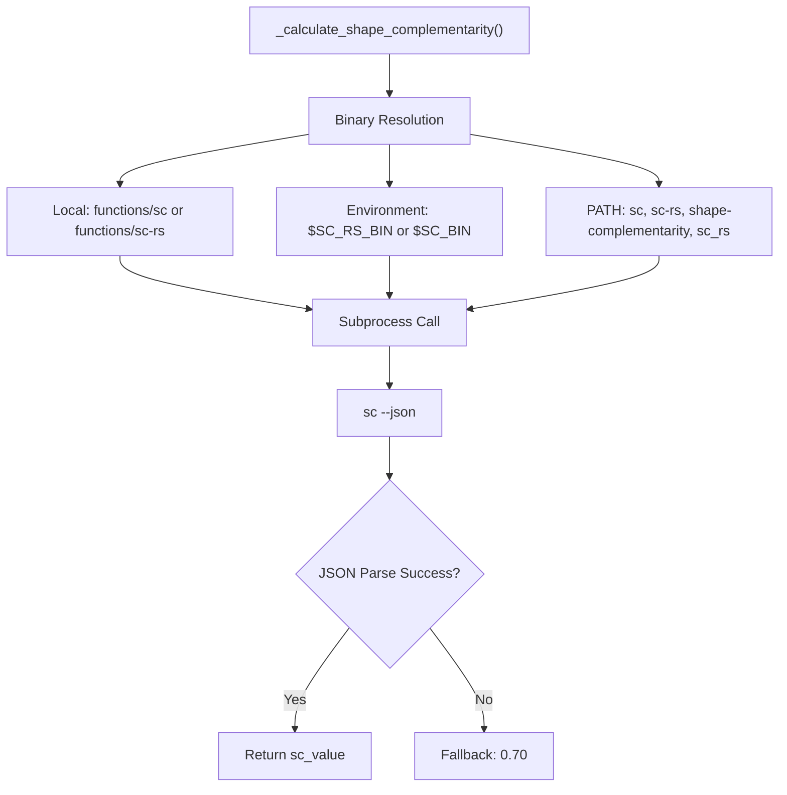
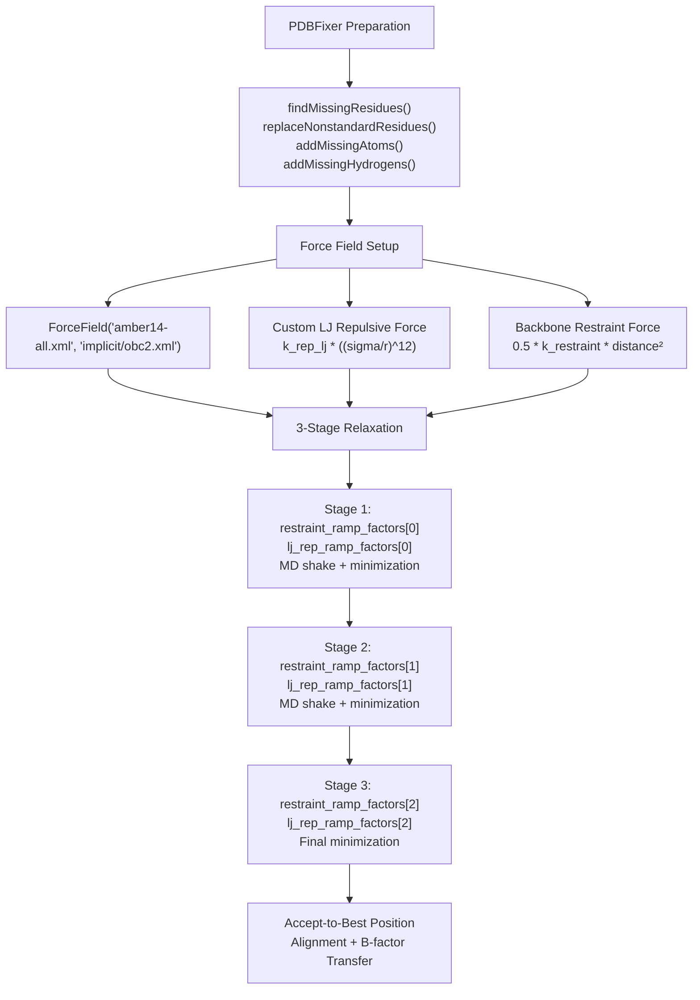

# PyRosetta vs PyRosetta-Free Design

<details>
<summary>Relevant source files</summary>

The following files were used as context for generating this wiki page:

- [README.md](README.md)
- [functions/pr_alternative_utils.py](functions/pr_alternative_utils.py)
- [functions/pyrosetta_utils.py](functions/pyrosetta_utils.py)

</details>


This document explains FreeBindCraft's key innovation: providing PyRosetta-free alternatives to traditional protein design workflows. It covers the technical differences between the two design paths, when to use each approach, and how the system automatically dispatches between them.

For installation and setup details, see [Installation](#2.1). For performance benchmarks comparing the approaches, see [Performance & Benchmarks](#7).

## Overview of Dual-Path Architecture

FreeBindCraft implements a dual-path design system where users can choose between traditional PyRosetta-based methods or open-source alternatives. This choice is controlled by the `--no-pyrosetta` flag and PyRosetta availability.

### Path Selection Logic



Sources: [README.md:13-21](), [functions/pyrosetta_utils.py:31-45]()

### Function Dispatch Pattern

The system uses a consistent dispatch pattern across all interface functions:



Sources: [functions/pyrosetta_utils.py:31-45](), [functions/pyrosetta_utils.py:187-193](), [functions/pyrosetta_utils.py:265-323]()

## Key Functional Differences

### Structure Relaxation

| Aspect | PyRosetta Path | PyRosetta-Free Path |
|--------|----------------|---------------------|
| **Implementation** | `FastRelax` protocol | OpenMM with custom restraints |
| **Force Field** | Rosetta REF2015 | AMBER14 + OBC2 implicit solvent |
| **Hardware** | CPU-based | GPU-accelerated (OpenCL/CUDA) |
| **Speed** | Baseline | 2-4x faster typically |
| **Restraints** | `constrain_relax_to_start_coords(True)` | Ramped backbone harmonic restraints |
| **Function** | `pr_relax()` | `openmm_relax_subprocess()` |

Sources: [functions/pyrosetta_utils.py:265-323](), [functions/pr_alternative_utils.py:525-891]()

### Interface Analysis

The PyRosetta-free path provides comprehensive interface scoring that closely matches PyRosetta results:



Sources: [functions/pyrosetta_utils.py:31-185](), [functions/pr_alternative_utils.py:892-1027]()

### SASA Calculations

The PyRosetta-free path offers two SASA computation engines:

#### FreeSASA Implementation
- **Primary engine**: [FreeSASA](https://github.com/mittinatten/freesasa) with NACCESS classifier
- **Configuration**: `functions/freesasa_naccess.cfg` or `FREESASA_CONFIG` environment variable
- **Function**: `_compute_sasa_metrics_with_freesasa()`

#### Biopython Fallback  
- **Secondary engine**: Shrake-Rupley algorithm with Chothia radii
- **Radii**: `R_CHOTHIA = {"H": 1.20, "C": 1.70, "N": 1.55, "O": 1.52, "S": 1.80}`
- **Function**: `_compute_sasa_metrics()`

Sources: [functions/pr_alternative_utils.py:380-524](), [functions/pr_alternative_utils.py:156]()

### Shape Complementarity

The PyRosetta-free path uses the `sc-rs` external tool:



Sources: [functions/pr_alternative_utils.py:185-285]()

## Technical Implementation Details

### OpenMM Relax Protocol

The OpenMM relaxation implements a sophisticated 3-stage protocol:



Sources: [functions/pr_alternative_utils.py:525-891]()

### Subprocess Isolation Strategy

The OpenMM relax runs in isolated subprocesses to avoid OpenCL context accumulation:

#### Rationale
OpenCL contexts can become unstable over long runs due to driver state accumulation. The subprocess approach provides complete teardown between relaxations.

#### Implementation
- **Function**: `openmm_relax_subprocess()`  
- **Retry Logic**: Up to 3 attempts on soft failures (input copied to output)
- **Output Filtering**: Suppresses OpenCL JIT spam (`"Failed to read file: /tmp/dep-*.d"`)
- **Timeout**: Configurable per subprocess call

Sources: [functions/pr_alternative_utils.py:23-24](), [functions/pr_alternative_utils.py:1030-1107]()

## Performance and Compatibility

### Computational Requirements

| Component | PyRosetta Path | PyRosetta-Free Path |
|-----------|----------------|---------------------|
| **CPU** | Required | Optional (minimization fallback) |
| **GPU** | Not used | Preferred (2-4x speedup) |
| **Memory** | ~2GB per trajectory | ~1GB per trajectory |
| **Dependencies** | PyRosetta license | Open-source only |

### Metric Compatibility

Most filters work identically between both paths. Key exceptions:

#### Rosetta-Specific Metrics (Placeholders Used)
- `binder_score`: Fixed to `-1.0` (passes `<= 0` filters)
- `interface_dG`: Fixed to `-10.0` (passes `<= 0` filters)  
- `interface_packstat`: Fixed to `0.65` (informational, no active filters)
- `interface_interface_hbonds`: Fixed to `5` (passes `>= 3` filters)
- `interface_delta_unsat_hbonds`: Fixed to `1` (passes `<= 4` filters)

#### Accurately Computed Metrics
- `interface_sc`: Via sc-rs (nearly identical to PyRosetta)
- `surface_hydrophobicity`: Via FreeSASA/Biopython residue selection
- `interface_dSASA`: Via monomer vs complex SASA difference
- `interface_fraction`: Via total dSASA / binder SASA in complex
- `interface_nres`: Via Biopython interface residue detection

Sources: [functions/pr_alternative_utils.py:994-1003](), [README.md:20]()

## Usage Recommendations

### When to Use PyRosetta Path
- **Validation studies** requiring exact Rosetta energy functions
- **Research workflows** where Rosetta-specific metrics are essential
- **CPU-only environments** without GPU acceleration
- **Existing PyRosetta licenses** and established workflows

### When to Use PyRosetta-Free Path  
- **Production pipelines** prioritizing throughput and cost
- **GPU-accelerated environments** seeking 2-4x speedup
- **License-restricted environments** requiring open-source solutions
- **Docker/cloud deployments** avoiding PyRosetta distribution complexity
- **Initial design exploration** where approximate metrics suffice

### Hybrid Workflow
A common pattern is to use PyRosetta-free for initial design generation, then rescore accepted designs with PyRosetta for validation:

```bash
# Fast initial design generation
python bindcraft.py --settings target.json --filters default_filters.json --no-pyrosetta

# Validate results with PyRosetta scoring  
python extras/rescore_accepted_with_rosetta.py --input_dir results/ --workers 4
```

Sources: [README.md:66-76](), [extras/rescore_accepted_with_rosetta.py]()

The system's dual-path architecture allows users to optimize for either speed (PyRosetta-free) or precision (PyRosetta) based on their specific requirements while maintaining filter compatibility between both approaches.

---