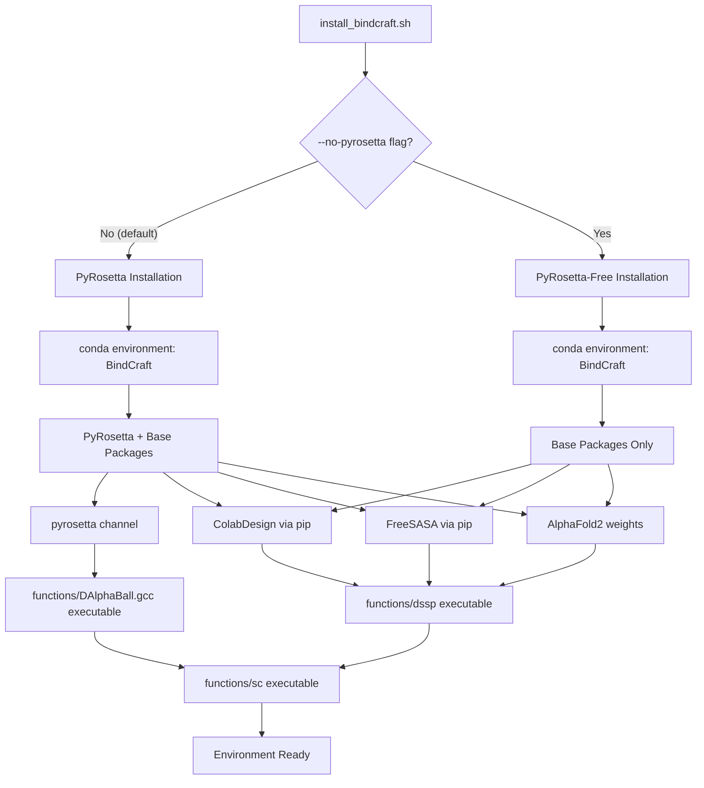
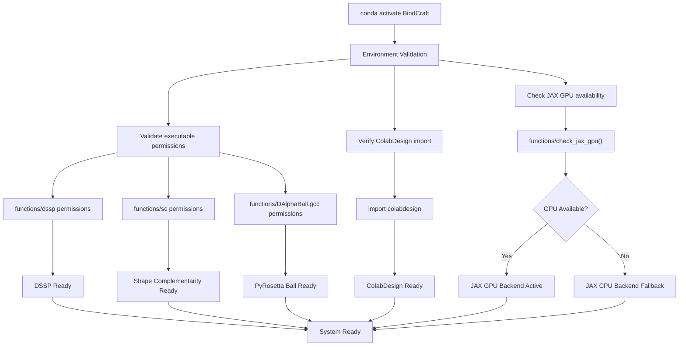
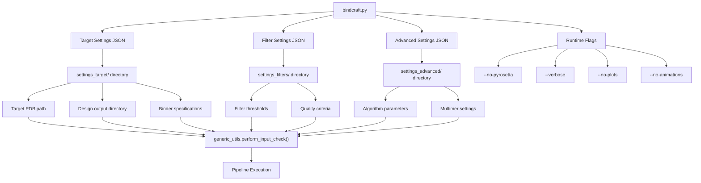
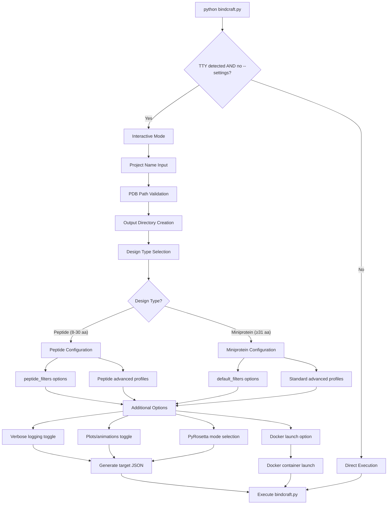

# Getting Started

<details>
<summary>Relevant source files</summary>

The following files were used as context for generating this wiki page:

- [README.md](README.md)
- [install_bindcraft.sh](install_bindcraft.sh)

</details>


This document covers the installation, initial setup, and first run of FreeBindCraft. It guides you through choosing between PyRosetta and PyRosetta-free installation modes, setting up the environment, and executing your first protein design workflow.

For detailed configuration of design parameters, see [Configuration System](#5). For understanding the core design pipeline mechanics, see [Core Pipeline](#3). For Docker-specific deployment strategies, see [Docker Deployment](#2.2).

## Installation Modes

FreeBindCraft supports two distinct installation modes through the `install_bindcraft.sh` script, each enabling different computational backends for protein design calculations.



### Standard Installation with PyRosetta

The default installation includes PyRosetta for traditional Rosetta-based calculations:

```bash
bash install_bindcraft.sh --cuda '12.4' --pkg_manager 'conda'
```

This mode installs packages from the `https://conda.rosettacommons.org` channel and enables full compatibility with original BindCraft functionality.

### PyRosetta-Free Installation  

The PyRosetta-free mode provides open-source alternatives for all computational steps:

```bash
bash install_bindcraft.sh --cuda '12.4' --pkg_manager 'conda' --no-pyrosetta
```

This mode excludes PyRosetta dependencies and relies on OpenMM, FreeSASA, and Biopython for structural calculations.

Sources: [install_bindcraft.sh:1-190](), [README.md:28-51]()

## Environment Setup and Validation

The installation script creates a conda environment named `BindCraft` with all required dependencies. After installation, the environment must be activated before running any FreeBindCraft operations.



Key validation steps performed during environment setup:

| Component | Validation Method | Location |
|-----------|------------------|----------|
| JAX GPU | `jax.devices()` check | `generic_utils.py` |
| DSSP | Executable permissions | `functions/dssp` |
| Shape Complementarity | Binary availability | `functions/sc` |
| ColabDesign | Import test | Python environment |
| AlphaFold2 Weights | File existence | `params/` directory |

Sources: [install_bindcraft.sh:60-67](), [install_bindcraft.sh:155-173]()

## First Run Workflow

FreeBindCraft execution involves three primary configuration files and the main orchestrator script. The basic execution pattern follows this structure:

```bash
python -u ./bindcraft.py \
  --settings './settings_target/your_target.json' \
  --filters './settings_filters/default_filters.json' \
  --advanced './settings_advanced/default_4stage_multimer.json' \
  --no-pyrosetta  # Optional: enables PyRosetta-free mode
```

### Core Execution Components



### Configuration File Hierarchy

Each configuration type serves a specific role in the design pipeline:

| Configuration Type | Purpose | Key Parameters |
|-------------------|---------|----------------|
| Target Settings | Define input structure and output specifications | `pdb_path`, `design_path`, `binder_name` |
| Filter Settings | Control design quality thresholds | Interface metrics, RMSD limits, clash detection |
| Advanced Settings | Algorithm-specific parameters | Trajectory settings, multimer configurations |

Sources: [README.md:66-78](), [README.md:109-116]()

## Interactive Setup Wizard

FreeBindCraft includes an interactive CLI wizard that simplifies initial configuration for new users. The wizard activates automatically when run in a TTY environment without the `--settings` parameter.

```bash
python bindcraft.py --interactive
```

### Interactive Workflow



The interactive wizard generates a target settings JSON file in the specified output directory and automatically launches the design pipeline with the configured parameters.

Sources: [README.md:80-100]()

## Docker Quick Start

Docker deployment provides a containerized environment with all dependencies pre-installed. Two deployment options are available: building locally or using pre-built images.

### Local Docker Build

```bash
# PyRosetta-free build (default)
docker build -t freebindcraft:gpu .

# PyRosetta-enabled build
docker build --build-arg WITH_PYROSETTA=true -t freebindcraft:pyrosetta .
```

### Pre-built Image Usage

```bash
docker pull cytokineking/freebindcraft-no-pyrosetta:latest

# Test OpenMM functionality
mkdir -p ~/bindcraft_out
docker run --gpus all --rm -it \
  --ulimit nofile=65536:65536 \
  -v ~/bindcraft_out:/work/out \
  cytokineking/freebindcraft-no-pyrosetta:latest \
  python extras/test_openmm_relax.py example/PDL1.pdb /work/out/relax_test
```

### Interactive Docker Wrapper

The `docker_cli.py` script provides an interactive interface for Docker-based execution:

```bash
python docker_cli.py
```

This wizard:
- Lists available Docker images
- Configures GPU device selection
- Sets up host directory mounting
- Generates target configuration files
- Launches containerized execution

Sources: [README.md:118-250](), [README.md:234-249]()

## Common Runtime Flags

Additional runtime flags control specific aspects of the design pipeline:

| Flag | Purpose | Default Behavior |
|------|---------|------------------|
| `--no-pyrosetta` | Enable PyRosetta-free mode | Use PyRosetta if available |
| `--verbose` | Detailed progress logging | Standard logging |
| `--no-plots` | Disable trajectory plots | Save plots if enabled in advanced settings |
| `--no-animations` | Disable trajectory animations | Save animations if enabled in advanced settings |
| `--interactive` | Force interactive mode | Auto-detect TTY environment |

### Example Complete Command

```bash
python -u ./bindcraft.py \
  --settings './settings_target/PDL1.json' \
  --filters './settings_filters/default_filters.json' \
  --advanced './settings_advanced/default_4stage_multimer.json' \
  --no-pyrosetta \
  --verbose \
  --no-animations
```

This command executes FreeBindCraft in PyRosetta-free mode with verbose logging and trajectory animations disabled.

Sources: [README.md:101-116]()

---