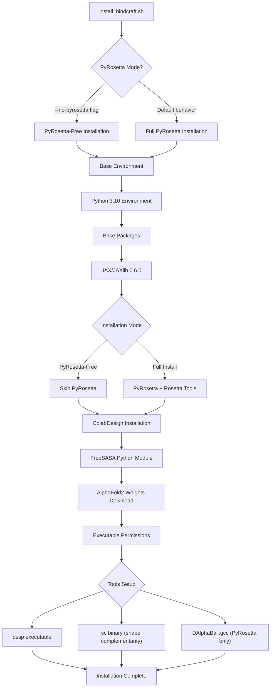
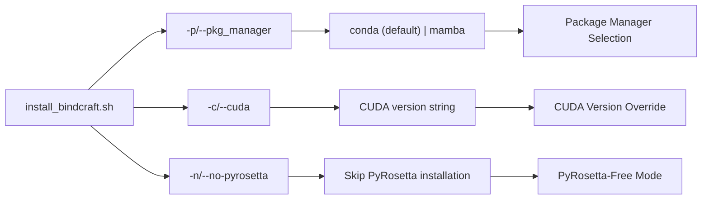
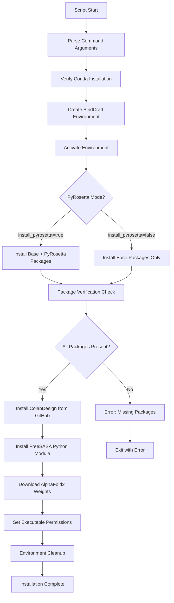
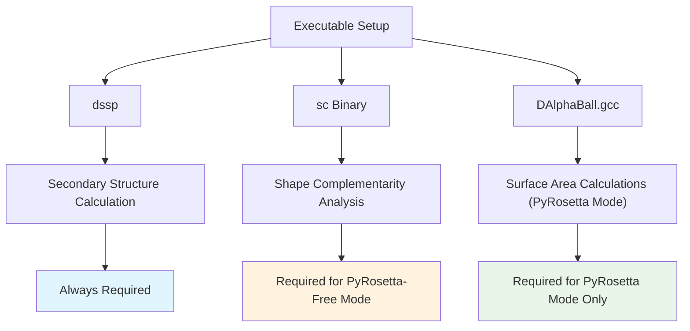

# Installation

<details>
<summary>Relevant source files</summary>

The following files were used as context for generating this wiki page:

- [install_bindcraft.sh](install_bindcraft.sh)

</details>


This document covers the installation process for FreeBindCraft, including both PyRosetta-enabled and PyRosetta-free installation modes. The installation script provides comprehensive setup of the computing environment, dependencies, and required computational tools.

For information about Docker deployment, see [Docker Deployment](#2.2). For post-installation usage instructions, see [Basic Usage](#2.3).

## Installation Overview

FreeBindCraft supports two primary installation modes that align with its dual-path architecture:



Sources: [install_bindcraft.sh:1-190]()

## Prerequisites

Before running the installation script, ensure the following requirements are met:

| Requirement | Description | Verification Command |
|-------------|-------------|---------------------|
| **conda/mamba** | Package manager for environment creation | `conda info --base` |
| **Internet Connection** | Required for downloading packages and weights | `wget --spider https://google.com` |
| **Disk Space** | Minimum 5GB for full installation | `df -h .` |
| **CUDA (Optional)** | For GPU acceleration of JAX operations | `nvidia-smi` |

The installation script automatically verifies conda availability and will exit with an error if not found.

Sources: [install_bindcraft.sh:55-56]()

## Installation Command Options

The `install_bindcraft.sh` script accepts several command-line options to customize the installation:



### Command Line Arguments

| Option | Long Form | Description | Default |
|--------|-----------|-------------|---------|
| `-p` | `--pkg_manager` | Specify package manager (`conda` or `mamba`) | `conda` |
| `-c` | `--cuda` | Override CUDA version for JAXlib | Auto-detect |
| `-n` | `--no-pyrosetta` | Install without PyRosetta support | `false` |

### Example Installation Commands

```bash
# Standard installation with PyRosetta
./install_bindcraft.sh

# PyRosetta-free installation
./install_bindcraft.sh --no-pyrosetta

# Installation with mamba and specific CUDA version
./install_bindcraft.sh --pkg_manager mamba --cuda 11.8

# PyRosetta-free with mamba
./install_bindcraft.sh --pkg_manager mamba --no-pyrosetta
```

Sources: [install_bindcraft.sh:9-46]()

## Installation Process Flow

The installation follows a systematic process with validation at each step:



Sources: [install_bindcraft.sh:50-190]()

## Package Dependencies

The installation manages different package sets based on the selected mode:

### Base Packages (Always Installed)

The base package set includes core scientific computing and structure analysis tools:

```
pip pandas matplotlib numpy<2.0.0 biopython scipy pdbfixer 
openmm seaborn libgfortran5 tqdm jupyter ffmpeg fsspec py3dmol 
chex dm-haiku flax<0.10.0 dm-tree joblib ml-collections 
immutabledict optax
```

### JAX Configuration

JAX and JAXlib are pinned to version 0.6.0 for stability, with CUDA support configured based on the `--cuda` parameter:

- **With CUDA**: `jaxlib=0.6.0=*cuda*` and `jax=0.6.0`
- **CPU Only**: `jaxlib=0.6.0` and `jax=0.6.0`

### PyRosetta Integration

When PyRosetta installation is enabled, additional packages are installed from the Rosetta Commons conda channel:

```
pyrosetta cuda-nvcc cudnn
```

Sources: [install_bindcraft.sh:72-112]()

## Executable Tools Setup

The installation configures several computational tools required for protein analysis:



### Tool Configuration Details

| Tool | File Location | Purpose | Installation Mode |
|------|---------------|---------|-------------------|
| `dssp` | `functions/dssp` | Secondary structure calculation | Always |
| `sc` | `functions/sc` | Shape complementarity scoring | PyRosetta-free fallback |
| `DAlphaBall.gcc` | `functions/DAlphaBall.gcc` | Surface area calculations | PyRosetta only |

Sources: [install_bindcraft.sh:156-173]()

## AlphaFold2 Model Weights

The installation automatically downloads and configures AlphaFold2 model parameters required for structure prediction:

### Download Process

1. **Weight Download**: Downloads `alphafold_params_2022-12-06.tar` from Google Storage
2. **Extraction**: Extracts weights to `params/` directory in installation folder
3. **Verification**: Confirms presence of `params_model_5_ptm.npz`
4. **Cleanup**: Removes downloaded tar archive to save space

### Storage Requirements

| Component | Size | Location |
|-----------|------|----------|
| Downloaded Archive | ~2.3GB | Temporary |
| Extracted Weights | ~2.3GB | `params/` directory |
| Total Required Space | ~5GB | During installation |
| Final Space Usage | ~2.3GB | After cleanup |

Sources: [install_bindcraft.sh:139-154]()

## Post-Installation Verification

After successful installation, verify the environment setup:

### Environment Activation

```bash
conda activate BindCraft
```

### Package Verification

The installation script automatically verifies all required packages are present. Manual verification can be performed using:

```bash
python -c "import colabdesign; print('ColabDesign: OK')"
python -c "import freesasa; print('FreeSASA: OK')" 
python -c "import openmm; print('OpenMM: OK')"
```

### Optional PyRosetta Verification

If installed with PyRosetta support:

```bash
python -c "import pyrosetta; print('PyRosetta: OK')"
```

### JAX GPU Configuration

Verify JAX can detect GPU resources (if available):

```bash
python -c "import jax; print('JAX devices:', jax.devices())"
```

Sources: [install_bindcraft.sh:109-127](), [install_bindcraft.sh:132-138]()

## Installation Modes Comparison

| Feature | PyRosetta Installation | PyRosetta-Free Installation |
|---------|----------------------|----------------------------|
| **Core Dependencies** | ✓ All base packages | ✓ All base packages |
| **PyRosetta** | ✓ Full PyRosetta suite | ✗ Not installed |
| **Shape Complementarity** | ✓ Native Rosetta tools | ✓ `sc` binary fallback |
| **SASA Calculations** | ✓ PyRosetta + FreeSASA | ✓ FreeSASA + Biopython |
| **Structure Relaxation** | ✓ PyRosetta FastRelax | ✓ OpenMM relaxation |
| **Installation Time** | ~45-60 minutes | ~30-40 minutes |
| **Disk Space** | ~8-10GB | ~6-8GB |
| **Computational Speed** | CPU-optimized | GPU-optimized |

This comparison reflects the dual-path architecture enabling users to choose between traditional PyRosetta-based workflows and modern open-source alternatives.

Sources: [install_bindcraft.sh:79-105]()

---