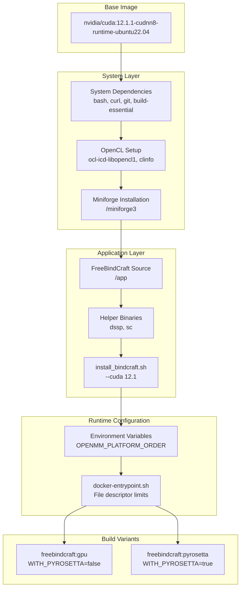
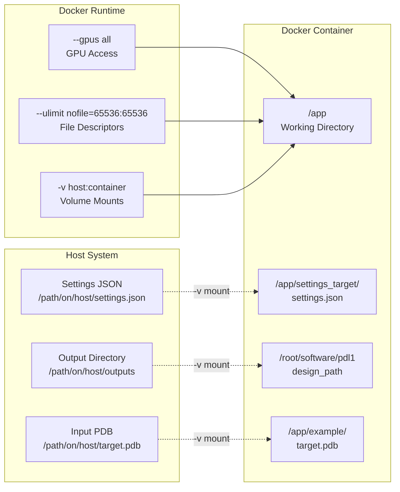
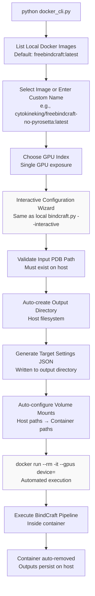

# Docker Deployment

<details>
<summary>Relevant source files</summary>

The following files were used as context for generating this wiki page:

- [.dockerignore](.dockerignore)
- [Dockerfile](Dockerfile)
- [README.md](README.md)
- [docker-entrypoint.sh](docker-entrypoint.sh)

</details>


This document covers deploying FreeBindCraft using Docker containers with GPU acceleration. It explains the two deployment options (building locally vs pulling prebuilt images), container configuration, volume mounting strategies, and the interactive Docker wrapper. For local installation without containers, see [Installation](#2.1). For basic usage after deployment, see [Basic Usage](#2.3).

## Prerequisites and System Setup

FreeBindCraft requires GPU-accelerated Docker containers for optimal performance. The following components must be installed on the host system:

### Host Requirements

| Component | Purpose | Validation Command |
|-----------|---------|-------------------|
| NVIDIA Driver | GPU access | `nvidia-smi` |
| Docker CE | Container runtime | `docker --version` |
| NVIDIA Container Toolkit | GPU passthrough | `sudo nvidia-ctk --version` |

### NVIDIA Container Toolkit Installation

For Ubuntu/Debian systems, install the toolkit and configure Docker:

```bash
sudo apt-get install -y nvidia-container-toolkit
sudo nvidia-ctk runtime configure --runtime=docker
sudo systemctl restart docker
```

Validate GPU availability in containers:
```bash
docker run --rm --gpus all nvidia/cuda:12.1.1-cudnn8-runtime-ubuntu22.04 nvidia-smi
```

Sources: [README.md:122-133]()

## Docker Image Options

FreeBindCraft provides two deployment paths: building images locally or using prebuilt images from Docker Hub.

### Docker Image Architecture



Sources: [Dockerfile:1-83]()

### Option A: Local Build

Build the PyRosetta-free version (default):
```bash
docker build -t freebindcraft:gpu .
```

Build with PyRosetta support:
```bash
docker build --build-arg WITH_PYROSETTA=true -t freebindcraft:pyrosetta .
```

The build process uses the [install_bindcraft.sh:62-64]() script with conditional PyRosetta installation based on the `WITH_PYROSETTA` build argument.

### Option B: Prebuilt Image

Pull the PyRosetta-free image from Docker Hub:
```bash
docker pull cytokineking/freebindcraft-no-pyrosetta:latest
```

**Note**: Only the PyRosetta-free version is available as a prebuilt image due to licensing restrictions.

Sources: [README.md:135-173]()

## Container Execution Patterns

FreeBindCraft containers require specific configuration for GPU access, volume mounting, and file descriptor limits.

### Core Container Configuration



Sources: [README.md:175-232](), [docker-entrypoint.sh:4-10]()

### Basic Execution Template

```bash
docker run --gpus all --rm -it \
  --ulimit nofile=65536:65536 \
  -v <host_output_dir>:<container_design_path> \
  <image_name> \
  python bindcraft.py <arguments>
```

### Volume Mounting Strategies

#### Strategy 1: Repository Defaults
Use built-in settings files, mount only outputs:

```bash
mkdir -p /path/on/host/run_outputs
docker run --gpus all --rm -it \
  --ulimit nofile=65536:65536 \
  -v /path/on/host/run_outputs:/root/software/pdl1 \
  cytokineking/freebindcraft-no-pyrosetta:latest \
  python bindcraft.py \
    --settings settings_target/PDL1.json \
    --filters settings_filters/default_filters.json \
    --advanced settings_advanced/default_4stage_multimer.json \
    --no-pyrosetta
```

#### Strategy 2: Custom Configuration Files
Mount custom settings and input PDB:

```bash
docker run --gpus all --rm -it \
  --ulimit nofile=65536:65536 \
  -v /path/on/host/run_outputs:/root/software/pdl1 \
  -v /path/on/host/my_settings.json:/app/settings_target/my_settings.json:ro \
  -v /path/on/host/your_target.pdb:/app/example/your_target.pdb:ro \
  cytokineking/freebindcraft-no-pyrosetta:latest \
  python bindcraft.py \
    --settings /app/settings_target/my_settings.json \
    --filters settings_filters/default_filters.json \
    --advanced settings_advanced/default_4stage_multimer.json \
    --no-pyrosetta
```

#### Strategy 3: Full Custom Configuration
Mount all configuration files:

```bash
docker run --gpus all --rm -it \
  --ulimit nofile=65536:65536 \
  -v /path/on/host/run_outputs:/root/software/pdl1 \
  -v /path/on/host/my_settings.json:/app/settings_target/my_settings.json:ro \
  -v /path/on/host/my_filters.json:/app/settings_filters/my_filters.json:ro \
  -v /path/on/host/my_advanced.json:/app/settings_advanced/my_advanced.json:ro \
  -v /path/on/host/your_target.pdb:/app/example/your_target.pdb:ro \
  cytokineking/freebindcraft-no-pyrosetta:latest \
  python bindcraft.py \
    --settings /app/settings_target/my_settings.json \
    --filters /app/settings_filters/my_filters.json \
    --advanced /app/settings_advanced/my_advanced.json \
    --no-pyrosetta
```

**Critical**: The output directory mount point must match the `design_path` specified in your target settings JSON file.

Sources: [README.md:183-228]()

## Interactive Docker Wrapper

The `docker_cli.py` script provides an interactive interface for Docker deployment, eliminating the need to construct complex `docker run` commands manually.

### Docker CLI Workflow



### Usage Example

```bash
python docker_cli.py
```

The wrapper handles:
- Image selection and validation
- GPU device assignment (`--gpus device=<index>`)
- Automatic volume mount configuration
- Path translation between host and container
- Container lifecycle management (auto-removal on completion)

Sources: [README.md:234-249]()

## Container Environment Configuration

### Environment Variables

The container sets several key environment variables for optimal operation:

| Variable | Value | Purpose |
|----------|-------|---------|
| `OPENMM_PLATFORM_ORDER` | `OpenCL,CUDA` | Platform preference for OpenMM |
| `OPENMM_DEFAULT_PLATFORM` | `OpenCL` | Default OpenMM platform |
| `PYTHONUNBUFFERED` | `1` | Real-time output |
| `BINDCRAFT_HOME` | `/app` | Application root |

### File Descriptor Limits

The [docker-entrypoint.sh:4-10]() script automatically increases file descriptor limits using `prlimit` or `ulimit` fallback, essential for BindCraft's high file I/O operations. The Docker run command should also specify `--ulimit nofile=65536:65536` for additional safety.

Sources: [Dockerfile:67-75](), [docker-entrypoint.sh:4-16]()

## Validation and Testing

### OpenMM Relax Test

Verify GPU acceleration and OpenMM functionality:

```bash
mkdir -p ~/bindcraft_out
docker run --gpus all --rm -it \
  --ulimit nofile=65536:65536 \
  -v ~/bindcraft_out:/work/out \
  freebindcraft:gpu \
  python extras/test_openmm_relax.py example/PDL1.pdb /work/out/relax_test
```

### Container Health Check

Validate NVIDIA driver integration:
```bash
docker run --rm --gpus all <image_name> nvidia-smi
```

Verify OpenCL platform availability:
```bash
docker run --rm --gpus all <image_name> clinfo
```

Sources: [README.md:147-173]()

---