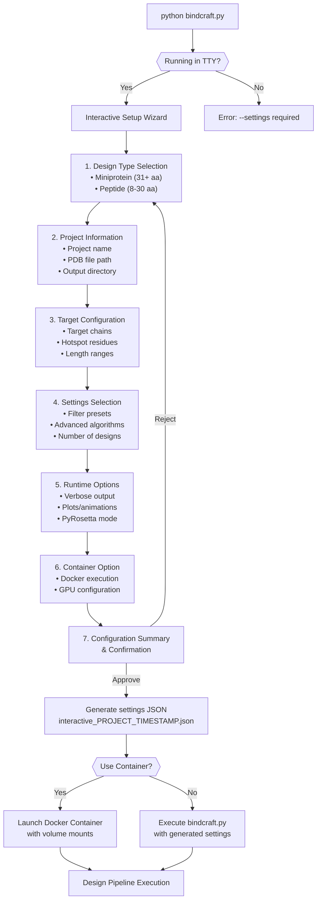
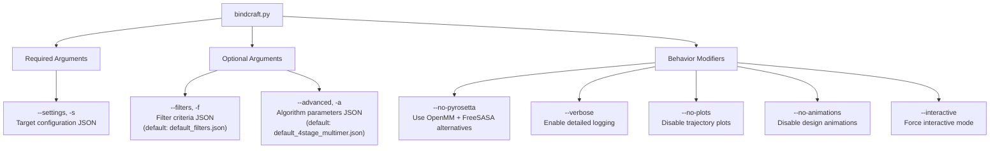
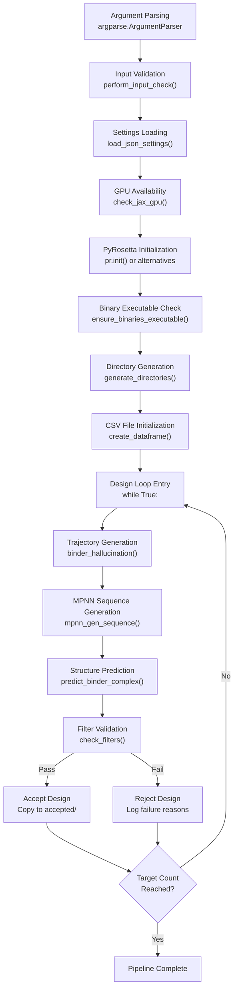

# Basic Usage

<details>
<summary>Relevant source files</summary>

The following files were used as context for generating this wiki page:

- [bindcraft.py](bindcraft.py)
- [bindcraft.slurm](bindcraft.slurm)
- [settings_target/PDL1.json](settings_target/PDL1.json)

</details>


This page covers how to run FreeBindCraft for your first protein design, including both interactive and command-line modes. For installation instructions, see [Installation](#2.1). For Docker-specific deployment, see [Docker Deployment](#2.2). For detailed configuration options, see [Configuration System](#5).

## Overview

FreeBindCraft provides two primary ways to run protein design:

1. **Interactive Mode**: Guided setup wizard that prompts for all necessary parameters
2. **Command Line Mode**: Direct execution with predefined JSON configuration files

Both modes ultimately invoke the same core pipeline orchestrated by `bindcraft.py`.

## Interactive Mode

The simplest way to get started is through interactive mode, which launches automatically when you run `bindcraft.py` without settings in a terminal.

### Starting Interactive Mode

```bash
python bindcraft.py
```

Or explicitly force interactive mode:

```bash
python bindcraft.py --interactive
```

### Interactive Setup Flow



**Interactive Mode Components**

| Component | Function Reference | Purpose |
|-----------|-------------------|---------|
| TTY Detection | `_isatty_stdin()` | Determine if interactive mode available |
| Input Collection | `_prompt_interactive_and_prepare_args()` | Gather all design parameters |
| Settings Generation | JSON creation at [bindcraft.py:342-360]() | Create target settings file |
| Container Integration | Docker command building [bindcraft.py:384-401]() | Optional containerized execution |

Sources: [bindcraft.py:405-407](), [bindcraft.py:118-403]()

## Command Line Mode

For production workflows and automation, use command-line mode with predefined JSON configuration files.

### Basic Command Structure

```bash
python bindcraft.py --settings TARGET_SETTINGS.json [OPTIONS]
```

### Essential Command Line Options



Sources: [bindcraft.py:69-87]()

### Example Usage Commands

**Standard miniprotein design:**
```bash
python bindcraft.py --settings settings_target/PDL1.json
```

**PyRosetta-free mode with verbose output:**
```bash
python bindcraft.py --settings settings_target/PDL1.json --no-pyrosetta --verbose
```

**Custom filters and advanced settings:**
```bash
python bindcraft.py \
  --settings settings_target/PDL1.json \
  --filters settings_filters/relaxed_filters.json \
  --advanced settings_advanced/peptide_3stage_multimer.json
```

Sources: [bindcraft.py:69-87](), [settings_target/PDL1.json:1-9]()

## Configuration File Structure

The command-line mode requires understanding three types of JSON configuration files:

### Target Settings Example

```json
{
    "design_path": "/root/software/pdl1/",
    "binder_name": "PDL1",
    "starting_pdb": "./example/PDL1.pdb",
    "chains": "A",
    "target_hotspot_residues": "56",
    "lengths": [65, 150],
    "number_of_final_designs": 100
}
```

**Target Settings Parameters**

| Parameter | Description | Example |
|-----------|-------------|---------|
| `design_path` | Output directory path | `"/root/software/pdl1/"` |
| `binder_name` | Project identifier | `"PDL1"` |
| `starting_pdb` | Input structure file | `"./example/PDL1.pdb"` |
| `chains` | Target protein chains | `"A"` or `"A,B"` |
| `target_hotspot_residues` | Binding site residues | `"A56,B20-25"` |
| `lengths` | Binder length range | `[65, 150]` |
| `number_of_final_designs` | Target design count | `100` |

Sources: [settings_target/PDL1.json:1-9]()

## Execution Pipeline Overview

Once configuration is complete, FreeBindCraft follows this execution flow:



**Key Pipeline Functions**

| Stage | Function | File Location |
|-------|----------|---------------|
| Input validation | `perform_input_check()` | [functions/generic_utils.py]() |
| Settings loading | `load_json_settings()` | [functions/generic_utils.py]() |
| Design generation | `binder_hallucination()` | [functions/colabdesign_utils.py]() |
| Sequence optimization | `mpnn_gen_sequence()` | [functions/colabdesign_utils.py]() |
| Structure prediction | `predict_binder_complex()` | [functions/colabdesign_utils.py]() |
| Filter evaluation | `check_filters()` | [functions/generic_utils.py]() |

Sources: [bindcraft.py:413-982]()

## HPC and SLURM Usage

For high-performance computing environments, use the provided SLURM script:

```bash
sbatch bindcraft.slurm --settings settings_target/PDL1.json
```

The SLURM script automatically:
- Requests GPU resources (`--gres=gpu:1`)
- Activates the BindCraft conda environment
- Passes through command-line arguments
- Configures appropriate memory and time limits

Sources: [bindcraft.slurm:1-48]()

## Common Usage Patterns

**Quick start for new users:**
```bash
python bindcraft.py  # Interactive mode
```

**Production miniprotein design:**
```bash
python bindcraft.py --settings my_target.json --verbose
```

**PyRosetta-free peptide design:**
```bash
python bindcraft.py \
  --settings peptide_target.json \
  --filters settings_filters/peptide_filters.json \
  --advanced settings_advanced/peptide_3stage_multimer.json \
  --no-pyrosetta
```

**HPC batch submission:**
```bash
sbatch bindcraft.slurm --settings production_target.json
```

Sources: [bindcraft.py:69-87](), [bindcraft.slurm:46-47]()

---