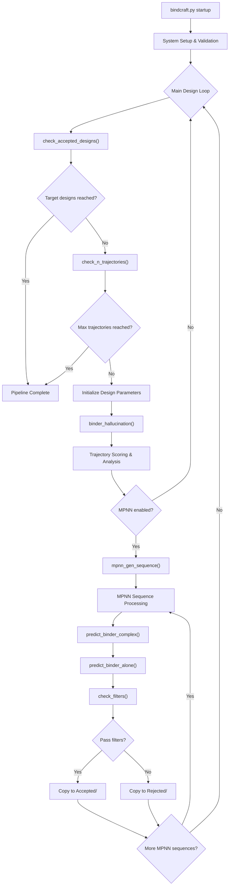
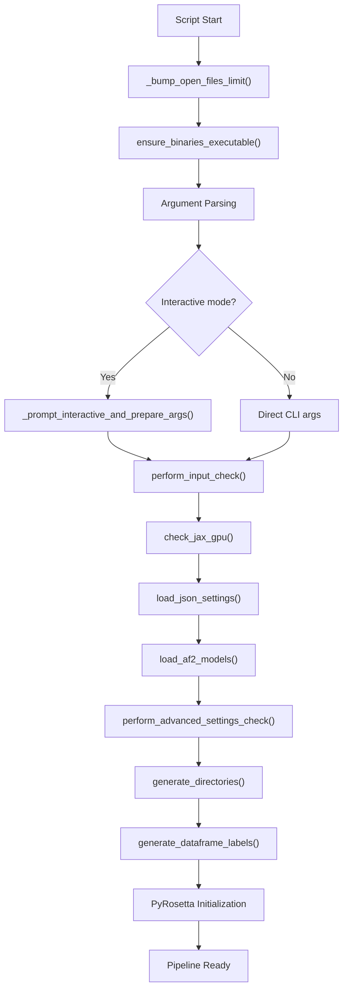
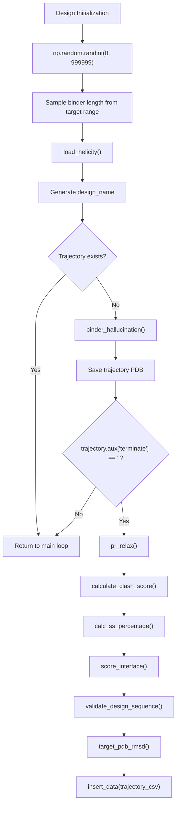
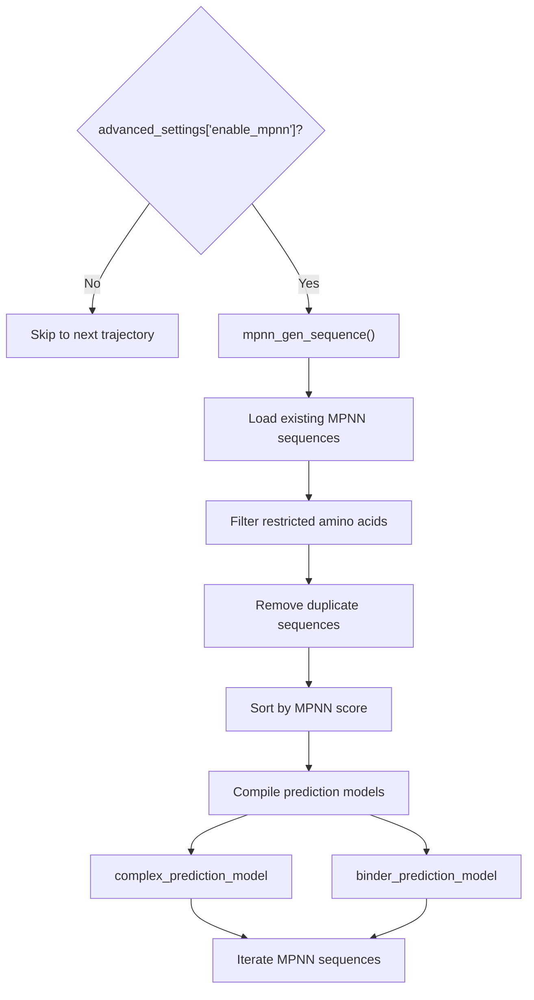
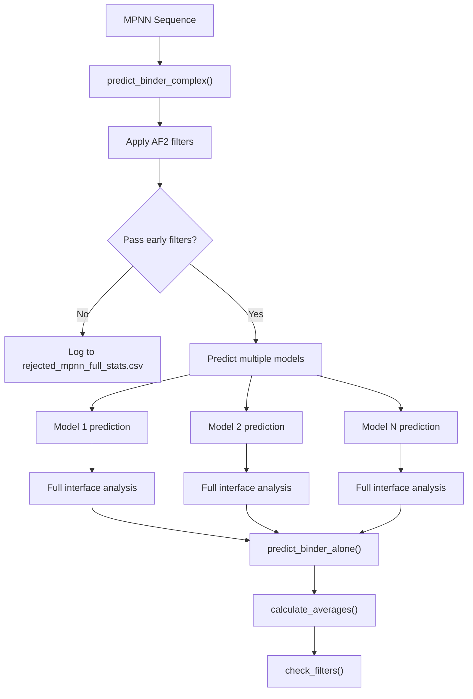
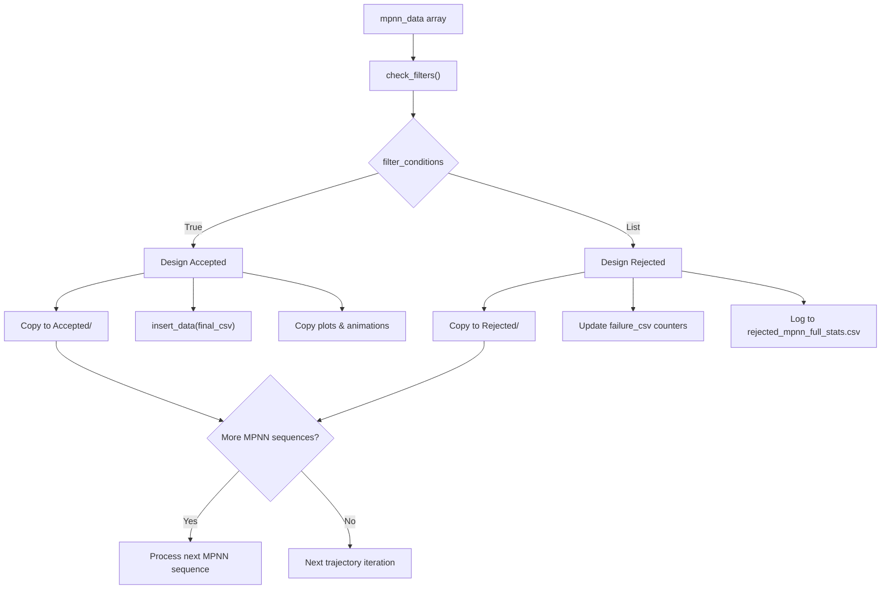
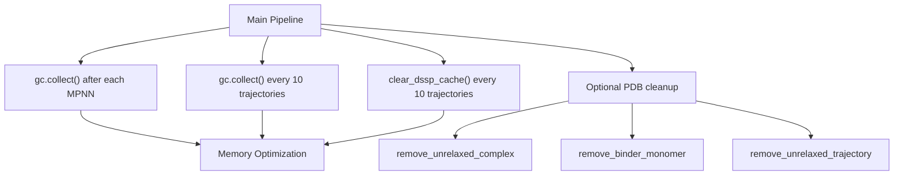

# Core Pipeline

Relevant source files

The following files were used as context for generating this wiki page:

- [bindcraft.py](bindcraft.py)

This document details the main design pipeline orchestrated by `bindcraft.py`, which serves as the central coordinator for FreeBindCraft's protein design workflow. The core pipeline manages the complete binder design process from initial hallucination through final validation and filtering.

For configuration details, see [Configuration System](#5). For PyRosetta alternatives, see [PyRosetta-Free Alternatives](#4.1). For analysis tools, see [Analysis & Validation](#6).

## Pipeline Overview

The core pipeline follows a multi-stage approach that iteratively generates, optimizes, and validates protein binders until the target number of accepted designs is reached.

### Main Design Loop Architecture

**Sources:** [bindcraft.py:526-982]()

## Initialization and Setup Phase

The pipeline begins with comprehensive system initialization that prepares the environment for protein design.

### System Preparation

**Sources:** [bindcraft.py:34-513]()

### Configuration Loading

The system loads three types of configuration files:
- **Target settings**: Basic design parameters from JSON files
- **Filter settings**: Acceptance criteria and thresholds  
- **Advanced settings**: Algorithm parameters and model configurations

Key initialization functions:
- `perform_input_check()`: Validates configuration file paths and formats
- `perform_advanced_settings_check()`: Validates advanced algorithm parameters
- `generate_directories()`: Creates output directory structure
- `generate_dataframe_labels()`: Sets up CSV column headers for results tracking

**Sources:** [bindcraft.py:413-469]()

## Trajectory Generation Phase

Each design iteration begins with generating a new binder trajectory using ColabDesign and AlphaFold2.

### Binder Hallucination Process

**Sources:** [bindcraft.py:541-616]()

### Trajectory Analysis

After successful hallucination, each trajectory undergoes comprehensive analysis:

| Analysis Type | Function | Purpose |
|---------------|----------|---------|
| Clash Detection | `calculate_clash_score()` | Detects atomic clashes before/after relaxation |
| Secondary Structure | `calc_ss_percentage()` | Calculates helix/sheet/loop content |
| Interface Scoring | `score_interface()` | Analyzes binding interface properties |
| Sequence Validation | `validate_design_sequence()` | Checks for problematic amino acids |
| Target RMSD | `target_pdb_rmsd()` | Measures target structure deviation |

**Sources:** [bindcraft.py:581-615]()

## MPNN Optimization Phase

If MPNN is enabled, the pipeline optimizes the hallucinated trajectory through sequence design.

### MPNN Sequence Generation

**Sources:** [bindcraft.py:623-686]()

### Sequence Processing Loop

For each MPNN sequence, the pipeline performs:

1. **Complex Prediction**: `predict_binder_complex()` - Predicts binder-target complex
2. **Early Filtering**: Basic AF2 quality filters applied immediately  
3. **Full Analysis**: Interface scoring and structural analysis for passing designs
4. **Monomer Prediction**: `predict_binder_alone()` - Predicts binder stability
5. **Final Filtering**: `check_filters()` - Applies all acceptance criteria

**Sources:** [bindcraft.py:687-932]()

## Structure Prediction and Analysis

The pipeline uses AlphaFold2 models for structure prediction with comprehensive analysis.

### Prediction Workflow

**Sources:** [bindcraft.py:703-858]()

### Interface Analysis Metrics

The pipeline calculates comprehensive interface metrics for each model:

| Metric Category | Key Measurements | Functions |
|----------------|------------------|-----------|
| Structural Quality | pLDDT, pTM, i_pTM, pAE, i_pAE | From ColabDesign prediction |
| Interface Geometry | Shape complementarity, PackStat | `score_interface()` |
| Energetics | dG, dSASA, binding energy | PyRosetta or alternatives |
| Hydrogen Bonding | Interface H-bonds, unsatisfied bonds | Interface analysis |
| Secondary Structure | Helix/sheet/loop percentages | `calc_ss_percentage()` |
| Structural Deviation | Hotspot RMSD, target RMSD | `unaligned_rmsd()`, `target_pdb_rmsd()` |

**Sources:** [bindcraft.py:741-791]()

## Filtering and Validation

The final stage applies comprehensive filters to determine design acceptance.

### Filter Application Process

**Sources:** [bindcraft.py:870-932]()

### Data Management

The pipeline maintains several CSV files for tracking:
- `trajectory_stats.csv`: Hallucination trajectory metrics
- `mpnn_design_stats.csv`: MPNN sequence analysis results  
- `final_design_stats.csv`: Accepted designs with full statistics
- `failure_csv.csv`: Filter failure counters
- `rejected_mpnn_full_stats.csv`: Detailed rejection reasons

**Sources:** [bindcraft.py:461-490]()

## Memory and Resource Management

The pipeline includes several optimization strategies for long-running design campaigns:

**Sources:** [bindcraft.py:936-980]()

---