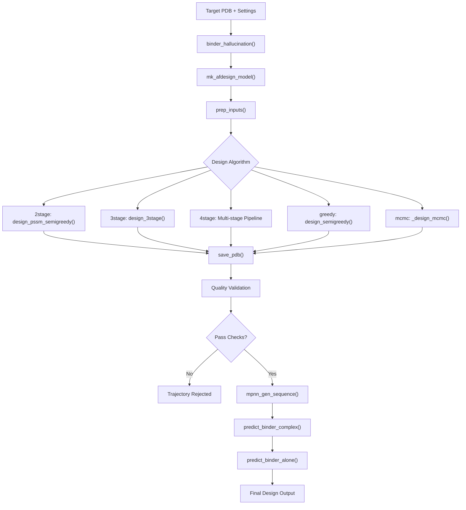
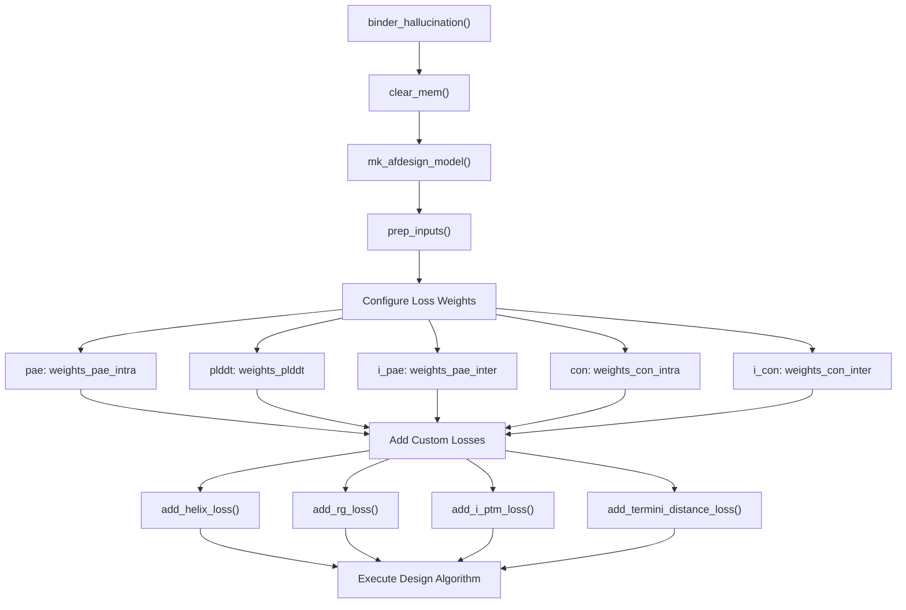
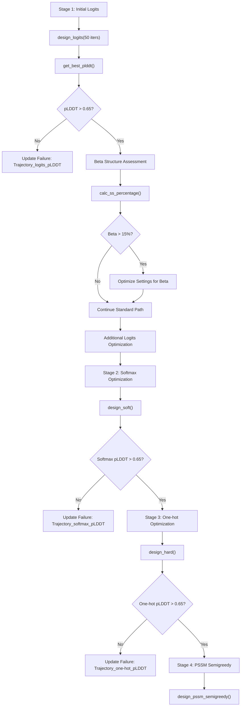
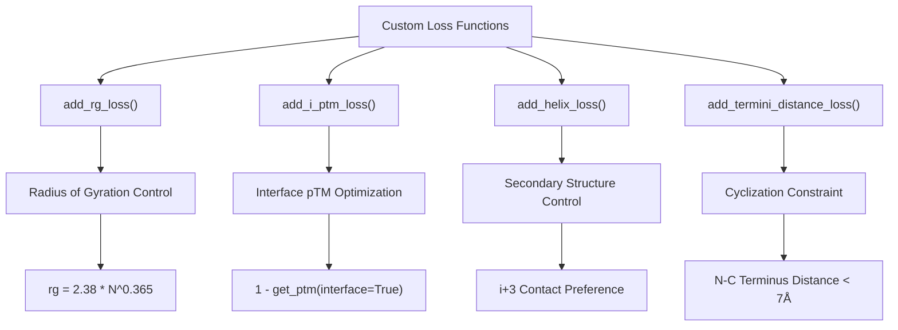
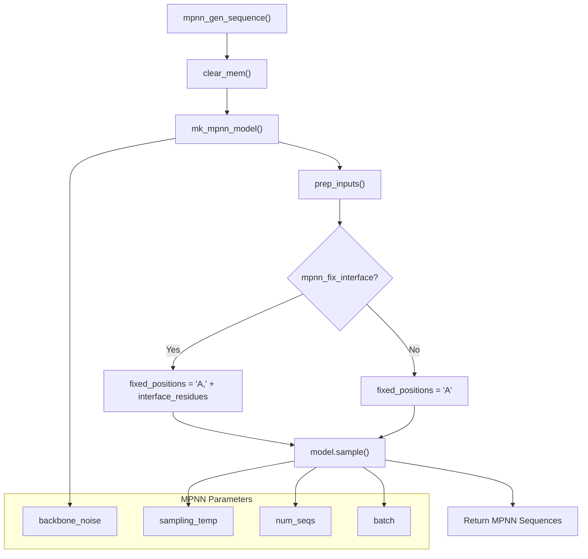
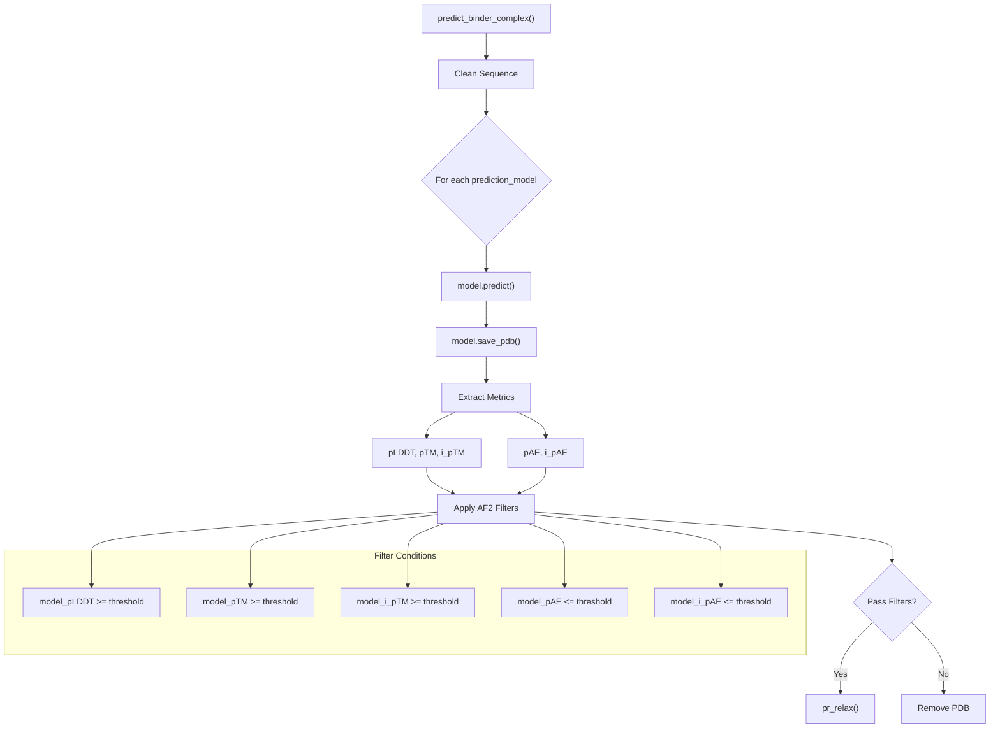

# Design Engine

Relevant source files

The following files were used as context for generating this wiki page:

- [functions/colabdesign_utils.py](functions/colabdesign_utils.py)

The Design Engine is the core component of FreeBindCraft that orchestrates protein binder design through AlphaFold2 hallucination and MPNN sequence optimization. This system leverages ColabDesign to generate novel protein binders that can bind to specified target proteins at defined hotspot regions.

This document covers the hallucination pipeline, design algorithms, loss functions, and MPNN integration. For structure analysis and validation of generated designs, see [Structure Analysis](#3.2). For PyRosetta-free alternatives to structure processing, see [PyRosetta-Free Alternatives](#4.1).

## Core Design Pipeline

The design engine follows a multi-stage pipeline that transforms a target protein structure into optimized binder designs:

### Design Pipeline Flow

**Sources:** [functions/colabdesign_utils.py:23-255]()

### Binder Hallucination Process

The `binder_hallucination` function serves as the entry point for design generation, implementing the following workflow:

1. **Model Initialization**: Creates an AlphaFold2 design model using ColabDesign
2. **Input Preparation**: Processes target PDB, chain selection, and hotspot residues
3. **Loss Function Configuration**: Sets up custom loss functions and weights
4. **Design Algorithm Execution**: Runs the selected optimization algorithm
5. **Quality Assessment**: Validates the generated trajectory for clashes and confidence

**Sources:** [functions/colabdesign_utils.py:23-72](), [functions/colabdesign_utils.py:201-234]()

## Design Algorithms

The design engine supports five distinct optimization algorithms, each with different trade-offs between speed and quality:

| Algorithm | Function | Description | Use Case |
|-----------|----------|-------------|----------|
| `2stage` | `design_pssm_semigreedy()` | Gradient descent + PSSM biased sampling | Fast prototyping |
| `3stage` | `design_3stage()` | Logits → Softmax → One-hot encoding | Balanced approach |
| `4stage` | Multi-stage pipeline | Comprehensive 4-step optimization | High-quality results |
| `greedy` | `design_semigreedy()` | Random mutations decreasing loss | Simple optimization |
| `mcmc` | `_design_mcmc()` | Monte Carlo mutation sampling | Exploration-focused |

**Sources:** [functions/colabdesign_utils.py:78-192]()

### Four-Stage Algorithm Detail

The most sophisticated algorithm implements a comprehensive optimization pipeline:

**Sources:** [functions/colabdesign_utils.py:100-192]()

## Loss Functions

The design engine incorporates multiple custom loss functions to guide the optimization process:

### Standard Loss Functions

| Loss Type | Weight Parameter | Purpose |
|-----------|------------------|---------|
| PAE Intra | `weights_pae_intra` | Internal structure confidence |
| PAE Inter | `weights_pae_inter` | Interface confidence |
| pLDDT | `weights_plddt` | Per-residue confidence |
| Contacts Intra | `weights_con_intra` | Internal contacts |
| Contacts Inter | `weights_con_inter` | Interface contacts |

**Sources:** [functions/colabdesign_utils.py:46-56]()

### Custom Loss Functions

The system includes specialized loss functions for specific design objectives:

**Sources:** [functions/colabdesign_utils.py:392-472]()

## MPNN Integration

After successful hallucination, the system uses ProteinMPNN to generate diverse sequences that maintain the designed structure:

### MPNN Sequence Generation

**Sources:** [functions/colabdesign_utils.py:362-386]()

## Structure Prediction and Validation

The design engine predicts both binder-target complexes and isolated binder structures to assess design quality:

### Prediction Pipeline

| Function | Purpose | Output |
|----------|---------|---------|
| `predict_binder_complex()` | Complex structure prediction | pLDDT, pTM, i_pTM, pAE, i_pAE |
| `predict_binder_alone()` | Isolated binder prediction | Binder confidence metrics |

### Complex Prediction Process

**Sources:** [functions/colabdesign_utils.py:257-327](), [functions/colabdesign_utils.py:329-360]()

## Quality Control and Validation

The design engine implements multiple quality control checkpoints:

### Trajectory Validation Criteria

| Check | Function | Threshold | Failure Type |
|-------|----------|-----------|--------------|
| CA Clashes | `calculate_clash_score()` | > 0 clashes | `Trajectory_Clashes` |
| Final pLDDT | `get_best_plddt()` | < 0.7 | `Trajectory_final_pLDDT` |
| Interface Contacts | `hotspot_residues()` | < 3 contacts | `Trajectory_Contacts` |

**Sources:** [functions/colabdesign_utils.py:201-234]()

### Output Generation

Upon successful validation, the system generates comprehensive output:

- **Trajectory PDB**: Final hallucinated structure
- **Design Plots**: Loss function trajectories for each metric
- **Animation**: HTML visualization of design trajectory
- **Pickle Files**: Complete design state for analysis

**Sources:** [functions/colabdesign_utils.py:241-254](), [functions/colabdesign_utils.py:474-501]()

---