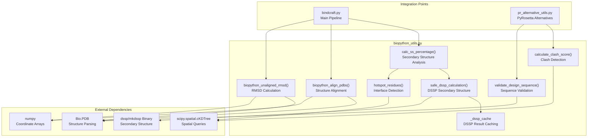
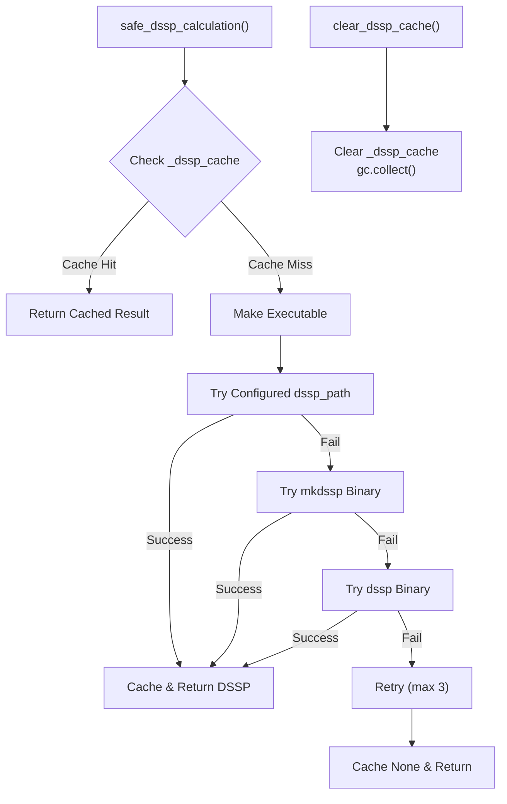
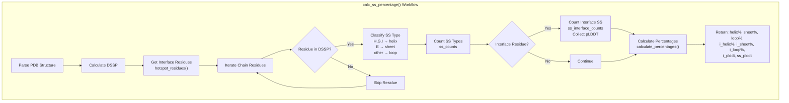
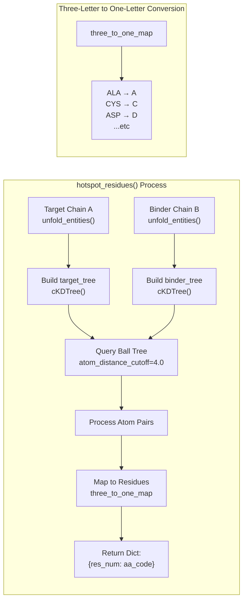
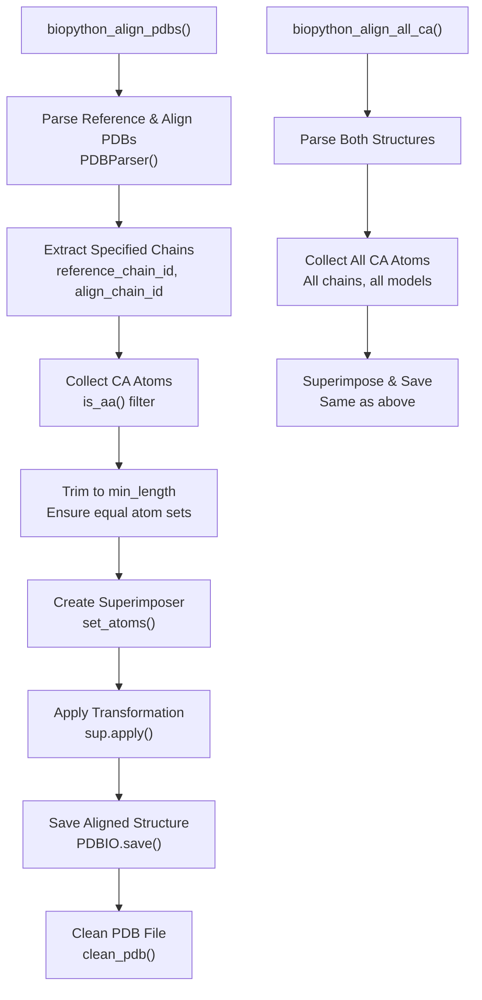
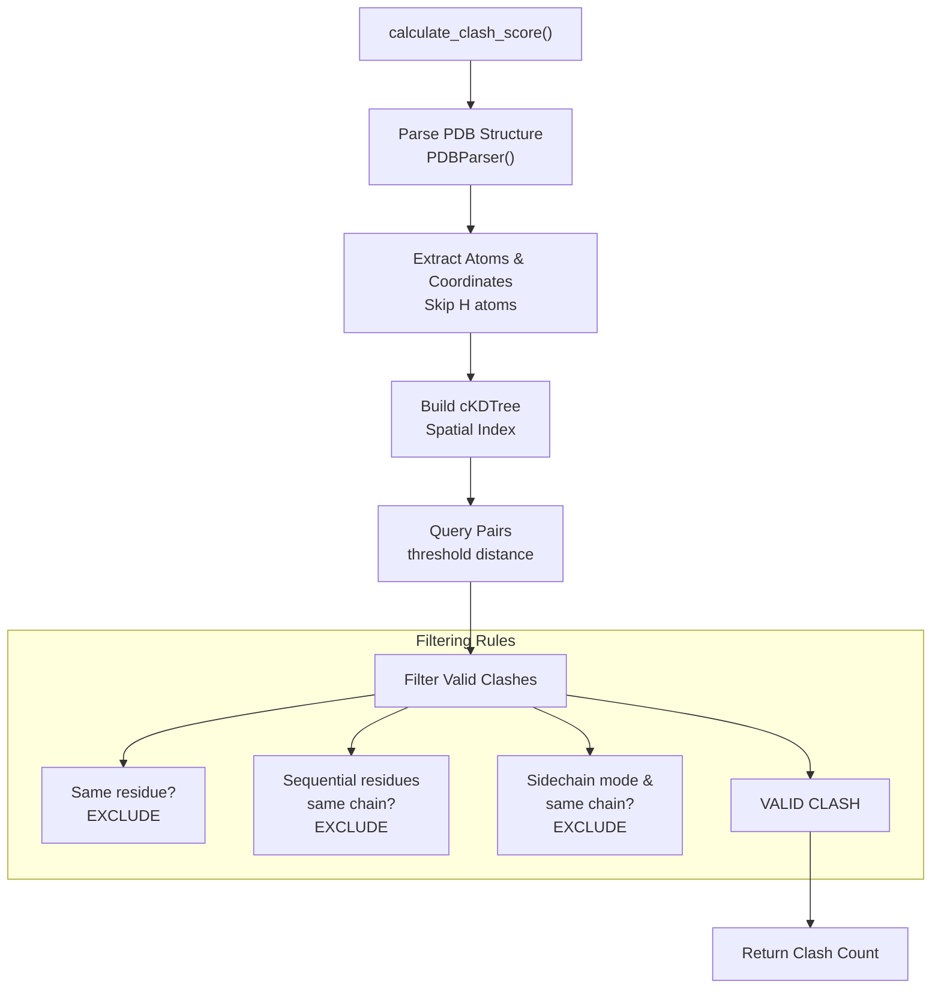
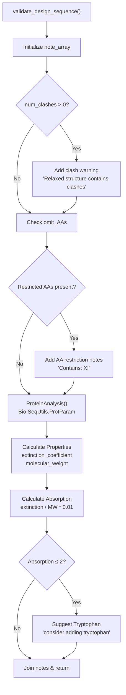
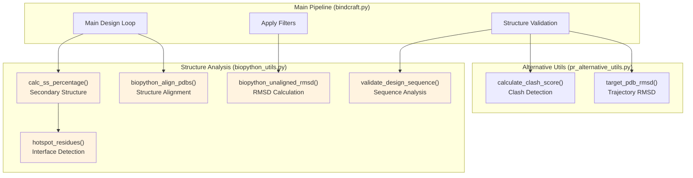

# Structure Analysis

<details>
<summary>Relevant source files</summary>

The following files were used as context for generating this wiki page:

- [functions/biopython_utils.py](functions/biopython_utils.py)

</details>


This document covers the Biopython-based structure analysis components that provide PyRosetta-free alternatives for analyzing protein structures in FreeBindCraft. The structure analysis system handles secondary structure calculation, interface detection, structural alignment, RMSD computation, clash detection, and sequence validation.

For PyRosetta-based structure analysis, see [PyRosetta Integration](#4). For post-processing analysis tools, see [Analysis & Validation](#6).

## Overview

The structure analysis system in FreeBindCraft provides comprehensive protein structure analysis capabilities using open-source tools, primarily Biopython. This system serves as the PyRosetta-free alternative for structural calculations required during the protein design pipeline.

**Core Structure Analysis Components**


Sources: [functions/biopython_utils.py:1-497]()

## Secondary Structure Analysis

The secondary structure analysis system uses DSSP (Dictionary of Secondary Structure of Proteins) to calculate helix, sheet, and loop percentages for protein designs. The system includes robust error handling, caching, and fallback mechanisms.

### DSSP Calculation with Caching

The `safe_dssp_calculation` function provides reliable DSSP computation with automatic retries and result caching:

| Feature | Implementation | Purpose |
|---------|----------------|---------|
| **Caching** | `_dssp_cache` global dictionary | Avoid redundant DSSP calculations |
| **Retry Logic** | 3 attempts with different DSSP executables | Handle binary execution failures |
| **Fallback Paths** | Tries configured path, then `mkdssp`, then `dssp` | Maximize compatibility across systems |
| **Memory Management** | Explicit cleanup with `gc.collect()` | Prevent memory leaks |

**DSSP Calculation Flow**


Sources: [functions/biopython_utils.py:22-88]()

### Secondary Structure Percentage Calculation

The `calc_ss_percentage` function computes comprehensive secondary structure metrics including interface-specific analysis:

**Calculated Metrics:**
- Overall helix, sheet, and loop percentages
- Interface-specific helix, sheet, and loop percentages  
- Interface pLDDT (confidence scores)
- Secondary structure pLDDT

**Secondary Structure Classification:**
- **Helix**: DSSP codes 'H', 'G', 'I' 
- **Sheet**: DSSP code 'E'
- **Loop**: All other codes



Sources: [functions/biopython_utils.py:249-318]()

## Interface Detection and Analysis

The interface detection system identifies residues that participate in protein-protein interactions based on spatial proximity. This analysis is crucial for evaluating binding interfaces in designed proteins.

### Hotspot Residue Identification

The `hotspot_residues` function uses spatial queries to identify interface residues:

**Algorithm:**
1. Extract atoms from binder chain and target chain A
2. Build KDTrees for efficient spatial queries
3. Find atom pairs within distance cutoff (default 4.0 Å)
4. Map interacting atoms back to residues
5. Return residue positions with single-letter amino acid codes



Sources: [functions/biopython_utils.py:211-247](), [functions/biopython_utils.py:204-209]()

## Structure Alignment and RMSD Calculation

The structure alignment system provides PyRosetta-free alternatives for structural superposition and RMSD calculation using Biopython's Superimposer class.

### Structure Alignment Functions

| Function | Purpose | Key Features |
|----------|---------|-------------|
| `biopython_align_pdbs` | Chain-specific alignment | Single chain alignment with file overwrite |
| `biopython_align_all_ca` | Whole-structure alignment | All C-alpha atoms, multi-chain support |
| `biopython_unaligned_rmsd` | RMSD without alignment | Direct coordinate comparison |
| `target_pdb_rmsd` | Trajectory vs target RMSD | Specific for design validation |

**Structure Alignment Workflow**


Sources: [functions/biopython_utils.py:322-378](), [functions/biopython_utils.py:433-497]()

### RMSD Calculation

The `biopython_unaligned_rmsd` function calculates root-mean-square deviation without performing structural alignment:

**RMSD Formula Implementation:**
```
RMSD = √(Σ(ref_coord - align_coord)² / N)
```

The function extracts C-alpha atoms from specified chains and computes direct coordinate differences.

Sources: [functions/biopython_utils.py:380-431]()

## Clash Detection

The clash detection system identifies steric clashes in protein structures using spatial proximity analysis. This is essential for validating the geometric quality of designed structures.

### Clash Score Calculation

The `calculate_clash_score` function implements a KDTree-based approach to identify atom pairs that are too close:

**Parameters:**
- `threshold`: Distance cutoff for clash detection (default 2.4 Å)
- `only_ca`: Option to check only C-alpha clashes for speed

**Filtering Logic:**
1. Exclude hydrogen atoms
2. Skip intra-residue contacts
3. Skip sequential residues in same chain
4. For sidechain clashes, only consider inter-chain contacts



Sources: [functions/biopython_utils.py:161-202]()

## Sequence Validation

The sequence validation system analyzes designed protein sequences for various quality metrics including disallowed amino acids, molecular properties, and structural issues.

### Design Sequence Analysis

The `validate_design_sequence` function performs comprehensive sequence analysis:

**Validation Checks:**
1. **Clash Detection**: Structural integrity after relaxation
2. **Restricted Amino Acids**: User-defined forbidden residues  
3. **Absorption Properties**: UV absorption for experimental detection

**Molecular Property Calculations:**
- Extinction coefficient (reduced and oxidized forms)
- Molecular weight
- Absorption value per 1% solution



Sources: [functions/biopython_utils.py:90-120]()

## Integration with Design Pipeline

The structure analysis components integrate seamlessly with the main FreeBindCraft pipeline, providing PyRosetta-free alternatives for critical structural calculations.

**Pipeline Integration Points**


**Key Integration Features:**
- **Caching System**: DSSP results cached globally to avoid recalculation
- **Error Handling**: Robust fallback mechanisms for binary dependencies
- **Memory Management**: Explicit garbage collection for large structure processing
- **File Operations**: Automatic PDB cleaning and validation after operations

Sources: [functions/biopython_utils.py:1-497]()

---