# Core Utilities

Relevant source files

The following files were used as context for generating this wiki page:

- [functions/generic_utils.py](functions/generic_utils.py)

## Purpose and Scope

The Core Utilities system provides foundational infrastructure services for FreeBindCraft, implemented primarily in `functions/generic_utils.py`. This module handles essential tasks including directory structure setup, configuration management, data persistence, system validation, and statistical processing that support the main design pipeline.

For information about the main design orchestration, see [Core Pipeline](#3). For configuration file formats and settings, see [Configuration System](#5).

## Directory Management System

The core utilities establish a standardized directory structure for organizing design outputs, intermediate files, and analysis results. The `generate_directories` function creates the complete folder hierarchy needed for a design run.

### Directory Structure

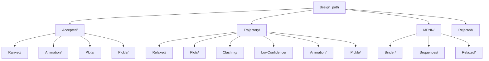

The directory structure serves specific purposes:
- **Accepted**: Final validated designs, ranked by quality
- **Trajectory**: Intermediate hallucination results and analysis  
- **MPNN**: Sequence generation outputs and structure predictions
- **Rejected**: Failed designs for debugging analysis

Sources: [functions/generic_utils.py:44-58]()

### Directory Creation Process

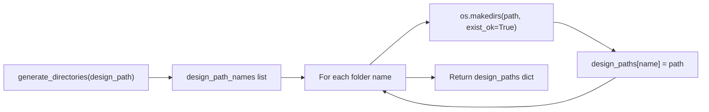

Sources: [functions/generic_utils.py:44-58]()

## Configuration and Settings Management  

The utilities provide a comprehensive configuration system that loads and validates settings from multiple JSON files, performs system checks, and ensures proper environment setup.

### Configuration Loading Flow

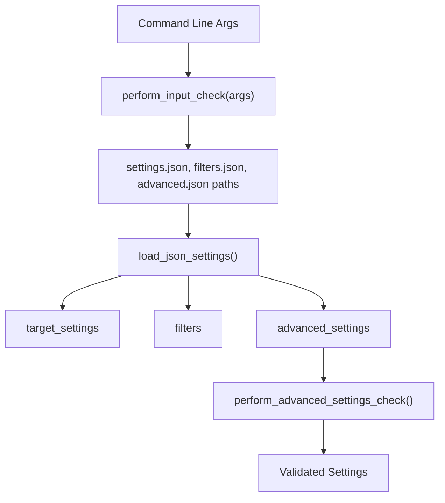

### Settings Validation Process

The `perform_advanced_settings_check` function handles several critical validation tasks:

1. **Path Resolution**: Sets default paths for model weights and executables
2. **Binary Validation**: Ensures required tools like DSSP and DAlphaBall are executable  
3. **Parameter Sanitization**: Validates and formats settings like `omit_AAs`
4. **Default Setting**: Provides fallback values for optional parameters

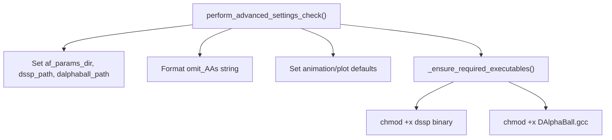

Sources: [functions/generic_utils.py:245-276](), [functions/generic_utils.py:278-305]()

## Data Management System

The core utilities manage structured data persistence through CSV files and pandas DataFrames, providing consistent data schemas and efficient I/O operations.

### DataFrame Schema Definition

The `generate_dataframe_labels` function defines three primary data schemas:

| Schema Type | Purpose | Key Fields |
|-------------|---------|------------|
| `trajectory_labels` | Hallucination tracking | pLDDT, pTM, i_pTM, clashes, interface metrics |
| `design_labels` | MPNN design results | Sequence, MPNN scores, averaged metrics |  
| `final_labels` | Ranked final outputs | Rank + all design labels |

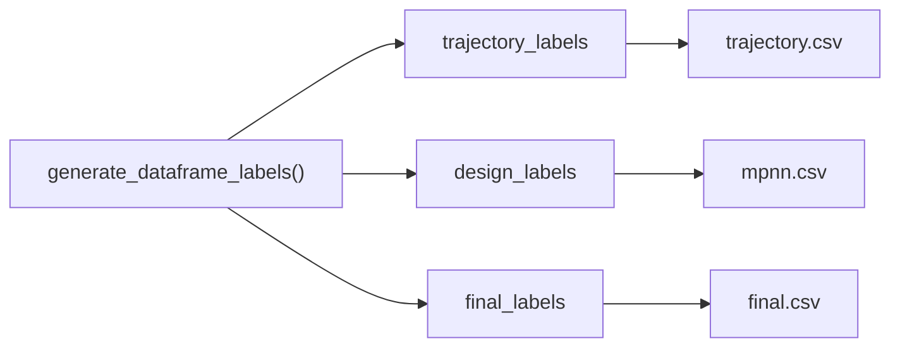

Sources: [functions/generic_utils.py:19-41]()

### Failure Tracking System

The utilities implement a comprehensive failure tracking system to monitor which filters cause design rejections:

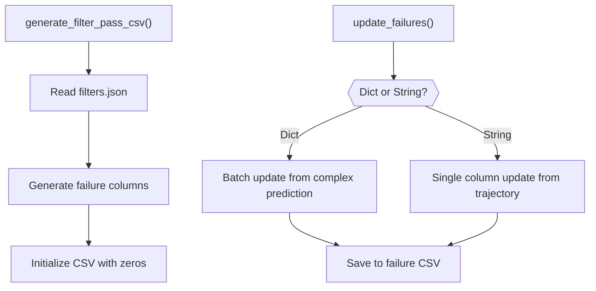

Sources: [functions/generic_utils.py:61-133]()

## System Validation and Health Checks

The core utilities perform essential system validation to ensure the runtime environment is properly configured before design execution begins.

### GPU Validation

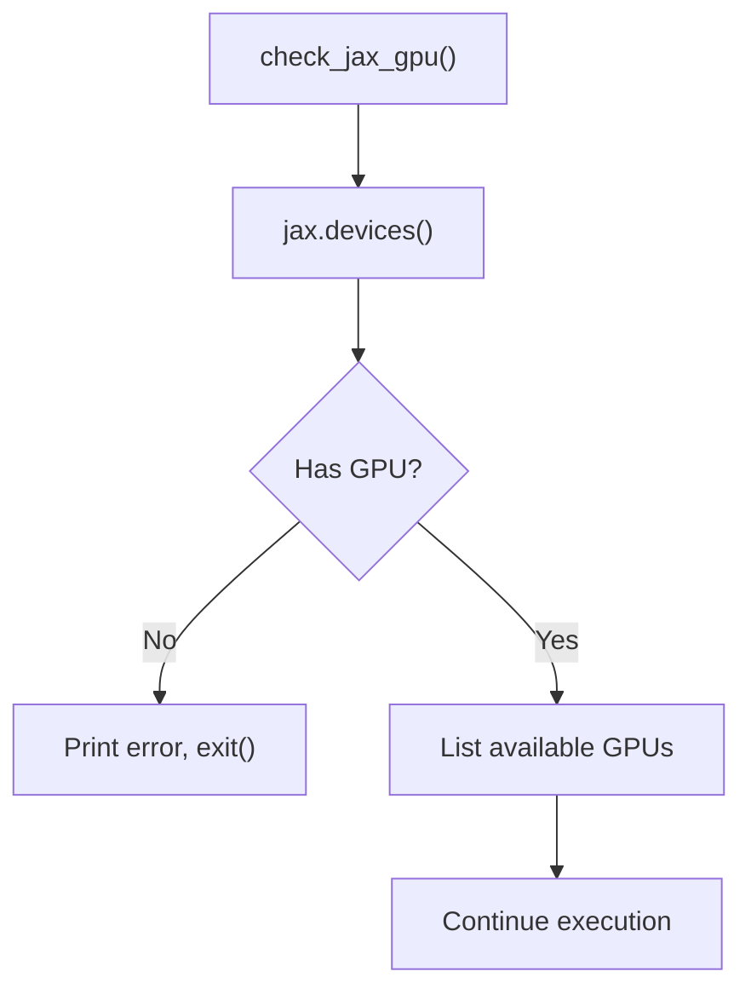

### Binary Executable Validation  

The `_ensure_required_executables` function validates that bundled tools have proper permissions:

| Binary | Purpose | Validation |
|--------|---------|------------|
| `dssp` | Secondary structure analysis | Check executable bit, chmod if needed |
| `DAlphaBall.gcc` | SASA calculations (PyRosetta mode) | Check executable bit, chmod if needed |

Sources: [functions/generic_utils.py:211-222](), [functions/generic_utils.py:278-305]()

## Statistical Processing

The utilities provide statistical processing capabilities for analyzing design results and calculating performance metrics.

### Averaging System

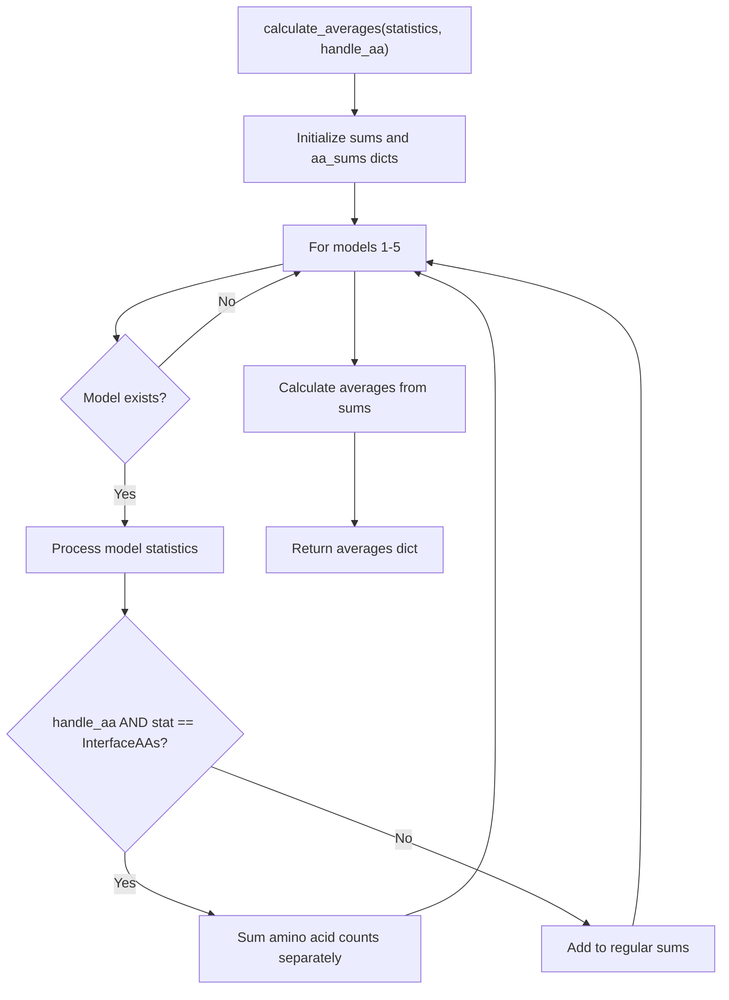

### Filter Validation

The `check_filters` function validates design metrics against threshold criteria:

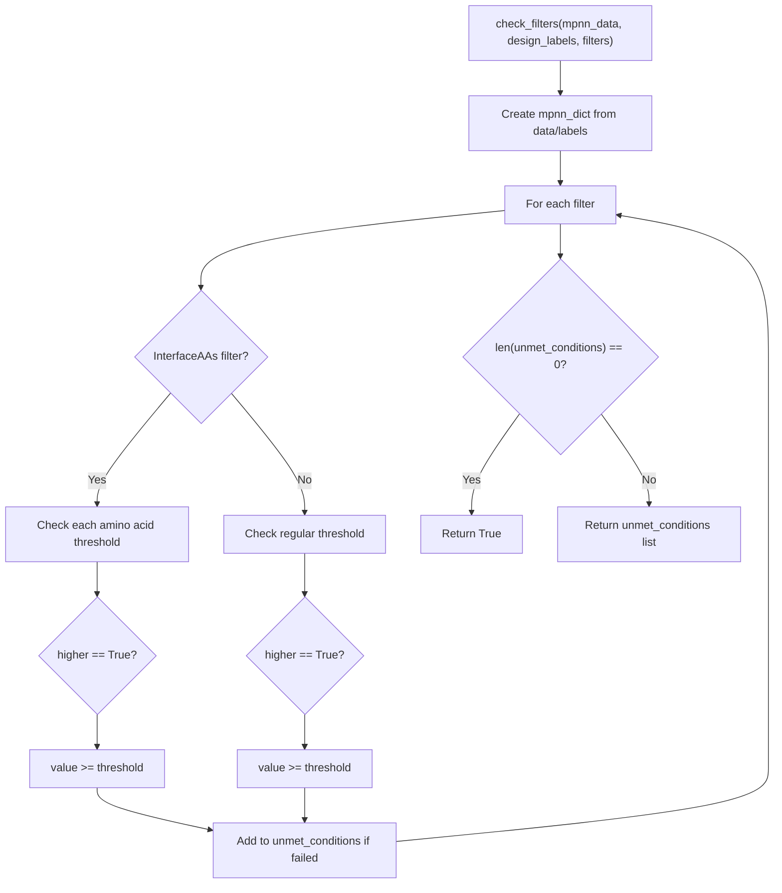

Sources: [functions/generic_utils.py:383-422](), [functions/generic_utils.py:425-464]()

## Design Progress Tracking

The utilities provide functions to monitor design progress and determine when target criteria are met.

### Trajectory Monitoring  

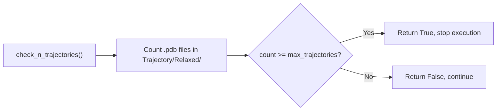

### Accepted Design Management

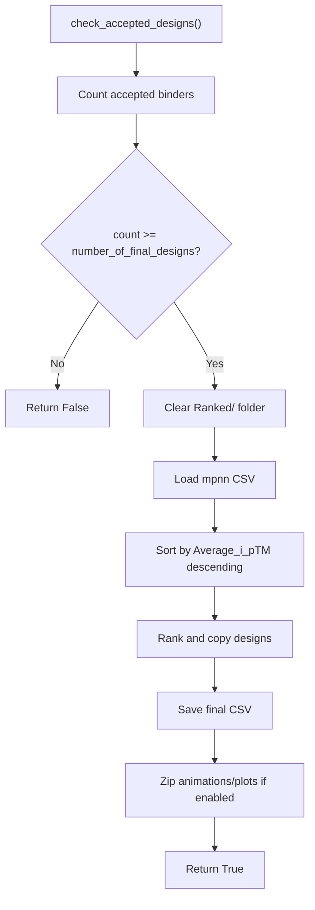

Sources: [functions/generic_utils.py:136-143](), [functions/generic_utils.py:146-195]()

## Utility Functions

### File Operations

| Function | Purpose | Key Operations |
|----------|---------|----------------|
| `clean_pdb` | Remove Rosetta metadata | Filter ATOM, HETATM, MODEL, TER, END, LINK lines |
| `save_fasta` | Write sequence files | Generate FASTA format for MPNN sequences |
| `zip_and_empty_folder` | Archive large outputs | Compress and remove files by extension |

### AlphaFold Model Management

The `load_af2_models` function manages model selection for different pipeline stages:

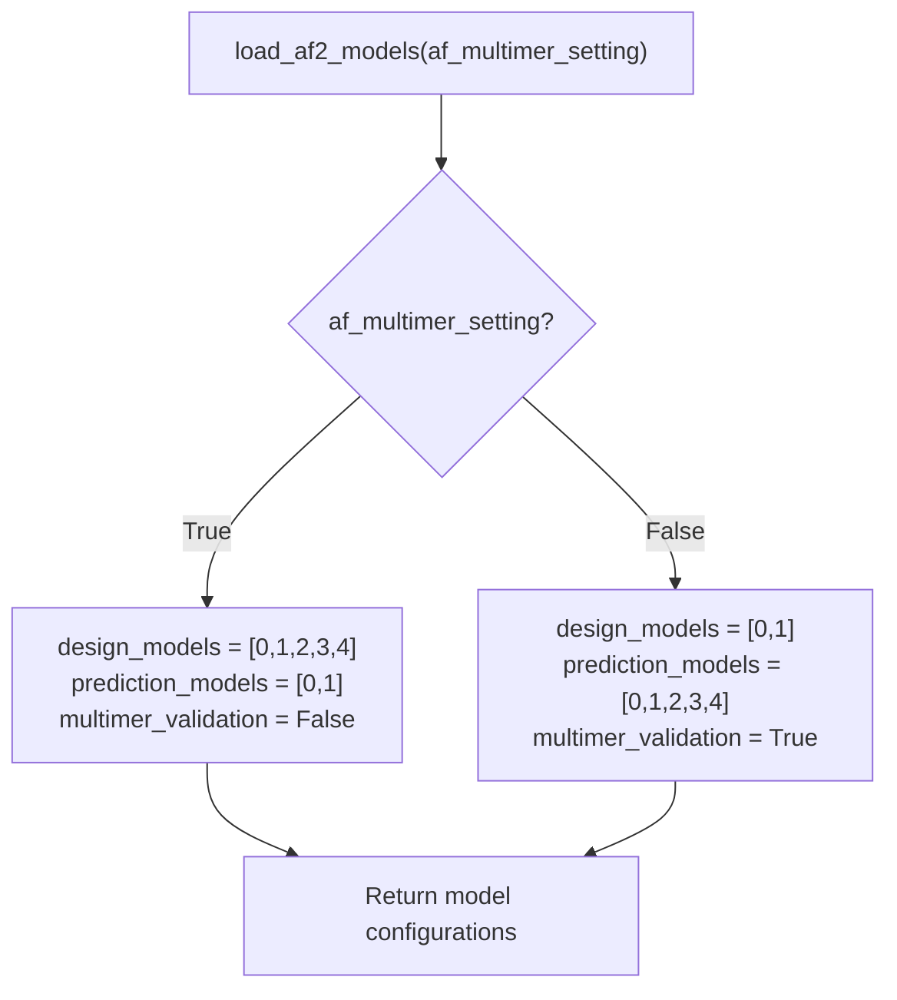

Sources: [functions/generic_utils.py:357-364](), [functions/generic_utils.py:350-354](), [functions/generic_utils.py:366-380](), [functions/generic_utils.py:322-332]()

---