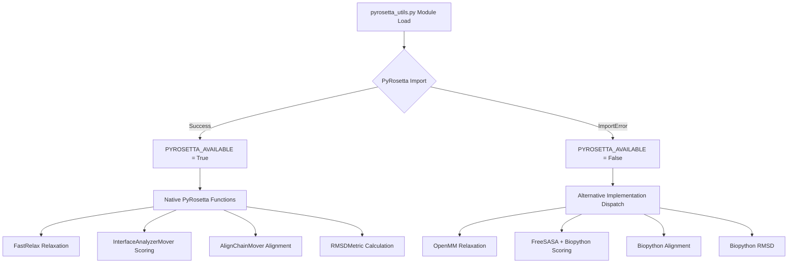
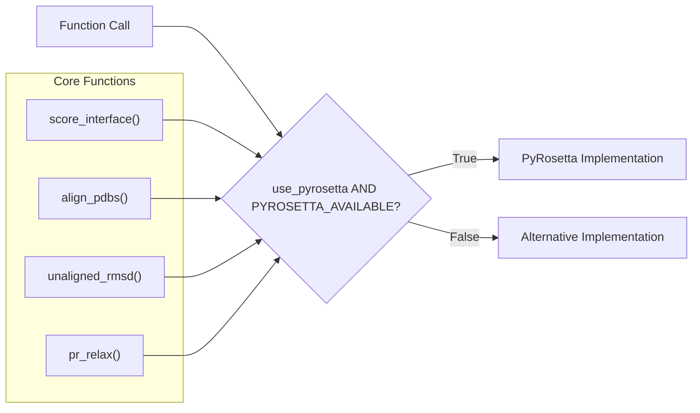
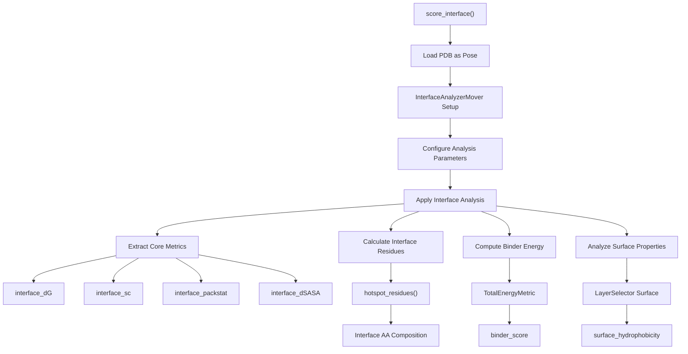
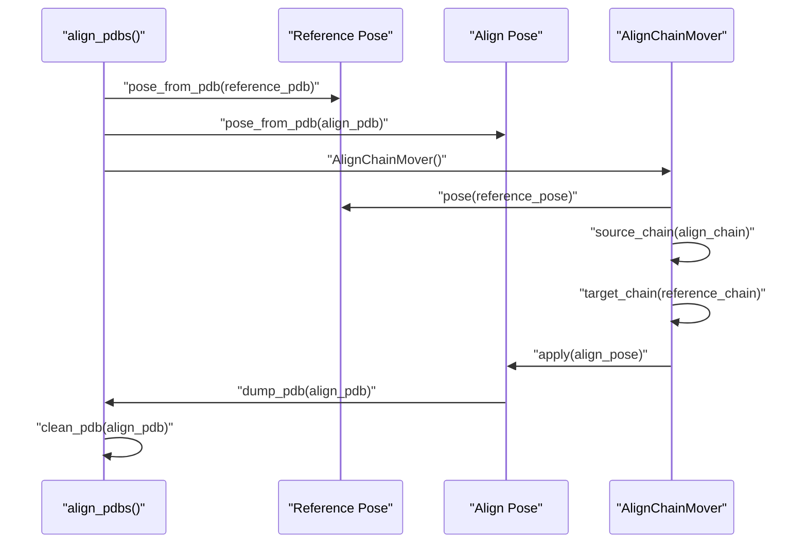
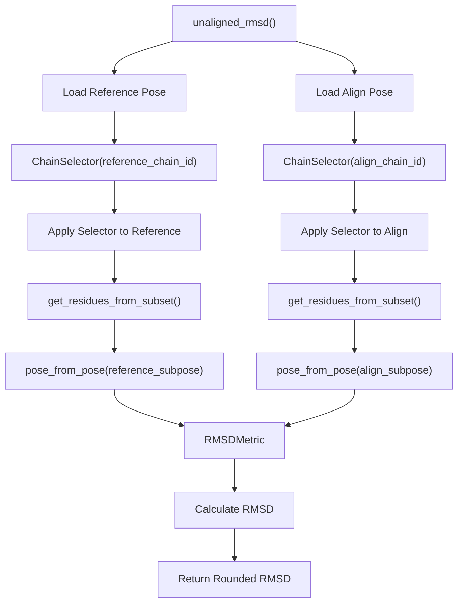
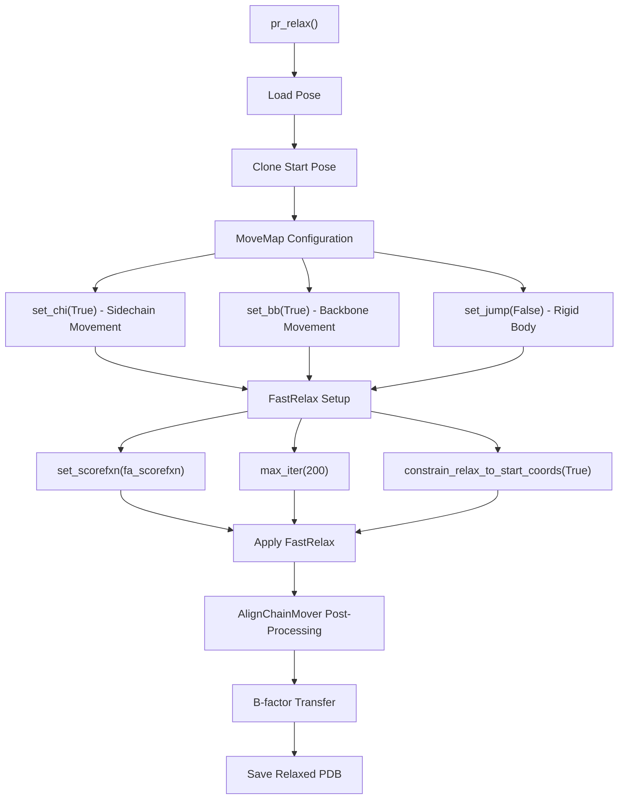
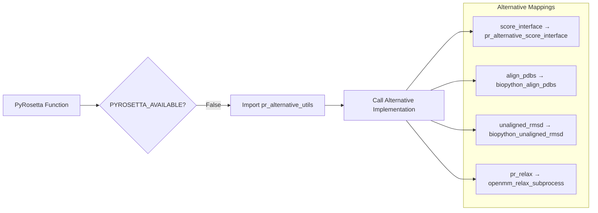

# PyRosetta Integration

Relevant source files

The following files were used as context for generating this wiki page:

- [functions/pyrosetta_utils.py](functions/pyrosetta_utils.py)

This document covers FreeBindCraft's PyRosetta integration layer, which provides comprehensive protein structure analysis, interface scoring, alignment, RMSD calculation, and relaxation capabilities. The system implements a dual-path architecture that uses PyRosetta when available but gracefully falls back to open-source alternatives when PyRosetta is unavailable or explicitly disabled.

For PyRosetta-free alternatives and their implementation details, see [PyRosetta-Free Alternatives](#4.1). For configuration of PyRosetta vs alternative modes, see [Configuration System](#5).

## System Architecture

FreeBindCraft's PyRosetta integration follows a conditional import pattern with graceful degradation. The system detects PyRosetta availability at runtime and dispatches function calls to either native PyRosetta implementations or alternative open-source tools.

### PyRosetta Availability Detection

**Sources:** [functions/pyrosetta_utils.py:12-29]()

### Function Dispatch Architecture

The PyRosetta utilities implement a consistent dispatch pattern where each function accepts a `use_pyrosetta` parameter and automatically handles the routing logic:

**Sources:** [functions/pyrosetta_utils.py:31-41](), [functions/pyrosetta_utils.py:187-194](), [functions/pyrosetta_utils.py:224-230](), [functions/pyrosetta_utils.py:265-269]()

## Interface Scoring

The `score_interface` function provides comprehensive protein-protein interface analysis using PyRosetta's `InterfaceAnalyzerMover` and associated metrics.

### Interface Analysis Pipeline

**Sources:** [functions/pyrosetta_utils.py:47-67](), [functions/pyrosetta_utils.py:100-110](), [functions/pyrosetta_utils.py:118-125](), [functions/pyrosetta_utils.py:140-161]()

### Computed Interface Metrics

The PyRosetta interface scoring returns a comprehensive dictionary of metrics:

| Metric | Description | PyRosetta Source |
|--------|-------------|------------------|
| `interface_dG` | Interface binding energy | `InterfaceAnalyzerMover.get_interface_dG()` |
| `interface_sc` | Shape complementarity | `InterfaceAnalyzerMover.get_all_data().sc_value` |
| `interface_packstat` | Interface packing statistics | `InterfaceAnalyzerMover.get_interface_packstat()` |
| `interface_dSASA` | Change in solvent accessible surface area | `InterfaceAnalyzerMover.get_interface_delta_sasa()` |
| `interface_interface_hbonds` | Number of interface hydrogen bonds | `InterfaceAnalyzerMover.get_all_data().interface_hbonds` |
| `interface_delta_unsat_hbonds` | Buried unsatisfied hydrogen bonds | `BuriedUnsatHbonds` filter |
| `binder_score` | Total energy of binder chain | `TotalEnergyMetric` with chain selector |
| `surface_hydrophobicity` | Fraction of hydrophobic residues on surface | `LayerSelector` analysis |

**Sources:** [functions/pyrosetta_utils.py:101-109](), [functions/pyrosetta_utils.py:164-179]()

## Structure Alignment

The `align_pdbs` function provides chain-based structure alignment using PyRosetta's `AlignChainMover`.

### Alignment Process

The alignment function handles chain ID parsing for multi-chain specifications and uses PyRosetta's chain number conversion utilities.

**Sources:** [functions/pyrosetta_utils.py:195-223]()

## RMSD Calculation

The `unaligned_rmsd` function computes backbone RMSD between specified chains without performing alignment, using PyRosetta's `RMSDMetric`.

### RMSD Computation Workflow

**Sources:** [functions/pyrosetta_utils.py:234-263]()

## Structure Relaxation

The `pr_relax` function performs energy minimization using PyRosetta's `FastRelax` protocol with customized parameters for protein design applications.

### FastRelax Configuration

### Relaxation Parameters

| Parameter | Value | Purpose |
|-----------|-------|---------|
| `max_iter` | 200 | Reduced from default 2500 for speed |
| `min_type` | "lbfgs_armijo_nonmonotone" | Optimization algorithm |
| `constrain_relax_to_start_coords` | True | Prevent large structural changes |
| Chi movement | Enabled | Allow sidechain optimization |
| Backbone movement | Enabled | Allow backbone flexibility |
| Jump movement | Disabled | Prevent rigid body movement |

**Sources:** [functions/pyrosetta_utils.py:276-291]()

## Integration with Alternatives

When PyRosetta is unavailable or disabled, the system automatically dispatches to alternative implementations through the `pr_alternative_utils` module.

### Alternative Dispatch Pattern

The fallback system ensures consistent API behavior regardless of PyRosetta availability, with alternative implementations providing comparable functionality through open-source tools.

**Sources:** [functions/pyrosetta_utils.py:40-41](), [functions/pyrosetta_utils.py:192-193](), [functions/pyrosetta_utils.py:228-229](), [functions/pyrosetta_utils.py:320-324]()

## Performance Characteristics

PyRosetta operations include detailed timing instrumentation for performance monitoring:

### Timing Breakdown

| Operation | Typical Duration | Optimization Notes |
|-----------|------------------|-------------------|
| Pose Loading | ~1-2 seconds | I/O bound, cached by PyRosetta |
| Interface Analysis | ~5-15 seconds | Most computationally intensive |
| RMSD Calculation | ~1-3 seconds | Depends on chain size |
| FastRelax | ~30-120 seconds | Reduced iterations for speed |
| Structure Alignment | ~1-2 seconds | Minimal overhead |

All timing information is logged through the `vprint` system for performance analysis and debugging.

**Sources:** [functions/pyrosetta_utils.py:50-52](), [functions/pyrosetta_utils.py:65-67](), [functions/pyrosetta_utils.py:290-292]()

---