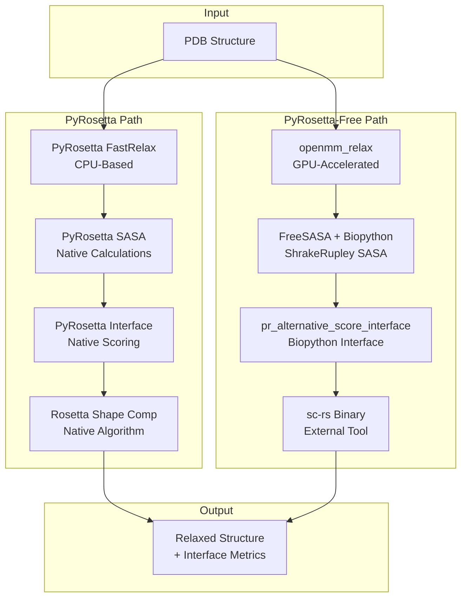
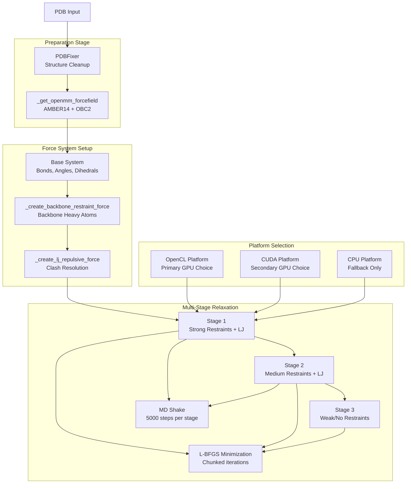
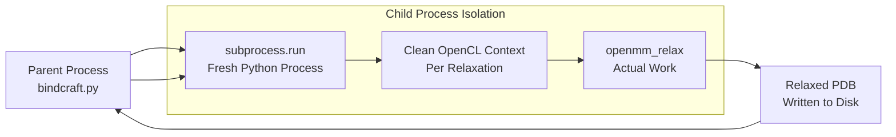
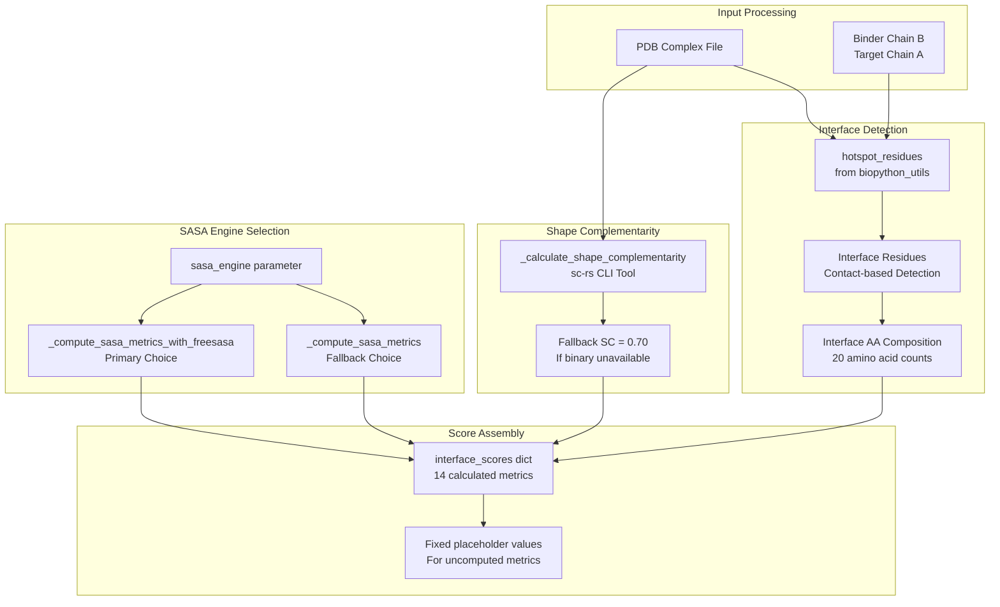
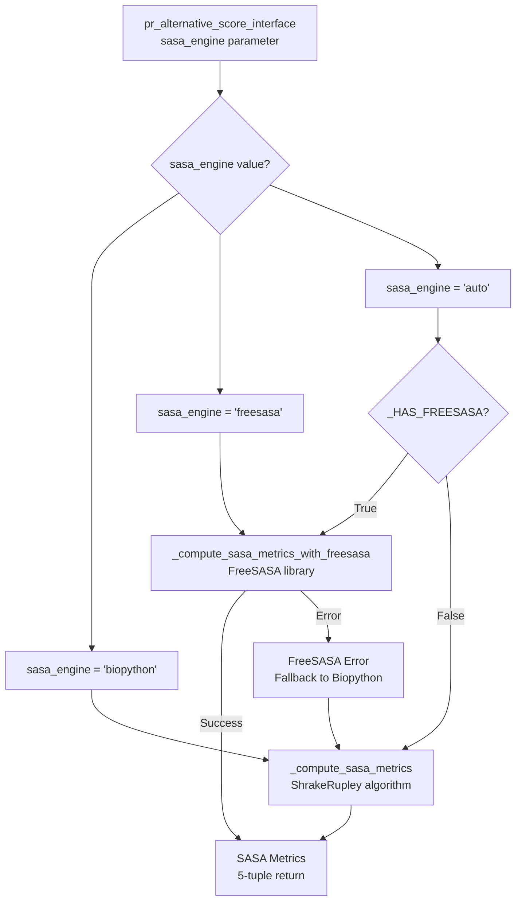
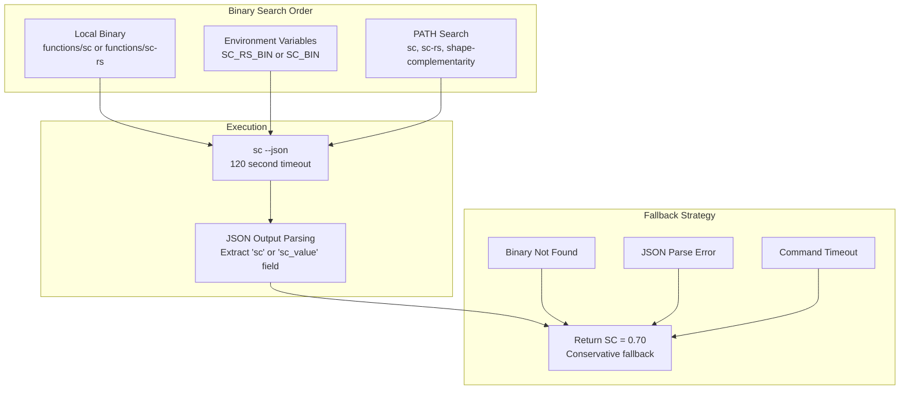

# PyRosetta-Free Alternatives

Relevant source files

The following files were used as context for generating this wiki page:

- [functions/pr_alternative_utils.py](functions/pr_alternative_utils.py)

This document covers the PyRosetta-free alternatives implemented in FreeBindCraft, which enable protein design workflows without requiring PyRosetta installation. These alternatives provide equivalent functionality using open-source tools like OpenMM, FreeSASA, and Biopython.

For information about traditional PyRosetta integration, see [PyRosetta Integration](#4). For shape complementarity tools specifically, see [Shape Complementarity Tools](#4.2).

## Overview

The PyRosetta-free alternatives system provides functionally equivalent replacements for key PyRosetta operations:

- **Structure Relaxation**: OpenMM with GPU acceleration replaces PyRosetta FastRelax
- **Interface Scoring**: Biopython SASA calculations replace PyRosetta interface analysis
- **Shape Complementarity**: External `sc-rs` binary replaces Rosetta shape complementarity
- **SASA Calculations**: FreeSASA and Biopython ShrakeRupley replace PyRosetta SASA

**Sources**: [functions/pr_alternative_utils.py:1-24]()

## OpenMM Structure Relaxation

The `openmm_relax` function provides GPU-accelerated structure relaxation as an alternative to PyRosetta's FastRelax protocol. It uses the AMBER14 force field with OBC2 implicit solvent.

### Relaxation Architecture

### Key Components

The relaxation system consists of several specialized components:

| Component | Function | Purpose |
|-----------|----------|---------|
| **Force Field Singleton** | `_get_openmm_forcefield` | Cached AMBER14-all.xml + OBC2 force field |
| **Backbone Restraints** | `_create_backbone_restraint_force` | Harmonic restraints on N,CA,C,O atoms |
| **LJ Repulsion** | `_create_lj_repulsive_force` | Custom repulsive force for clash resolution |
| **Platform Selection** | Multi-platform fallback | OpenCL → CUDA → CPU priority order |

**Sources**: [functions/pr_alternative_utils.py:62-66](), [functions/pr_alternative_utils.py:122-153](), [functions/pr_alternative_utils.py:74-120]()

### Subprocess Isolation

The `openmm_relax_subprocess` function provides process isolation to prevent OpenCL context accumulation:

**Sources**: [functions/pr_alternative_utils.py:1030-1107](), [functions/pr_alternative_utils.py:21-23]()

## Interface Scoring System

The `pr_alternative_score_interface` function provides comprehensive interface analysis without PyRosetta dependency.

### Scoring Components

**Sources**: [functions/pr_alternative_utils.py:892-1027](), [functions/pr_alternative_utils.py:922-927](), [functions/pr_alternative_utils.py:934-973]()

### Computed vs Placeholder Metrics

The scoring system provides both computed and placeholder values:

| Metric Type | Implementation | Status |
|-------------|----------------|---------|
| **Interface Residues** | `hotspot_residues` function | ✅ Computed |
| **SASA Calculations** | FreeSASA/Biopython | ✅ Computed |
| **Shape Complementarity** | `sc-rs` binary | ✅ Computed |
| **Surface Hydrophobicity** | Residue-based analysis | ✅ Computed |
| **Hydrogen Bonds** | Fixed placeholder = 5 | ⚠️ Placeholder |
| **PackStat** | Fixed placeholder = 0.65 | ⚠️ Placeholder |
| **dG Energy** | Fixed placeholder = -10.0 | ⚠️ Placeholder |

**Sources**: [functions/pr_alternative_utils.py:994-1002](), [functions/pr_alternative_utils.py:1004-1021]()

## SASA Calculation Methods

FreeBindCraft provides two SASA calculation engines with automatic fallback.

### Engine Selection Logic

### SASA Calculation Details

Both engines compute the same 5-tuple output:

1. **Surface Hydrophobicity Fraction**: Hydrophobic residue SASA / Total binder SASA
2. **Binder SASA in Complex**: Binder accessibility in bound state  
3. **Binder SASA Monomer**: Binder accessibility when isolated
4. **Target SASA in Complex**: Target accessibility in bound state
5. **Target SASA Monomer**: Target accessibility when isolated

**Sources**: [functions/pr_alternative_utils.py:287-378](), [functions/pr_alternative_utils.py:380-523](), [functions/pr_alternative_utils.py:54-60]()

## Shape Complementarity Integration

The shape complementarity calculation uses the external `sc-rs` binary with robust fallback handling.

### Binary Resolution Strategy

The shape complementarity function handles mixed output by extracting JSON from potentially verbose output:

**Sources**: [functions/pr_alternative_utils.py:185-285](), [functions/pr_alternative_utils.py:211-229](), [functions/pr_alternative_utils.py:253-276]()

## Integration with Main Pipeline

The PyRosetta-free alternatives integrate seamlessly with the main design pipeline through conditional logic.

### Pipeline Integration Points

| Integration Point | Traditional Path | PyRosetta-Free Path |
|------------------|------------------|-------------------|
| **Structure Relaxation** | `pr_relax` function | `openmm_relax_subprocess` |
| **Interface Scoring** | `pr_score_interface` | `pr_alternative_score_interface` |
| **SASA Calculations** | PyRosetta native | FreeSASA or Biopython |
| **Shape Complementarity** | Rosetta protocols | `sc-rs` binary |

The selection between paths is controlled by:
- `--no-pyrosetta` command line flag
- PyRosetta installation detection  
- GPU availability for OpenMM
- Binary availability for shape complementarity

**Sources**: [functions/pr_alternative_utils.py:1-24](), [functions/pr_alternative_utils.py:525-891]()

---