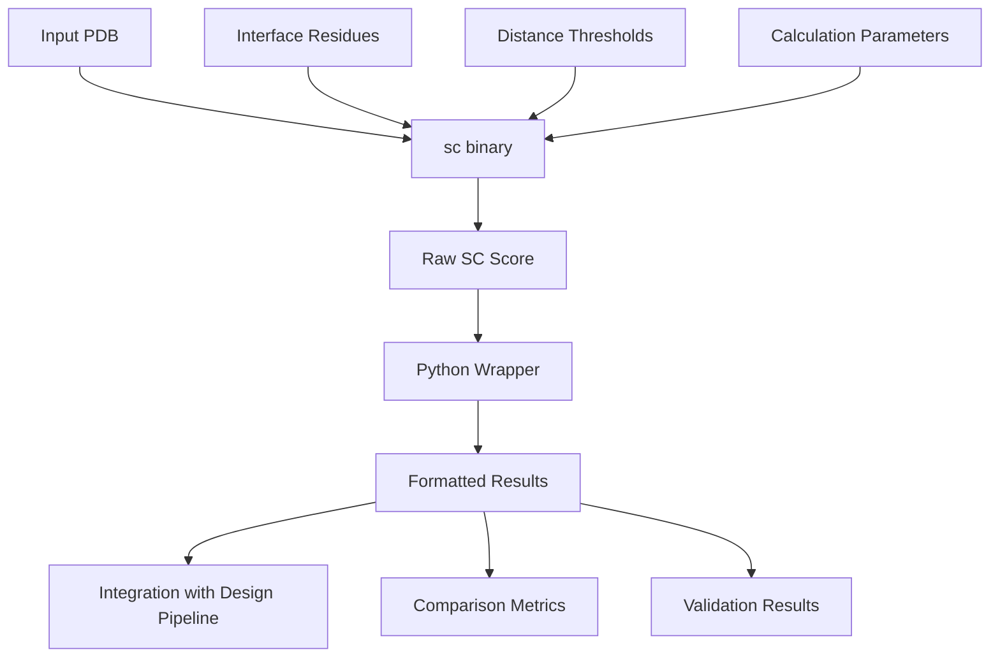
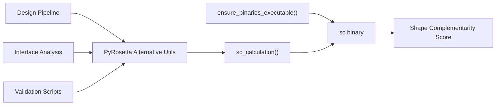
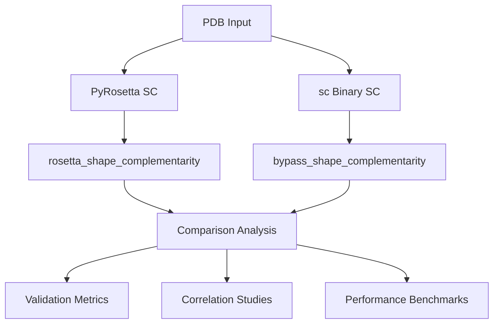
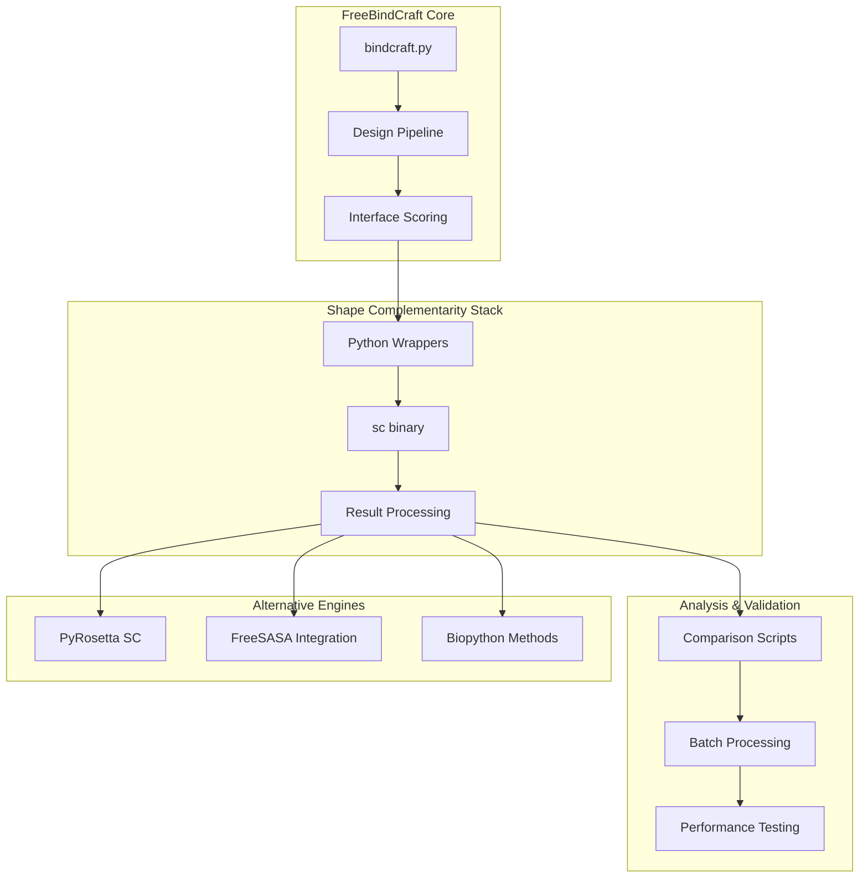

# Shape Complementarity Tools

Relevant source files

The following files were used as context for generating this wiki page:

- [extras/compare_interface_metrics_all.py](extras/compare_interface_metrics_all.py)
- [extras/compare_pyrosetta_bypass_scores.py](extras/compare_pyrosetta_bypass_scores.py)
- [extras/test_openmm_relax.py](extras/test_openmm_relax.py)
- [functions/sc](functions/sc)

This document covers the shape complementarity calculation tools in FreeBindCraft, which provide PyRosetta-free alternatives for measuring the geometric fit between protein interfaces. Shape complementarity is a critical metric for evaluating protein-protein interactions and binder design quality.

For information about other PyRosetta-free alternatives like OpenMM relaxation and FreeSASA calculations, see [PyRosetta-Free Alternatives](#4.1). For broader PyRosetta integration topics, see [PyRosetta Integration](#4).

## Overview

Shape complementarity measures how well two protein surfaces fit together geometrically at their interface. In protein design, high shape complementarity indicates good geometric matching between a designed binder and its target, which correlates with binding affinity and specificity.

FreeBindCraft provides shape complementarity calculations through the `sc` binary, offering an alternative to PyRosetta's native shape complementarity scoring functions. This enables shape complementarity analysis in environments where PyRosetta is not available.

## The sc Binary Tool

The core shape complementarity calculations are performed by the `sc` binary executable located at [functions/sc:1-400](), which implements geometric algorithms for measuring interface complementarity.

### Shape Complementarity Calculation Flow

**Shape Complementarity Calculation Pipeline**

Sources: [functions/sc:1-400]()

### Binary Integration

The `sc` binary is integrated into the FreeBindCraft ecosystem through Python wrapper functions and is automatically made executable during system initialization:

**sc Binary Integration Architecture**

Sources: [extras/compare_pyrosetta_bypass_scores.py:36-53](), [extras/compare_interface_metrics_all.py:32-45]()

## Pipeline Integration

Shape complementarity calculations integrate with the broader FreeBindCraft design and analysis pipeline through several key components:

### Design Pipeline Integration

| Component | Role | sc Binary Usage |
|-----------|------|----------------|
| **Interface Scoring** | Primary interface evaluation | Direct calculation of SC scores |
| **Design Validation** | Post-design quality assessment | Comparison with target thresholds |
| **Multi-Engine Comparison** | Cross-validation between methods | Reference metric for PyRosetta comparison |
| **Batch Analysis** | High-throughput processing | Parallel SC calculations |

### Comparison with PyRosetta Methods

FreeBindCraft enables direct comparison between `sc` binary results and PyRosetta native shape complementarity calculations:

**Shape Complementarity Method Comparison**

Sources: [extras/compare_pyrosetta_bypass_scores.py:88-106](), [extras/compare_interface_metrics_all.py:113-131]()

## Usage in Analysis Scripts

The shape complementarity tools are utilized across several analysis and comparison scripts in the FreeBindCraft ecosystem:

### Batch Comparison Scripts

The `compare_pyrosetta_bypass_scores.py` script demonstrates shape complementarity integration in batch analysis workflows:

- **Parallel Processing**: Multiple worker processes can execute `sc` binary calculations simultaneously
- **Error Handling**: Robust error management for binary execution failures  
- **Result Integration**: SC scores integrated with other interface metrics in unified CSV output

### Multi-Engine Validation

The `compare_interface_metrics_all.py` script showcases shape complementarity as part of comprehensive interface analysis:

- **Cross-Engine Validation**: SC scores from multiple calculation engines (PyRosetta, FreeSASA, Biopython alternatives)
- **Metric Correlation**: Shape complementarity compared alongside SASA, interface area, and clash metrics
- **Performance Profiling**: Timing comparisons between different SC calculation methods

## Configuration and Parameters

### Binary Execution Parameters

The `sc` binary accepts various parameters that control the shape complementarity calculation:

| Parameter Type | Description | Default Behavior |
|----------------|-------------|-----------------|
| **Interface Definition** | Residue distance thresholds for interface detection | Contact-based detection |
| **Geometric Precision** | Grid resolution for surface sampling | Standard precision mode |
| **Output Format** | Score formatting and additional metrics | Numerical score output |

### System Requirements

| Requirement | Details |
|-------------|---------|
| **Executable Permissions** | `sc` binary must have execute permissions |
| **Memory Usage** | Scales with protein complex size |
| **Disk Space** | Temporary files for intermediate calculations |
| **Platform Support** | Compiled for target system architecture |

Sources: [extras/compare_pyrosetta_bypass_scores.py:36-53](), [extras/test_openmm_relax.py:75-84]()

## Integration Architecture

### System-Level Integration

**Shape Complementarity System Architecture**

Sources: [extras/compare_pyrosetta_bypass_scores.py:75-147](), [extras/compare_interface_metrics_all.py:66-149]()

### Error Handling and Fallbacks

The shape complementarity system implements robust error handling for binary execution failures:

- **Binary Availability Checks**: Verification that `sc` binary exists and is executable
- **Execution Monitoring**: Timeout handling for long-running calculations
- **Graceful Degradation**: Continuation of analysis pipeline when SC calculation fails
- **Alternative Method Fallback**: Automatic switching to available SC calculation methods

## Performance Characteristics

### Computational Efficiency

| Metric | sc Binary | PyRosetta Native | 
|--------|-----------|------------------|
| **Memory Usage** | Lower overhead | Higher PyRosetta overhead |
| **Execution Speed** | Fast binary execution | Depends on PyRosetta initialization |
| **Scalability** | Good parallel scaling | Limited by PyRosetta threading |
| **Dependencies** | Minimal system dependencies | Full PyRosetta stack required |

### Parallel Processing Support

The shape complementarity tools support efficient parallel processing through:

- **Process-Level Parallelism**: Multiple `sc` binary instances can run simultaneously
- **Shared Memory Efficiency**: Minimal memory overhead per process
- **Load Balancing**: Even distribution of calculations across available workers

Sources: [extras/compare_pyrosetta_bypass_scores.py:207-235](), [extras/compare_interface_metrics_all.py:209-237]()

---