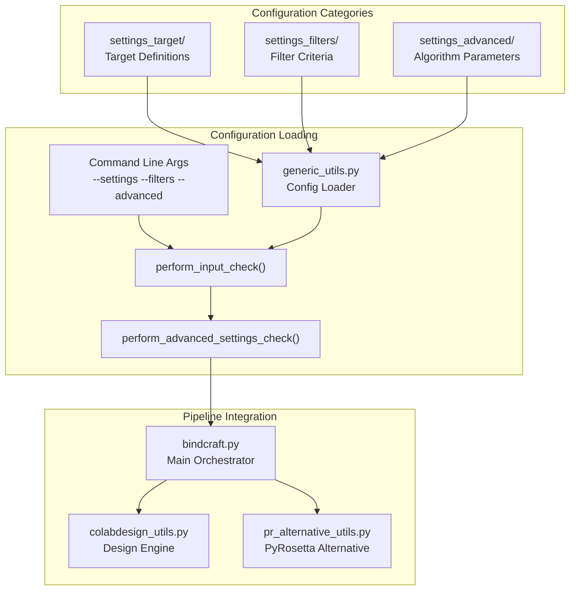
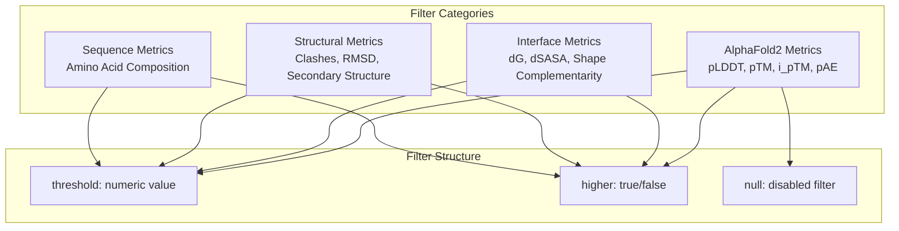
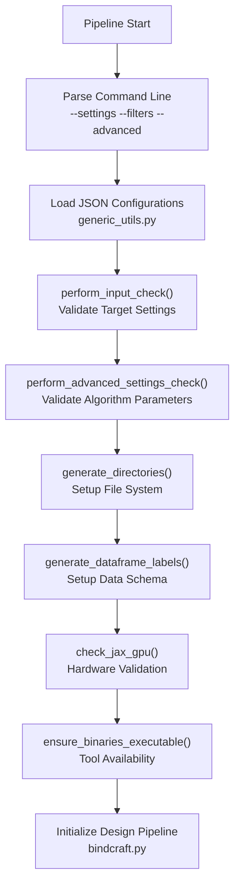
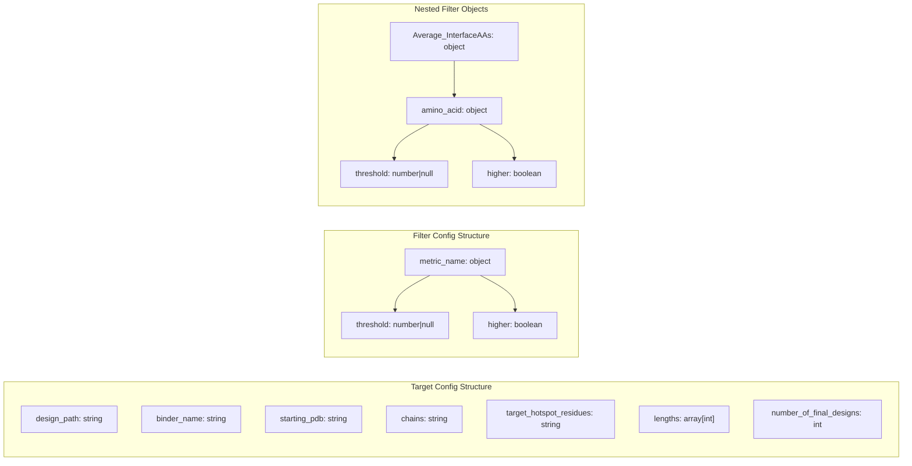

# Configuration System

<details>
<summary>Relevant source files</summary>

The following files were used as context for generating this wiki page:

- [bindcraft.slurm](bindcraft.slurm)
- [settings_filters/default_filters.json](settings_filters/default_filters.json)
- [settings_filters/no_filters.json](settings_filters/no_filters.json)
- [settings_target/PDL1.json](settings_target/PDL1.json)

</details>


The Configuration System provides a comprehensive, JSON-based approach to controlling all aspects of FreeBindCraft's protein design pipeline. This system manages target definitions, filtering criteria, and advanced algorithm parameters through structured configuration files that are loaded and validated before pipeline execution.

For detailed information about filter-specific configurations, see [Filter Configuration](#5.1). For algorithm-specific parameters, see [Advanced Parameters](#5.2).

## Architecture Overview

The Configuration System operates through three distinct configuration categories that work together to control the design pipeline. The system uses JSON files for structured configuration management and provides both command-line and interactive interfaces for configuration selection.



Sources: [bindcraft.slurm:47](), [settings_target/PDL1.json:1-9](), [settings_filters/default_filters.json:1-1342]()

## Configuration Categories

### Target Settings

Target settings define the fundamental parameters for the design target, including input structures, binding sites, and design objectives. These configurations are stored in the `settings_target/` directory.

| Parameter | Description | Example |
|-----------|-------------|---------|
| `design_path` | Working directory for design outputs | `"/root/software/pdl1/"` |
| `binder_name` | Identifier for the target protein | `"PDL1"` |
| `starting_pdb` | Path to input PDB structure | `"./example/PDL1.pdb"` |
| `chains` | Target chain identifiers | `"A"` |
| `target_hotspot_residues` | Specific residues to target for binding | `"56"` |
| `lengths` | Range of binder lengths to explore | `[65, 150]` |
| `number_of_final_designs` | Target number of successful designs | `100` |

Sources: [settings_target/PDL1.json:2-8]()

### Filter Settings

Filter settings control design acceptance criteria through threshold-based filtering on various structural and sequence metrics. The system supports both strict filtering ([settings_filters/default_filters.json]()) and permissive modes ([settings_filters/no_filters.json]()).



Each filter entry contains:
- `threshold`: Numeric cutoff value (`null` disables the filter)
- `higher`: Boolean indicating whether higher values are better

Sources: [settings_filters/default_filters.json:10-13](), [settings_filters/no_filters.json:10-13]()

## Configuration Loading Workflow

The configuration loading process involves validation, cross-referencing, and system initialization steps that ensure proper pipeline setup before design execution begins.



Sources: [bindcraft.slurm:27-47]()

## Command-Line Integration

The configuration system integrates with the command-line interface through three primary parameters that specify configuration file paths. The SLURM script demonstrates the standard usage pattern:

```bash
# SLURM script parameter parsing
SETTINGS=""
FILTERS=""  
ADVANCED=""
TEMP=$(getopt -o s:f:a: --long settings:,filters:,advanced: -n 'bindcraft.slurm' -- "$@")

# Pipeline execution
python -u "${SCRIPT_DIR}/bindcraft.py" --settings "${SETTINGS}" --filters "${FILTERS}" --advanced "${ADVANCED}"
```

The system requires the `--settings` parameter as mandatory, while `--filters` and `--advanced` are optional with system defaults applied when not specified.

Sources: [bindcraft.slurm:24-47]()

## Configuration File Structure

### JSON Schema Pattern

All configuration files follow a consistent JSON structure that enables systematic validation and processing:



### Filter Configuration Patterns

The filter system supports both simple threshold filters and complex nested structures for amino acid composition analysis:

**Simple Filter Pattern:**
```json
{
    "Average_pLDDT": {
        "threshold": 0.8,
        "higher": true
    }
}
```

**Nested Filter Pattern (Amino Acid Composition):**
```json
{
    "Average_InterfaceAAs": {
        "A": {
            "threshold": null,
            "higher": false
        },
        "C": {
            "threshold": null,
            "higher": false
        }
    }
}
```

Sources: [settings_filters/default_filters.json:10-13](), [settings_filters/default_filters.json:707-787]()

## Configuration Validation

The system performs comprehensive validation during the configuration loading phase to ensure all required parameters are present and valid before pipeline execution begins. This includes file path validation, parameter range checking, and cross-parameter consistency verification.

The validation process integrates with the broader system initialization workflow, ensuring that hardware requirements, software dependencies, and file system setup are all properly configured based on the loaded configuration parameters.

Sources: [bindcraft.slurm:40-44]()

---