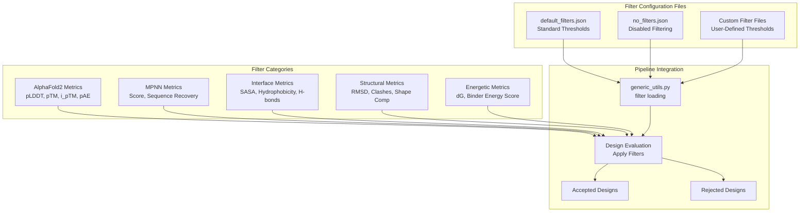
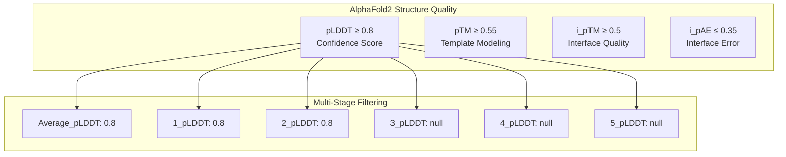
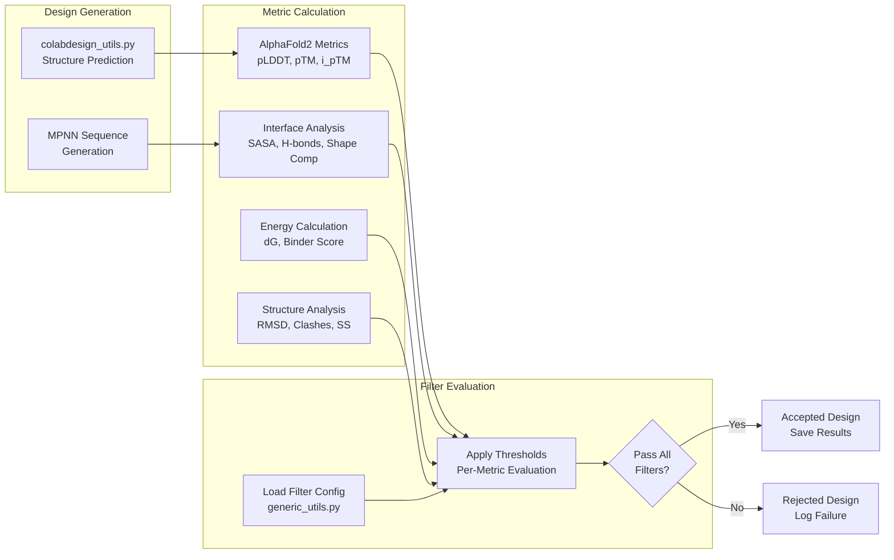
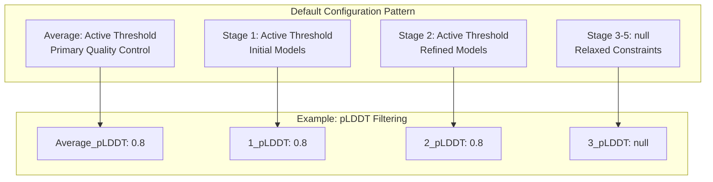
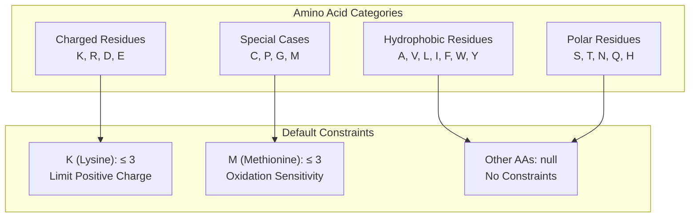

# Filter Configuration

<details>
<summary>Relevant source files</summary>

The following files were used as context for generating this wiki page:

- [settings_filters/default_filters.json](settings_filters/default_filters.json)
- [settings_filters/no_filters.json](settings_filters/no_filters.json)

</details>


This document describes the filter configuration system in FreeBindCraft, which controls quality thresholds for protein design acceptance. The filter system evaluates designs against multiple structural, energetic, and sequence-based criteria to ensure only high-quality binders are retained. For advanced algorithm parameters, see [Advanced Parameters](#5.2). For overall configuration system architecture, see [Configuration System](#5).

## Filter System Architecture

The filter configuration system uses JSON files to define acceptance criteria for protein designs. Each filter specifies a threshold value and direction (higher or lower is better) for computed metrics.



Sources: [settings_filters/default_filters.json:1-1342](), [settings_filters/no_filters.json:1-1342]()

## Filter File Structure

Filter configuration files use a standardized JSON structure where each metric has `threshold` and `higher` properties:

```json
{
    "metric_name": {
        "threshold": numeric_value_or_null,
        "higher": boolean_indicating_direction
    }
}
```

### Basic Filter Properties

| Property | Type | Description |
|----------|------|-------------|
| `threshold` | `number` or `null` | Cutoff value for acceptance; `null` disables the filter |
| `higher` | `boolean` | `true` if higher values are better, `false` if lower values are better |

### Nested Filter Structure

For amino acid composition filters, the structure includes per-residue thresholds:

```json
{
    "Average_InterfaceAAs": {
        "A": {"threshold": null, "higher": false},
        "C": {"threshold": null, "higher": false},
        "K": {"threshold": 3, "higher": false},
        "M": {"threshold": 3, "higher": false}
    }
}
```

Sources: [settings_filters/default_filters.json:706-786](), [settings_filters/no_filters.json:706-786]()

## Default Filter Configuration

The `default_filters.json` file defines production-ready thresholds based on empirical protein design best practices:

### AlphaFold2 Quality Metrics



### Interface Quality Filters

| Metric | Threshold | Direction | Purpose |
|---------|-----------|-----------|---------|
| `Average_ShapeComplementarity` | 0.6 | Higher | Interface geometric fit |
| `1_ShapeComplementarity` | 0.55 | Higher | First model quality |
| `2_ShapeComplementarity` | 0.55 | Higher | Second model quality |
| `Average_n_InterfaceResidues` | 7 | Higher | Sufficient interface size |
| `Average_n_InterfaceHbonds` | 3 | Higher | Hydrogen bonding |
| `Average_n_InterfaceUnsatHbonds` | 4 | Lower | Unsatisfied H-bonds |

### Energetic and Structural Filters

| Metric | Threshold | Direction | Purpose |
|---------|-----------|-----------|---------|
| `Average_dG` | 0 | Lower | Binding affinity |
| `Average_dSASA` | 1 | Higher | Buried surface area |
| `Average_Binder_Energy_Score` | 0 | Lower | Binder stability |
| `Average_Surface_Hydrophobicity` | 0.35 | Lower | Avoid aggregation |
| `Average_Binder_RMSD` | 3.5 | Lower | Structural deviation |
| `Average_Hotspot_RMSD` | 6 | Lower | Hotspot preservation |

### Secondary Structure Constraints

| Metric | Threshold | Direction | Purpose |
|---------|-----------|-----------|---------|
| `Average_Binder_Loop%` | 90 | Lower | Limit disordered regions |
| `1_Binder_Loop%` | 90 | Lower | First model structure |
| `2_Binder_Loop%` | 90 | Lower | Second model structure |

Sources: [settings_filters/default_filters.json:10-21](), [settings_filters/default_filters.json:274-296](), [settings_filters/default_filters.json:322-368](), [settings_filters/default_filters.json:682-704]()

## Filter Application Pipeline



Sources: [settings_filters/default_filters.json:1-1342]()

## No Filters Configuration

The `no_filters.json` file disables all filtering by setting all thresholds to `null`. This configuration is useful for:

- Debugging filter effects
- Collecting unfiltered design statistics
- Custom post-processing workflows
- Performance testing without filtering overhead

```json
{
    "Average_pLDDT": {
        "threshold": null,
        "higher": true
    },
    "Average_ShapeComplementarity": {
        "threshold": null,
        "higher": true
    }
}
```

Sources: [settings_filters/no_filters.json:10-21](), [settings_filters/no_filters.json:274-276]()

## Multi-Stage Filtering System

FreeBindCraft supports multi-stage design evaluation with separate thresholds for different trajectory stages:

### Stage Numbering Convention

| Stage | Description | Typical Usage |
|-------|-------------|---------------|
| `Average_*` | Across all stages | Primary filter |
| `1_*` | First stage | Initial quality |
| `2_*` | Second stage | Refined quality |
| `3_*` | Third stage | Extended sampling |
| `4_*` | Fourth stage | Advanced sampling |
| `5_*` | Fifth stage | Final sampling |

### Stage-Specific Thresholds



Sources: [settings_filters/default_filters.json:10-32](), [settings_filters/default_filters.json:34-56](), [settings_filters/default_filters.json:58-80]()

## Amino Acid Composition Filters

The system includes sophisticated amino acid composition filtering for interface residues:

### Interface Amino Acid Constraints



### Per-Stage AA Filtering

The system allows different amino acid composition rules for each design stage:

- `Average_InterfaceAAs`: Overall composition limits
- `1_InterfaceAAs` through `5_InterfaceAAs`: Stage-specific limits

Sources: [settings_filters/default_filters.json:706-1197]()

## Custom Filter Configuration

### Creating Custom Filters

1. Copy `default_filters.json` as a starting template
2. Modify threshold values for specific metrics
3. Set thresholds to `null` to disable unwanted filters
4. Specify the custom filter file path in pipeline configuration

### Filter Customization Examples

**Relaxed Quality Filters:**
```json
{
    "Average_pLDDT": {"threshold": 0.7, "higher": true},
    "Average_ShapeComplementarity": {"threshold": 0.5, "higher": true}
}
```

**Strict Interface Filters:**
```json
{
    "Average_n_InterfaceResidues": {"threshold": 10, "higher": true},
    "Average_n_InterfaceHbonds": {"threshold": 5, "higher": true}
}
```

**Peptide-Specific Filters:**
```json
{
    "Average_Binder_Loop%": {"threshold": 95, "higher": false},
    "Average_dSASA": {"threshold": 0.5, "higher": true}
}
```

Sources: [settings_filters/default_filters.json:442-464](), [settings_filters/default_filters.json:466-488](), [settings_filters/default_filters.json:682-704]()

## Integration with Pipeline Components

### Filter Loading and Validation

The filter configuration integrates with the main pipeline through the generic utilities system, which handles:

- JSON file parsing and validation
- Threshold application during design evaluation  
- Failure logging for rejected designs
- Statistics collection for filter performance

### Computational Engine Compatibility

Filter configurations work with both PyRosetta and PyRosetta-free computational paths:

- **PyRosetta path**: Uses native Rosetta metrics where available
- **PyRosetta-free path**: Uses equivalent calculations from OpenMM, FreeSASA, and Biopython
- **Hybrid mode**: Combines metrics from multiple computational engines

The filter thresholds remain consistent across computational engines, enabling direct comparison of results.

Sources: [settings_filters/default_filters.json:1-1342](), [settings_filters/no_filters.json:1-1342]()

---