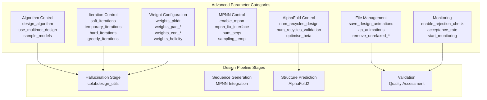
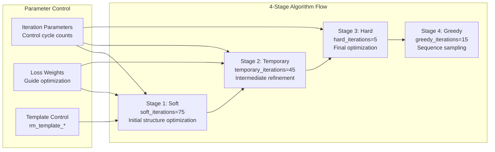
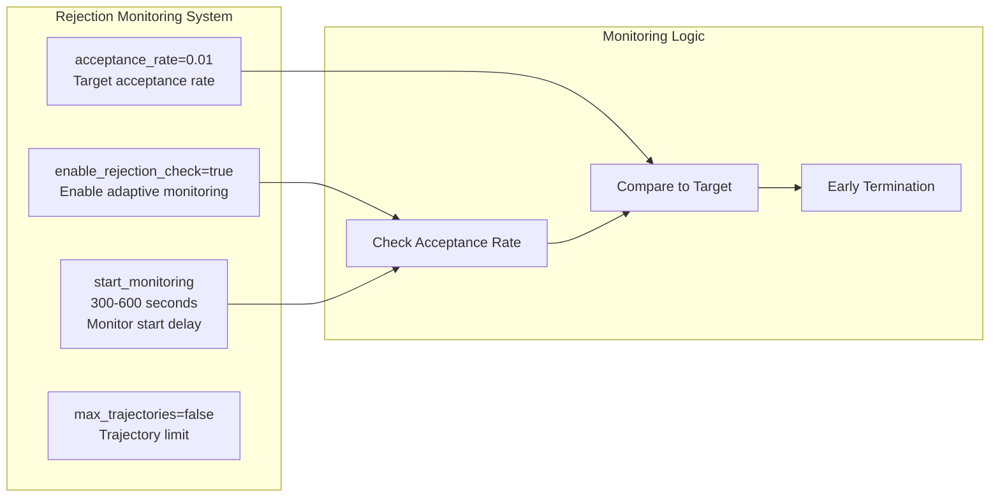

# Advanced Parameters

Relevant source files

The following files were used as context for generating this wiki page:

- [settings_advanced/betasheet_4stage_multimer_flexible_hardtarget.json](settings_advanced/betasheet_4stage_multimer_flexible_hardtarget.json)
- [settings_advanced/betasheet_4stage_multimer_hardtarget.json](settings_advanced/betasheet_4stage_multimer_hardtarget.json)
- [settings_advanced/betasheet_4stage_multimer_mpnn_hardtarget.json](settings_advanced/betasheet_4stage_multimer_mpnn_hardtarget.json)
- [settings_advanced/default_4stage_multimer_flexible_hardtarget.json](settings_advanced/default_4stage_multimer_flexible_hardtarget.json)

This document covers the advanced algorithm parameters that control the ColabDesign-based protein design process in FreeBindCraft. These parameters are stored in JSON configuration files within the `settings_advanced/` directory and control sophisticated aspects of the design algorithm, including the 4-stage multimer design process, loss function weights, MPNN sequence generation, and AlphaFold2 prediction cycles.

For basic design filters and acceptance criteria, see [Filter Configuration](#5.1). For target-specific settings, see the Configuration System overview [Configuration System](#5).

## Parameter Categories Overview

FreeBindCraft's advanced parameters are organized into several functional categories that correspond to different stages of the design pipeline:

**Sources:** [settings_advanced/default_4stage_multimer_flexible_hardtarget.json:1-66](), [settings_advanced/betasheet_4stage_multimer_hardtarget.json:1-66]()

## 4-Stage Algorithm Configuration

The `"4stage"` design algorithm represents the core multimer design approach, with parameters controlling each stage of the optimization process:

| Parameter | Type | Purpose | Default Value |
|-----------|------|---------|---------------|
| `design_algorithm` | string | Algorithm type ("4stage") | `"4stage"` |
| `use_multimer_design` | boolean | Enable multimer mode | `true` |
| `sample_models` | boolean | Sample multiple models | `true` |
| `soft_iterations` | integer | Initial optimization cycles | 75 |
| `temporary_iterations` | integer | Intermediate cycles | 45 |
| `hard_iterations` | integer | Final optimization cycles | 5 |
| `greedy_iterations` | integer | Greedy optimization cycles | 15 |
| `greedy_percentage` | float | Greedy sampling fraction | 1.0 |

**Sources:** [settings_advanced/default_4stage_multimer_flexible_hardtarget.json:5-17](), [settings_advanced/betasheet_4stage_multimer_hardtarget.json:5-17]()

## Loss Function Weights

The loss function weights control how different structural and chemical properties are balanced during design optimization:

### Structure Quality Weights
- `weights_plddt` (0.1-0.15): AlphaFold2 confidence score weight
- `weights_pae_intra` (0.4): Intra-chain predicted aligned error weight
- `weights_pae_inter` (0.1): Inter-chain predicted aligned error weight

### Contact Weights
- `weights_con_intra` (0.4-1.0): Intra-chain contact weight
- `weights_con_inter` (0.5-1.0): Inter-chain contact weight
- `intra_contact_distance` (14.0): Distance threshold for intra-chain contacts
- `inter_contact_distance` (20.0): Distance threshold for inter-chain contacts

### Secondary Structure Weights
- `weights_helicity` (-0.3 to -2.0): Helical structure penalty (negative values discourage helices)
- `random_helicity` (false): Randomize helical constraints

### Specialized Loss Terms
- `use_i_ptm_loss` (true): Enable interface pTM loss
- `weights_iptm` (0.05): Interface pTM weight
- `use_rg_loss` (true): Enable radius of gyration loss
- `weights_rg` (0.3): Radius of gyration weight

**Sources:** [settings_advanced/default_4stage_multimer_flexible_hardtarget.json:20-36](), [settings_advanced/betasheet_4stage_multimer_hardtarget.json:20-36]()

## MPNN Sequence Generation Parameters

ProteinMPNN parameters control sequence design and diversity:

```mermaid
graph TB
    subgraph "MPNN Configuration Flow"
        EN["enable_mpnn=true<br/>Enable MPNN integration"]
        FIX["mpnn_fix_interface<br/>true/false<br/>Interface constraint"]
        SEQ["num_seqs=20<br/>Sequences per design"]
        MAX["max_mpnn_sequences=2<br/>Max sequences to keep"]
        TEMP_PARAM["sampling_temp=0.1<br/>Sampling temperature"]
        NOISE["backbone_noise=0.0<br/>Backbone perturbation"]
    end
    
    subgraph "MPNN Model Control"
        MODEL["model_path='v_48_020'<br/>MPNN model version"]
        WEIGHTS_MPNN["mpnn_weights='soluble'<br/>Model weights type"]
        SAVE["save_mpnn_fasta=false<br/>Save FASTA output"]
    end
    
    EN --> FIX
    FIX --> SEQ
    SEQ --> MAX
    MAX --> TEMP_PARAM
    TEMP_PARAM --> NOISE
    
    MODEL --> WEIGHTS_MPNN
    WEIGHTS_MPNN --> SAVE
```

| Parameter | Type | Description | Typical Values |
|-----------|------|-------------|----------------|
| `mpnn_fix_interface` | boolean | Fix interface residues during MPNN | true (fixed), false (flexible) |
| `sampling_temp` | float | MPNN sampling temperature | 0.1 (conservative) |
| `num_seqs` | integer | Sequences generated per backbone | 20 |
| `max_mpnn_sequences` | integer | Maximum sequences to evaluate | 2 |

**Sources:** [settings_advanced/default_4stage_multimer_flexible_hardtarget.json:37-45](), [settings_advanced/betasheet_4stage_multimer_mpnn_hardtarget.json:37-45]()

## AlphaFold2 Prediction Parameters

AlphaFold2 prediction cycles and optimization control:

### Recycle Control
- `num_recycles_design` (1): Recycles during design phase
- `num_recycles_validation` (3): Recycles during validation
- `predict_initial_guess` (true): Generate initial structure prediction
- `predict_bigbang` (false): Use bigbang initialization

### Beta Optimization
- `optimise_beta` (true): Enable beta parameter optimization
- `optimise_beta_extra_soft` (0): Extra soft optimization cycles
- `optimise_beta_extra_temp` (0): Extra temporary optimization cycles
- `optimise_beta_recycles_design` (3): Recycles during beta optimization (design)
- `optimise_beta_recycles_valid` (3): Recycles during beta optimization (validation)

**Sources:** [settings_advanced/default_4stage_multimer_flexible_hardtarget.json:46-52](), [settings_advanced/betasheet_4stage_multimer_hardtarget.json:46-52]()

## Template Control Parameters

Template removal settings control which structural information is preserved or removed during design:

| Parameter | Purpose | Fixed Template | Flexible Template |
|-----------|---------|----------------|-------------------|
| `rm_template_seq_design` | Remove sequence template during design | false | true |
| `rm_template_seq_predict` | Remove sequence template during prediction | false | true |
| `rm_template_sc_design` | Remove sidechain template during design | false | false |
| `rm_template_sc_predict` | Remove sidechain template during prediction | false | false |

The "flexible" variants allow more backbone freedom by removing sequence templates, while "hardtarget" variants maintain more structural constraints.

**Sources:** [settings_advanced/default_4stage_multimer_flexible_hardtarget.json:7-10](), [settings_advanced/betasheet_4stage_multimer_hardtarget.json:7-10]()

## File Management Parameters

Output control and storage optimization:

### Animation and Visualization
- `save_design_animations` (true): Save design trajectory animations
- `save_design_trajectory_plots` (true): Save trajectory plots
- `zip_animations` (true): Compress animation files
- `zip_plots` (true): Compress plot files

### Cleanup Parameters
- `remove_unrelaxed_trajectory` (true): Delete unrelaxed trajectory files
- `remove_unrelaxed_complex` (true): Delete unrelaxed complex structures
- `remove_binder_monomer` (true): Delete isolated binder structures
- `save_trajectory_pickle` (false): Save trajectory data as pickle files

**Sources:** [settings_advanced/default_4stage_multimer_flexible_hardtarget.json:18-19, 53-58](), [settings_advanced/betasheet_4stage_multimer_hardtarget.json:18-19, 53-58]()

## Monitoring and Rejection Control

Parameters for adaptive design monitoring and early termination:

- `enable_rejection_check`: Enable adaptive monitoring system
- `acceptance_rate`: Target design acceptance rate (0.01 = 1%)
- `start_monitoring`: Delay before monitoring begins (300-600 seconds)
- `max_trajectories`: Maximum trajectory limit (false = unlimited)

**Sources:** [settings_advanced/default_4stage_multimer_flexible_hardtarget.json:60-62](), [settings_advanced/betasheet_4stage_multimer_hardtarget.json:60-62]()

## Path Configuration Parameters

External tool and data path specifications:

- `af_params_dir`: AlphaFold2 parameter directory path (empty = use default)
- `dssp_path`: DSSP executable path (empty = use system PATH)
- `dalphaball_path`: DAlphaBall executable path (empty = use system PATH)

These paths are typically left empty to use system defaults or environment-configured paths.

**Sources:** [settings_advanced/default_4stage_multimer_flexible_hardtarget.json:63-65](), [settings_advanced/betasheet_4stage_multimer_hardtarget.json:63-65]()

## Configuration Variants

FreeBindCraft provides several pre-configured parameter sets optimized for different design scenarios:

### Available Configurations
- `default_4stage_multimer_flexible_hardtarget.json`: Balanced parameters with flexible templates
- `betasheet_4stage_multimer_hardtarget.json`: Optimized for beta-sheet structures with fixed templates
- `betasheet_4stage_multimer_flexible_hardtarget.json`: Beta-sheet optimization with flexible templates
- `betasheet_4stage_multimer_mpnn_hardtarget.json`: Beta-sheet design with flexible MPNN interface

### Key Differences Between Variants

| Variant | Template Flexibility | Helicity Weight | Contact Weights | Interface MPNN |
|---------|---------------------|-----------------|-----------------|----------------|
| Default Flexible | High (rm_template_seq=true) | -0.3 | con_intra=1.0, con_inter=1.0 | Fixed |
| Betasheet Hard | Low (rm_template_seq=false) | -2.0 | con_intra=0.4, con_inter=0.5 | Fixed |
| Betasheet MPNN | Low (rm_template_seq=false) | -2.0 | con_intra=0.4, con_inter=0.5 | Flexible |

**Sources:** [settings_advanced/default_4stage_multimer_flexible_hardtarget.json:1-66](), [settings_advanced/betasheet_4stage_multimer_hardtarget.json:1-66](), [settings_advanced/betasheet_4stage_multimer_flexible_hardtarget.json:1-66](), [settings_advanced/betasheet_4stage_multimer_mpnn_hardtarget.json:1-66]()

---