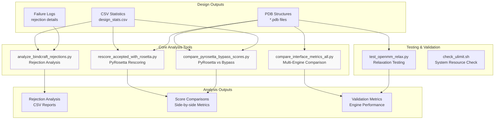
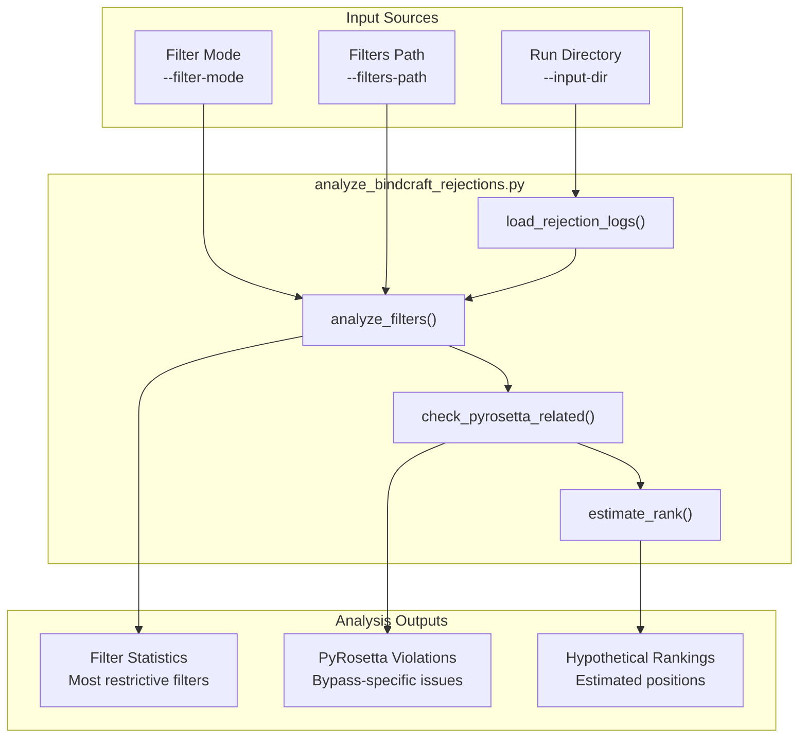
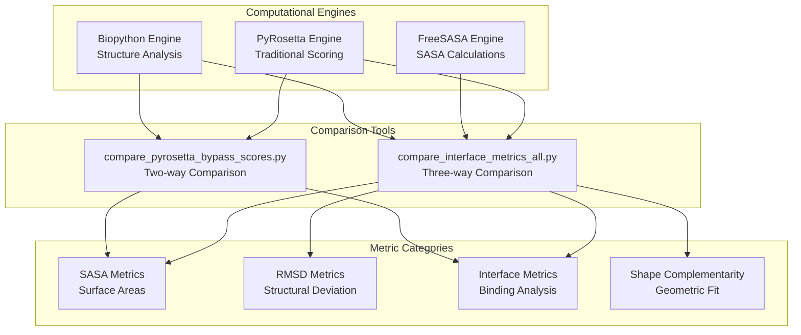
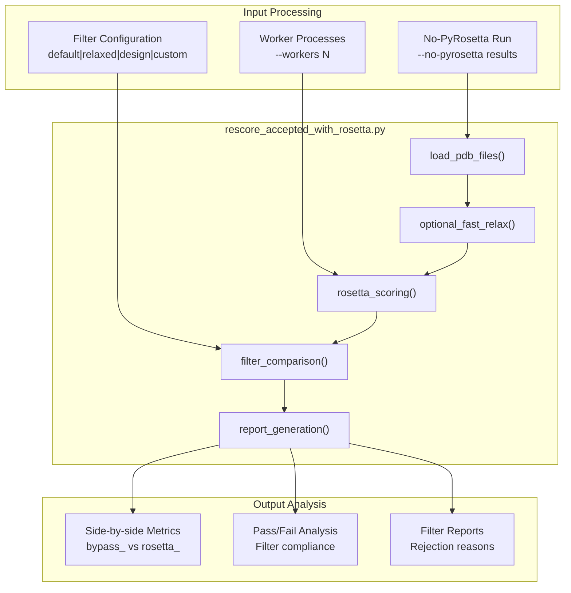

# Analysis & Validation

Relevant source files

The following files were used as context for generating this wiki page:

- [extras/README.md](extras/README.md)

This document provides an overview of the post-processing and analysis tools available in FreeBindCraft for validating design results and understanding system performance. These tools enable users to analyze rejected designs, compare different computational engines, and validate PyRosetta-free results using traditional metrics.

For detailed guides on specific analysis workflows, see: [Rejection Analysis](#6.1), [Rescoring & Validation](#6.2), and [Interface Metrics Comparison](#6.3).

## Overview

FreeBindCraft provides a comprehensive suite of analysis tools located in the `extras/` directory that support various validation and debugging workflows. These tools are particularly important for understanding the performance differences between PyRosetta-based and PyRosetta-free design approaches, and for troubleshooting design failures.

## Analysis Workflow Architecture

The analysis system follows a modular approach where different tools can be used independently or in combination to validate and understand design results.

### Analysis Tools System Map

Sources: [extras/README.md:1-78]()

## Core Analysis Components

### Rejection Analysis System

The rejection analysis system examines why designs were filtered out during the design process, providing insights into which filters are most restrictive and whether rejections are related to PyRosetta-specific metrics.

Sources: [extras/README.md:7-18]()

### Multi-Engine Validation System

The validation system compares results across different computational engines to assess the reliability and consistency of PyRosetta-free alternatives.

Sources: [extras/README.md:32-46]()

## Validation Workflow Types

FreeBindCraft supports several validation workflows depending on the analysis needs:

| Workflow Type | Primary Tool | Purpose | Input Requirements |
|---------------|--------------|---------|-------------------|
| Rejection Analysis | `analyze_bindcraft_rejections.py` | Understand design failures | Run directories with rejection logs |
| PyRosetta Rescoring | `rescore_accepted_with_rosetta.py` | Validate PyRosetta-free results | Accepted designs from `--no-pyrosetta` runs |
| Engine Comparison | `compare_interface_metrics_all.py` | Compare computational engines | PDB structures with interface definitions |
| Relaxation Testing | `test_openmm_relax.py` | Test relaxation protocols | Single PDB structure |

Sources: [extras/README.md:7-65]()

### Rescoring and Validation Pipeline

The rescoring system provides a critical validation pathway for designs generated without PyRosetta, allowing users to apply traditional PyRosetta filters to assess design quality.

Sources: [extras/README.md:48-58]()

## System Integration Points

The analysis tools integrate with several core FreeBindCraft components:

- **Configuration System**: Analysis tools read the same filter configurations used during design ([Configuration System](#5))
- **Core Pipeline**: Analysis tools process outputs from `bindcraft.py` runs ([Core Pipeline](#3))
- **PyRosetta Integration**: Rescoring tools interface with PyRosetta utilities ([PyRosetta Integration](#4))
- **PyRosetta Alternatives**: Comparison tools validate alternative implementations ([PyRosetta-Free Alternatives](#4.1))

## Environment and Dependencies

The analysis tools require specific setup considerations:

- Repository root must be importable via `sys.path` modifications
- Binary executables in `functions/` directory (e.g., `dssp`, `DAlphaBall.gcc`, `sc`)
- Automatic executable permissions via `chmod +x` when needed
- Optional PyRosetta installation for rescoring and comparison workflows

Sources: [extras/README.md:67-77]()

---