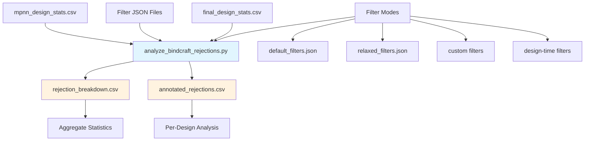
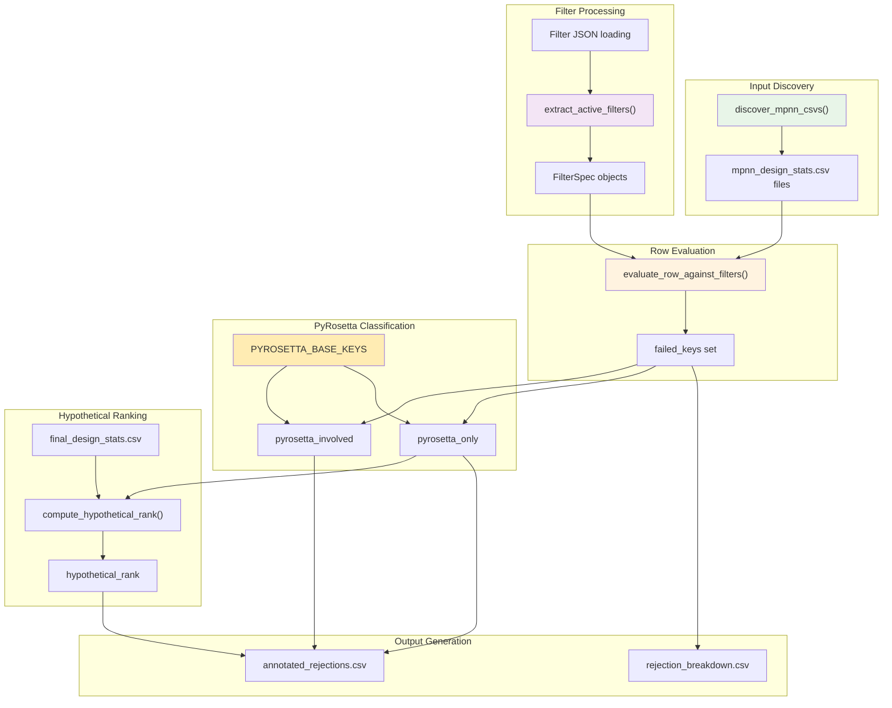
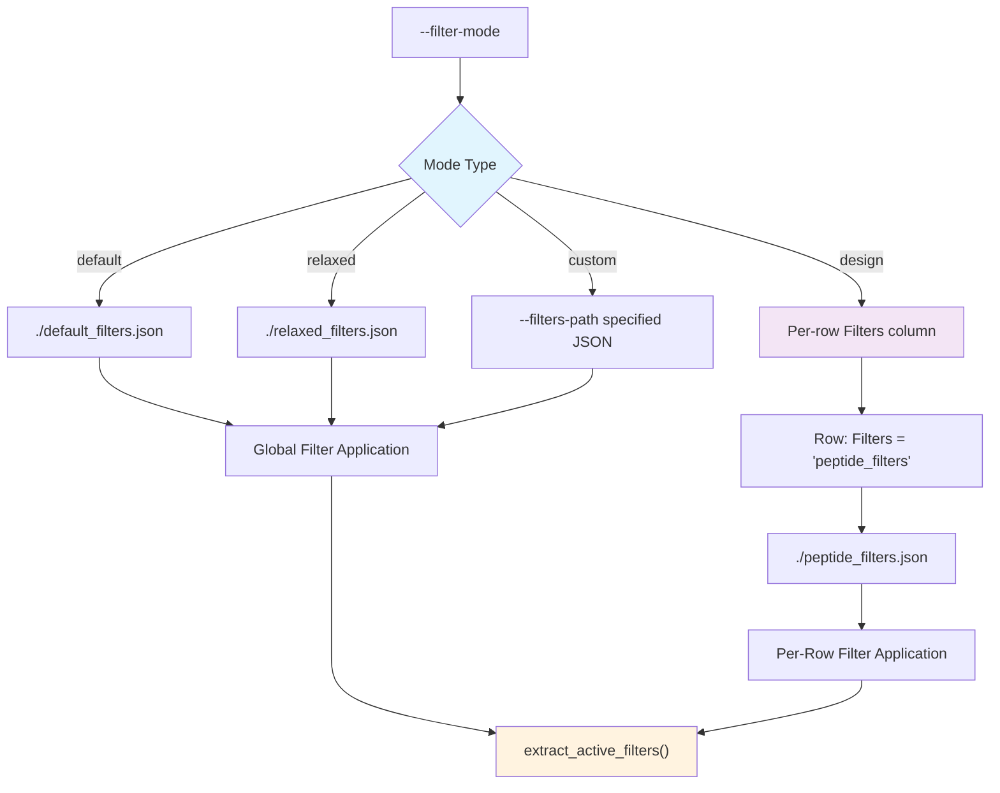
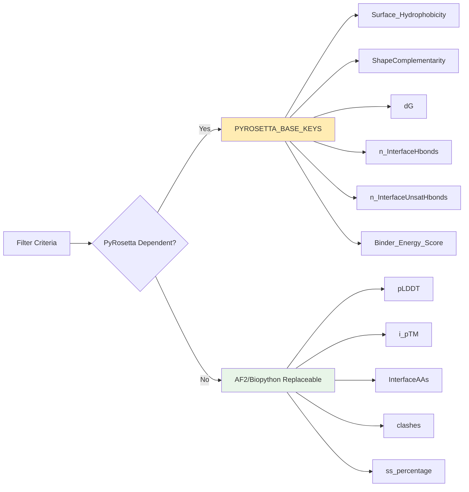
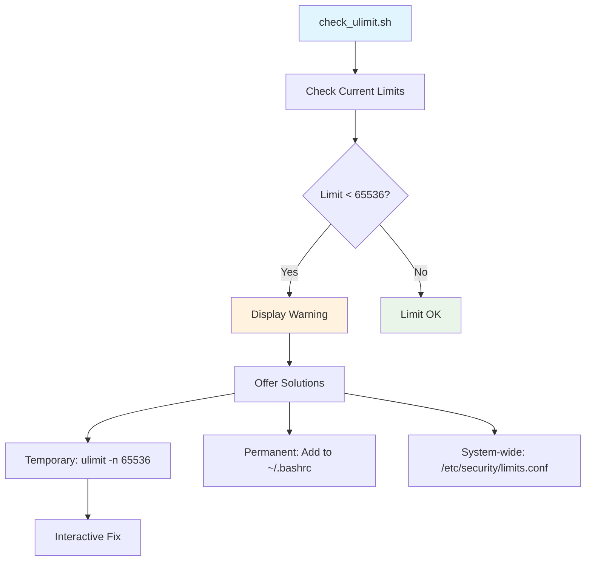

# Rejection Analysis

<details>
<summary>Relevant source files</summary>

The following files were used as context for generating this wiki page:

- [extras/BUGFIX_FILE_DESCRIPTORS.md](extras/BUGFIX_FILE_DESCRIPTORS.md)
- [extras/analyze_bindcraft_rejections.py](extras/analyze_bindcraft_rejections.py)
- [extras/bindcraft_rejection_analysis_spec.md](extras/bindcraft_rejection_analysis_spec.md)
- [extras/check_ulimit.sh](extras/check_ulimit.sh)

</details>


This page covers the tools and methods for analyzing why protein designs were rejected during FreeBindCraft runs. The primary focus is on understanding rejection patterns, identifying PyRosetta-dependent failures, and evaluating the impact of different scoring criteria on design success rates.

For general information about the analysis and validation ecosystem, see [Analysis & Validation](#6). For rescoring accepted designs with PyRosetta metrics, see [Rescoring & Validation](#6.2).

## Overview

The rejection analysis system provides insights into why designs fail to meet filter criteria during the FreeBindCraft pipeline. This is particularly valuable for understanding the trade-offs between PyRosetta-based scoring and PyRosetta-free alternatives, as well as optimizing filter thresholds for better design success rates.

**Rejection Analysis Workflow**


Sources: [extras/analyze_bindcraft_rejections.py:1-507](), [extras/bindcraft_rejection_analysis_spec.md:1-151]()

## The Rejection Analysis Tool

The main rejection analysis tool is `analyze_bindcraft_rejections.py`, which processes MPNN design statistics to identify rejection patterns and compute impact metrics.

**Core Components and Data Flow**


Sources: [extras/analyze_bindcraft_rejections.py:55-74](), [extras/analyze_bindcraft_rejections.py:99-136](), [extras/analyze_bindcraft_rejections.py:176-208]()

### Key Classes and Functions

The `FilterSpec` class represents individual filter criteria:

| Attribute | Type | Description |
|-----------|------|-------------|
| `json_key` | `str` | Key in filter JSON (e.g., "Average_pLDDT") |
| `base_key` | `str` | Normalized key for reporting (e.g., "pLDDT") |
| `threshold` | `float` | Threshold value for filtering |
| `higher` | `bool` | Whether higher values are better |
| `is_interface_aas` | `bool` | Whether this is an interface amino acid filter |
| `aa` | `Optional[str]` | Specific amino acid for interface filters |

Sources: [extras/analyze_bindcraft_rejections.py:22-34]()

## Filter Modes and Configuration

The rejection analysis tool supports four different filter modes, each providing a different perspective on design rejection patterns.

**Filter Mode Resolution**


Sources: [extras/analyze_bindcraft_rejections.py:243-257](), [extras/bindcraft_rejection_analysis_spec.md:12-21]()

### Command Line Usage

Basic usage patterns for the rejection analysis tool:

```bash
# Analyze with default filters
python analyze_bindcraft_rejections.py --input-dir /path/to/runs --filter-mode default

# Recursive search with design-time filters  
python analyze_bindcraft_rejections.py --input-dir /path/to/runs --filter-mode design --recursive

# Custom filters with specific output directory
python analyze_bindcraft_rejections.py --input-dir /path/to/runs --filter-mode custom --filters-path ./my_filters.json --output-dir ./analysis_results
```

Sources: [extras/bindcraft_rejection_analysis_spec.md:139-151](), [extras/analyze_bindcraft_rejections.py:35-42]()

## Understanding Analysis Outputs

The rejection analysis produces two complementary output files that provide different levels of detail about design failures.

### Rejection Breakdown (rejection_breakdown.csv)

This file provides aggregate statistics across all processed runs:

| Column | Description |
|--------|-------------|
| `filter_key` | Base filter name (e.g., "pLDDT", "dG", "InterfaceAAs_K") |
| `is_pyrosetta` | Boolean indicating PyRosetta dependency |
| `threshold` | Filter threshold value |
| `higher_is_better` | Whether higher values pass the filter |
| `num_violations` | Count of designs that failed this filter |
| `rejected_total` | Total rejected designs across all runs |
| `percent_of_rejections` | Percentage of rejections due to this filter |

Sources: [extras/bindcraft_rejection_analysis_spec.md:57-66](), [extras/analyze_bindcraft_rejections.py:416-428]()

### Annotated Rejections (annotated_rejections.csv)

This file provides per-design rejection details:

| Column | Description |
|--------|-------------|
| `run_dir` | Relative path to run directory |
| `design_name` | Design identifier from MPNN stats |
| `sequence` | Design sequence |
| `Average_i_pTM` | Confidence metric for ranking |
| `pyrosetta_involved` | 1 if any PyRosetta filter failed |
| `pyrosetta_only` | 1 if would pass without PyRosetta filters |
| `hypothetical_rank` | Potential rank if PyRosetta ignored |
| Per-filter columns | 1/0 flags for each filter violation |

Sources: [extras/bindcraft_rejection_analysis_spec.md:68-78](), [extras/analyze_bindcraft_rejections.py:456-497]()

## PyRosetta vs PyRosetta-Free Analysis

A key feature of the rejection analysis is distinguishing between PyRosetta-dependent and PyRosetta-free filter criteria.

**PyRosetta Dependency Classification**


Sources: [extras/analyze_bindcraft_rejections.py:12-19](), [extras/bindcraft_rejection_analysis_spec.md:35-44]()

### Hypothetical Ranking

For designs that fail only PyRosetta-dependent criteria (`pyrosetta_only` = 1), the tool computes hypothetical rankings by:

1. Loading accepted designs from `final_design_stats.csv` in the same run directory
2. Extracting `Average_i_pTM` values from accepted designs
3. Inserting the rejected design's `Average_i_pTM` into the sorted list
4. Computing the 1-based rank position

Sources: [extras/analyze_bindcraft_rejections.py:211-230](), [extras/bindcraft_rejection_analysis_spec.md:49-55]()

## Common Issues and Troubleshooting

### File Descriptor Limits

One common issue during intensive analysis runs is hitting file descriptor limits, which can cause "Too many open files" errors.

**File Descriptor Limit Check and Fix**


The `check_ulimit.sh` script provides an interactive solution to diagnose and fix file descriptor limit issues.

Sources: [extras/check_ulimit.sh:1-56](), [extras/BUGFIX_FILE_DESCRIPTORS.md:1-125]()

### Missing Filter Files

When using `design` mode, the tool requires filter JSON files to be present in the current working directory. The tool validates these files upfront:

```python
# Pre-scan required filters JSONs in design mode  
for mpnn_path in mpnn_csv_paths:
    df_tmp = pd.read_csv(mpnn_path, usecols=["Filters"])
    required_basenames.update(df_tmp["Filters"].dropna().astype(str).unique())

# Ensure each required file exists in CWD
for base in required_basenames:
    path = get_cwd_filters_path(base)  # e.g., "./peptide_filters.json"
    ensure_file_exists(path, f"filters JSON for design mode")
```

Sources: [extras/analyze_bindcraft_rejections.py:264-279]()

### Interface Amino Acid Parsing

The tool includes robust parsing for `InterfaceAAs` data, which is stored as dictionary-like strings in CSV files:

```python
def parse_interface_aas_cell(cell: Any) -> Optional[Dict[str, float]]:
    if isinstance(cell, str):
        try:
            parsed = ast.literal_eval(cell)  # Safe evaluation
            return {str(k): float(v) for k, v in parsed.items()}
        except Exception:
            return None
```

Sources: [extras/analyze_bindcraft_rejections.py:148-173]()

---