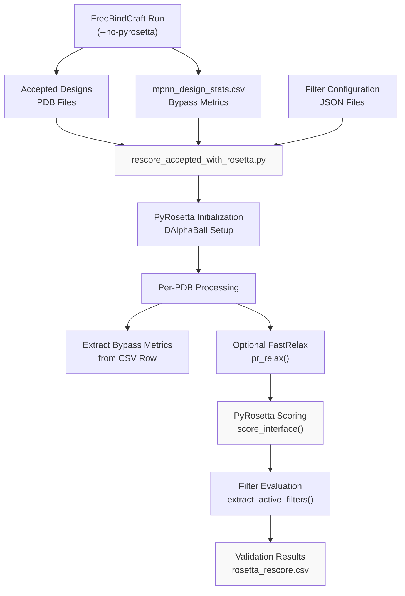
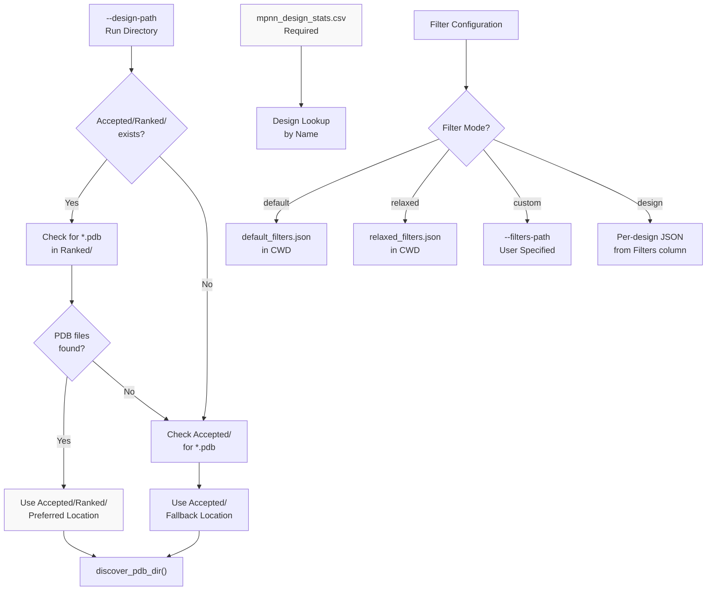
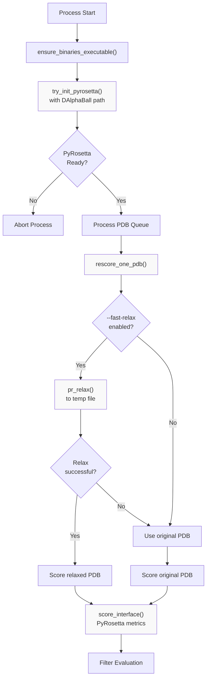
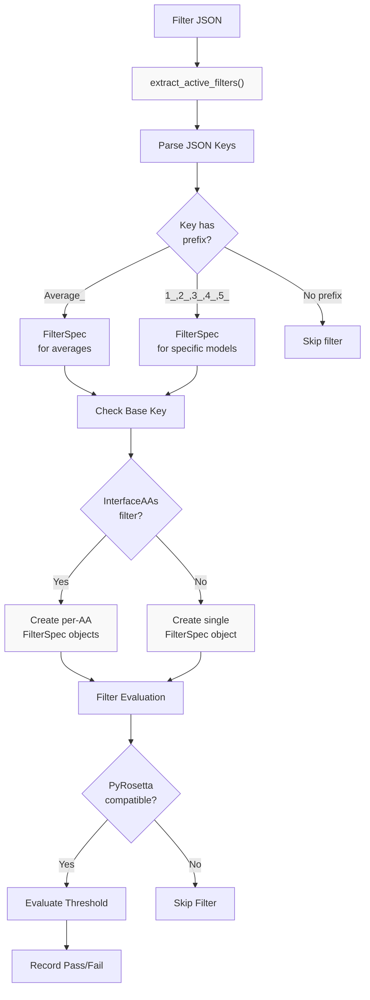
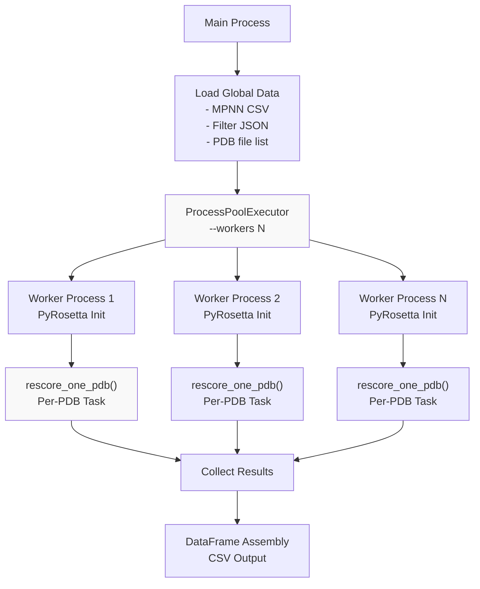

# Rescoring & Validation

<details>
<summary>Relevant source files</summary>

The following files were used as context for generating this wiki page:

- [extras/rescore_accepted_with_rosetta.md](extras/rescore_accepted_with_rosetta.md)
- [extras/rescore_accepted_with_rosetta.py](extras/rescore_accepted_with_rosetta.py)

</details>


This document covers the rescoring and validation tools that allow PyRosetta-free FreeBindCraft designs to be validated against PyRosetta metrics. The primary tool is the `rescore_accepted_with_rosetta.py` script that provides side-by-side comparison of bypass metrics (from PyRosetta-free runs) and native PyRosetta metrics.

For analyzing why designs were rejected during the original run, see [Rejection Analysis](#6.1). For comparing interface metrics across different computational engines, see [Interface Metrics Comparison](#6.3).

## Purpose and Workflow

The rescoring system addresses a key validation need: when FreeBindCraft runs with `--no-pyrosetta`, it uses alternative tools (OpenMM, FreeSASA, Biopython) to compute interface metrics. To validate these results, the rescoring tool recomputes the same metrics using PyRosetta and evaluates whether PyRosetta-based filters would have accepted or rejected each design.

### Rescoring Workflow Overview



Sources: [extras/rescore_accepted_with_rosetta.py:1-577]()

## Input Discovery and Requirements

The rescoring tool requires specific input files and follows a discovery process to locate them:

### File Discovery Process



Sources: [extras/rescore_accepted_with_rosetta.py:404-413](), [extras/rescore_accepted_with_rosetta.py:424-446]()

### Required Input Files

| File Type | Location | Purpose |
|-----------|----------|---------|
| PDB Files | `Accepted/Ranked/*.pdb` (preferred) or `Accepted/*.pdb` | Design structures to rescore |
| MPNN Statistics | `mpnn_design_stats.csv` | Original bypass metrics and metadata |
| Filter Configuration | Various JSON files based on mode | Filter thresholds for validation |
| Binary Dependencies | `functions/DAlphaBall.gcc`, `functions/dssp`, `functions/sc` | Required for PyRosetta scoring |

## Rescoring Process

### PyRosetta Initialization and Scoring

The rescoring process initializes PyRosetta once per worker process and then scores each PDB file:



Sources: [extras/rescore_accepted_with_rosetta.py:65-82](), [extras/rescore_accepted_with_rosetta.py:219-293]()

### Metric Mapping and Extraction

The tool maps PyRosetta interface scores to BindCraft base labels and extracts bypass metrics from the original CSV:

| PyRosetta Key | BindCraft Base Label | Description |
|---------------|---------------------|-------------|
| `binder_score` | `Binder_Energy_Score` | Energy score of binder |
| `interface_dG` | `dG` | Interface binding energy |
| `interface_dSASA` | `dSASA` | Change in solvent accessible surface area |
| `interface_sc` | `ShapeComplementarity` | Shape complementarity score |
| `interface_packstat` | `PackStat` | Interface packing statistics |
| `interface_fraction` | `Interface_SASA_%` | Interface SASA percentage |
| `interface_nres` | `n_InterfaceResidues` | Number of interface residues |

Sources: [extras/rescore_accepted_with_rosetta.py:198-216](), [extras/rescore_accepted_with_rosetta.py:165-188]()

## Filter Evaluation System

### Filter Specification and Parsing

The tool supports multiple filter modes and parses filter specifications from JSON files:



Sources: [extras/rescore_accepted_with_rosetta.py:88-146](), [extras/rescore_accepted_with_rosetta.py:331-395]()

### Filter Mode Configuration

The tool supports four filter modes:

- **default**: Uses `default_filters.json` from current working directory
- **relaxed**: Uses `relaxed_filters.json` from current working directory  
- **custom**: Uses user-specified JSON file via `--filters-path`
- **design**: Uses per-design filters from the `Filters` column in `mpnn_design_stats.csv`

## Output Format and Results

### Output CSV Structure

The rescoring tool produces a comprehensive CSV with side-by-side metrics:

| Column Category | Prefix | Example Columns | Source |
|----------------|--------|----------------|---------|
| Metadata | - | `File`, `Path`, `Design`, `Model`, `BinderChain` | PDB filename parsing |
| Bypass Metrics | `bypass_` | `bypass_dG`, `bypass_ShapeComplementarity` | Original CSV data |
| PyRosetta Metrics | `rosetta_` | `rosetta_dG`, `rosetta_ShapeComplementarity` | Freshly computed |
| Validation Results | - | `rosetta_filters_pass`, `rosetta_failed_filters` | Filter evaluation |
| Filter Info | - | `FiltersSource`, `FiltersFileUsed` | Filter configuration used |

### Key Output Columns

- `rosetta_filters_pass`: Boolean indicating if all PyRosetta filters passed
- `rosetta_failed_filters`: Comma-separated list of failed filter base keys
- `error`: Error message if scoring or filter evaluation failed
- `relax_error`: Error message if FastRelax failed (when `--fast-relax` used)

Sources: [extras/rescore_accepted_with_rosetta.py:567-570]()

## Usage Examples

### Basic Rescoring

```bash
python extras/rescore_accepted_with_rosetta.py \
    --design-path /path/to/freebindcraft/run \
    --filter-mode design
```

### Parallel Rescoring with FastRelax

```bash
python extras/rescore_accepted_with_rosetta.py \
    --design-path /path/to/freebindcraft/run \
    --filter-mode default \
    --workers 8 \
    --fast-relax \
    --verbose
```

### Custom Filter Rescoring

```bash
python extras/rescore_accepted_with_rosetta.py \
    --design-path /path/to/freebindcraft/run \
    --filter-mode custom \
    --filters-path /path/to/custom_filters.json \
    --output validation_results.csv
```

Sources: [extras/rescore_accepted_with_rosetta.py:449-573]()

## Performance and Parallelization

### Worker Process Architecture



The tool supports parallel processing through `ProcessPoolExecutor`, with each worker process maintaining its own PyRosetta initialization. PyRosetta is initialized lazily per process to avoid memory overhead.

### Performance Considerations

- **FastRelax**: Optional but recommended for consistency with original BindCraft pipeline
- **Memory Usage**: Each PyRosetta process requires significant memory (~2-4GB)
- **I/O Bottleneck**: PDB file reading can become a bottleneck with many small files
- **Error Handling**: Individual PDB scoring failures don't stop the entire process

Sources: [extras/rescore_accepted_with_rosetta.py:536-565](), [extras/rescore_accepted_with_rosetta.py:195-196]()

---