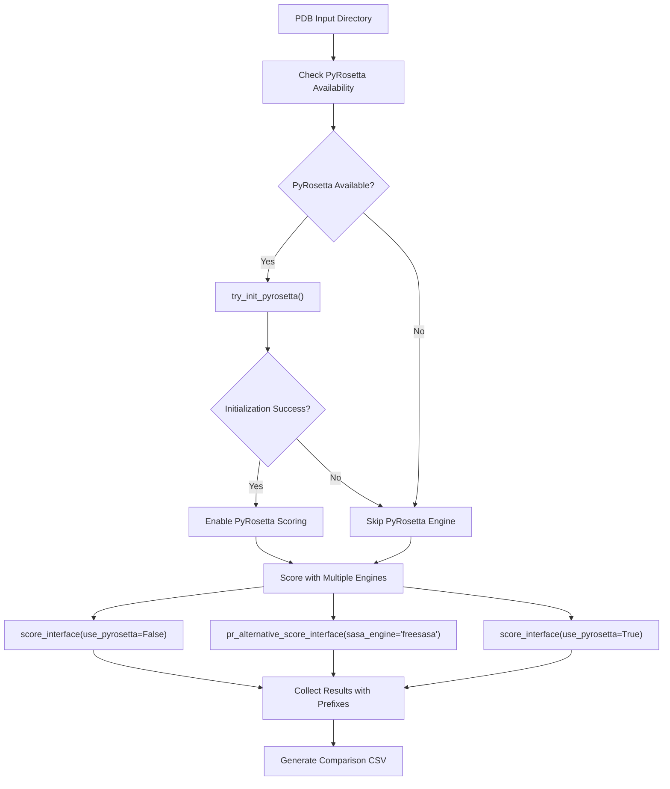
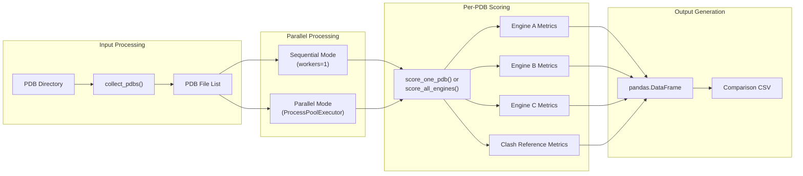
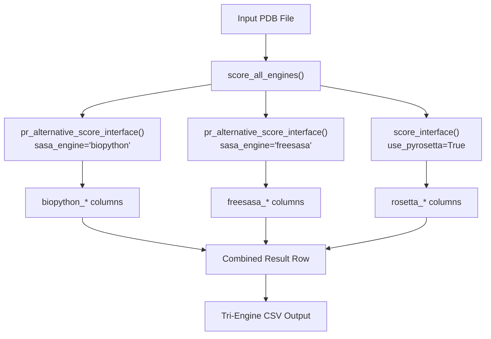
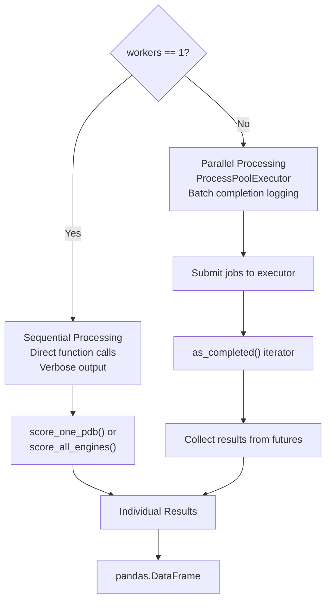
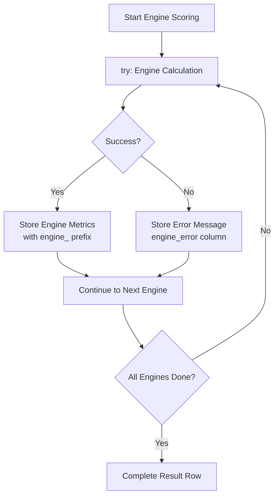

# Interface Metrics Comparison

<details>
<summary>Relevant source files</summary>

The following files were used as context for generating this wiki page:

- [extras/compare_interface_metrics_all.py](extras/compare_interface_metrics_all.py)
- [extras/compare_pyrosetta_bypass_scores.py](extras/compare_pyrosetta_bypass_scores.py)
- [extras/test_openmm_relax.py](extras/test_openmm_relax.py)
- [functions/freesasa_naccess.cfg](functions/freesasa_naccess.cfg)

</details>


This document covers the tools and utilities for comparing interface metrics calculated using different computational engines within FreeBindCraft. These tools enable validation of PyRosetta-free alternatives against traditional PyRosetta methods and provide quantitative assessments of agreement between different SASA calculation approaches.

For information about the underlying interface scoring implementations, see [PyRosetta Integration](#4) and [PyRosetta-Free Alternatives](#4.1). For post-design validation workflows, see [Rescoring & Validation](#6.2).

## Overview

FreeBindCraft provides two main comparison utilities that systematically evaluate interface metrics across different computational backends:

- **Dual-engine comparison**: PyRosetta vs Biopython using `compare_pyrosetta_bypass_scores.py`
- **Tri-engine comparison**: PyRosetta vs FreeSASA vs Biopython using `compare_interface_metrics_all.py`

Both tools process collections of PDB files and generate comprehensive CSV outputs with side-by-side metric comparisons, enabling quantitative validation of the PyRosetta-free pathway.

## Comparison Architecture

The interface metrics comparison system operates through a modular architecture that can selectively enable or disable different computational engines based on availability and user preferences.

### Engine Selection Flow



**Sources:** [extras/compare_pyrosetta_bypass_scores.py:55-72](), [extras/compare_interface_metrics_all.py:47-63]()

### Processing Pipeline



**Sources:** [extras/compare_pyrosetta_bypass_scores.py:149-162](), [extras/compare_interface_metrics_all.py:151-162](), [extras/compare_pyrosetta_bypass_scores.py:208-235]()

## Dual-Engine Comparison

The `compare_pyrosetta_bypass_scores.py` script provides focused comparison between PyRosetta and Biopython-based interface metrics.

### Key Functions

| Function | Purpose | Implementation |
|----------|---------|----------------|
| `score_one_pdb()` | Score single PDB with both engines | [extras/compare_pyrosetta_bypass_scores.py:75-146]() |
| `try_init_pyrosetta()` | Attempt PyRosetta initialization | [extras/compare_pyrosetta_bypass_scores.py:55-72]() |
| `ensure_binaries_executable()` | Make required binaries executable | [extras/compare_pyrosetta_bypass_scores.py:36-53]() |
| `collect_pdbs()` | Gather PDB files from directory | [extras/compare_pyrosetta_bypass_scores.py:149-161]() |

### Usage Pattern

```bash
python compare_pyrosetta_bypass_scores.py \
  --pdb-dir /path/to/pdb/folder \
  --output comparison.csv \
  --binder-chain B \
  --workers 4 \
  --recursive
```

### Output Schema

The dual-engine comparison generates CSV output with the following column structure:

| Column Pattern | Description | Source Engine |
|----------------|-------------|---------------|
| `File` | PDB filename | - |
| `Path` | Full PDB path | - |
| `BinderChain` | Binder chain identifier | - |
| `bypass_*` | Biopython metrics | `score_interface(use_pyrosetta=False)` |
| `rosetta_*` | PyRosetta metrics | `score_interface(use_pyrosetta=True)` |
| `Clashes_AllAtoms` | All-atom clash count | `calculate_clash_score(only_ca=False)` |
| `Clashes_CAOnly` | CA-only clash count | `calculate_clash_score(only_ca=True)` |

**Sources:** [extras/compare_pyrosetta_bypass_scores.py:78-129](), [extras/compare_pyrosetta_bypass_scores.py:131-144]()

## Tri-Engine Comparison

The `compare_interface_metrics_all.py` script extends the comparison to include FreeSASA alongside PyRosetta and Biopython engines.

### Engine-Specific Scoring



**Sources:** [extras/compare_interface_metrics_all.py:66-148]()

### Extended Output Schema

The tri-engine comparison produces CSV output with expanded column sets:

| Column Prefix | Engine | SASA Method | Interface Detection |
|---------------|--------|-------------|-------------------|
| `biopython_*` | Biopython | Shrake-Rupley | Distance-based |
| `freesasa_*` | FreeSASA | Lee-Richards | Distance-based |
| `rosetta_*` | PyRosetta | Rosetta SASA | Rosetta interface |

**Sources:** [extras/compare_interface_metrics_all.py:83-130]()

## Parallel Processing Support

Both comparison tools support parallel processing through the `ProcessPoolExecutor` for improved performance on large PDB collections.

### Worker Configuration



**Sources:** [extras/compare_pyrosetta_bypass_scores.py:207-235](), [extras/compare_interface_metrics_all.py:210-237]()

## Binary Dependencies

The comparison tools require several external binaries to be executable for complete functionality.

### Required Binaries

| Binary | Purpose | Configuration |
|--------|---------|---------------|
| `dssp` | Secondary structure calculation | Made executable by `ensure_binaries_executable()` |
| `DAlphaBall.gcc` | Cavity/void detection for PyRosetta | Path passed to PyRosetta init |
| `sc` | Shape complementarity calculation | Made executable by `ensure_binaries_executable()` |

### FreeSASA Configuration

FreeSASA engine uses the NACCESS-compatible atom type definitions from `functions/freesasa_naccess.cfg` for consistent SASA calculations across different atom types and residues.

**Sources:** [extras/compare_pyrosetta_bypass_scores.py:36-53](), [extras/compare_interface_metrics_all.py:32-44](), [functions/freesasa_naccess.cfg:1-256]()

## Error Handling and Robustness

The comparison tools implement comprehensive error handling to ensure robust operation across diverse PDB collections.

### Per-Engine Error Isolation



This approach ensures that failure in one engine (e.g., PyRosetta unavailable) does not prevent comparison of available engines.

**Sources:** [extras/compare_pyrosetta_bypass_scores.py:89-106](), [extras/compare_interface_metrics_all.py:79-110]()

---