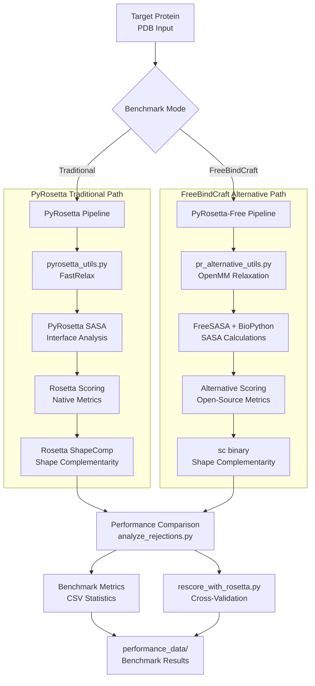
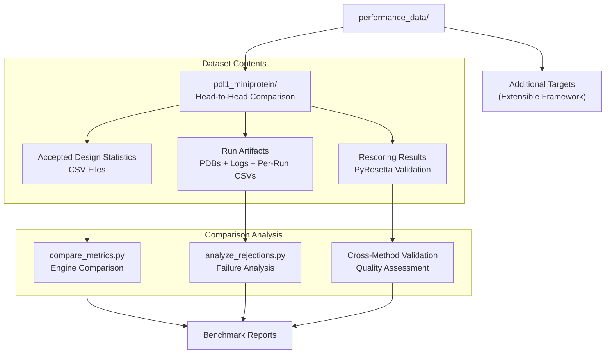
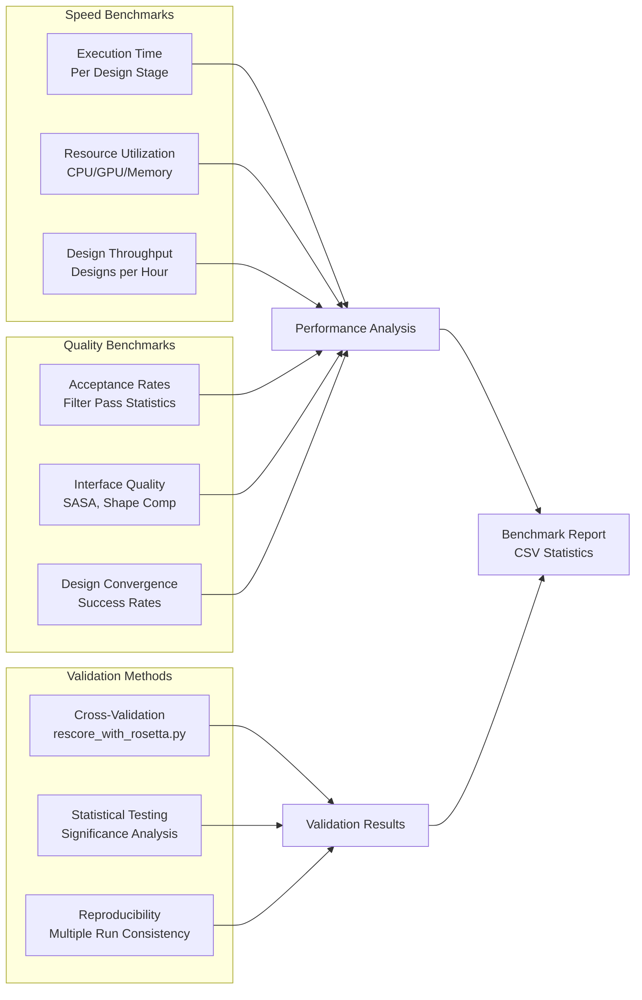
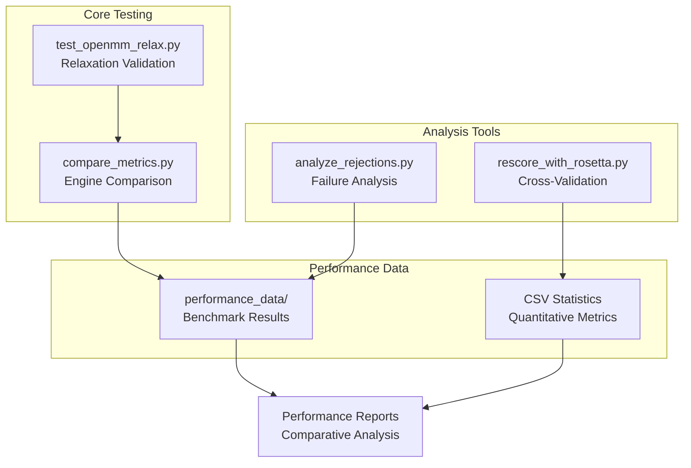

# Performance & Benchmarks

<details>
<summary>Relevant source files</summary>

The following files were used as context for generating this wiki page:

- [performance_data/README.md](performance_data/README.md)

</details>


This document provides an overview of performance characteristics and benchmarking methodologies for FreeBindCraft, specifically comparing the PyRosetta-free implementation against traditional PyRosetta-based approaches. The benchmarks evaluate computational efficiency, resource utilization, and design quality metrics across different protein design scenarios.

For detailed technical implementation of PyRosetta alternatives, see [PyRosetta-Free Alternatives](#4.1). For comprehensive analysis of specific benchmark datasets, see [PDL1 Benchmark Results](#7.1). For validation and rescoring methodologies, see [Rescoring & Validation](#6.2).

## Benchmarking Methodology

FreeBindCraft performance testing follows a systematic comparison approach between two distinct computational pathways, measuring both efficiency and design quality across representative protein targets.

### Benchmark Design Pipeline Comparison



**Sources:** [performance_data/README.md:1-14]()

### Performance Metrics Framework

The benchmark system evaluates multiple performance dimensions across both computational efficiency and design quality:

| Metric Category | Traditional PyRosetta | FreeBindCraft Alternative |
|-----------------|----------------------|---------------------------|
| **Computational** | PyRosetta FastRelax | OpenMM GPU acceleration |
| **SASA Analysis** | Native Rosetta SASA | FreeSASA + Biopython |
| **Shape Complementarity** | Rosetta ShapeComp | sc-rs binary tool |
| **Interface Scoring** | PyRosetta interface metrics | Alternative scoring functions |
| **Resource Usage** | CPU-intensive operations | GPU-optimized where possible |
| **Dependencies** | PyRosetta license required | Open-source stack only |

**Sources:** [performance_data/README.md:3-8]()

## Benchmark Dataset Organization

The performance evaluation system maintains structured datasets for systematic comparison and reproducibility.

### Benchmark Data Structure



**Sources:** [performance_data/README.md:9-12]()

## Performance Comparison Framework

The benchmark system enables direct comparison between FreeBindCraft and traditional BindCraft approaches across multiple dimensions.

### Computational Efficiency Analysis



**Sources:** [performance_data/README.md:5-7]()

## Rescoring and Cross-Validation

The benchmark framework includes comprehensive cross-validation to ensure that PyRosetta-free designs maintain comparable quality to traditional approaches.

### Cross-Method Validation Pipeline

```mermaid
sequenceDiagram
    participant FB as FreeBindCraft Pipeline
    participant Alt as Alternative Tools
    participant PyR as PyRosetta Rescoring
    participant Val as Validation Analysis
    
    FB->>Alt: Generate designs using<br/>OpenMM + FreeSASA + sc
    Alt->>FB: Return accepted designs<br/>with alternative metrics
    
    FB->>PyR: Submit designs for<br/>PyRosetta rescoring
    PyR->>PyR: Calculate traditional<br/>Rosetta metrics
    PyR->>Val: Return PyRosetta scores<br/>for comparison
    
    FB->>Val: Provide alternative<br/>scoring results
    Val->>Val: Compare metric<br/>correlations and agreement
    Val->>Val: Generate validation<br/>statistics and reports
```

The rescoring process evaluates whether designs produced using open-source alternatives maintain equivalent quality when assessed by traditional PyRosetta metrics, providing confidence in the PyRosetta-free approach.

**Sources:** [performance_data/README.md:7-8]()

## Available Benchmark Datasets

The performance evaluation framework currently includes validated benchmark datasets with plans for expansion to additional protein targets.

### Current Benchmark Systems

| Target System | Description | Comparison Scope |
|---------------|-------------|------------------|
| **PDL1 Miniprotein** | Head-to-head comparison using original BindCraft example | Complete pipeline comparison |
| **Future Targets** | Extensible framework for additional benchmarks | Systematic evaluation across target types |

The PDL1 miniprotein benchmark serves as the primary validation case, utilizing the same target system from the original BindCraft repository to ensure direct comparability between traditional and FreeBindCraft approaches.

**Sources:** [performance_data/README.md:9-12]()

## Performance Testing Integration

The benchmark system integrates with the broader FreeBindCraft testing and analysis infrastructure to provide comprehensive performance assessment capabilities.

### Testing and Analysis Integration



This integration ensures that performance benchmarks are continuously validated and that any changes to the underlying algorithms can be systematically evaluated for their impact on both speed and design quality.

**Sources:** [performance_data/README.md:1-14]()

---