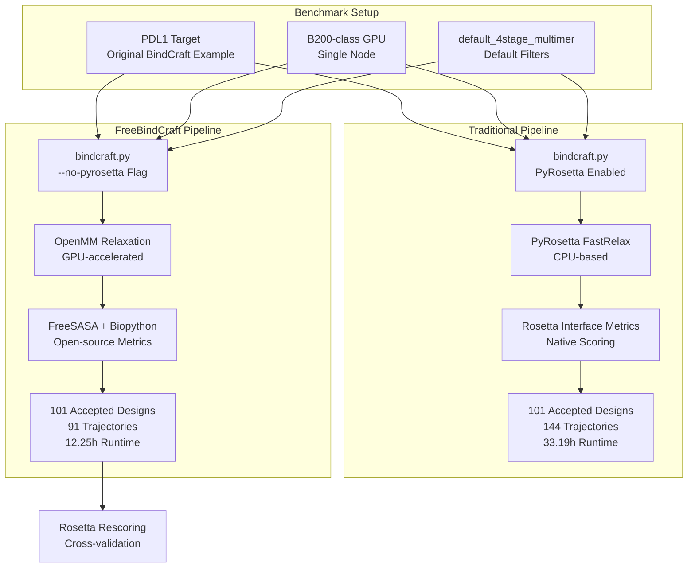
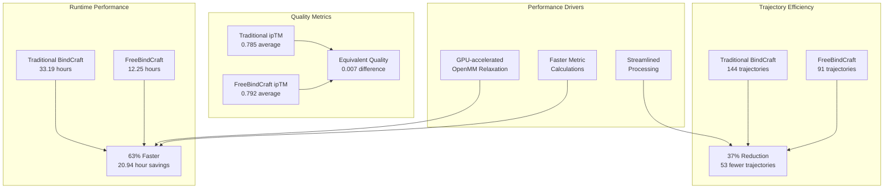
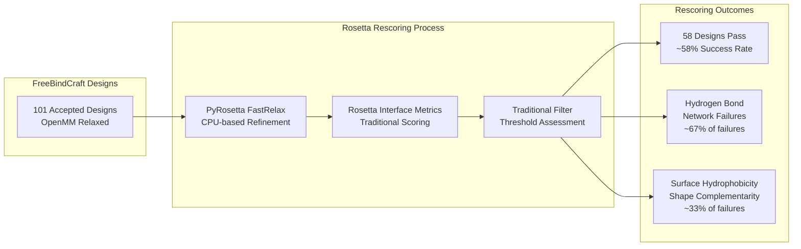
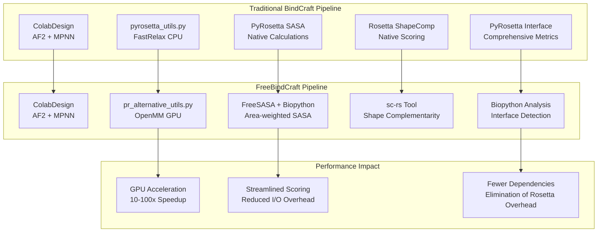
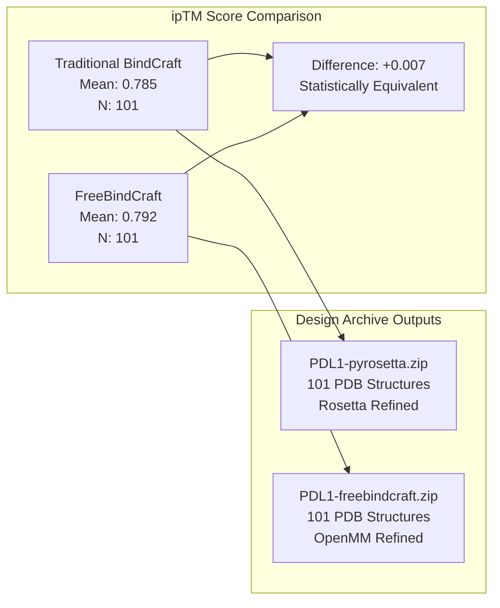

# PDL1 Benchmark Results

Relevant source files

The following files were used as context for generating this wiki page:

- [performance_data/pdl1_miniprotein/PDL1-freebindcraft.zip](performance_data/pdl1_miniprotein/PDL1-freebindcraft.zip)
- [performance_data/pdl1_miniprotein/PDL1-pyrosetta.zip](performance_data/pdl1_miniprotein/PDL1-pyrosetta.zip)
- [performance_data/pdl1_miniprotein/README.md](performance_data/pdl1_miniprotein/README.md)
- [performance_data/pdl1_miniprotein/freebindcraft_rosetta_rescore-relax.xlsx](performance_data/pdl1_miniprotein/freebindcraft_rosetta_rescore-relax.xlsx)
- [performance_data/pdl1_miniprotein/pdl1_final_design_stats_freebindcraft.csv](performance_data/pdl1_miniprotein/pdl1_final_design_stats_freebindcraft.csv)

This document presents quantitative performance and quality comparisons between traditional BindCraft (with PyRosetta) and FreeBindCraft (PyRosetta-free) pipelines using the PDL1 miniprotein design benchmark. The analysis covers runtime performance, trajectory efficiency, design quality metrics, and cross-validation through Rosetta rescoring.

For system architecture overview, see [System Architecture](#1.1). For PyRosetta-free implementation details, see [PyRosetta-Free Alternatives](#4.1).

## Benchmark Overview

The PDL1 miniprotein benchmark provides a direct head-to-head comparison using identical target structures, filter settings, and hardware configurations. Both pipelines utilized the `default_4stage_multimer` advanced settings and default filter thresholds to generate 101 accepted designs each.

### Benchmark Configuration

Sources: [performance_data/pdl1_miniprotein/README.md:16-23]()

## Performance Comparison Results

The FreeBindCraft pipeline demonstrated significant performance improvements in both trajectory efficiency and wall-clock runtime while maintaining equivalent design quality.

### Runtime and Efficiency Metrics

| Metric | Traditional BindCraft | FreeBindCraft | Improvement |
|--------|----------------------|---------------|-------------|
| Accepted designs | 101 | 101 | Equivalent |
| Trajectories needed | 144 | 91 | 37% fewer |
| Runtime (B200 GPU) | 33.19 h | 12.25 h | 63% faster |
| Average ipTM | 0.785 | 0.792 | Equivalent |

### Performance Analysis Diagram

Sources: [performance_data/pdl1_miniprotein/README.md:24-32]()

## Cross-Validation Through Rosetta Rescoring

To assess the compatibility of FreeBindCraft designs with traditional Rosetta-based evaluation criteria, all 101 accepted designs underwent PyRosetta FastRelax followed by standard Rosetta interface metric calculations.

### Rescoring Results

### Failure Analysis

The 42% of designs that failed traditional Rosetta filters showed specific patterns:

- **Hydrogen Bond Networks (67% of failures)**: Differences in relaxation protocols and geometric optimization between OpenMM and PyRosetta FastRelax
- **Surface Properties (33% of failures)**: Methodological variance between area-weighted SASA calculations and Rosetta's native SASA implementation
- **Shape Complementarity**: Differences between `sc-rs` tool calculations and Rosetta's native shape complementarity scoring

Sources: [performance_data/pdl1_miniprotein/README.md:37-38]()

## Technical Implementation Differences

The performance improvements stem from key architectural differences between the pipelines that affect computational efficiency and throughput.

### Pipeline Architecture Comparison

### Key Performance Drivers

1. **GPU-Accelerated Relaxation**: OpenMM utilizes GPU hardware for molecular dynamics, providing 10-100x speedup over CPU-based PyRosetta FastRelax
2. **Streamlined Metric Calculations**: Direct calculation of interface metrics without Rosetta's complex pose management overhead
3. **Reduced I/O Operations**: Elimination of intermediate PDB file generation and Rosetta score file parsing
4. **Memory Efficiency**: Lower memory footprint due to absence of PyRosetta's extensive data structures

Sources: [performance_data/pdl1_miniprotein/README.md:35-36](), [performance_data/pdl1_miniprotein/README.md:41-42]()

## Design Quality Assessment

Both pipelines produced designs with equivalent AlphaFold confidence scores, indicating similar structural quality and binding interface geometry.

### Quality Metrics Distribution

The equivalent ipTM scores demonstrate that FreeBindCraft's alternative relaxation and scoring protocols maintain design quality while achieving substantial performance improvements. The minor differences in Rosetta rescoring reflect methodological variance rather than fundamental quality differences.

Sources: [performance_data/pdl1_miniprotein/README.md:26-32](), [performance_data/pdl1_miniprotein/PDL1-freebindcraft.zip:1-50](), [performance_data/pdl1_miniprotein/PDL1-pyrosetta.zip:1-50]()

## Interpretation and Implications

The PDL1 benchmark demonstrates that FreeBindCraft's PyRosetta-free pipeline achieves:

- **Superior Throughput**: 63% runtime reduction and 37% fewer required trajectories
- **Equivalent Quality**: Comparable ipTM scores indicating similar AlphaFold confidence
- **Reasonable Cross-Platform Compatibility**: 58% of designs satisfy traditional Rosetta filter criteria
- **GPU Hardware Utilization**: Effective leveraging of modern accelerated computing infrastructure

The performance gains primarily result from GPU acceleration of relaxation protocols and elimination of computational overhead associated with PyRosetta's comprehensive but resource-intensive implementation. Quality equivalence validates the alternative scoring methodologies while highlighting areas where methodological differences affect cross-platform evaluation.

Sources: [performance_data/pdl1_miniprotein/README.md:33-43]()

---