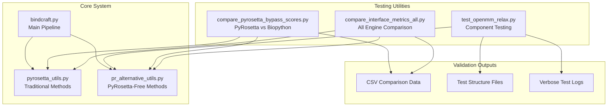
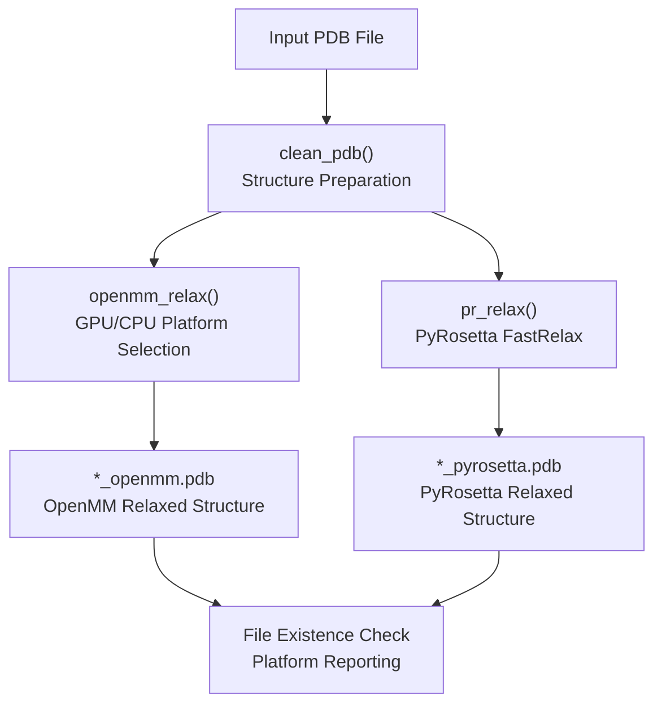
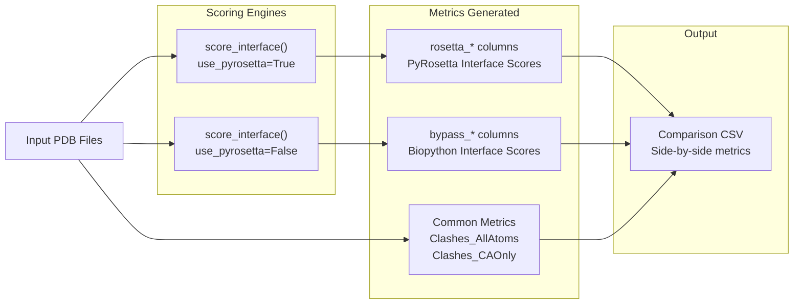

# Testing Utilities

<details>
<summary>Relevant source files</summary>

The following files were used as context for generating this wiki page:

- [.gitignore](.gitignore)
- [extras/compare_interface_metrics_all.py](extras/compare_interface_metrics_all.py)
- [extras/compare_pyrosetta_bypass_scores.py](extras/compare_pyrosetta_bypass_scores.py)
- [extras/test_openmm_relax.py](extras/test_openmm_relax.py)

</details>


This page covers the testing and validation utilities provided in FreeBindCraft for verifying system components and comparing computational backends. These utilities are primarily located in the `extras/` directory and focus on validating PyRosetta-free alternatives against traditional PyRosetta methods.

For information about the core PyRosetta alternatives being tested, see [PyRosetta-Free Alternatives](#4.1). For analysis of design results, see [Analysis & Validation](#6).

## Testing Philosophy

FreeBindCraft implements a comprehensive testing strategy that validates PyRosetta-free alternatives against established PyRosetta methods. The testing utilities serve three main purposes:

1. **Component Testing** - Validate individual components like OpenMM relaxation work correctly
2. **Backend Comparison** - Compare metrics between PyRosetta, FreeSASA, and Biopython engines  
3. **Validation Testing** - Ensure PyRosetta-free results are scientifically equivalent to PyRosetta



**Testing Ecosystem Overview**

Sources: [extras/test_openmm_relax.py:1-133](), [extras/compare_pyrosetta_bypass_scores.py:1-246](), [extras/compare_interface_metrics_all.py:1-248]()

## Component Testing

### OpenMM Relaxation Testing

The `test_openmm_relax.py` script validates the OpenMM relaxation pipeline by testing both OpenMM and PyRosetta relaxation on the same input structure and comparing outputs.

| Feature | Implementation |
|---------|----------------|
| Input Validation | PDB file existence check and cleaning via `clean_pdb` |
| Dual Testing | Tests both `openmm_relax` and `pr_relax` functions |
| Platform Detection | Reports which OpenMM platform was used (CUDA/OpenCL/CPU) |
| Error Handling | Comprehensive exception handling with detailed traceback |
| Output Verification | Checks for successful file creation |



**OpenMM Relaxation Test Workflow**

The script implements a systematic testing approach:

- **Preprocessing**: Uses `clean_pdb` to prepare input structures [test_openmm_relax.py:54-62]()
- **Platform Selection**: OpenMM automatically selects the best available platform (CUDA → OpenCL → CPU) [test_openmm_relax.py:91-92]()
- **Parallel Testing**: Both relaxation methods run on the same input for direct comparison [test_openmm_relax.py:88-132]()
- **Output Verification**: Validates successful file creation and reports platform usage [test_openmm_relax.py:93-96]()

Sources: [extras/test_openmm_relax.py:28-133]()

## Interface Metrics Comparison

### PyRosetta vs Biopython Comparison

The `compare_pyrosetta_bypass_scores.py` script performs side-by-side comparison of interface metrics between PyRosetta and Biopython implementations.

| Comparison Aspect | PyRosetta Method | Biopython Method |
|-------------------|------------------|------------------|
| SASA Calculation | Rosetta native SASA | Shrake-Rupley with Chothia radii |
| Interface Detection | PyRosetta interface analysis | Distance-based detection |
| Shape Complementarity | Rosetta shape complementarity | External `sc` binary |
| Scoring Framework | `score_interface(..., use_pyrosetta=True)` | `score_interface(..., use_pyrosetta=False)` |



**PyRosetta vs Biopython Comparison Workflow**

The script supports both serial and parallel processing modes:

- **Serial Processing**: Single-threaded with verbose output for debugging [compare_pyrosetta_bypass_scores.py:208-213]()
- **Parallel Processing**: Multi-worker processing using `ProcessPoolExecutor` [compare_pyrosetta_bypass_scores.py:214-235]()
- **Common Metrics**: Includes clash detection as reference metrics for both engines [compare_pyrosetta_bypass_scores.py:131-145]()

Sources: [extras/compare_pyrosetta_bypass_scores.py:75-147](), [extras/compare_pyrosetta_bypass_scores.py:164-243]()

### Three-Engine Comparison

The `compare_interface_metrics_all.py` script extends the comparison to include FreeSASA alongside PyRosetta and Biopython methods.

| Engine | SASA Method | Primary Function |
|--------|-------------|------------------|
| PyRosetta | Rosetta native | `score_interface(..., use_pyrosetta=True)` |
| FreeSASA | FreeSASA library | `pr_alternative_score_interface(..., sasa_engine="freesasa")` |
| Biopython | Shrake-Rupley | `pr_alternative_score_interface(..., sasa_engine="biopython")` |

The three-engine comparison provides comprehensive validation by testing all available SASA calculation methods:

- **PyRosetta Engine**: Traditional Rosetta-based calculations [compare_interface_metrics_all.py:113-131]()
- **FreeSASA Engine**: Uses the FreeSASA library for SASA calculations [compare_interface_metrics_all.py:96-110]()
- **Biopython Engine**: Pure Python implementation using Biopython [compare_interface_metrics_all.py:79-94]()

Sources: [extras/compare_interface_metrics_all.py:66-148]()

## Utility Functions and Infrastructure

### Binary Executable Management

Both comparison scripts include the `ensure_binaries_executable()` function that manages external tool dependencies:

```python
# Managed binaries
binaries = ["dssp", "DAlphaBall.gcc", "sc"]
```

This function ensures all required external tools have proper execution permissions:

- **DSSP**: Secondary structure assignment
- **DAlphaBall.gcc**: Cavity detection for PyRosetta  
- **sc**: Shape complementarity calculations

Sources: [extras/compare_pyrosetta_bypass_scores.py:36-53](), [extras/compare_interface_metrics_all.py:32-45]()

### PyRosetta Initialization Management

The testing utilities implement robust PyRosetta initialization with fallback handling:

- **Initialization Flags**: Uses comprehensive flags including DAlphaBall path and beta corrections [compare_pyrosetta_bypass_scores.py:61-62]()
- **Fallback Behavior**: Gracefully handles PyRosetta initialization failures [compare_pyrosetta_bypass_scores.py:69-72]()
- **Process-Level Caching**: Implements `_PROCESS_PYROSETTA_READY` to avoid re-initialization in parallel processing [compare_pyrosetta_bypass_scores.py:33-34]()

## Usage Patterns

### Basic Component Testing

```bash
# Test OpenMM relaxation on a single structure
python extras/test_openmm_relax.py input.pdb output_base

# This creates:
# - output_base_openmm.pdb (OpenMM relaxed)  
# - output_base_pyrosetta.pdb (PyRosetta relaxed)
```

### Interface Metrics Comparison

```bash
# Compare PyRosetta vs Biopython metrics
python extras/compare_pyrosetta_bypass_scores.py \
    --pdb-dir /path/to/pdbs \
    --binder-chain B \
    --workers 4

# Compare all three engines
python extras/compare_interface_metrics_all.py \
    --pdb-dir /path/to/pdbs \
    --binder-chain B \  
    --workers 4 \
    --recursive
```

### Command Line Options

| Option | Purpose | Available In |
|--------|---------|--------------|
| `--pdb-dir` | Input directory containing PDB files | Both comparison scripts |
| `--binder-chain` | Specify binder chain ID (default: B) | Both comparison scripts |
| `--workers` | Number of parallel workers | Both comparison scripts |
| `--recursive` | Recursively scan subdirectories | Both comparison scripts |
| `--no-pyrosetta` | Skip PyRosetta even if available | Both comparison scripts |
| `--output` | Custom output CSV path | Both comparison scripts |

Sources: [extras/compare_pyrosetta_bypass_scores.py:165-172](), [extras/compare_interface_metrics_all.py:166-173](), [extras/test_openmm_relax.py:29-43]()

---