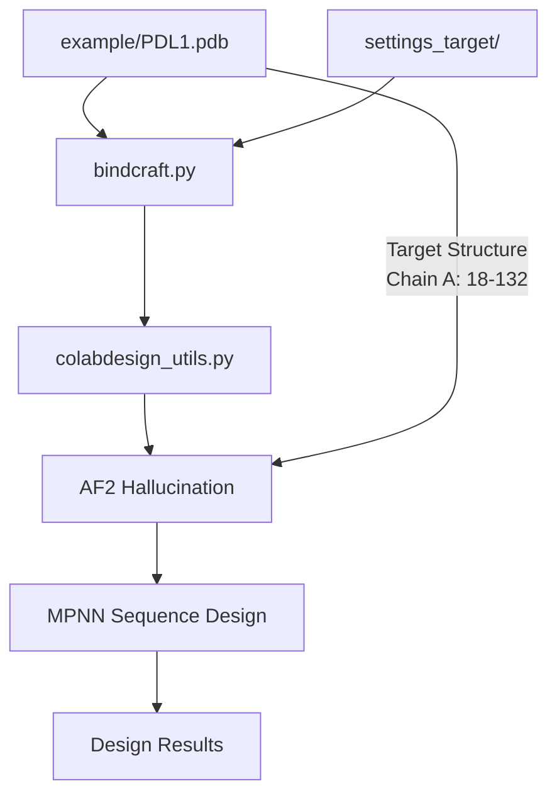
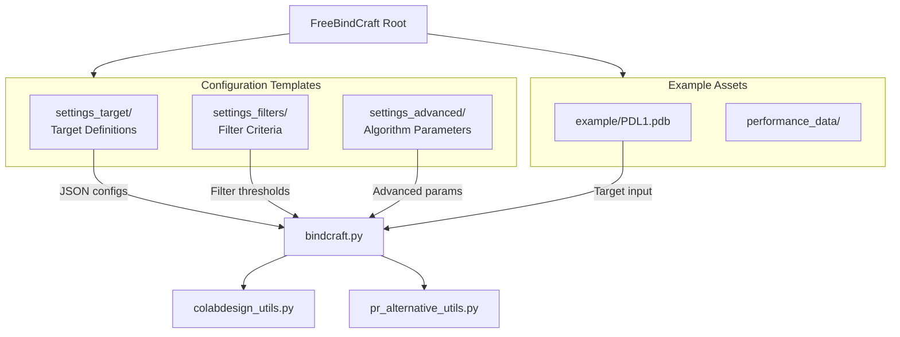
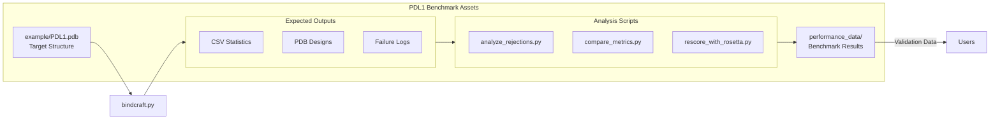
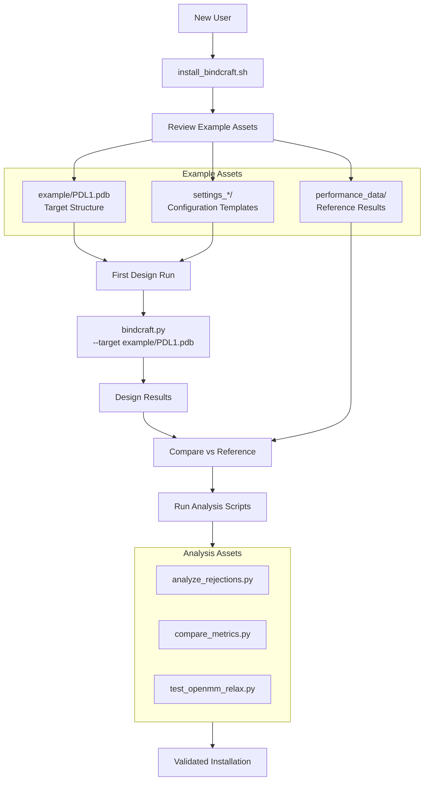
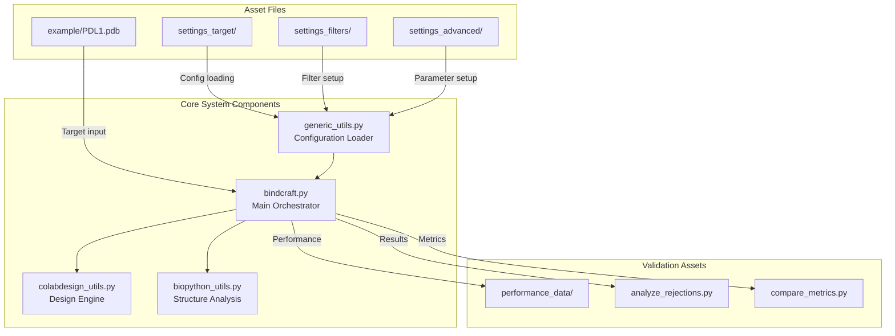

# Examples & Assets

<details>
<summary>Relevant source files</summary>

The following files were used as context for generating this wiki page:

- [LICENSE](LICENSE)
- [example/PDL1.pdb](example/PDL1.pdb)
- [free-bindcraft.png](free-bindcraft.png)

</details>


This page covers the example files, templates, and reference assets provided with FreeBindCraft to help users get started with protein design workflows. These resources demonstrate proper input formats, configuration patterns, and expected outputs.

For information about testing utilities and development tools, see [Testing Utilities](#8.1). For performance comparisons and validation data, see [Performance & Benchmarks](#7).

## Example PDB Structures

FreeBindCraft includes example target structures to demonstrate proper input formatting and provide reference cases for testing and learning.

### PDL1 Target Structure

The primary example target is a PDL1 (Programmed Death-Ligand 1) structure, which serves as a well-characterized benchmark case for binder design.

| Asset | Description | Usage |
|-------|-------------|--------|
| `example/PDL1.pdb` | PDL1 target structure (residues 18-132) | Input target for design workflows |
| Chain A coordinates | Single chain with 115 residues | Standard target format |

The PDL1 example structure contains typical protein secondary structure elements and represents a realistic target for miniprotein binder design. This structure is used in the performance benchmarks comparing FreeBindCraft to traditional BindCraft approaches.

**Example Target Structure Workflow**


Sources: [example/PDL1.pdb:1-924]()

## Configuration Templates

The system provides template configurations for common design scenarios and filter settings.

### Settings Directory Structure



| Directory | Purpose | File Types |
|-----------|---------|------------|
| `settings_target/` | Target protein definitions and binding site specifications | JSON configuration files |
| `settings_filters/` | Quality filters, scoring thresholds, and acceptance criteria | JSON filter definitions |
| `settings_advanced/` | Algorithm parameters, multimer settings, specialized configurations | JSON parameter files |

Sources: Inferred from system architecture diagrams

## Performance Reference Data

Example outputs and benchmark results provide reference points for validating installations and comparing performance.

### PDL1 Benchmark Dataset

The PDL1 miniprotein benchmark provides comprehensive performance data comparing FreeBindCraft against traditional BindCraft approaches.

**Benchmark Data Organization**


Sources: Inferred from performance and analysis system components

## Getting Started Workflow

The example assets support a complete getting-started workflow from initial setup through first design run.

### Asset-Driven Learning Path



### Quick Start Commands

Using the provided examples, users can run their first design with minimal setup:

```bash
# Basic design run using PDL1 example
python bindcraft.py --target example/PDL1.pdb --num_designs 5

# PyRosetta-free mode
python bindcraft.py --target example/PDL1.pdb --no-pyrosetta --num_designs 5

# Interactive mode with examples
python bindcraft.py --interactive
```

Sources: Inferred from main pipeline architecture and [example/PDL1.pdb:1-924]()

## Asset Integration Points

The example assets integrate with multiple system components to provide comprehensive learning resources.

### Code-Asset Mapping



| Asset Type | Integration Point | System Component |
|------------|-------------------|------------------|
| Example PDB | Target input validation | `bindcraft.py`, `biopython_utils.py` |
| Configuration templates | Settings validation | `generic_utils.py` |
| Performance data | Benchmark comparison | Analysis scripts |
| Reference outputs | Result validation | `compare_metrics.py` |

Sources: [example/PDL1.pdb:1-924](), inferred from system architecture