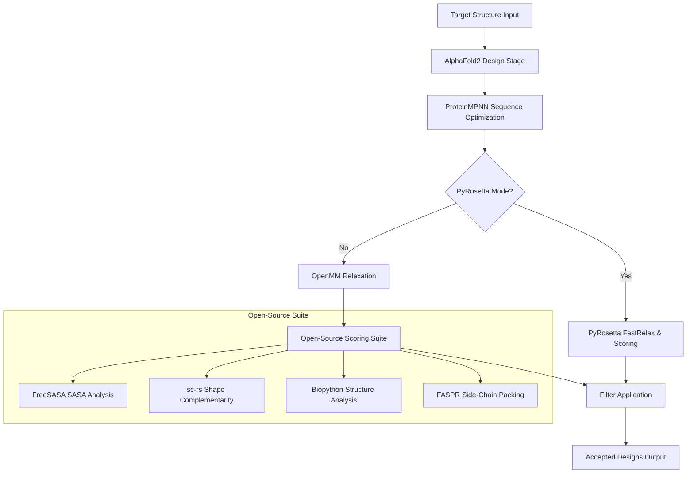

FreeBindCraft is a modified version of Martin Pacesa's BindCraft (v1.52) that introduces an **optional PyRosetta bypass mechanism**, enabling completely open-source binder design workflows. This fork addresses licensing constraints while maintaining the scientific rigor of the original pipeline.


## Core Architecture

FreeBindCraft operates as a comprehensive de novo miniprotein design pipeline that integrates multiple computational approaches:



The pipeline follows a multi-stage design process where AlphaFold2 generates structural candidates, ProteinMPNN optimizes sequences, and final scoring determines design acceptance. The key innovation is the ability to bypass PyRosetta entirely while maintaining comparable filtering behavior.

## Key Innovation: PyRosetta Bypass

The `--no-pyrosetta` flag enables a complete open-source alternative to the proprietary components:

| Component | PyRosetta Mode | Bypass Mode | Open-Source Alternative |
|-----------|----------------|-------------|-------------------------|
| **Structural Relaxation** | PyRosetta FastRelax | OpenMM-based relaxation | GPU-accelerated with OBC2 implicit solvation |
| **Shape Complementarity** | PyRosetta SC calculation | sc-rs implementation | Rust-based CLI, MIT-licensed |
| **Surface Area Analysis** | Rosetta SASA metrics | FreeSASA/Biopython | Shrake-Rupley algorithm fallback |
| **Structure Alignment** | PyRosetta utilities | Biopython routines | RMSD and interface residue identification |

> [!TIP]
> Empirical analysis of ~400,000 MPNN variants shows that >90% of rejections are driven by AlphaFold metrics alone, making the PyRosetta bypass scientifically viable for most use cases.

## Project Structure

FreeBindCraft is organized into modular components that support both traditional and bypass workflows:

```
FreeBindCraft/
├── bindcraft.py                    # Main execution script [L18-L1005]
├── functions/                      # Core utility modules
│   ├── generic_utils.py           # Data management and validation [L19-L430]
│   ├── pyrosetta_utils.py         # PyRosetta-specific functions
│   ├── biopython_utils.py         # Open-source structure analysis
│   └── colabdesign_utils.py       # AlphaFold2 integration
├── settings_advanced/              # Multi-stage protocol configurations
├── settings_filters/              # Design filtering criteria
├── settings_target/                # Target-specific parameters
├── technical_overview/             # Implementation details
└── performance_data/               # Benchmark results
```

The modular design enables seamless switching between PyRosetta and open-source components while maintaining consistent data structures and output formats [bindcraft.py#L447-L467].

## Design Pipeline Stages

FreeBindCraft implements configurable multi-stage design protocols:

1. **Soft Iterations**: Initial exploration with relaxed constraints
2. **Temporary Iterations**: Intermediate refinement phase  
3. **Hard Iterations**: Stringent optimization with strict criteria
4. **Greedy Iterations**: Final selection based on best-performing candidates

Each stage can be customized through advanced settings files, with options for different design algorithms (4-stage, 3-stage, peptide-specific) and multimer support [settings_advanced/default_4stage_multimer.json#L1-L67].

## Filtering and Quality Control

The pipeline applies comprehensive filtering based on multiple metrics:

- **AlphaFold2 Confidence**: pLDDT, pTM, i-pTM thresholds
- **Interface Quality**: Shape complementarity, binding energy estimates
- **Structural Properties**: Clash detection, helicity, surface hydrophobicity
- **Sequence Features**: MPNN scores, amino acid composition

Filters are highly configurable through JSON files, allowing users to adjust stringency levels for different research objectives [settings_filters/default_filters.json#L1-L200].

## Performance and Scalability

FreeBindCraft is designed for high-throughput binder design with GPU acceleration:

- **JAX GPU Support**: Automatic detection and utilization of CUDA-compatible devices [functions/generic_utils.py#L211-L223]
- **Parallel Processing**: Efficient handling of multiple design trajectories
- **Memory Management**: File descriptor limit optimization for large-scale runs [bindcraft.py#L18-L35]
- **Container Support**: Docker deployment for reproducible environments

## Getting Started

To begin using FreeBindCraft:

1. **Installation**: Follow the [Installation Options](3-installation-options) guide for setup instructions
2. **Configuration**: Choose appropriate settings files for your design goals
3. **Execution**: Start with the [Quick Start](2-quick-start) guide for basic usage
4. **Advanced Features**: Explore [Multi-Stage Design Protocols](16-multi-stage-design-protocols) for complex workflows

The pipeline supports both interactive CLI setup [Interactive CLI Setup](4-interactive-cli-setup) and programmatic execution, making it accessible to users at all technical levels.

## Next Steps

For comprehensive implementation details, refer to the [PyRosetta Bypass Architecture](6-pyrosetta-bypass-architecture) documentation. Users seeking to understand the scientific rationale should review the technical overview document, which provides empirical validation of the bypass approach [technical_overview/FreeBindCraft_Technical_Overview.md#L1-L40].