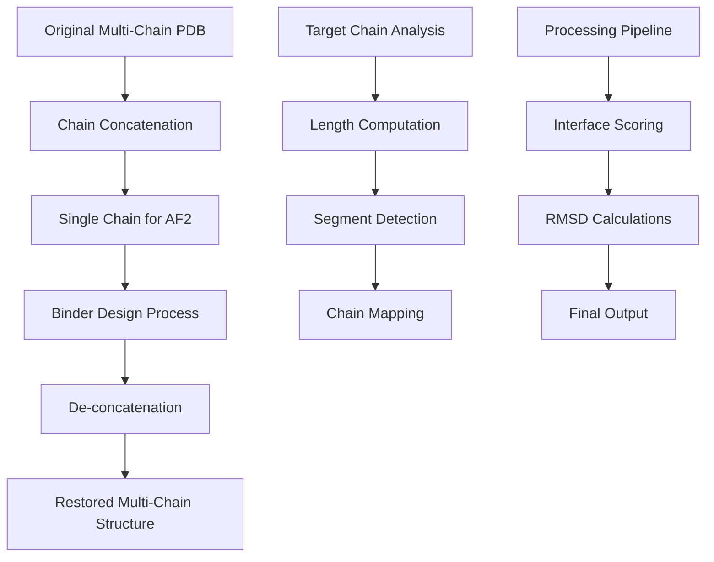

FreeBindCraft implements a sophisticated chain handling system that enables seamless manipulation of multi-chain protein structures throughout the binder design pipeline. This system is critical for maintaining structural integrity while enabling the flexible concatenation and de-concatenation of protein chains required for AlphaFold2 multimer predictions and downstream analysis.

## Chain Architecture Overview

The chain handling architecture operates on a fundamental principle: **target chains are temporarily concatenated into a single chain for AlphaFold2 processing, then de-concatenated back to their original structure for analysis**. This approach leverages AlphaFold2's superior performance on single-chain inputs while preserving the biological relevance of multi-chain interactions.



## Core Chain Processing Functions

### Target Chain Length Computation

The system begins by analyzing the original target structure to determine chain boundaries and residue counts [functions/biopython_utils.py#L503-L543](functions/biopython_utils.py#L503-L543):

```python
def compute_target_chain_lengths(starting_pdb_path: str, chains: str):
    """
    Compute the number of standard amino acid residues in each of the original
    target chains from the starting PDB, preserving input order.
    """
```

This function parses the input PDB file and extracts residue counts for each specified chain, counting only standard amino acids while excluding non-standard residues and heteroatoms. The result provides the essential mapping information needed for later de-concatenation.

### Segment Detection and Boundary Analysis

For robust chain handling, the system implements sophisticated segment detection that identifies continuous residue segments within each chain [functions/biopython_utils.py#L546-L602](functions/biopython_utils.py#L546-L602):

```python
def compute_target_segment_lengths(starting_pdb_path: str, chains: str):
    """
    Compute continuous segment lengths for each requested chain by splitting on
    residue number gaps (resseq jumps > 1).
    """
```

This analysis is crucial for handling proteins with missing residues or discontinuous numbering, ensuring accurate chain reconstruction after de-concatenation.

## Chain Manipulation Operations

### Chain Splitting and Subchain Assignment

The core de-concatenation functionality resides in the `split_chain_into_subchains` function [functions/biopython_utils.py#L605-L680](functions/biopython_utils.py#L605-L680):

```python
def split_chain_into_subchains(pdb_in_path: str,
                               source_chain_id: str,
                               subchain_lengths,
                               new_chain_ids,
                               output_path: str = None):
```

This operation performs precise atom-level manipulation:

1. **Residue Tracking**: Maintains a counter of unique residue identifiers (resseq, icode) as they appear in the file
2. **Boundary Calculation**: Uses pre-computed cumulative boundaries to efficiently determine subchain assignments
3. **Chain ID Reassignment**: Systematically rewrites chain IDs in ATOM/HETATM records based on residue position
4. **File Integrity**: Preserves all PDB formatting and metadata while only modifying chain identifiers

> [!TIP]
> The splitting algorithm uses cumulative boundary pre-computation for O(1) subchain lookup, making it highly efficient even for large protein structures with thousands of residues.

### Chain Merging for AlphaFold2 Processing

The reverse operation, `merge_chains_into_single`, consolidates multiple chains back into a single chain identifier [functions/biopython_utils.py#L683-L719](functions/biopython_utils.py#L683-L719):

```python
def merge_chains_into_single(pdb_in_path: str,
                             source_chain_ids,
                             dest_chain_id: str = 'A',
                             output_path: str = None):
```

This function is essential for preparing structures for AlphaFold2 input, where single-chain representations often yield better prediction quality for binder design scenarios.

## Integration with Design Pipeline

### Target RMSD Validation

The chain handling system integrates closely with structural validation through the `target_pdb_rmsd` function [functions/biopython_utils.py#L123-L159](functions/biopython_utils.py#L123-L159). This ensures that chain manipulation operations preserve structural fidelity:

```python
def target_pdb_rmsd(trajectory_pdb, starting_pdb, chain_ids_string):
    # Extract chain A from trajectory_pdb
    chain_trajectory = structure_trajectory[0]['A']
    
    # Extract the specified chains from starting_pdb
    chain_ids = chain_ids_string.split(',')
    residues_starting = []
    for chain_id in chain_ids:
        chain_id = chain_id.strip()
        chain = structure_starting[0][chain_id]
```

This validation compares the de-concatenated structure against the original target, ensuring that chain operations haven't introduced structural artifacts.

### Interface Analysis Integration

Chain handling directly enables accurate interface analysis through the `hotspot_residues` function [functions/biopython_utils.py#L212-L247](functions/biopython_utils.py#L212-L247):

```python
def hotspot_residues(trajectory_pdb, binder_chain="B", atom_distance_cutoff=4.0):
    # Get the specified chain
    binder_atoms = Selection.unfold_entities(structure[0][binder_chain], 'A')
    
    # Get atoms and coords for the target chain
    target_atoms = Selection.unfold_entities(structure[0]['A'], 'A')
```

By maintaining proper chain separation after de-concatenation, the system can accurately identify interfacial residues between binder and target chains.

## Error Handling and Robustness

The chain handling system incorporates comprehensive error handling:

- **Graceful Degradation**: Functions return empty lists or None values on parsing failures rather than crashing
- **Input Validation**: Validates chain ID formats and ensures matching lengths for subchain operations
- **File Safety**: Implements backup mechanisms and atomic writes to prevent data corruption

> [!TIP]
> All chain manipulation functions operate with copy-on-write semantics when possible, ensuring that the original PDB files remain intact unless explicitly overwritten.

## Performance Considerations

The chain handling system is optimized for large-scale binder design operations:

- **Memory Efficiency**: Uses streaming file operations rather than loading entire structures into memory
- **Computational Scaling**: Implements O(n) algorithms for chain splitting and merging operations
- **Caching Integration**: Leverages the DSSP caching system [functions/biopython_utils.py#L20-L88](functions/biopython_utils.py#L20-L88) to avoid redundant calculations

## Configuration and Usage

Chain handling behavior is controlled through the target settings configuration:

```json
{
  "chains": "A,B",
  "starting_pdb": "target_structure.pdb"
}
```

The system automatically detects chain boundaries and performs the necessary concatenation/de-concatenation cycles without requiring manual intervention.

For advanced usage scenarios, developers can directly invoke chain manipulation functions for custom preprocessing workflows or integration with external structural analysis tools.

The chain handling and de-concatenation system represents a critical component of FreeBindCraft's architecture, enabling seamless integration between AlphaFold2's single-chain optimization and the multi-chain reality of protein-protein interactions.