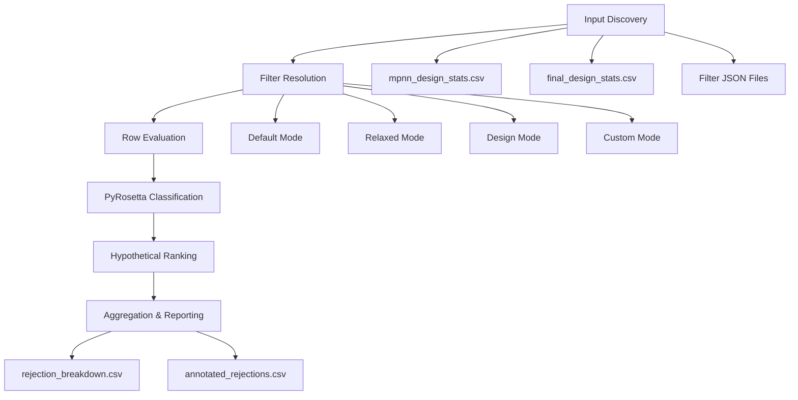

The **Rejection Analysis Framework** provides a comprehensive post-hoc analysis system for understanding why BindCraft designs are rejected during the filtering process. This framework is particularly valuable for identifying the impact of PyRosetta-dependent criteria versus open-source alternatives, enabling data-driven decisions about filter optimization and computational resource allocation.

## Framework Overview

The rejection analysis system operates on completed BindCraft runs, re-evaluating MPNN design statistics against configurable filter criteria to generate detailed rejection reports. The framework distinguishes between PyRosetta-dependent metrics and open-source alternatives, allowing users to assess the trade-offs between computational cost and filtering stringency.

The analysis is implemented through the `analyze_bindcraft_rejections.py` script [analyze_bindcraft_rejections.py](extras/analyze_bindcraft_rejections.py#L1-L508), which processes `mpnn_design_stats.csv` files from one or more BindCraft runs and generates two complementary output files: a rejection breakdown summary and detailed annotated rejection records.

## Core Architecture

The framework follows a modular design with distinct processing phases:



### Filter Processing Pipeline

The framework processes filters through a sophisticated normalization and evaluation system:

1. **Key Normalization**: Converts JSON keys to standardized base names (e.g., `Average_pLDDT` → `pLDDT`) [analyze_bindcraft_rejections.py](extras/analyze_bindcraft_rejections.py#L85-L92)
2. **Interface Amino Acid Expansion**: Expands nested `InterfaceAAs` specifications into per-amino-acid criteria [analyze_bindcraft_rejections.py](extras/analyze_bindcraft_rejections.py#L93-L108)
3. **Threshold Evaluation**: Applies directional comparisons based on `higher` boolean flag [analyze_bindcraft_rejections.py](extras/analyze_bindcraft_rejections.py#L154-L179)

## PyRosetta Dependency Classification

The framework explicitly classifies criteria into PyRosetta-dependent and open-source categories:

| PyRosetta-Dependent Criteria | Open-Source Alternatives |
|------------------------------|--------------------------|
| `Surface_Hydrophobicity` | `Average_pLDDT` |
| `ShapeComplementarity` | `Average_pTM` |
| `dG` | `Average_i_pTM` |
| `n_InterfaceHbonds` | `Average_i_pAE` |
| `n_InterfaceUnsatHbonds` | `Average_Unrelaxed_Clashes` |
| `Binder_Energy_Score` | `MPNN_score` |

This classification enables the framework to identify designs that would be accepted using only open-source metrics but are rejected due to PyRosetta-dependent criteria [analyze_bindcraft_rejections.py](extras/analyze_bindcraft_rejections.py#L12-L18).

> [!TIP]
> The framework's hypothetical ranking feature is particularly powerful for PyRosetta impact assessment. For designs rejected only by PyRosetta criteria, it calculates their potential rank if accepted, using the `Average_i_pTM` metric from accepted designs as the ranking baseline [analyze_bindcraft_rejections.py](extras/analyze_bindcraft_rejections.py#L181-L194).

## Filter Configuration Modes

The framework supports four distinct filter resolution modes, each serving different analysis scenarios:

### Default Mode
Uses predefined `default_filters.json` from the current working directory [default_filters.json](settings_filters/default_filters.json#L1-L200). This mode provides consistent, reproducible analysis across multiple runs using standard filter thresholds.

### Relaxed Mode  
Applies `relaxed_filters.json` with less stringent thresholds [relaxed_filters.json](settings_filters/relaxed_filters.json#L1-L100), useful for understanding the impact of filter stringency on rejection rates.

### Design Mode
Resolves filters on a per-row basis using the `Filters` column in `mpnn_design_stats.csv`, enabling analysis of heterogeneous filter applications across different experimental conditions.

### Custom Mode
Accepts user-specified filter JSON files for scenario testing and filter optimization experiments.

## Output Specifications

### Rejection Breakdown Summary
The `rejection_breakdown.csv` provides aggregated statistics across all processed runs:

| Column | Description |
|--------|-------------|
| `filter_key` | Normalized filter name (e.g., `pLDDT`, `InterfaceAAs_K`) |
| `is_pyrosetta` | Boolean flag indicating PyRosetta dependency |
| `threshold` | Applied threshold value |
| `higher_is_better` | Direction of optimal comparison |
| `num_violations` | Count of rejected designs violating this criterion |
| `percent_of_rejections` | Proportion of total rejections attributed to this criterion |

### Annotated Rejections Detail
The `annotated_rejections.csv` provides row-level analysis with comprehensive metadata:

| Column | Description |
|--------|-------------|
| `run_dir` | Relative path to the run directory |
| `design_name` | Design identifier from the `Design` column |
| `sequence` | Amino acid sequence |
| `Average_i_pTM` | Interface predicted TM score for ranking |
| `pyrosetta_involved` | Flag indicating any PyRosetta criterion violation |
| `pyrosetta_only` | Flag indicating rejection solely by PyRosetta criteria |
| `hypothetical_rank` | Potential rank if accepted by open-source criteria only |
| `accepted_in_run` | Count of accepted designs in the same run |

## Performance Metrics Integration

The framework incorporates trajectory-level performance estimation by reading `trajectory_stats.csv` files when available, providing context for the computational cost of rejected designs [analyze_bindcraft_rejections.py](extras/analyze_bindcraft_rejections.py#L275-L283). This enables cost-benefit analysis of filter adjustments by correlating rejection patterns with computational investment.

## Usage Examples

### Basic Analysis
```bash
python analyze_bindcraft_rejections.py --input-dir /path/to/runs --filter-mode default
```

### Recursive Analysis with Design-Time Filters
```bash
python analyze_bindcraft_rejections.py --input-dir /path/to/runs --filter-mode design --recursive
```

### Custom Filter Evaluation
```bash
python analyze_bindcraft_rejections.py --input-dir /path/to/runs --filter-mode custom --filters-path ./experimental_filters.json
```

## Integration with Performance Analysis

The rejection framework complements the broader performance analysis capabilities described in [Benchmark Results and Metrics](12-benchmark-results-and-metrics). By combining rejection analysis with runtime optimization strategies from [Runtime Optimization Strategies](13-runtime-optimization-strategies), users can make informed decisions about filter stringency versus computational efficiency trade-offs.

The framework's output can be particularly valuable when evaluating the impact of the PyRosetta bypass architecture described in [PyRosetta Bypass Architecture](6-pyrosetta-bypass-architecture), providing quantitative evidence for the effectiveness of open-source alternatives in maintaining design quality while reducing computational dependencies.