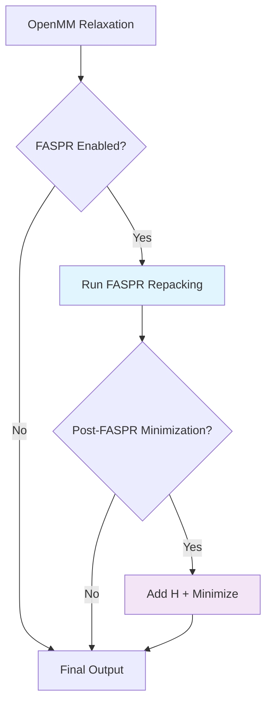

## Overview

FASPR (Fast and Accurate Side-chain Packing for Rotamers) is integrated into FreeBindCraft as an open-source alternative to PyRosetta's side-chain optimization capabilities. This integration provides rapid, deterministic side-chain repacking using the Dunbrack 2010 rotamer library, enabling high-quality structural refinement without requiring commercial software licenses.

## Architecture and Integration

The FASPR integration follows a modular design pattern within FreeBindCraft's PyRosetta bypass architecture. The implementation is centralized in `functions/pr_alternative_utils.py` with dedicated helper functions for binary resolution, execution, and post-processing [functions/pr_alternative_utils.py#L705-L783].

### Binary Resolution Strategy

FASPR employs a hierarchical binary discovery mechanism:

1. **Environment Override**: Checks `FASPR_BIN` environment variable first
2. **Repository Bundle**: Falls back to the bundled `functions/FASPR` executable
3. **System PATH**: Final fallback to system-wide installation

This approach ensures maximum compatibility while allowing users to override with custom builds when needed [functions/pr_alternative_utils.py#L706-L740].

### Execution Pipeline

The FASPR integration operates as a post-processing step within the OpenMM relaxation pipeline:



The FASPR execution requires the `dun2010bbdep.bin` rotamer library to be co-located with the executable. The implementation sets the working directory to the FASPR binary location to ensure proper library discovery [functions/pr_alternative_utils.py#L745-L746].

## Configuration Parameters

FASPR integration is controlled through the main `openmm_relax` function parameters:

| Parameter | Type | Default | Description |
|-----------|------|---------|-------------|
| `use_faspr_repack` | bool | `True` | Enable/disable FASPR side-chain repacking |
| `post_faspr_minimize` | bool | `True` | Perform hydrogen addition and minimization after FASPR |
| `timeout` | int | `900` | Maximum execution time in seconds |

> [!TIP]
> The default timeout of 900 seconds (15 minutes) provides ample time for complex structures while preventing indefinite hangs. Adjust based on your typical protein size and computational resources.

## Technical Implementation Details

### Side-Chain Repacking Process

FASPR operates through a sophisticated rotamer selection algorithm:

1. **Rotamer Library Lookup**: Uses Dunbrack 2010 backbone-dependent rotamers
2. **Energy Evaluation**: Calculates van der Waals and electrostatic interactions
3. **Optimization**: Performs deterministic search for optimal rotamer combinations
4. **Output Generation**: Writes optimized structure with updated side-chain coordinates

The binary accepts standard PDB input and produces repacked output while preserving backbone geometry and overall protein conformation [functions/pr_alternative_utils.py#L742-L772].

### Post-FASPR Processing

After FASPR repacking, FreeBindCraft optionally performs additional refinement:

1. **Hydrogen Addition**: Uses PDBFixer to add missing hydrogen atoms
2. **Short Minimization**: Applies constrained OpenMM minimization to resolve minor clashes
3. **Structure Validation**: Ensures structural integrity and proper geometry

This two-stage approach (FASPR repacking + minimization) provides the best balance between computational efficiency and structural quality [functions/pr_alternative_utils.py#L774-L783].

## Performance Considerations

### Computational Efficiency

FASPR demonstrates significant performance advantages over PyRosetta side-chain optimization:

- **Speed**: Typically 5-10x faster than PyRosetta repacking
- **Memory**: Lower memory footprint due to focused algorithm
- **Determinism**: Consistent results across runs and platforms

### Integration Overhead

The integration adds minimal overhead to the overall pipeline:
- Binary resolution: <1 second
- Process spawning: <0.5 seconds
- File I/O: Depends on structure size, typically <5 seconds

> [!TIP]
> For high-throughput workflows, consider setting `post_faspr_minimize=False` to reduce processing time when working with well-prepared structures.

## Error Handling and Fallbacks

The FASPR integration includes comprehensive error handling:

1. **Binary Not Found**: Graceful degradation with warning message
2. **Execution Failures**: Timeout protection and exception handling
3. **Output Validation**: Verifies file creation and non-zero size
4. **Fallback Mechanism**: Continues pipeline execution even if FASPR fails

When FASPR is unavailable or fails, the system logs appropriate warnings and continues with the OpenMM-relaxed structure, ensuring pipeline robustness [functions/pr_alternative_utils.py#L751-L772].

## Usage Examples

### Basic Integration

```python
from functions.pr_alternative_utils import openmm_relax

# Standard relaxation with FASPR (default)
platform = openmm_relax(
    "input.pdb", 
    "output.pdb",
    use_faspr_repack=True,
    post_faspr_minimize=True
)
```

### Performance-Optimized Configuration

```python
# Faster processing for well-prepared structures
platform = openmm_relax(
    "input.pdb", 
    "output.pdb",
    use_faspr_repack=True,
    post_faspr_minimize=False  # Skip minimization for speed
)
```

### FASPR-Only Processing

```python
# Disable FASPR for OpenMM-only relaxation
platform = openmm_relax(
    "input.pdb", 
    "output.pdb",
    use_faspr_repack=False
)
```

## Debugging and Troubleshooting

### Environment Variables

Set these environment variables for debugging:

- `BINDCRAFT_DEBUG_PDBS=1`: Save intermediate structures including `.debug_post_faspr.pdb`
- `FASPR_BIN=/path/to/custom/faspr`: Override binary discovery

### Common Issues

1. **Permission Denied**: Ensure FASPR binary has execute permissions
2. **Library Not Found**: Verify `dun2010bbdep.bin` is in the same directory as FASPR
3. **Timeout Issues**: Increase timeout parameter for large structures

### Debug Output Files

When debug mode is enabled, FASPR creates `.debug_post_faspr.pdb` files showing the structure immediately after side-chain repacking, useful for analyzing repacking quality and troubleshooting issues [functions/pr_alternative_utils.py#L899].

## Integration with Pipeline Components

FASPR seamlessly integrates with other FreeBindCraft components:

- **Chain Handling**: Works with de-concatenation/re-concatenation pipeline
- **Scoring**: Compatible with downstream interface scoring functions
- **Multi-stage Protocols**: Integrates with 4-stage design workflows
- **Filter Systems**: Results work with all existing filter configurations

The FASPR integration maintains full compatibility with existing FreeBindCraft workflows while providing enhanced side-chain optimization capabilities as part of the broader PyRosetta bypass architecture.