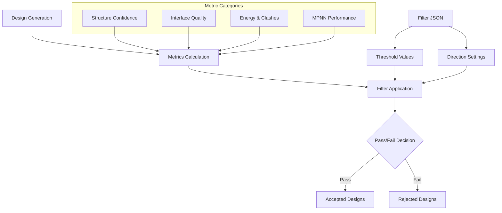
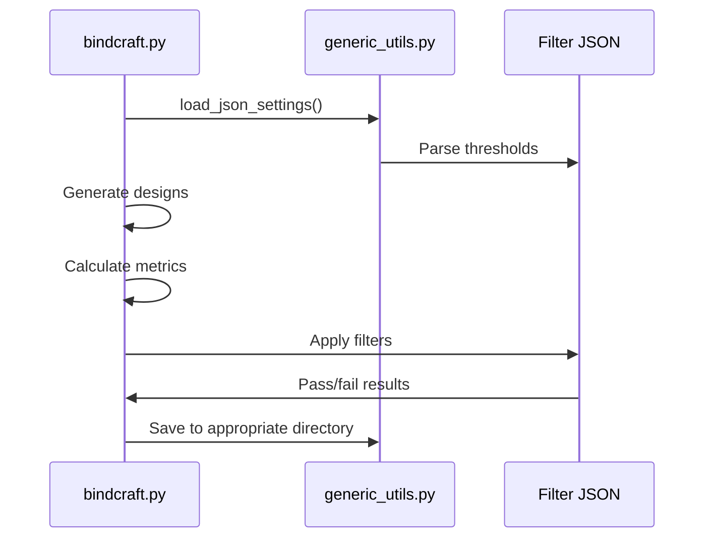

Custom filter development in FreeBindCraft enables precise control over design selection criteria through JSON-based configuration files. This system allows intermediate developers to tailor the filtering process to specific research needs, from relaxed acceptance criteria for exploratory studies to stringent filters for high-confidence binder design.

## Filter Architecture Overview

The filtering system operates on a threshold-based approach where each metric can be configured with a cutoff value and directionality. The architecture supports both individual model evaluation (models 1-5) and aggregate statistics (Average) across the AlphaFold2 ensemble.



## Filter Configuration Structure

Each filter file follows a consistent JSON schema with two key parameters per metric:

- **threshold**: Numeric cutoff value (null disables filtering)
- **higher**: Boolean indicating if higher values are preferred (true) or lower values are preferred (false)

### Core Metric Categories

**Structure Confidence Metrics**:
- `pLDDT`: Per-residue confidence scores (0-1 scale)
- `pTM`: Predicted TM-score for overall structure quality
- `ss_pLDDT`: Secondary structure-specific confidence

**Interface Quality Metrics**:
- `i_pTM`: Interface-specific predicted TM-score
- `i_pAE`: Interface predicted aligned error
- `i_pLDDT`: Interface-specific confidence scores

**Energy and Clash Metrics**:
- `Unrelaxed_Clashes`: Atomic clashes before relaxation
- `Relaxed_Clashes`: Atomic clashes after relaxation
- `Binder_Energy_Score`: Overall binding energy

**Sequence Design Metrics**:
- `MPNN_score`: ProteinMPNN sequence design confidence
- `MPNN_seq_recovery`: Sequence recovery rate

## Pre-built Filter Templates

FreeBindCraft provides several filter templates in the `settings_filters/` directory:

| Filter File | Use Case | Key Characteristics |
|-------------|----------|-------------------|
| `default_filters.json` | Standard binder design | Balanced stringency with pLDDT ≥ 0.8, i_pTM ≥ 0.5 |
| `peptide_filters.json` | Peptide binder design | More relaxed interface criteria (i_pTM ≥ 0.4) |
| `relaxed_filters.json` | Post-relaxation filtering | Lower pTM thresholds (0.45) accounting for structural changes |
| `no_filters.json` | Exploratory analysis | All thresholds set to null for comprehensive data collection |

Sources: [default_filters.json](settings_filters/default_filters.json), [peptide_filters.json](settings_filters/peptide_filters.json), [relaxed_filters.json](settings_filters/relaxed_filters.json)

## Creating Custom Filters

### Step-by-Step Filter Development

1. **Copy Base Template**: Start with the most similar existing filter template
2. **Identify Critical Metrics**: Determine which quality aspects are most important for your application
3. **Set Threshold Values**: Based on empirical data or literature benchmarks
4. **Configure Directionality**: Specify whether higher or lower values indicate better quality
5. **Test Iteratively**: Apply to small datasets and adjust based on acceptance rates

### Practical Example: High-Confidence Filter

```json
{
    "Average_pLDDT": {
        "threshold": 0.9,
        "higher": true
    },
    "Average_i_pTM": {
        "threshold": 0.65,
        "higher": true
    },
    "Average_i_pAE": {
        "threshold": 0.25,
        "higher": false
    },
    "Average_Unrelaxed_Clashes": {
        "threshold": 5,
        "higher": false
    }
}
```

> [!TIP]
> When developing custom filters, consider the correlation between metrics. For example, high pLDDT scores often correlate with good i_pTM values, so setting both thresholds too stringently may unnecessarily limit design diversity.

## Filter Integration Pipeline

The filtering system integrates seamlessly into the main design pipeline through the `load_json_settings()` function in [bindcraft.py](bindcraft.py#L448). Filters are applied after metric calculation but before final ranking, ensuring only designs meeting quality criteria proceed to downstream analysis.



## Advanced Filtering Strategies

### Multi-Stage Filtering

Combine multiple filter files throughout the design process:

1. **Initial Filtering**: Use relaxed criteria during MPNN design
2. **Intermediate Filtering**: Apply moderate stringency after relaxation
3. **Final Filtering**: Use stringent criteria for final selection

### Conditional Filtering

While the current system uses static thresholds, you can implement conditional logic by:
- Creating multiple filter variants
- Using the rejection analysis framework to identify optimal thresholds
- Iteratively refining filters based on experimental validation results

## Performance Considerations

The filtering system is designed for efficiency:
- Metric calculations are performed once and reused
- Filter application uses vectorized operations
- Rejected designs are logged for analysis without full processing overhead

> [!TIP]
> Monitor rejection rates when implementing new filters. Excessive rejection (>95%) may indicate overly stringent criteria, while very low rejection (<10%) might suggest insufficient stringency for quality control.

## Debugging and Validation

### Filter Validation Workflow

1. **Apply to Known Designs**: Test filters on a dataset with validated binders
2. **Analyze Rejection Patterns**: Use the rejection analysis framework to understand which metrics cause most failures
3. **Adjust Thresholds**: Fine-tune based on empirical performance
4. **Cross-Validation**: Test against independent datasets to ensure generalizability

The system automatically logs filter performance metrics, enabling data-driven filter optimization and continuous improvement of design quality criteria.

## Next Steps

For comprehensive filter optimization, explore the [Rejection Analysis Framework](11-rejection-analysis-framework) to understand design failure patterns and refine your filtering criteria. The [Benchmark Results and Metrics](12-benchmark-results-and-metrics) page provides additional context for setting appropriate threshold values based on empirical performance data.